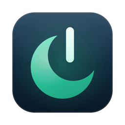
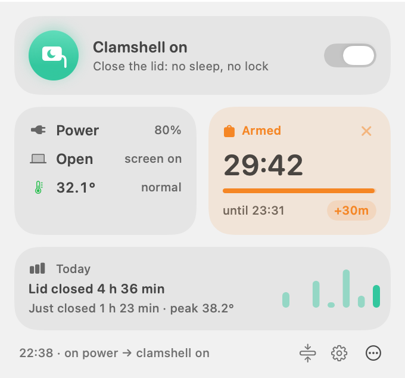
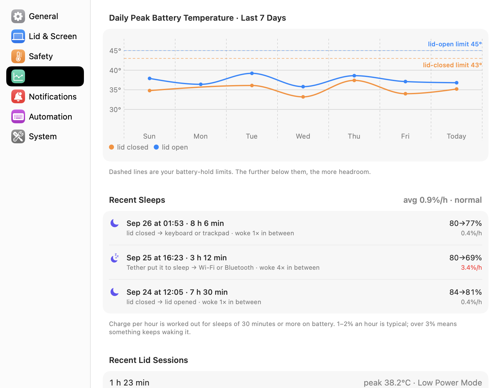

<p align="center"></p>

<h1 align="center">Tether</h1>

<p align="center">전원에 따라 움직이는 클램쉘 모드. Apple 실리콘 MacBook용.<br>
<a href="README.md">English</a></p>

전원을 연결한 채 덮개를 닫아도 Mac은 계속 일합니다. 잠들지 않고, **잠기지도 않고**, 덮개 아래
화면은 꺼 둡니다. 전원을 뽑으면 노트북답게 잠듭니다. 이미 덮개를 닫아 가방에 넣은 상태여도요.

<p align="center">
  
  
</p>

## 왜 만들었나

macOS는 외장 모니터가 없으면 덮개를 닫을 때 MacBook을 재웁니다. 잠 안 자기 앱이나
`caffeinate`는 덮개를 닫은 경우를 다루지 못하거나, 전원과 상관없이 계속 깨워 둡니다. 그래서
덮개를 닫은 채 전원을 뽑으면 가방 안에서도 깨어 있을 수 있습니다. Tether는 클램쉘 모드를 전원에
묶습니다.

| | 덮개 열림 | 덮개 닫힘 |
|---|---|---|
| **전원 연결** | 클램쉘 켜짐 | 클램쉘 켜짐: 화면은 어둡게, 잠금 없음 |
| **전원 해제** | 클램쉘 꺼짐 | 클램쉘 꺼짐, 바로 잠자기 |

잠기지 않으니 원격 데스크톱, SSH, 빌드, AI 에이전트가 덮개를 닫아도 그대로 이어집니다.

## 기능

- **자동 클램쉘 모드**: 전원을 연결하면 켜지고, 덮개를 닫은 채 전원을 뽑으면 바로 잠듭니다.
- **잠금 없음**: 화면을 끄는 대신 내장 화면과 키보드 조명을 어둡게 합니다. 잠그고 싶으면 "화면
  잠그기"를 고르면 됩니다.
- **배터리 유지**: 가방 안에서도 배터리로 잠시 깨어 있습니다. 배터리가 뜨거워지거나, 줄어들거나,
  시간이 끝나면 도우미가 끝냅니다. 기준은 더 엄격하게만 바꿀 수 있습니다.
- **발열 보호**: 전원 연결 상태에서 덮개를 닫은 채 뜨거워지면 저전력 모드로 식힙니다(언제 켤지, 또는
  안 켤지 선택). 모니터 없이 계속 과열되면(보조배터리를 꽂고 가방에 넣은 경우 등) 잠재웁니다.
- **데이터 기반 설정**: 이 Mac의 배터리 온도와 사용량을 재서 기준을 추천합니다.
- **잠자기 기록**: 얼마나 잤는지, 시간당 얼마나 썼는지, 무엇이 재우고 깨웠는지 보여 주고,
  소모가 크면 알립니다.
- **잠금 없이 화면 끄기**: 입력이 없으면 몇 분 뒤 자동으로.
- **메뉴바 카운트다운**: 배터리 유지 중에는 아이콘을 둘러싼 링이 줄어들고 남은 시간이 초 단위로
  줄어듭니다.
- **`tether run -- <명령>`**: 빌드나 에이전트가 끝날 때까지 깨어 있다가 다시 잠들 수 있게 풀어
  줍니다.
- **잠을 막는 앱**: 어떤 앱이 잠자기를 막고 있는지 보여 줍니다.
- **문제 해결 보고서**: 자세한 기록과 Markdown 보고서. 이슈나 AI 도우미에게 바로 줄 수 있습니다.
- 스크립트·에이전트·단축어 앱용 `tether` 명령과 `tether://` 주소.
- 컴팩트/자세히 패널, 리퀴드 글래스, 영어·한국어(설정에서 선택).

## 요구 사항

- Apple 실리콘 MacBook
- macOS 26 Tahoe 이상

덮개나 배터리가 없는 데스크톱 Mac에서는 잠자기 설정을 건드리지 않습니다.

## 설치

1. [Releases](https://github.com/jukqaz/tether/releases)에서 `Tether-x.y.z.zip`을 받아 압축을 풀고
   **Tether.app**을 응용 프로그램 폴더로 옮깁니다.
2. Tether는 공증을 받지 않아(유료 Apple 개발자 계정이 필요) 처음 실행이 막힙니다. 한 번 연 뒤
   **시스템 설정 › 개인정보 보호 및 보안**에서 **그래도 열기**를 누르세요. 터미널에서는 다음과
   같이 해도 됩니다.

   ```sh
   xattr -dr com.apple.quarantine /Applications/Tether.app
   ```

3. 시작 창에서 **도우미 설치…**를 누르고 관리자 암호를 한 번 입력합니다.

직접 확인하고 싶다면 [소스에서 빌드](#소스에서-빌드)하세요. 1분이면 됩니다.

## 사용법

- **메뉴바 패널**: 맨 위 스위치로 클램쉘 모드를 켜고 끕니다. 기본은 켜짐이라 전원을 연결하면
  저절로 켜집니다. 끄면 전원을 다시 연결할 때까지 덮개를 macOS에 맡기므로, 끈 채로 잊어버릴 일이
  없습니다. 그 아래에서 배터리 유지를 시작하고, 맨 아래 버튼으로 자세히/컴팩트 모드를 바꿉니다.
- **설정**(톱니바퀴): 언어, 덮개 동작, 추천값이 있는 안전 기준, 기록, 알림, 자동화, 그리고
  Tether가 바꾸는 시스템 설정.
- **터미널**: 설정 › 자동화에서 "터미널 명령 설치"를 켭니다.

```sh
tether status [--json]          # 상태 (사람용 또는 스크립트용)
tether on | off | toggle
tether sleep                    # 전원이 연결돼 있어도 지금 잠자기
tether hold 1h30m               # 배터리에서도 유지 (최대 4시간), tether hold off
tether hold +30m                # 켜져 있는 배터리 유지 늘리기 (시작부터 최대 4시간)
tether run -- make release      # 명령이 끝날 때까지 유지
tether doctor                   # 빠른 점검: 도우미, 감시 장치, 잠자기 설정, 로그인 항목
tether diagnose --record        # 문제 해결 보고서 (아래 참고)
```

같은 동작을 단축어 앱의 "URL 열기"로도 쓸 수 있습니다: `tether://sleep`, `tether://toggle`,
`tether://hold/90m`.

## 안전장치

배터리로 덮개를 닫은 채 깨어 있는 것은 배터리 유지 중뿐이고, 아래 중 하나라도 해당하면 도우미가
유지를 끝내고 Mac을 잠재웁니다.

| 덮개를 닫았을 때 | |
|---|---|
| 배터리 43 °C | 바로 |
| 배터리 40 °C 또는 발열 '심각'이 1분 지속 | |
| 발열 '위험' | 바로 |
| 배터리 20 % | |
| 정한 시간 (최대 4시간) | |
| 배터리 온도를 읽지 못함 | 바로 (안전한 쪽으로) |

- 유지 중에는 10초마다 검사하고, 열과 소모를 줄이도록 저전력 모드를 켭니다. 설정 › 배터리와 발열 ›
  저전력 모드에서 끌 수 있습니다.
- 도우미나 Mac이 재시작되면 유지는 무조건 풀립니다.
- 기준은 설정에서 더 엄격하게만 바꿀 수 있고, 설정 파일을 직접 고쳐도 느슨해지지 않습니다.
- 전원이 연결돼 있어도 덮개가 닫혀 있고 모니터가 없는 채 과열되면(보조배터리를 꽂고 가방에 넣은
  경우 등) 잠재웁니다. 발열 '위험'이 2분 지속되거나 배터리가 45 °C로 1분 지속될 때입니다. 충전기
  출력이 부족해 배터리가 하한선에서 1분 넘게 계속 줄어도 잠재웁니다.
- 전원 연결 중에 재운 Mac은 계속 잡니다. 클램쉘 모드는 Mac이 완전히 깨어 있을 때만 켜지고, Power
  Nap이 잠깐 깨우는 다크 웨이크에서는 켜지지 않습니다.
- 배터리가 하한선 이하이면 배터리 유지를 시작하지 않습니다(시작해도 바로 끝나기 때문).
- 배터리에서 잠자기 금지가 켜진 채 도우미가 멈추면, 따로 도는 감시 장치(launchd가 1분마다 실행하는
  셸 스크립트)가 잠자기를 다시 켭니다.

## 문제 해결

생각대로 동작하지 않으면 먼저 `tether doctor`를 실행해 보세요(설정 › 시스템 › 진단에도 확인이 필요한
점검이 표시됩니다). 그래도 모르겠으면 **자세한 기록 남기기**를 켜고 문제를 다시 일으킨
뒤 **보고서 만들기…**를 누르세요. Tether가 원래 어떻게 동작해야 하는지, 지금 상태, 설정, 최근 잠자기
기록, 도우미 로그, macOS 전원 로그, 앱 로그가 담긴 Markdown 파일이 바탕화면에 생깁니다. 사용자 이름과
Mac 이름은 가려집니다. 이슈에 첨부하거나 AI 도우미에게 붙여 넣으면 됩니다.

터미널에서는 `tether diagnose --record`가 같은 일을 합니다. 문제를 재현하는 동안 자세히 기록한 뒤
보고서를 씁니다(`--out <파일>`, `--hours <n>`).

## 동작 방식

작은 도우미가 root LaunchDaemon으로 돕니다. 전원, 덮개, 잠들기·깨어나기를 지켜보다가 전원이
연결되면 `pmset disablesleep`을 켜고 배터리면 끕니다. macOS는 덮개가 움직일 때만 잠자기를 다시
판단하기 때문에, 덮개가 닫혀 있으면 도우미가 직접 재웁니다. 메뉴바 앱은 화면이 꺼지지 않게 붙잡아
잠기지 않게 하고, 대신 덮개 아래 화면을 어둡게 합니다. 안전 기준은 모두 도우미가 적용하므로 앱을
꺼도 지켜지고, 도우미 자체는 감시 장치가 지킵니다.

자세한 내용과 이유: [docs/ARCHITECTURE.md](docs/ARCHITECTURE.md)

## Tether가 바꾸는 시스템 설정

| 설정 | 언제 | 시스템 설정에서 |
|---|---|---|
| 잠자기 금지 (`pmset disablesleep`) | 전원이 연결돼 있는 동안 켬 | 안 보임 (숨은 값) |
| 저전력 모드 | 설정 › 배터리와 발열에서 허용한 경우(배터리 유지, 전원 연결 중 발열)에만 켜고, 그사이 직접 바꾸지 않았다면 원래대로 돌림 | 켜져 있는 동안 보임 |
| 화면 밝기, 키보드 조명 | 덮개를 닫은 동안 어둡게, 열면 복원 | 어두운 동안 보임 |
| 백그라운드 항목 | 도우미, 감시 장치, "로그인 시 열기" | 일반 › 로그인 항목 |

잠자기·화면 끄기 타이머, 잠금 암호, 화면 보호기, 입력 소스는 바꾸지 않습니다. 설정 › 시스템에서
지금 값을 볼 수 있습니다.

## 개인정보

분석도 계정도 없습니다. 하루에 한 번 GitHub에 최신 릴리스 버전만 물어봅니다(끌 수 있음). 측정값과
기록은 Mac 안에만 남습니다.

## 제거

설정 › 시스템 › **Tether 완전히 제거…**를 누르면 도우미와 감시 장치(잠자기 금지 해제 포함),
설정·기록 파일, 로그인 항목, `tether` 명령, 환경설정을 지우고 앱을 휴지통으로 옮깁니다. 이렇게 하지
않고 앱만 휴지통에 버려도 도우미가 알아채고 10분 뒤 잠자기를 원래대로 돌린 다음 스스로 지웁니다.

## 자주 묻는 질문

**Amphetamine이나 `caffeinate`와 무엇이 다른가요?** 그 앱들은 Mac을 깨워 둡니다. Tether는 전원으로
결정합니다. 전원이 연결되면 덮개를 닫아도 자동으로 깨어 있고, 전원을 뽑으면 바로 잠들며, 깨어 있는
동안 잠기지 않습니다.

**외장 모니터와 같이 쓸 수 있나요?** 네. 전원이 연결된 상태에서 외장 모니터가 있으면 macOS가
원래 덮개를 닫아도 깨워 둡니다. Tether는 전원을 뽑을 때의 규칙만 더하고 화면은 macOS에 맡깁니다.

**AlDente처럼 충전을 제한할 수 있나요?** 아니요. macOS 26.4부터 충전 제한이 기본으로 들어왔고(배터리
› 충전), macOS 27은 다른 앱이 충전을 제어하지 못하게 막았습니다.

**왜 공증을 받지 않았나요?** 공증에는 유료 Apple 개발자 계정이 필요합니다. 소스가 모두 공개돼
있고, 직접 빌드는 스크립트 하나면 됩니다.

## 소스에서 빌드

macOS 26 이상과 Xcode 26(Swift 6)이 필요합니다.

```sh
git clone https://github.com/jukqaz/tether.git && cd tether
swift test
scripts/build.sh                     # ad-hoc 서명된 build/Tether.app
cp -R build/Tether.app /Applications/
```

`scripts/release.sh`는 `dist/Tether-<버전>.zip`과 SHA-256도 만듭니다.

## 라이선스

[MIT](LICENSE)
