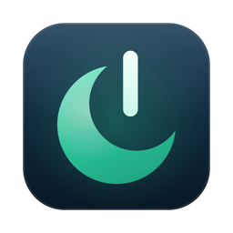
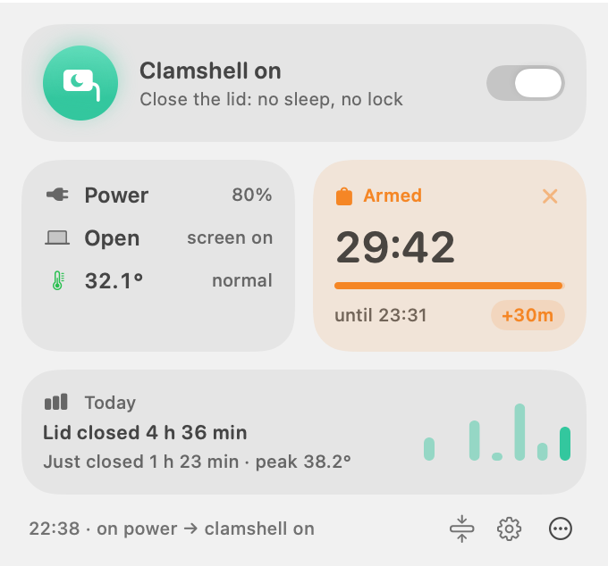
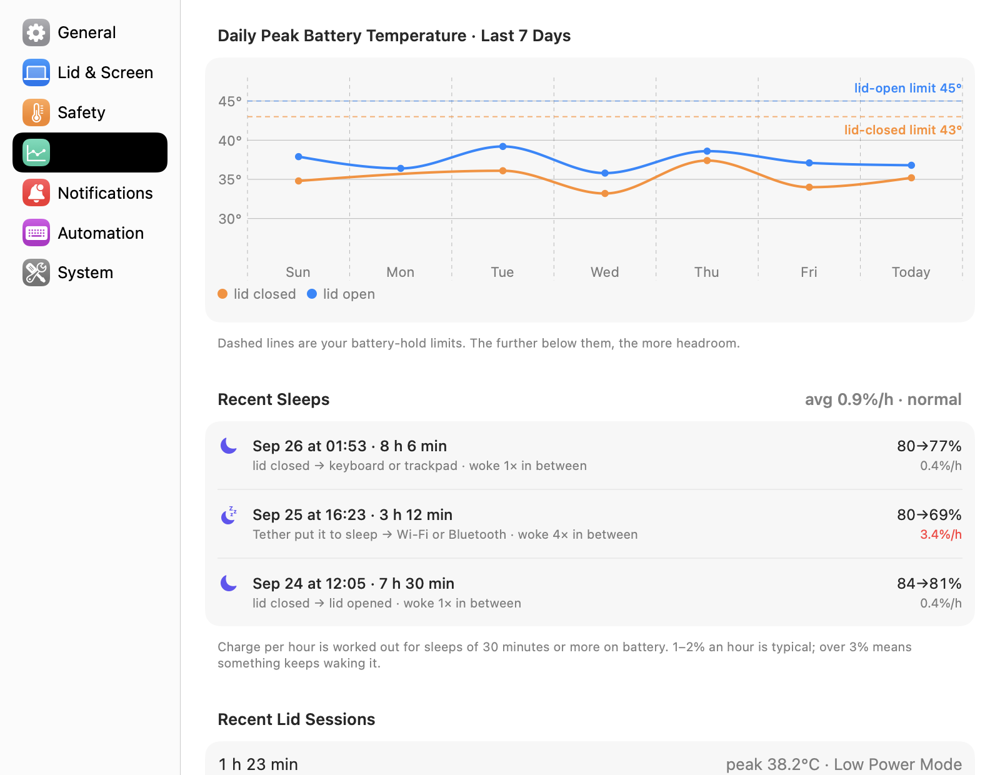
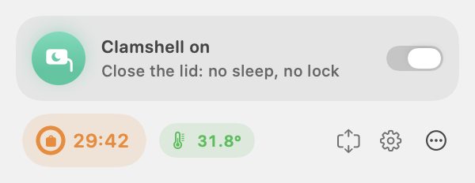
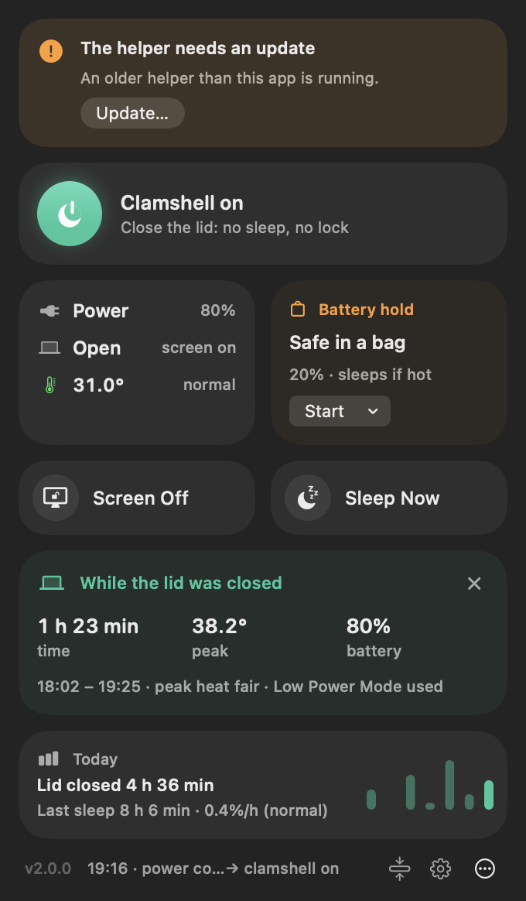
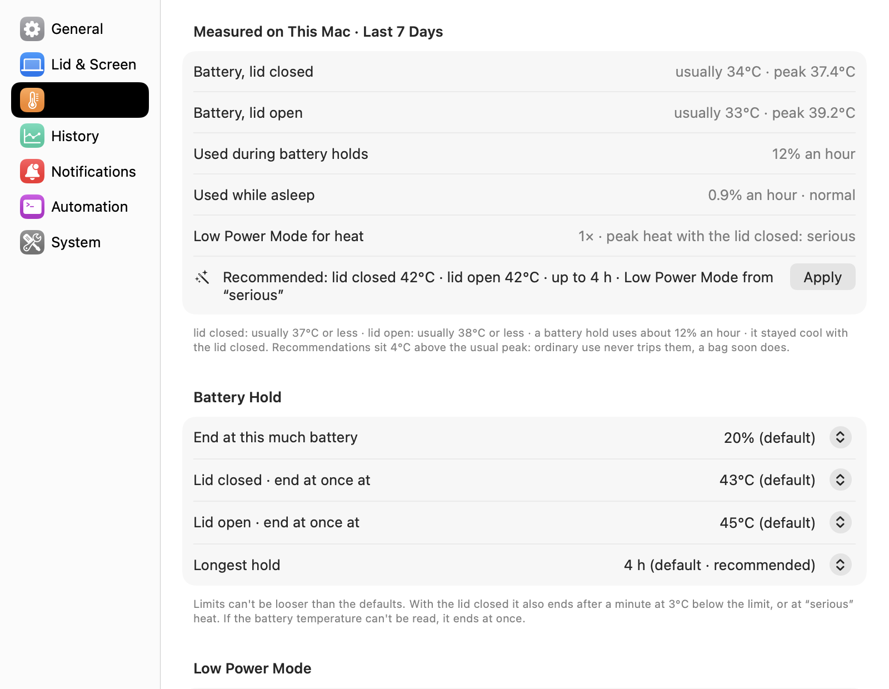
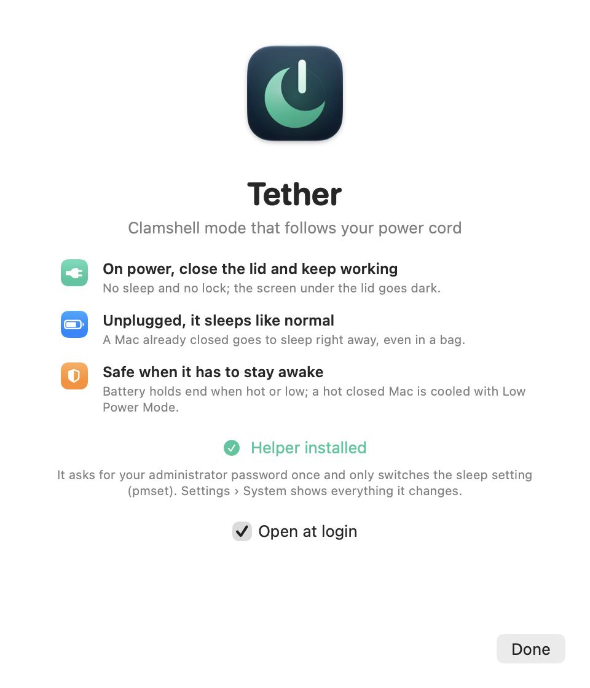

<p align="center"></p>

<h1 align="center">Tether</h1>

<p align="center">Clamshell mode that follows your power cord, for Apple silicon MacBooks.<br>
<a href="README.ko.md">한국어</a></p>

Close the lid while it's plugged in and your Mac keeps working: no sleep, **no lock**, the screen
under the lid dark. Pull the plug and it sleeps like a laptop should, even when the lid is already
shut and it's in your bag.

<p align="center">
  
  
</p>

<details>
<summary>More screenshots</summary>

The status item in each state (clamshell on, a battery hold counting down, running hot, on
battery, switched off, helper not responding):


<p>
  
  
</p>
<p>
  
  
</p>
</details>

## Why

macOS sleeps a MacBook when the lid closes, unless an external display is attached. Keep-awake
apps and `caffeinate` either don't cover a closed lid, or keep the Mac awake whatever the power
source, so a Mac unplugged with the lid shut can stay awake in a bag. Tether ties clamshell mode to
power instead:

| | Lid open | Lid closed |
|---|---|---|
| **Power connected** | clamshell on | clamshell on: screen dark, session not locked |
| **Power disconnected** | clamshell off | clamshell off, and the Mac sleeps at once |

Because nothing locks, remote desktop sessions, SSH, builds and AI agents keep going with the lid
closed.

## Features

- **Automatic clamshell mode** on power; a closed Mac sleeps the moment you unplug it.
- **No lock**: the built-in screen and keyboard light are dimmed instead of sleeping the display.
  Prefer a lock? Choose "Lock the screen" for when the lid closes.
- **Battery hold**: stay awake on battery for a while, bag included. The helper ends it when the
  battery gets hot, runs low, or time is up. Limits can be made stricter, never looser.
- **Heat guard**: a closed Mac running hot on power is cooled with Low Power Mode (your choice of
  when, or never). If it keeps overheating with no display attached, as in a bag on a power bank,
  it is put to sleep.
- **Data-based settings**: Tether measures this Mac's battery temperatures and battery use and
  recommends limits from them, or with "Adjust to this Mac" on, applies them by itself (never
  looser than the defaults).
- **Sleep log**: how long it slept, charge used per hour, what put it to sleep and what woke it,
  with an alert when sleep drains more than it should.
- **Screen off without locking** after a few idle minutes.
- **Menu bar countdown**: during a battery hold a ring around the icon empties and the time left
  counts down to the second.
- **`tether run -- <command>`**: keep the Mac awake until a build or agent finishes, then let it
  sleep again.
- **Apps keeping the Mac awake**: see which apps are holding off sleep.
- **Troubleshooting report**: detailed logging and a Markdown report, ready for an issue or an AI
  assistant.
- A `tether` command and `tether://` URLs for scripts, agents and the Shortcuts app.
- A compact or full menu bar panel, Liquid Glass, English and Korean (pick either in Settings).

## Requirements

- A MacBook with Apple silicon.
- macOS 26 Tahoe or later.
- An administrator account: the helper installs with your password, and only administrators can
  change Tether's settings.

On a desktop Mac (no lid, no battery) Tether leaves sleep settings alone.

## Install

1. Download `Tether-x.y.z.zip` from [Releases](https://github.com/jukqaz/tether/releases), unzip it
   and move **Tether.app** to Applications.
2. Tether isn't notarized (that needs a paid Apple developer account), so macOS blocks the first
   launch. Open it once, then go to **System Settings › Privacy & Security**, click
   **Open Anyway** and confirm. Or, in Terminal:

   ```sh
   xattr -dr com.apple.quarantine /Applications/Tether.app
   ```

3. Click **Install Helper…** in the welcome window and enter your administrator password once.

Or install from Terminal, checking the download against the release's SHA-256 first. Files fetched
with `curl` aren't quarantined, so step 2 isn't needed; carry on with step 3. For an update, quit
Tether and move the old app to the Trash first.

```sh
cd ~/Downloads
v=$(curl -fs https://api.github.com/repos/jukqaz/tether/releases/latest | sed -n 's/.*"tag_name": *"v\([^"]*\)".*/\1/p')
curl -fLO "https://github.com/jukqaz/tether/releases/download/v$v/Tether-$v.zip"
curl -fLO "https://github.com/jukqaz/tether/releases/download/v$v/Tether-$v.zip.sha256"
shasum -a 256 -c "Tether-$v.zip.sha256" && ditto -x -k "Tether-$v.zip" /Applications && open /Applications/Tether.app
```

To check a browser download instead, keep `Tether-x.y.z.zip.sha256` from the release next to the
zip and run `shasum -a 256 -c Tether-x.y.z.zip.sha256` in that folder before unzipping. Safari may
unzip downloads by itself and remove the zip.

Prefer to see what you run? [Build it yourself](#build-from-source): it takes a minute.

### Update

Tether checks GitHub once a day and offers a newer version in the panel's **…** menu and in
Settings › System.

1. Quit Tether (panel › **…** › **Quit Tether**).
2. Move the old **Tether.app** to the Trash, then put the new one in Applications. Copying over
   the old app in place can fail.
3. Open Tether. If the panel says the helper needs an update, click **Update…** and enter your
   password. Settings and records are kept.

2.0.1 is a security fix: update from 2.0.0, helper included.

## Use

- **Menu bar panel**: the switch at the top turns clamshell mode on and off. It's on by default,
  so connecting power turns it on by itself; off gives the lid back to macOS until power is
  connected again, so it can't be forgotten off. Start a battery hold below it. The footer switches
  between the full and compact panels.
- **Settings** (the gear): language, lid behaviour, safety limits with recommendations, history,
  notifications, automation, and everything Tether changes on your Mac. Options that need
  explaining have an **ⓘ** next to them.
- **Terminal**: turn on "Install the tether command" in Settings › Automation.

```sh
tether status [--json]          # state, for people or scripts
tether on | off | toggle
tether sleep                    # sleep now, even on power
tether hold 1h30m               # stay awake on battery too (up to 4 h); tether hold off
tether hold +30m                # extend the running hold (still at most 4 h from its start)
tether run -- make release      # stay awake until the command finishes
tether doctor                   # quick checks: helper, watchdog, sleep setting, login item
tether diagnose --record        # a troubleshooting report (see below)
```

The same actions work as URLs, for the Shortcuts app's "Open URL": `tether://sleep`,
`tether://toggle`, `tether://hold/90m`.

## Safety

A closed Mac stays awake on battery only during a battery hold, and the helper ends the hold and
puts the Mac to sleep as soon as any of these is true:

| With the lid closed | |
|---|---|
| Battery at 43 °C | at once |
| Battery at 40 °C, or thermal pressure "serious", for a minute | |
| Thermal pressure "critical" | at once |
| Battery at 20 % | |
| The time you set, at most 4 hours | |
| Battery temperature unreadable | at once (the safe side) |

- The helper checks every 10 seconds during a hold and turns Low Power Mode on for less heat and
  drain; Settings › Safety › Low Power Mode can turn that off.
- A hold never survives a restart of the helper or the Mac.
- The limits can be made stricter in Settings, never looser, even by editing the control file.
  "Adjust to this Mac" sets them from this Mac's own measurements (4 °C above the usual peak,
  the longest hold from the measured drain) and keeps them up to date, within the same rule.
- On power, overheating with the lid closed and no display attached (as in a bag on a power bank)
  puts the Mac to sleep: critical thermal pressure for 2 minutes, or the battery at 45 °C for a
  minute. So does a charger that can't keep up: the battery at its floor and still draining for a
  minute.
- A Mac put to sleep on power stays asleep: clamshell mode only turns on when the Mac is fully
  awake, not during Power Nap's short dark wakes.
- A battery hold can't start at or below the battery floor, where it would end at once.
- If the helper ever stops while sleep is off on battery, a separate watchdog (a plain shell
  script launchd runs every minute) turns sleep back on.

## Troubleshooting

Something not working as expected? First run `tether doctor` (or look at Settings › System ›
Diagnostics, which lists any check that needs attention). Then turn on **Detailed logging**,
make it happen again, then click **Create Report…**. You get a Markdown file on your Desktop with
how Tether is meant to behave, the current state, settings, recent sleeps, the helper log, the
macOS power log and the app log, with your user name and the Mac's name masked. Attach it to an
issue, or paste it to an AI assistant.

From Terminal, `tether diagnose --record` does the same: it logs in detail while you reproduce the
problem, then writes the report (`--out <file>`, `--hours <n>`).

## How it works

A small helper runs as a root LaunchDaemon. It follows the power source, the lid and sleep and
wake, sets `pmset disablesleep` on power, clears it on battery, and puts a closed Mac to sleep
itself, because macOS only reconsiders sleep when the lid moves. The menu bar app keeps the
display from sleeping (so nothing locks) and dims the screen under the lid instead. The helper
applies all safety limits, so they hold even with the app closed, and a watchdog covers the
helper itself.

Details and reasoning: [docs/ARCHITECTURE.md](docs/ARCHITECTURE.md).

## What Tether changes on your Mac

| Setting | When | Visible in System Settings |
|---|---|---|
| Prevent sleep (`pmset disablesleep`) | on while power is connected | no (a hidden setting) |
| Low Power Mode | only in the cases you allow in Settings › Safety (a battery hold, heat on power), then restored unless you changed it meanwhile | yes, while on |
| Screen brightness, keyboard light | dimmed while the lid is closed, restored when it opens | yes, while dimmed |
| Background items | the helper, its watchdog and "open at login" | General › Login Items |

It never changes sleep or display timers, the lock password, the screen saver or input sources.
Settings › System shows the live values.

## Privacy

No analytics, no account. Once a day Tether asks GitHub for the latest release version (you can
turn this off). Measurements and logs stay on your Mac.

## Uninstall

Settings › System › **Uninstall Tether…** removes the helper and its watchdog (turning "prevent
sleep" back off), their files, the login item, the `tether` command and preferences, then moves
the app to the Trash. An app dragged to the Trash without this is noticed by the helper, which
restores normal sleep and removes itself after 10 minutes.

If the app won't open, remove the helper and the login item from Terminal, then drag Tether.app to
the Trash:

```sh
sudo sh /Applications/Tether.app/Contents/Resources/uninstall-helper.sh
launchctl bootout gui/$(id -u)/local.tether.app 2>/dev/null
rm -f ~/Library/LaunchAgents/local.tether.app.plist
```

If you installed the `tether` command in `~/.local/bin`, delete that link too.

## Glossary

In Settings, the options that need explaining have an **ⓘ** next to them.

| Term | Meaning |
|---|---|
| Clamshell mode | Using the Mac with its lid closed. With Tether, on power it stays awake and unlocked with the lid closed; unplugged, it sleeps as usual. |
| Battery hold | A timed exception, 30 minutes to 4 hours, that keeps clamshell mode on battery. The safety limits end it early. |
| Safety limits | What ends a battery hold: battery temperature, heat, the battery floor and the longest hold. Stricter only. |
| Battery floor | The charge at which a battery hold ends, 20% unless you choose more. A hold can't start at or below it. |
| Heat | macOS thermal pressure: normal, fair, serious, critical. |
| Heat guard | On power with the lid closed, Low Power Mode while the Mac runs hot; your setting comes back once it cools. |
| Safety net | Always on: a closed Mac on power with no display is put to sleep if it overheats or its charger can't keep up. |
| Auto-adjust | Temperature limits and the longest hold set from this Mac's measurements, never looser than the defaults. |
| Low Power Mode | macOS's setting for less heat and drain. Tether switches it only where you allow, then puts yours back. |
| Screen off without locking | The screen goes black after idle minutes and comes straight back with any input, no password. |
| Lid session | One stretch awake with the lid closed, from closing the lid to opening it or sleeping. |
| Helper | Tether's background service with administrator rights; it keeps every rule and limit, even with the app closed. |
| Watchdog | A tiny script launchd runs every minute so sleep is never left off on battery should the helper stop. |
| Prevent sleep | The hidden macOS setting behind clamshell mode (`pmset disablesleep`), on only while power is connected or a hold runs. |
| Dark wake | A short wake with the screen off (Power Nap, charging); Tether leaves it alone, so a sleeping Mac goes back to sleep. |

## FAQ

**How is this different from Amphetamine or `caffeinate`?** Tether starts with a power-source
policy: clamshell mode on AC, a sleep request when unplugged with the lid closed, and explicit,
time-limited battery holds with temperature and battery limits. It also records lid sessions
and sleep drain. Amphetamine offers configurable power-source triggers and clamshell sessions;
`caffeinate` provides command-line sleep assertions. Tether puts its cable policy, safety limits
and history in one menu bar app.

**Does it work with an external display?** Yes. macOS already keeps a closed Mac awake with an
external display on power; Tether adds the unplug rule and leaves the displays to macOS.

**Can it limit charging like AlDente?** Tether does not control charging. Its battery floor
ends a keep-awake session; it is not a charging limit. Available charging controls depend on
the Mac and macOS version and must be checked separately.

**Why "not notarized"?** Notarization needs a paid Apple developer account. The source is here,
and building it yourself is one script.

## Build from source

Requires Xcode 26 or later (Swift 6) on macOS 26 or later.

```sh
git clone https://github.com/jukqaz/tether.git && cd tether
swift test
scripts/build.sh                                  # ad-hoc signed build/Tether.app
ditto build/Tether.app /Applications/Tether.app   # quit Tether and trash an older copy first
open /Applications/Tether.app                     # then Install Helper…
```

A build of your own isn't quarantined, so macOS opens it without the Gatekeeper step.

`scripts/release.sh` also packs `dist/Tether-<version>.zip` with its SHA-256.

## License

[MIT](LICENSE)
