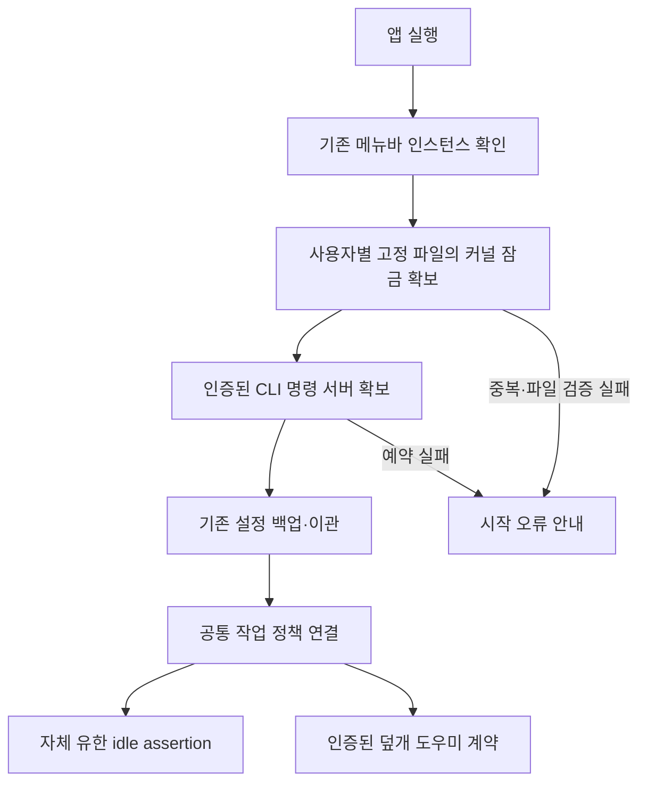

# 앱 실행 수명과 단일 조정자

2026-10-01 미배포 빌드 50 후보의 기록이다. 설치본 빌드 49는 교체하지 않았다. 같은 사용자에게 두 앱 복사본이 동시에 초기화되면 설정 이관과 작업 정책이 함께 시작할 수 있던 경로를 보완했다. 명령 소켓의 잠금과 앱 실행 수명의 잠금을 구별한다.

## 시작 순서

운영 파일은 `~/Library/Application Support/io.github.jukqaz.tether/instance.lock`이다. 빌드 번호나 앱 복사본 경로에 따라 별도 파일을 만들지 않는다. 폴더는 현재 사용자 소유 0700, 파일은 0600의 단일 일반 파일이어야 한다. 심볼릭 링크·하드 링크·공유 권한을 거절하며, 디렉터리를 연 FD와 파일의 device/inode를 대조한다. root 사용자 실행은 이 경로의 소유자가 될 수 없다.

`flock`을 확보한 다음 사용자 명령 서버를 예약한다. 둘 중 하나라도 실패하면 설정 이관, 작업 정책 연결, 도우미 연결과 전원 세션 시작으로 진행하지 않는다. 실패한 앱은 시작 오류를 안내하고 종료한다. 명령 서버 예약과 모델 연결은 main actor에서 수행하며, 모델의 저장 속성이 초기화된 뒤 요청 처리 대상을 연결한다.

기존 `NSRunningApplication` 확인은 실행 중인 메뉴바 인스턴스를 활성화하는 편의 경로다. 동시에 실행해 그 확인을 모두 통과한 새 앱끼리의 경쟁은 커널 잠금으로 조정한다. 이미 출시된 구버전이 새 잠금 계약을 사용한다는 뜻은 아니며, 구버전·기존 root 기록의 인계는 별도 완료 조건이다.

## 종료와 소유권 상실

`commands.lock`의 수명은 명령 서버까지지만 `instance.lock`의 FD는 운영 `AppModel.shared`가 앱 프로세스 수명 동안 보유한다. 서버 중지나 업데이트·종료 승인 응답만으로 실행 소유권을 넘기지 않는다. 정상 종료 때도 lock 파일을 삭제·재생성하지 않는다. 프로세스 사망 후에는 커널이 잠금을 풀며, 다음 실행이 같은 파일을 잠근다. FD에는 `O_CLOEXEC`을 사용한다.

폴더·파일 신원이나 권한을 다시 확인하지 못하면 모델의 변경 명령·설정 저장·새 덮개 계약을 허용하지 않는다. 사용자 실행기는 다음 평가에서 자신이 만든 native 요청을 해제하고 임시 세션을 종료한다. 이때 다른 앱의 요청을 해제하거나 전체 Mac에 잠자기 명령을 보내지 않는다. 해제 실패는 기존 확인 오류로 남긴다.

이는 협력하는 Tether 인스턴스의 조정 계약이다. 같은 UID의 악의적인 프로세스가 임의 파일을 바꾸는 공격의 완전 방어 또는 root 전역 값의 즉시 원복 보장으로 표현하지 않는다. 권한만 원래대로 복구한 같은 inode는 다시 검증될 수 있지만, 파일 교체로 신원이 달라진 옛 lease는 유효해지지 않는다. root 도우미는 별도의 유한 허가·복구 계약을 따른다.

## 확인한 범위

전체 Swift **523개(Core 466 + 앱·업데이트 57), 실패·건너뜀 0**을 통과했다. 이 단계의 새 검사 8개와 기존 실제 native 요청 검사 6개는 전체 수에 포함된다.

| 검사 | 직접 확인한 내용 |
|---|---|
| `AppCoordinatorLeaseTests` 5개 | 두 번째 작성자 거절, 해제 후 같은 inode 유지, 링크·권한·디렉터리 거절, 파일 교체 시 옛 lease 무효, 실제 별도 프로세스의 잠금·강제 종료 후 재획득 |
| `AppCoordinatorStartupTests` 3개 | 격리 `AppModel`의 중복 연결 거절, 서버 중지·성공한 종료 응답 뒤 잠금 유지, 소켓 예약 실패 시 정책 연결/설정 쓰기 없음, 파일 교체 시 자체 요청 해제와 추가 쓰기 거절 |
| 기존 native 검사 6개 | 현재 Mac의 IOKit 요청 생성·유한 만료·재갱신·명시적 종료, 외부 요청 보존. 새 lifetime 검사 8개는 가상 전원/GUI·backend도 사용함 |
| 후보 패키지 | arm64·macOS 15 최소 대상, deep/strict ad-hoc 서명, 스크립트 일치, 시험 실행 파일 제외, 읽기 전용 설치 판정, 격리 도우미 소켓·CLI 경로 |
| 포장된 CLI의 같은 회귀 2개 | 실제 CLI subprocess가 격리된 앱 정책에 연결·JSON 상태 반환, 서버 부재 시 새 세션 없이 실패. 전체 Swift의 같은 2개를 포장 바이너리로 재확인한 결과이며 별도 고유 검사로 합산하지 않음 |
| 포장 도우미 IPC 10개 | 인증된 공통 계약·재전송·마감·발열 보호·자동/수동 분리·소비 예산·외부 중지·재시작 확인. 실제 helper와 소켓을 사용하되 센서/OS 전원 쓰기는 격리된 dry-run |

시작 실패 검사는 격리된 preview 모델과 실제 커널 파일 잠금을 사용했다. 운영 시작 순서의 코드 확인과 별개로, 실제 GUI 앱의 동시 실행·관리자 연결·설정 이관 전체 경로를 통과시킨 결과는 아니다. 현재 호스트는 macOS 27이며 최소 대상 컴파일을 macOS 15 실행 증거로 확대하지 않는다.

## 남은 완료 조건

실행기 가용성 변경과 기존 root 기록 인계, 구버전과 새 앱의 실제 교체, GUI 앱→관리자 도우미 전체 실행, 빠른 사용자 전환·동일 UID의 별도 GUI 로그인, 보호·watchdog 해제의 전체 상한, 실제 Sleep/Wake·닫힌 AC 연결·화면·원격 입력, macOS 15 실행 및 전체 Sparkle 업데이트가 남는다. 시스템 잠금·팬·충전 정책을 변경하지 않았다. 커밋·푸시·원격 CI·배포 전이며 #6·#7·#8과 P0를 이 단계로 완료하지 않는다.
