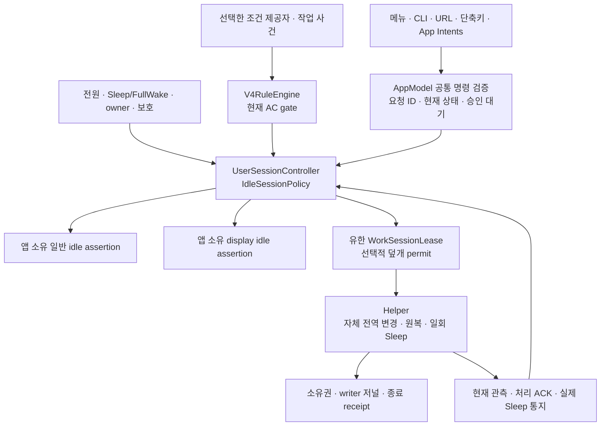

# Tether v4 실행 설계

2026-10-15 · 현재 작업 트리의 v4 구현을 설명한다. 행동 계약은 [PRODUCT-SPEC](PRODUCT-SPEC.ko.md)이 기준이며, 이 문서는 그 계약을 현재 코드가 어떤 책임과 실행 경계로 처리하는지 정리한다. **소스 연결·자동 검증, 배포 패키지·설치본, 실제 전원 분리·Sleep·원격 사용의 합격은 서로 별개다.** 이 문서 갱신은 설치나 물리 시험의 완료를 뜻하지 않으며, 진행 중인 검사의 통과 수를 대신 기록하지 않는다.

## 1. 하나의 결정 경로와 세 실행 책임

제품 상태의 작성자는 사용자 프로세스의 `@MainActor UserSessionController`다. `IdleSessionPolicy`가 수동·자동·중지·보호와 기한을 계산하고, `V4RuleEngine`은 선택한 고급 자동 조건을 유한한 gate로 전달한다. 메뉴, CLI, URL, 단축키, App Intents, PID/작업 사건은 같은 명령·정책 경로를 사용한다. 입력을 추가해도 독립된 전원 작성자나 시작 큐를 만들지 않는다.

| 책임 | 현재 구현 | 권한의 한계 |
|---|---|---|
| 공통 명령·정책 | `AppModel+UserCommands` / `AppModel+V4Automation` / `UserSessionController` | 전송 성공만으로 기능 적용을 승인하지 않음. 종료한 요청을 자동 재전송해 시작하지 않음 |
| 일반·화면 유지 | 사용자 앱의 서로 다른 `IdleAssertionDriver` | 프로세스 소유 assertion만 생성·갱신·해제. 화면 실패와 일반 유지 실패를 구별 |
| 덮개 실행 | helper의 `prepareWorkSession` → `attachWorkSession` / `syncWorkSession` | 앱이 발급한 현재 전원 범위의 유한 허가만 집행. root가 자동 조건·기본값을 새로 해석하지 않음 |
| 복구 | helper, 전용 recovery executor, watchdog | 검증한 자체 변경 정리. 새 유지·종료한 수동 복원·과거 Sleep 재생 없음 |
| 표현 | 현재 승인 상태와 필요한 사용자 조작 | 알 수 없는 내부 원인을 추정해 표시하지 않음. 처리 미확인을 실제 적용이나 실제 Sleep으로 바꾸지 않음 |

MacBook의 도우미 준비와 ‘덮개 유지 켜기’는 다른 선택이다. 새 설치의 AC 자동/덮개 허용은 OFF/OFF이며 한쪽을 켜도 다른 쪽을 켜지 않는다. 데스크톱은 덮개 실행과 도우미 준비가 필요하지 않다. 도우미 장애·덮개 원복 미확인으로 이미 유효한 일반 유지까지 성공/실패를 일괄 판정하지 않는다.

## 2. 설정·실행 상태·증거를 분리한다

제품 v4와 IPC의 버전 숫자는 다르다. 현재 lease는 wire `version=1`, `executionVersion=3`, coordinator8을 사용한다. 실행 버전이 없는 구형 활성 lease는 `unsupportedVersion`으로 거절한다. 구형 payload의 decode·보존 원본과 빈 준비/해제는 호환하지만, 옛 전원 projection/token으로 실행·예산·새 영수증을 만들지 않는다. 이는 helper 재시작 직후 옛 수동이 다시 부착되는 경로도 차단한다.

| 자료 | 수명과 저장 범위 | 다시 시작할 때의 의미 |
|---|---|---|
| `IdleSessionSettings` / `V4Settings` | 사용자 선택, 프리셋·규칙·다음 수동 기본값. 공통 설정 record로 저장 | 선택만 재사용. 켜져 있던 수동/PID/작업 사건은 복원하지 않음 |
| `RuntimeMarkers` | 전체 중지·사용자 Sleep·owner 종료·보호 이유 | 관측 반복·재연결·업데이트로 지우지 않음. 명시 재개와 실제 Sleep/FullWake의 해당 계약만 적용 |
| 수동 요청 | 요청 ID, 연장 revision ID, 최초 시작·마감·최초 배터리 상한, 시작 때 캡처한 옵션 | 프로세스 수명 안에서만 유효. 실행 중 기본값 변경이 기존 요청을 바꾸지 않음 |
| 작업 사건 | job/event ID·순서·owner/부팅/전원 세대·TTL·종료 상태 | 소비된 ID의 늦은 heartbeat는 부활 권한이 아님 |
| `WorkSessionLease` | 앱 세션 ID·증가 sequence·현재 전원·자원별 유한 허가 | 저장된 snapshot은 조사/원복 자료. helper 재시작 뒤 실행 권한으로 복구하지 않음 |
| 전원 소유권·writer 저널·종료 receipt | OS 쓰기 전후 상태, 확인할 writer, 원복 debt, 사건 소비·요청 결과 | 확인 전 삭제하지 않음. 사건 기록만으로 OS 명령을 재실행하지 않음 |
| 결정/설정 이력 | 제한된 설명과 설정 변경 | 실행 허가·현재 요청·중지·보호·OS 권한·원복 baseline을 복원하지 않음 |

현재 설정 형식은 `IdleSessionSettings.currentVersion = 6`, helper 설정 schema는 4, coordinator protocol은 8이다. 내부 `executionVersion = 3`과 `usesV3LidExecution` 명칭은 유한 덮개 실행기의 호환 식별자이며, 제품의 v4 정책이 구버전 배터리 승계를 지원한다는 의미가 아니다.

기한은 잠든 시간도 포함하는 `ContinuousTime`으로 비교한다. 벽시계는 시간표·캘린더 구간과 표시 시각에만 사용한다. 벽시계 변경·heartbeat·재연결·설정 복원은 수동 마감과 배터리 상한을 늘리지 않는다.

## 3. 전원과 다중 요청의 합성

자동은 기본 AC 조건과 고급 조건 모두 **현재 AC에서만** 가능하다. 고급 모드의 선택 프리셋 없음·빈 규칙·권한 부족·unknown·만료 gate는 단순 AC 자동으로 대체하지 않는다. 배터리/양쪽 전원 자동과 AC 수동의 배터리 승계 값은 호환 decode/이관 자료이며 실행 권한이 아니다.

수동은 한 번에 하나다. 유한 시간은 5/10/15/30/60/120분이며 무제한은 AC에서만 새로 시작한다. 배터리에서 시작한 수동은 **최초 시작+120분**을 넘지 못한다. 중간에 AC로 바뀌어도 이 상한은 유지하고, 이후 AC→배터리가 확인되면 해당 수동도 다른 기존 요청과 함께 종료한다. 배터리에서 다시 유지하려면 현재 상태를 검증한 새 명시적 수동 요청이 필요하다.

| 사건 | 요청 처리 | 종료 효과 |
|---|---|---|
| 확인된 AC→배터리 | 분리 전에 존재한 자동·수동·작업 사건과 승인 대기 소비 | 닫힌 MacBook은 자체 원복 후 유한 권한 안에서 Sleep 한 번 요청. 열린 상태는 자체 해제 후 macOS에 맡김 |
| 배터리→AC | 남아 있는 유효 배터리 수동은 최초 마감/상한 유지. 저장한 자동 ON은 현재 조건으로 재평가 | 이전 분리에서 끝난 수동·작업 사건은 복원하지 않음 |
| AC 재연결 | 현재 조건의 새 자동 평가 허용 | 과거 종료 Sleep 권한 취소. 수동 비복원 |
| 개별 자동 조건/PID 종료 | 해당 이유만 종료. 자원별 다른 유효 이유는 합성해 보존 | AC 자연 종료는 macOS에 맡김. 마지막 배터리 수동 만료/연결 작업 종료는 현재 닫힘·원복 등 종료 조건 재검사 |
| 전체 중지·보호·owner 종료 | 해당 강제 종료가 개별 요청 합성보다 우선 | 설정 선택은 보존하되 종료된 수동은 재개하지 않음. 보호 해제는 정상 상태에서 명시 재개 |
| 실제 OS Sleep | 임시 요청·준비/연장 허가 소비, 자체 자원 해제 | FullWake 후 새 관측으로 자동 AC만 재평가. 늦은 이전 ACK는 활성 권한 아님 |
| 전원·owner·필수 관측 unknown | 새 획득/갱신을 허용하지 않고 기존 권한의 신선도·마감 적용 | unknown 자체를 분리·잠듦·작업 성공으로 추정하지 않음 |

원격 연결, 화면 잠금, 화면 절전, 외장 화면 존재는 그 자체로 수동/PID/작업 사건의 수명을 바꾸지 않는다. 사용자가 고른 고급 자동 조건의 외장 화면 관측과 원격 진단은 별도다. 덮개 조건 해제는 그 자동 이유의 종료이며, 케이블 분리의 ‘기존 요청 전체 소비’와 같지 않다.

`WorkSessionDecision`은 일반·화면·덮개 필요를 각각 합성한다. 각 자원은 그 자원을 요청한 유효 이유가 하나라도 있으면 유지한다. 수동 시작 때 `nextManualOptions`의 화면·덮개·선택한 화면 유휴 해제 기준을 캡처하고, 전역 화면/덮개 허용은 실제 실행의 상한으로 적용한다. 이후 다음 수동 기본값·프리셋 편집으로 현재 수동의 캡처와 마감을 교체하지 않는다.

## 4. 시작 승인과 2단계 연장

시작은 최신 owner·전원·FullWake·보호 관측 → 정책 결정 → 필요한 일반/화면 실행 확인 → 필요한 덮개 실행 확인 순서로 진행한다. 일반 전용 수동의 승인에는 다른 자동 이유의 화면/덮개 실패를 섞지 않는다. 덮개를 요청한 수동은 같은 요청 ID의 ACK에 더해 현재 덮개/FullWake 관측과 자체 `SleepDisabled` 적용 또는 검증된 native 위임을 확인한다. 실제로 덮개가 닫혀 있어야 미리 준비할 수 있는 것은 아니다.

연장은 전체 +15분 또는 +30분만 가능하다. 만료·무제한·보호·분리·배터리 최초 상한을 넘는 연장은 거부하며 남은 여유만 잘라 부분 적용하지 않는다.

1. `prepareManualExtension`은 현재 수동과 제안 정책 복사본을 만들고 요청 ID·새 연장 ID·기존/제안 마감·승인 만료를 고정한다. 실행 허가의 실제 마감은 여전히 기존 마감이다.
2. `WorkSessionLease.extensionPreparation`을 helper에 보내 준비 검사를 받는다. `WorkSessionBridge.extensionPreparationReceipt`가 현재 요청·제안과 일치해야 commit할 수 있다.
3. `commitPreparedManualExtension`은 그 수동 revision만 변경한다. 그 사이 바뀐 자동 설정·프리셋·중지를 옛 복사본으로 덮어쓰지 않는다.
4. 새 마감의 실제 실행 ACK까지 UI/외부 응답은 승인 대기다. 전체 대기는 최초 제출+5초와 기존 마감 중 이른 때까지만 유효하다.
5. 실패·분리·기존 마감 도달·새 요청이면 취소한다. rollback은 같은 요청/연장 ID와 아직 유효한 기존 마감에만 적용하며, 다른 새 수동을 끝내거나 종료한 수동을 되살리지 않는다.

현재 연장 revision과 다른 배터리 permit ACK는 새 마감을 짧게 바꾸거나 다시 늘리는 자료로 채택하지 않는다. 동일 명령 ID 재전송은 원래 처리 결과와 **현재 상태**를 함께 반환한다. 원래 성공 ACK가 종료 후에도 활성 상태를 증명하지 않는다.

## 5. 유한 실행 허가와 관측

| 제한 | 현재 소스 값 | 의미 |
|---|---|---|
| 공통 필수 관측 | 유효기간15초, 활성/자동 평가 중 최대5초 재확인 경계 | 이미 확인한 분리·보호는 유예 없이 처리. 실패를 정상 표본으로 갱신하지 않음 |
| 실행 허가 | 최대30초, 갱신 간격10초 | 유효 표본·조건·자원별 요청 마감보다 오래 실행하지 않음 |
| 시작/연장 승인 | 전체5초 또는 기존 마감 중 먼저 | 단계별 재시도로 대기 기한 초기화하지 않음 |
| 종료 Sleep 권한 | 원래 종료 사건/예정 마감부터30초 | helper 지연·재시작이 새30초를 만들지 않음 |
| 자체 원복 재시도 | 활성 종료 receipt+Sleep 권한 안에서는 사건 T+0/5/10/20초. 종료 권한 없는 원복 debt는30초 간격 | 지난 슬롯 몰아서 실행하지 않음. Sleep 권한과 별개 |

이 숫자는 현재 제품 구현 상수이며 OS 실행 시간·최대 복구 지연의 보증이 아니다. native assertion의 timeout이 전역 `SleepDisabled`도 자동 원복한다는 뜻은 아니다. 실제 마감 타이머, 관측 재확인, 실행기 건강성, 조건 제공자의 표본 주기는 서로 다른 목적을 가진다.

helper는 허가의 부팅·앱 프로세스 identity·GUI 로그인 owner·세션/sequence·현재 전원·필수 관측을 확인한다. 반대 전원에 대한 사전 허가를 받지 않는다. 앱과 helper가 분리를 보는 순서가 달라도 직전 AC 요청을 먼저 소비하며, 배터리에서 승인된 **다른 새 수동 ID**를 옛 AC 요청으로 다시 소비하지 않는다. 이전 ID를 배터리 갱신으로 바꿔 보내는 것은 새 수동 승인이 아니다.

## 6. 분리 종료·한 번의 Sleep·원복 debt

이 경로의 실행자는 helper다. 사용자 앱과 독립적으로 전원/Sleep 사건을 관측하고, 앱이 유한하게 위임한 종료 권한을 집행한다. 창·원격 연결·GUI의 다음 heartbeat를 분리 감지 조건으로 삼지 않는다. 다만 현재 owner·권한·필수 관측을 확인하지 못하면 새 Sleep을 요청하지 않는다.

`WorkSessionEndReceipt`는 사건 ID와 `captured → restored → consumed` 단계를 저장한다. 사건을 먼저 고정하고 이전 work lease/연장 준비를 무효화한 뒤, 자체 전역 변경을 원복·재조회한다. 원복을 확인한 다음 현재 전원·덮개·FullWake·owner·새 유효 요청·권한 기한을 다시 검사한다. OS 호출 전에 `consumed`를 durable하게 저장하므로 동일 사건 ID로 OS Sleep을 두 번 보내지 않는다.

최종 검사와 저널 저장 이후에도 호출 직전에 연속 시계 기한을 비교한다. 재연결·덮개 열림·새 유효 요청·owner 변경·실제 Sleep/관측 불가가 생기면 옛 종료 권한을 취소한다. helper 재시작은 미완료 사건을 실행 권한으로 복원하지 않는다. 프로세스 종료가 OS 호출의 직전/직후에 일어나면 결과가 미확인일 수 있으며, 그 불확실성을 명령 재생으로 해결하지 않는다.

`IOPMSleepSystem` 성공 응답, 종료 receipt 소비, 실제 OS Sleep 통지는 각각 다른 증거다. 거절되거나 결과가 미확인인 OS 호출은 자동 재시도하지 않는다. 실제 Sleep은 별도 IOKit 소비 receipt/관측 시각으로 전달하고, 일반 Workspace 알림과 중복되어도 새 임시 요청을 잘못 소비하지 않도록 사건 경계를 대조한다. Sleep 통지 응답을 IPC·원복 재시도 완료까지 붙잡지 않는다.

자체 원복 실패는 receipt/소유권을 남긴 debt다. 활성 종료 receipt와 Sleep 권한이 함께 있을 때는 같은 사건의 T+0/5/10/20초 계획을 사용하고, 종료 권한 없는 debt는30초 간격으로 검증한 자체 정리만 재확인한다. **원복 debt의 존속은 과거 Sleep 권한의 연장이 아니다.** 이전 writer의 종료를 확인하지 못하면 다음 writer를 시작하지 않으며, 오류 알림/관측 횟수가 새 원복 작성자를 만들지 않는다.

타사 assertion/PID를 임의 해제·종료하지 않는다. 일반 idle/display 요청과 전역 demand-Sleep 차단은 구별한다. 선택된 닫힌 분리/배터리 종료의 Sleep 요청은 다른 앱 작업도 잠재울 수 있지만, 그 앱의 요청을 제거한 것은 아니다. 타사 전역 `SleepDisabled`는 해제·자체 소유로 채택하지 않고 종료 요청을 막는 상태로 보존한다.

Tether `잠자기`는 별도 명시 명령이다. `userSleep` 중지와 임시 요청 소비를 먼저 저장하고 자체 해제 후 같은 일회 실행 경로를 사용한다. 이 명령은 열린 덮개/AC에서도 가능하다. 실제 Sleep→FullWake를 확인한 경우에만 해당 `userSleep` 이유를 해제하며, 재시작·요청 ACK만으로 중지나 보호를 해제하지 않는다.

## 7. 덮개 backend·원복 소유권·설치 경계

일반 작업 유지는 공개 `PreventUserIdleSystemSleep`, 화면 유지는 별도 display idle assertion을 쓴다. 일반 assertion을 덮개 닫힘·명시적 Sleep의 범용 차단 API로 설명하지 않는다. 현재 helper의 덮개 backend는 journal로 소유한 전역 `disablesleep` 변경이며, 덮개에만 영향을 주는 OS 기능이 아니다. native 외장 클램쉘은 확인된 증거에 따라 위임한다. Tether가 실제로 관리했던 세션의 종료 책임은 위임 후에도 같은 프로세스 안에서 추적하되, 처음부터 native만 사용한 기기에 임의 종료 권한을 만들지 않는다.

전원 writer·복구·설치의 실제 쓰기는 짧은 `RecoveryLock`과 `PowerWriterJournal`을 사용한다. 쓰기 전 identity/의도/단계를 기록하고 writer 종료·OS 재조회까지 확인한다. timeout이나 signal 전송만으로 프로세스 종료를 성공 처리하지 않는다. 알 수 없거나 손상된 저널은 삭제해 초기화하지 않는다.

정상 해제/분리와 **복구 전용 경로**는 구별한다. owner가 유효하게 유지 중인 자원을 복구 요청만으로 회수하지 않는다. writer 복구는 기록으로 식별한 기한 지난 writer만 정리하며, helper 종료/허가 만료 뒤에는 자체 원복만 허용한다. watchdog은 현재 helper/새 소유권의 신선도를 재검사하고 stale 상태에서만 원복한다. 현재 watchdog의90초 신선도와30초 실행 주기는 v4 work lease의 최대30초와 다른 장애 복구 경로이며, 30초 내 복구 보증으로 합치지 않는다. watchdog은 crash를 분리 사건으로 바꾸거나 Sleep을 추가 요청하지 않는다.

`PowerOwnership`은 Tether 쓰기의 증거이며 전역 bool의 배타적 커널 소유권은 아니다. 외부가 같은 값을 쓰는 모든 경쟁을 식별한다고 보장하지 않는다. 외부 변경·소유 불명·전역 차단을 관측하면 반복 덮어쓰지 않는다. root의 실제 새 획득/화면 명령은 native exec 경계에서도 현재 GUI 권한과 유한 허가를 확인한다. owner 종료 뒤 자체 cleanup에는 새 유지 권한이 필요하지 않다.

설치·업데이트의 `InstallLock`은 설치 전체 수명, `RecoveryLock`은 전원 쓰기 구간을 직렬화한다. installer는 기존 writer/자체 변경 원복을 확인한 뒤 교체하고 실패 시 기존 파일/상태를 보존하는 경로를 둔다. 종료/교체 전 원복 확인이 실패해 앱 종료를 취소하면 유효한 공통 요청과 원래 마감을 보존한다. 이후 자체 원복을 확인한 뒤 새 종료 조작을 검증하며, 취소된 종료가 새 유지나 시간 연장 권한은 아니다. 이 설계 설명은 현재 Mac에 그 패키지가 설치됐거나 rollback/크래시·부팅 복구를 실물로 확인했다는 증거가 아니다.

## 8. 선택한 제공자만 관측한다

`V4NativeObservations`는 활성 고급 프리셋의 켜진 조건만 조회한다. 자동 OFF·배터리·중지·보호·owner/FullWake 불가에서는 자동 관측 구성을 해제한다. 조건 표본은 owner/부팅/전원 세대에 결속되고, 분리 전 표본/작업 사건을 재연결의 새 권한으로 쓰지 않는다. 유효한 다른 OR 묶음이나 별도 수동은 개별 제공자 실패와 독립적이다.

| 현재 코드 범위 | 제공 방식과 한계 |
|---|---|
| 앱 실행/전면, 선택 프로세스, 시간표 | native 상태 또는 순수 시간 계산. PID는 identity와 종료 관측에 결속. 외부 PID 종료는 성공 완료의 증거가 아님 |
| Wi-Fi/VPN/IP/DNS, USB/Bluetooth/볼륨, 오디오 출력 장치/외장 화면 | 선택 대상 상태 조회. 오디오 장치 선택은 실제 재생 감지가 아님. 권한 없음·대상 없음·unknown을 구별 |
| 선택 캘린더 | EventKit full access가 이미 있는 범위의 시간/상태 조회. 권한 요청은 명시 준비 조작에서만 수행 |
| CPU·네트워크 전송량 | 기본 OFF 실험 제공자. 선택 시2초 표본·10초 평균/히스테리시스·유예 계산. 활동은 작업 성공/완료 증거가 아님 |
| 구조화 작업 사건 | CLI의 begin/working/waiting/idle/heartbeat/finish/fail/cancel. 내용 없는 상태, 순서·scope·TTL 검증 |
| 다운로드·마이크·카메라·앱별 오디오 재생 | 현재 capability는 unsupported. 형식/시안에 항목이 있어도 자동 감지 지원 완료로 표시하지 않음 |

일반 선택 조건은10초 재조회/표본30초, 캘린더는60초/120초를 사용한다. 작업 사건의 기본 TTL120초·최대300초와 응답 대기5분은 실행 허가/수동 기한과 별도다. 정상 AC 작업 사건에 임의 총2시간 상한을 추가하지 않지만, TTL·선택 마감·분리·보호·Sleep은 계속 적용한다.

표현용 status/목록 조회가 활성 요청·승인·원복 완료를 만들지는 않는다. 현재 helper snapshot은 GUI 권한 갱신과 필요한 안전 평가를 할 수 있으므로 ‘모든 읽기가 부작용 없는 순수 함수’라고 묶지 않는다. 진단 기록·상태 저장과 전원 변경 권한을 구별한다. 예행연습은 아래 별도 순수 경계를 사용한다.

## 9. F14~17의 정책과 실행 어댑터

### F14 · 규칙 예행연습

`V4RehearsalEngine`은 설정·현재 관측 복사본·가상 전원/덮개/사건/시계를 받아 예상 이유와 일반/화면/덮개 계획, 소비와 Sleep 선행 조건을 반환한다. 실행 어댑터·저널·권한/저장 callback이 없는 순수 평가다. `AppModel+V4Runtime`은 이 결과를 설명하며 실제 정책 상태에 적용하지 않는다.

assertion·helper 제어/허가 갱신·pmset/Sleep·감싼 명령·알림 제출·권한창·새 감시·업데이트 예약·설정/이력/원복 저널 변경을 수행하지 않는다. 현재 관측 복사본을 사용했다는 사실과 가상 입력을 구별하며 물리 동작·실제 적용 권한·실제 Sleep의 증거로 저장하지 않는다.

### F15 · 작업 종료 후 업데이트

`V4UpdateWaitEngine`은 대상 패키지/채널·설정 세대·owner/scope에 결속된 프로세스 내 예약을 계산한다. 예약은 최대24시간이며 재시작 뒤 복원하지 않는다. 시간제 수동/PID·작업형 AC 이벤트·시작/연장 승인 대기를 대상으로 삼고 단순 AC 자동·시간표·회의 조건을 무한 대기 이유로 삼지 않는다. 연결 작업 없는 무제한 수동은 예약할 수 없고, 대기 중 새로 승인되면 예약만 해제하고 그 수동은 보존한다.

TTL/관측 만료·분리·보호·전체/직접 종료·Sleep·owner 종료는 작업 완료가 아니다. 예약 승인을 취소하고 기존 안전 종료/원복을 먼저 수행한다. 교체 경계 전 새 유효 작업은 다시 대기하고, 경계 획득 후 새 시작/연장은 `updateBusy`로 거절하며 옛 명령을 나중에 재생하지 않는다.

실제 교체에는 현재 정상 AC·owner·열·자체 원복 확인·시작/연장 대기 없음·호환 패키지가 필요하다. MacBook은 열린 덮개를 확인해야 한다. `AppUpdater`/`UpdateUserDriver`는 정확한 candidate identity와 실제 ready callback을 보존하고, 다운로드/추출 준비 ACK를 ready 또는 설치 완료로 사용하지 않는다. 캐시된 installing 경로도 같은 최종 gate를 통과한다.

자동 예약은 새 관리자 인증창을 시작하지 않는다. 인증 필요 시 명시 설치 조작을 기다리고, 별도 확인한 ‘지금 설치’도 현재 preflight를 다시 거친다. `SUAutomaticallyUpdate`를 통한 install-on-quit 우회를 사용하지 않는다. 예약 취소는 유지 요청을 끝내지 않으며, 실제 교체가 시작되면 종료된 수동을 새 앱이 복원하지 않는다. 다운로드·서명 검증·설치는 Sparkle 책임이고 OS/도우미 교체 결과는 별도다.

### F16 · 설정 변경 이력과 선택 되돌리기

`V4SettingsHistory`는 설정만 보관하고 선택 묶음의 차이·generation/fingerprint를 검증한다. `AppModel+V4Settings`가 preview 후 현재 세대를 재확인하며 `UserSessionController.applyConfiguration`이 선택 묶음을 한 공통 설정 record로 저장한다. 수동 실행에 영향을 주는 화면/덮개·보호 묶음은 진행 중 수동과 충돌하면 적용하지 않는다.

현재 요청 ID/PID·마감·연장 대기·중지/보호·이벤트·OS 권한·설치 승인·원복 저널은 이력에서 되살리지 않는다. 자동 ON/규칙 복원은 명시 적용 뒤 현재 gate로 재평가한다. 로그인 항목 등 외부 등록과 실제 OS 효과는 공통 설정 저장과 별개여서 전체 효과의 원자적 rollback을 약속하지 않는다. 이력 저장 실패는 분리·보호·중지·자동 OFF·원복을 막지 않는다.

### F17 · 선택적 만료 예고

`V4ExpiryNoticeEngine`은 기본 OFF인 유한 수동의5분 전 후보와 요청/revision/owner/scope/승인 마감 token을 계산한다. `V4NotificationDelivery`만 OS 제출/제거를 수행한다. 요청당 최대1회 제출 시도하며5분 이하·문턱 뒤 켜기·잠든 동안 놓친 예고를 따라잡아 제출하지 않는다.

제출 전 연장이 최종 승인되면 새 마감으로 예약하고, 승인 대기는 기존 마감을 유지한다. 제출 뒤 연장해도 같은 요청에 재예고하지 않는다. 종료·분리·보호·Sleep·owner/마감 세대 변경이면 옛 token을 무효화한다. ‘+15분’은 전체 분량이 가능한 때만 제공하고 동작 시 같은 공통 연장 경로에서 다시 검증한다. 배터리 최초+120분을 넘기거나 옛 알림을 새 시작으로 바꾸지 않는다. OS 제출 성공은 실제 표시 시각/삭제 완료의 보증이 아니며 예고가 종료·원복·Sleep을 지연시키지 않는다.

## 10. 화면·잠금·원격의 독립 경계

화면 유지 선택은 display idle assertion의 수명이다. 유휴 후 화면 유지 해제는 해당 이유의 화면 요구만 없애며 작업 요청·마감·일반 assertion을 종료하지 않는다. 유휴 관측 unknown으로 화면 꺼짐 권한을 추정하지 않는다. 원격 진단·프레임/입력 상태는 세션 수명이나 보호 기준을 바꾸지 않는다.

v4 유한 덮개 경로는 구버전 `Helper+Display.updateDisplay`의 자동 `displaysleepnow` 복구 루프를 호출하지 않는다. legacy 코드의 존재를 v4의 자동 화면 꺼짐 동작으로 설명하지 않는다. 명시 잠금/화면 조작과 관측은 구별한다. 공개 화면 idle assertion을 macOS 자동 잠금의 면제 API로 설명하거나 잠금 방지를 보장하지 않는다.

새 세션의 밝기0·가짜 HID·전역 암호/자동 잠금 설정 변경·임의 unlock은 없다. `ScreenGuard`와 `DisplayControls`는 구버전 패널·키보드 밝기와 자동 밝기 설정의 남은 복원 자료를 정리하는 별도 경로이며, 재조회로 원복을 확인한 값만 지운다. 복원 시도·읽기 실패가 기존 작업을 성공/실패로 바꾸지 않는다.

## 11. 이관과 검증 근거의 위치

이관은 읽을 수 있는 기존 선택을 보존하고 원본 백업/검증 뒤 저장한다. 구버전 양쪽 자동은 AC 부분만 유지하고 배터리 전용 자동은 OFF로 옮긴다. 이전 battery hold/승계/예산은 v4 실행 권한으로 옮기지 않는다. 손상·미지원 설정을 기본 ON으로 덮어쓰지 않으며, 새 설치 OFF/OFF를 기존 사용자 선택에 일괄 적용하지 않는다. 구버전 전원 모드/화면 원복 debt는 새 유지 정책과 분리한다.

| 책임 | 현재 소스/검증 진입점 |
|---|---|
| 공통 결정·수동·시간·마커 | [IdleSessionPolicy](../Sources/TetherCore/Policy/IdleSessionPolicy.swift), [ManualSessionPolicy](../Sources/TetherCore/Policy/ManualSessionPolicy.swift), [WorkSessionDecision](../Sources/TetherCore/Policy/WorkSessionDecision.swift), [RuntimeMarkers](../Sources/TetherCore/Policy/RuntimeMarkers.swift) |
| 앱 실행·공통 명령·승인 | [UserSessionController](../Sources/Tether/Model/UserSessionController.swift), [공통 명령](../Sources/Tether/Model/AppModel+UserCommands.swift), [수동 승인](../Sources/Tether/Model/AppModel+V4Manual.swift), [자동화](../Sources/Tether/Model/AppModel+V4Automation.swift) |
| wire·helper 실행·사건 | [WorkSessionLease](../Sources/TetherCore/IPC/WorkSessionLease.swift), [Helper WorkSession](../Sources/TetherHelper/Helper+WorkSession.swift), [Helper LidExecution](../Sources/TetherHelper/Helper+LidExecution.swift), [Sleep 정책](../Sources/TetherCore/Policy/SleepRequestPolicy.swift), [OS 사건](../Sources/TetherHelper/Helper+Events.swift) |
| 소유권·원복·native 위임 | [Ownership](../Sources/TetherHelper/Helper+Ownership.swift), [writer 저널](../Sources/TetherCore/IPC/PowerWriterJournal.swift), [권한 gate](../Sources/TetherCore/IPC/PowerWriterGUIAuthority.swift), [native 위임](../Sources/TetherHelper/Helper+NativeClamshell.swift), [watchdog](../Resources/tether-watchdog.sh) |
| 선택 제공자·규칙·이벤트 | [V4NativeObservations](../Sources/Tether/Model/V4NativeObservations.swift), [V4RuleEngine](../Sources/TetherCore/V4/V4RuleEngine.swift), [V4WorkEvents](../Sources/TetherCore/V4/V4WorkEvents.swift) |
| F14~17 정책/어댑터 | [예행연습](../Sources/TetherCore/V4/V4Rehearsal.swift), [업데이트 대기](../Sources/TetherCore/V4/V4UpdateWait.swift), [설정 이력](../Sources/TetherCore/V4/V4SettingsHistory.swift), [만료 예고](../Sources/TetherCore/V4/V4Notifications.swift), [런타임 연결](../Sources/Tether/Model/AppModel+V4Runtime.swift), [설정 연결](../Sources/Tether/Model/AppModel+V4Settings.swift), [Sparkle 연결](../Sources/Tether/Model/AppUpdater.swift) |
| 자동 회귀 | [Core tests](../Tests/TetherCoreTests), [앱/업데이트 tests](../Tests/TetherUpdateTests), [격리 helper fixture](../scripts/test-v4-core-helper.py) |

자동 회귀는 정책 전이·ID/기한·늦은 ACK·원복 실패·일회 Sleep·모의 업데이트 callback 등 테스트가 주입한 조건을 확인한다. `--dry-run` helper와 가상 관측은 실제 pmset·실제 전원 분리·물리 패널 꺼짐·원격 프레임/입력·OS 알림 표시·실제 설치 성공의 증거가 아니다. 실제 설치/권한/외장 클램쉘/AC 왕복·동시 owner 변경/원복 지연과 실제 Sleep은 해당 패키지·설치본에서 별도 기록해야 한다. 과거 후보 빌드나 설치본의 수치를 현재 소스 검사의 결과로 옮기지 않는다.
