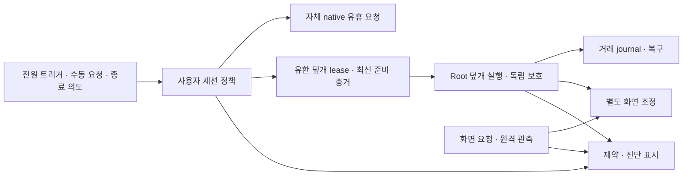

# Tether 설계 재검토와 타 앱의 시스템 변경 범위

2026-10-02~06 · macOS 15 이상·Apple Silicon. 제품 계약은 [기능 정의](PRODUCT-SPEC.ko.md), 현재 실행 경계는 [아키텍처](ARCHITECTURE.md)를 따른다. 이전 소스 검토와 사용자 요청에 따른 후속 실설치 시험을 구별해 기록한다. [경쟁 앱 정식 비교·간소화 결정](COMPETITOR-DEEP-RESEARCH.ko.md)은 현재 구현과 추가 제안을 구별한다.

## R34: 요구별 재검증과 남아 있는 결함

2026-10-06 · 사용자 요청 ‘확실하냐, 하나하나 디테일하게 체크’에 따른 후속 감사다. **공통 세션과 소유권·유한 종료 구조를 유지할 근거는 있지만, 화면 절전과 무잠금을 함께 보장하는 최적안은 아직 확정할 수 없다.** 아래의 ‘통과’는 명시한 소스/모의 시험 범위이며 물리 기기의 합격으로 확대하지 않는다. 제품 실행 코드나 설치본은 수정하지 않았다.

### 기능별 판정

| 요구·경계 | 이번에 확인한 근거 | 판정·남은 조건 |
|---|---|---|
| AC 자동 유지와 독립적인 수동 시작/종료 | `IdleSessionTests`·`ManualSessionTests`·공통/일반 routing에서 시작 사유와 기한을 별도로 평가. helper 수동 시나리오 34개 재실행 | 모의 통과. 새 공통 계약은 설치본과 일치시키지 않음 |
| 닫힌 채 전원 분리 → 자체 유지 해제 → Sleep | `ClosedLidSleepTrackerTests` 8개와 native handoff 14개. 해제 이후에도 이전 자체 세션의 종료 책임을 최대 90초 보존하며 명령 직전 재검증 | 모의 통과. 실제 닫힌 분리·OS Sleep/Wake는 이번 미시험. 실제 타 앱 system 요청이 남으면 자체 해제와 OS Sleep 보류를 구별 |
| 닫힌 채 AC 연결/앱 활성화 | 현재 상태를 재평가하며 닫힘 edge만 요구하지 않음. `fullWake`·관측·GUI 소유권·보호가 실행 조건 | 이미 Full Wake인 경로와 잠든 기기의 연결을 구별. Dark Wake에서 강제 Full Wake를 보장하지 않음 |
| 수동 AC 무제한·명시적 배터리 예외 최대 2시간 | `ManualSessionPolicy.swift:84–107`, 수동 정책 28개 및 helper 수동 34개. 기본 분리 종료와 선택한 연속 사용을 구별 | 모의 통과. 배터리 직접 시작/자동 트리거는 다른 계약이며 수동 무제한을 배터리에 적용하지 않음 |
| AC 왕복과 배터리 시간 | `StablePowerGate`는 AC 관측 두 번의 간격 30초 이상을 요구. 자동/F-02 종료 시각과 지정 수동 종료 시각은 연장하지 않음 | 기존 ‘AC 복귀로 타이머가 재충전되지 않는다’는 표현을 좁힘. 안정 AC에서 소비 예산은 재무장되고, AC 시작 수동의 배터리 연속 사용 마감도 해제되어 다음 분리 때 선택 시간으로 다시 계산. 15분→안정 AC→분리의 직접 교차 시험은 아직 없음 |
| 발열·센서 불확실·취소 후 재시도 | 충돌 51개에서 보호 후 중지, 열림, Dark Wake, 알 수 없는 전원, 외부 override, 조회 불가를 확인 | 모의 통과. 중지는 보호 retry를 취소하지만 실제로 관리했던 닫힌 세션의 새 종료용 Sleep까지 금지하는 계약은 아님 |
| 외장/가상 화면·타 앱 공존 | native handoff 14개·화면 관측 17개·충돌 51개. 실제 system 요청/화면 요청을 분리하고 자기 소유 요청만 해제 | 모의 통과. 전역 `SleepDisabled`에는 작성자 신원이 없어 타 앱이 같은 값을 쓰는 새 의도를 완벽히 식별하지 못함 |
| 화면은 꺼지고 작업은 유지 | 생산 경로 `IdleAssertionDriver.swift:18`은 system-idle만 생성. helper의 실제 화면 절전 관측·유한 복구는 존재 | 닫힌 화면 관측의 모의 통과. OS의 화면 꺼짐 관측을 패널 전력 0이나 원격 입력 성공으로 표시하지 않음 |
| 자동 무잠금·로그인 유지 | 현재 display-idle 생산 실행기가 없음. `ScreenLockPolicyProbe.swift:18`은 암호 지연 정책만 조회하며 실제 잠금/원인 관측기가 아님 | **미구현·미확인.** 항상 display-idle을 유지하면 열린 상태의 유휴 화면 꺼짐과 충돌. 닫힘 이후만 획득하면 열린 유휴 무잠금을 해결하지 못하고 이미 시작된 잠금을 되돌리지 못함 |
| 원격 접속·화면·입력 | `RemoteProviderProbe.swift:99–102`는 연결·프레임·입력 왕복·인증을 unavailable/unmeasured로 반환. 가상 화면은 세션 수명을 결정하지 않음 | 원격 앱 추정으로 작업을 종료하지 않는 구조는 확인. 실제 원격 조작/재연결 합격은 미확인 |
| 구 공통 helper 5 → 앱 계약 6 첫 시작 | `AppModel.swift:317–321,588–614`. 이미 controller를 주입한 기존 시험과 달리 실제 cold-start 분기로 임시 모의 시험 2개 수행 | **가용성 공백 재현.** helper 5에서는 일반 세션도 없음·생성 요청 0. 같은 조건의 helper 6에서는 시작 성공. 구 helper의 덮개 grant 거부는 타당하지만 갱신 전 일반 유지까지 제공하지 못하는 범위는 별도 보완 필요 |
| 관리자 없는 일반 유지 | `LocalService.swift:246,287`의 root:admin 제한과 `AppModel.swift:554–558`의 fallback 조건 대조 | **R30-05 미해결.** 노트북에서 기존 helper/control이 남고 root 조회가 거부되면 일반 controller도 만들지 않음. socket 개방이나 보호 기록을 무시한 fallback으로 해결하면 안 됨 |
| 업데이트 설치·원복 | `install-helper.sh:74–105,119–123,153`와 `AppModel.prepareToQuit()` 확인 | **R30-01/P1 미해결.** 전체 설치 A/B 경쟁을 직렬화하지 않아 실패한 B가 성공한 A를 되돌릴 수 있음. 이번 32개 동시 설정 IPC 시험은 설치 경쟁 검증이 아님 |
| 구버전 밝기 복원 | `ScreenGuard.swift:22–29`, `DisplayControls.swift:33–35,69–80`은 setter 실패/부재를 전달하지 않고 원본을 삭제 | **R30-02/P2 미해결.** 구 밝기 저장 기록이 있는 이관 경로의 문제. 현재 화면 꺼짐을 밝기 0으로 바꾸자는 뜻이 아님. 실제 private API 실패 재현은 미실행 |
| 시각 변경 뒤 배터리 표시 | `UserSessionController.swift:420–434`에서 수동 표시만 시각 변화 때 재투영. battery Date는 continuous 마감 변경 때만 갱신 | **R30-03/P2 미해결.** 실제 한도는 continuous 기준이지만 남은 시간/진행률은 시스템 시계 변경에 어긋날 수 있음. 이번 실제 시각 변경은 하지 않음 |
| Apple Silicon·macOS 15·데스크톱 | 모델 목록 대신 일반/배터리/덮개 capability 분기. 후보 helper의 Mach-O `minos 15.0` 확인 | 컴파일·분기 확인이며 모든 모델/macOS 15 실행 증거가 아님. **R30-04/P3 미해결:** `Welcome.swift:54–80`은 지원 데스크톱에도 덮개 안내/설치 버튼을 보이지만 실제 설치 가드는 거부 |

### 실행한 시험과 실패의 분류

| 이번 실행 | 결과 | 증거의 경계 |
|---|---:|---|
| Core 13개 선택 suite | 219 통과·실패 0 | 정책, 충돌 행렬, 소유권, 보호, 화면/GUI, 이관, 업데이트. 행렬의 조합 수를 기기 수로 세지 않음 |
| Common/General routing·UserSessionController·SessionTimingController | 127개 중 125 통과·실제 OS assertion opt-in 2개 미실행·실패 0 | UI model과 mock backend. 실제 절전/무잠금 시험 아님 |
| 재빌드한 helper의 manual/native handoff/display observation/conflicts | 34 + 14 + 17 + 51 = **116개 통과** | 실제 실행 파일·Unix IPC, private 임시 경로, OS 쓰기는 dry-run. 충돌 시험 안의 600개 seeded 전이는 물리 동작이 아님 |
| 별도 cold-start 진단 | 2개 기대 결과 확인 | helper 5의 기능 불가 재현과 6의 정상 시작 대조. 결함 재현을 제품 성공으로 집계하지 않음. 원본 시험 파일은 byte 단위로 복원 |

기존 충돌 시험 8번은 중지 뒤 모든 Sleep 호출이 없어야 한다고 기대해 실패했다. 소스·R31 계약·격리 로그를 대조하면 기존 보호 retry는 취소되고, 닫힌 자기 세션에 대한 새 `lidSleep` 요청이 발생한다. 기대를 이 계약에 맞추고 타 앱 system 요청/조회 불가 두 경우를 추가했다. 즉시 snapshot에서 새 사건을 기대했던 후속 실패도 snapshot이 평가하지 않는다는 경계를 확인해 유한 polling으로 수정했다. 실제 취소·보류 검사는 유지했다. cold-start의 helper 6 대조는 처음에 mock 전원/깨움 입력을 누락해 실패했으며, 생산 관측에 해당하는 AC·Full Wake·GUI 입력을 주입한 뒤 두 진단이 통과했다. 앱 실행 로직을 변경해 실패를 가린 것은 아니다.

### 설치 상태와 변경 범위

14:25–14:37 KST 읽기 전용 조회: 설치 앱 `2026.9.1`/빌드 `50`, 실행 helper **coordinator 5**. 수정 소스와 이번 테스트 helper는 **coordinator 6**이다. root 설치 helper와 앱 번들 helper의 SHA-256은 모두 `a6721fdd8f1e438ce955862a98d6c085f70c6ad01cb976018d1115a6af170f24`; 후보는 `d301a13e63fe9689a3ff3c83a2d8576e4614b31b45353d4bdafc82afef5a4cb7`이다. 같은 표시 빌드 번호가 동작 계약까지 같음을 의미하지 않는다.

마지막 live 상태는 AC·열린 덮개·Full Wake·appConnected·자체 SleepDisabled 소유이며 virtualOnly 화면이었다. `displaySleeping=false`를 이 조건의 실패로 단정하지 않는다. 암호 요구 지연은 `immediate`였고, 이는 실제로 잠겼다는 관측이 아니다. 시험 전후 root control SHA-256은 `dce534fd181709a72679fc87104294f56bc94d95c58612644d9e273c89f0b28e`로 동일했다. private dry-run helper 잔여 프로세스는 0이었다.

이번 지속 변경은 이 감사 기록/R33 표현 정정과 `scripts/test-conflicts.py`의 종료 계약·보류 회귀뿐이다. 설치 앱·helper·전원·암호 정책·다른 앱은 변경하지 않았고 GitHub 배포도 하지 않았다. 물리 테스트 없이 ‘최적안 확정’, ‘암페타민보다 우월’, ‘모든 상황 합격’으로 결론 내리지 않는다. 보완 순서는 무잠금/화면 동시 요구의 실행 가능성 확정, 설치 전체 수명, 구 공통 helper 첫 시작/일반 계정 계약, 구 밝기 복원, 배터리 표시, 데스크톱 안내다.

## R33: 공개 소스로 정한 보완안과 무잠금 검증 후보

2026-10-06 · 사용자 요청 ‘다른 소스코드를 참고해서 최적안을 찾아’에 따른 코드 대조다. **기존 공통 세션·coordinator 6의 전원 분리 종료·엄격한 복구 기록을 유지하고, 시스템/화면 요청을 구별하는 실행 경로와 설치 수명을 보완하는 안을 선택한다.** 새 범용 트리거 엔진이나 원격 앱별 제어 계층을 추가하지 않는다. 이번에 바꾼 것은 이 기록뿐이며, 앱 코드·설치본·전원/암호 설정을 바꾸거나 새 실행 시험을 하지 않았다.

### 다시 확인한 비교 버전

| 소스 | 고정한 정식 코드와 라이선스 | 확인 범위 |
|---|---|---|
| [KeepingYouAwake 1.6.8](https://github.com/newmarcel/KeepingYouAwake/blob/cca86d604835ad4fda1acab4b4807d4c7a1db856/Packages/KYASleepWakeTimer/Sources/KYASleepWakeTimer/KYASleepWakeTimer.m#L95-L133) | `cca86d604835ad4fda1acab4b4807d4c7a1db856` · MIT | `-i`와 `-di`를 구별하고 `-t`·`-w 앱PID` 및 자기 child 종료로 수명을 연결. 덮개 유지는 별도 지원하지 않음 |
| [Keepresso v1.26.0](https://github.com/gyorgysh/keepresso/blob/e114f3230e3501005ec285839f874911d24fe024/Sources/KeepressoCore/SessionController.swift) | `e114f3230e3501005ec285839f874911d24fe024` · GPL-3.0 | 세션 재평가, assertion 종류별 소유, 덮개 자동 유지와 helper/복구. 검토한 관련 8개 파일은 main `e9d96264d9500e5c3b0bc904d303d13fb3be2d0d`와 동일 |
| [OpenLid v2.4.0](https://github.com/openlid/openlid/blob/ea5c9b9acc60239bb1bad178a02246fd7cc7fa96/crates/app/src/platform/macos/display.rs#L54-L108) | `ea5c9b9acc60239bb1bad178a02246fd7cc7fa96` · Apache-2.0 | 화면 유휴 assertion과 실제 화면 절전 요청을 병용. 관련 화면/runtime/platform/config/license 5개 파일은 main `60a6865ed8e53d112133fa399af3a5c6653478f3`와 동일. README의 무잠금 설명과 실제 시험 증거를 구별 |
| [Liddy v0.1.0](https://github.com/bygelo/liddy/blob/6c5e1b00efef3911cb7747d534060c7b6d94ae7c/Sources/LiddyHelper/main.swift) 및 [개선된 main](https://github.com/bygelo/liddy/blob/b010439631b0b68f58cefbe564cf7877ea2f6c98/Sources/LiddyKit/Runtime/ClamshellGuard.swift) | 정식 `6c5e1b00efef3911cb7747d534060c7b6d94ae7c`, main `b010439631b0b68f58cefbe564cf7877ea2f6c98` · MIT | main의 연결 소유권 개선과 정식의 모든 연결 종료 원복을 구별. 후속 journal 저장과 원복 확인 없이 기록 삭제하는 경로는 차용하지 않음 |

Tether 비교 대상은 현재 작업 소스의 coordinator 6이다. 이 전의 live 조회는 설치 도우미 coordinator 5·표시 빌드 50을 확인했고, 설치 앱에 포함된 도우미와 root 설치 도우미의 SHA-256은 같았다. 서로 다른 설치 도우미 문제가 아니라 수정 소스가 아직 적용되지 않은 경계다. 현재 코드 서명도 `Signature=adhoc`, `TeamIdentifier=not set`으로 읽었다. Amphetamine 비공개 본체의 내부 구현을 읽거나 추정 구현을 근거로 삼지 않았다. 외부 코드를 복사·번역하거나 의존성을 추가하지 않았다.

### 선택한 실행 구조

| 책임 | 채택·유지할 동작 | Tether에서 보완할 부분 |
|---|---|---|
| 사용자 세션 | Keepresso의 [요구한 assertion 집합으로 재평가](https://github.com/gyorgysh/keepresso/blob/e114f3230e3501005ec285839f874911d24fe024/Sources/KeepressoCore/PowerAssertion.swift#L50-L82) 원리를 참고. 자동·수동 유지의 시작 사유와 기한은 `IdleSessionPolicy`/`UserSessionController` 한 경로에서 계산 | 기존 system-idle 요청을 유지하고 display-idle 요청은 별도 수명으로 검증. 종류마다 최대 하나만 소유, 활성 확인·유한 OS 만료·해제 실패 시 ID 보존을 적용. 경쟁 코드처럼 해제 결과를 확인하기 전에 ID를 버리지 않음 |
| 전원 분리 | AC 전용 기본에서는 수동·자동의 AC 사유를 끝냄. 명시적 배터리 연속 사용만 승인된 시간 안에서 유지하며 수동 배터리 한도는 2시간. 별도로 선택한 배터리 자동 트리거와 혼동하지 않음 | coordinator 6의 현재 정책을 설치본과 일치시키고 일반 요청·화면 요청·자체 덮개 override를 같은 종료 결정에 따라 해제. 자동/F-02 마감과 지정 수동 종료 시각은 AC 복귀로 연장되지 않음. 다만 소비 예산은 안정 AC 30초 확인 뒤 재무장되며, AC 시작 수동의 선택 배터리 연속 사용 마감도 다음 분리 때 다시 계산. 원격 재접속·Wake·앱 재실행으로 소비된 세션을 부활시키지 않음 |
| 덮개 확장 | 관리자 도우미는 현재 전원·덮개·GUI 소유자·보호·배터리 한도를 검증하고 자체 전역 값만 관리. [Keepresso의 해제](https://github.com/gyorgysh/keepresso/blob/e114f3230e3501005ec285839f874911d24fe024/Sources/KeepressoCore/ClosedDisplayAuto.swift#L402-L410)와 [별도 Sleep 행동](https://github.com/gyorgysh/keepresso/blob/e114f3230e3501005ec285839f874911d24fe024/Sources/KeepressoCore/SessionEndAction.swift#L73-L119)의 구분을 유지 | 실제 `SleepDisabled=false` 확인 뒤에도 닫힌 세션의 유한 종료 책임을 보존. 매 재시도 직전 조건을 다시 확인하고 열림·재연결·새 유지·소유권 변경에 취소. 검증된 외장 화면의 native handoff와 가상 화면을 구별 |
| 화면·무잠금 | 시스템 유지·화면 유휴 방지·실제 화면 꺼짐은 독립. 원격 앱 이름·연결 추정 실패는 작업의 시작/종료 조건으로 사용하지 않음 | 아래 병용 후보를 먼저 검증. 외장/가상 화면·타 앱 화면 요청이 있으면 전체 화면 명령만 보류. 닫힌 채 AC 연결·이미 닫힌 상태에서 시작·재점등에도 현재 관측과 제한된 재시도 적용. 화면 실패가 작업이나 타이머를 끝내지 않음 |
| 복구·설치 | Tether의 OS 쓰기 전 durable journal·쓰기 후 실제 값 확인·복구 실패 기록 보존·짧은 recovery lock은 유지 | R30-01의 설치 수명 잠금을 백업 전부터 준비 확인·commit/rollback 완료까지 적용. 전원 recovery lock과 분리해 서비스 시작 대기를 막지 않음. 종료·재실행도 이 수명을 존중하고 다음 후보는 빌드 50을 재사용하지 않음 |
| 사용자 화면 | 기본 화면은 유지 상태, 전원 조건, 수동 시작/종료, 배터리 예외에 집중 | 실측하지 않은 원격 프레임·인증·입력 안내는 주요 화면에서 제외. 실제 실패와 관련될 때 진단 안에 표시. 시스템 설정 읽기는 문제 설명이며 무잠금 구현이나 원격 성공 표시로 쓰지 않음 |

일반 세션은 데스크톱에서도 관리자 도우미 없이 제공한다. helper의 최신 센서·예산 검증은 사용자 의도를 중복 계산하는 트리거 엔진이 아니라 권한 실행의 제한이다. 일반 소유 request와 달리 `SleepDisabled`는 전역 값이어서 동일한 값을 쓰는 타 앱의 새 의도를 완벽하게 식별할 수 없다. 이 한계를 없앴다고 표시하지 않는다.

### 무잠금 후보의 확인된 범위와 맹점

**system-idle와 유한 display-idle의 병용은 닫힌 덮개의 비교 후보일 뿐, 열린 유휴까지 포함한 전체 요구의 최적안은 아니다.** 항상 유지/닫힘 뒤 획득 어느 변형도 열린 화면 절전과 자동 무잠금의 동시 보장을 현재 근거로 입증하지 못한다. OpenLid는 [먼저 세션·assertion을 재평가한 뒤 닫힘 edge에서 `displaysleepnow`를 요청](https://github.com/openlid/openlid/blob/ea5c9b9acc60239bb1bad178a02246fd7cc7fa96/crates/app/src/state_runtime.rs#L455-L471)한다. 이는 실제 공개 코드에 있지만 [관련 시험](https://github.com/openlid/openlid/blob/ea5c9b9acc60239bb1bad178a02246fd7cc7fa96/crates/app/src/state_runtime.rs#L1117-L1298)은 mock 호출과 held 상태이며 무잠금·원격의 실기 합격이 아니다. [전원 변경](https://github.com/openlid/openlid/blob/ea5c9b9acc60239bb1bad178a02246fd7cc7fa96/crates/app/src/state_runtime.rs#L475-L500)은 화면 명령 없이 재평가하므로 edge-only 동작을 그대로 이식하지 않는다.

[Apple IOKit 계약](https://github.com/apple-oss-distributions/IOKitUser/blob/323ead896d04424f87184d8f6ff0cce811aab106/pwr_mgt.subproj/IOPMLib.h#L274-L314)은 display-idle assertion이 유휴 화면 꺼짐을 막지만 자연 덮개 닫힘 같은 다른 이유의 꺼짐을 허용하고 이미 꺼진 화면을 켜지 않는다고 설명한다. **자동 잠금 방지의 보장은 명시하지 않는다.** 따라서 다음 경계가 남는다.

- 활성 세션 내내 display-idle을 유지하면 닫힘 직전 요청을 준비할 수 있지만 **열린 상태 장시간 유휴 시 화면만 꺼지는 요구와 충돌한다**. 이 요구를 삭제하거나 이미 충족했다고 표시하지 않는다.
- 닫힘을 관측한 뒤에만 display-idle을 획득하는 변형은 열린 화면 설정을 보존할 후보지만 이미 시작된 잠금을 되돌리지 못한다. 닫힘·전원 연결·명령 간 경합을 별도로 확인해야 한다.
- 자연 덮개 닫힘으로 화면이 실제 꺼지는지 먼저 대조하고, 켜짐이 확인된 경우에만 기존 제한된 화면 절전 경로와 비교한다. 강제 화면 절전과 무잠금의 동시 성공은 아직 미확인이다.
- Apple의 [`displaySleepNow()`](https://github.com/apple-oss-distributions/PowerManagement/blob/d415e45501842834a280930c3eed9186544a67f0/pmset/pmset.m#L982-L1009)는 화면 idle 요청이며 일부 오류를 stderr에만 남긴다. exit=0을 화면 꺼짐·무잠금으로 해석하지 않는다. 화면 절전 관측도 패널 소비전력 0의 증거가 아니다.
- [사용자 활동 선언](https://github.com/apple-oss-distributions/IOKitUser/blob/323ead896d04424f87184d8f6ff0cce811aab106/pwr_mgt.subproj/IOPMLib.h#L540-L579)은 화면을 깨울 수 있어 주기적 ping을 도입하지 않는다. 밝기 0·가상 화면 생성·입력 모사·자동 unlock·전역 암호 정책 해제도 현재 핵심 기능의 대체로 도입하지 않는다.

### 설치 방식과 보완 순서

[Keepresso HelperManager](https://github.com/gyorgysh/keepresso/blob/e114f3230e3501005ec285839f874911d24fe024/Sources/Keepresso/HelperManager.swift#L77-L105)는 Team ID와 설치 위치로 등록 관리 범위를 제한하고, [구형 프로토콜의 응답과 도우미 장애](https://github.com/gyorgysh/keepresso/blob/e114f3230e3501005ec285839f874911d24fe024/Sources/Keepresso/HelperManager.swift#L239-L260)를 구별한다. 이 원리는 참고한다. [SMAppService](https://developer.apple.com/documentation/servicemanagement/smappservice)는 macOS 13 이상 표준 등록 경로지만, 현재 Tether의 ad-hoc 사설 배포에서 등록·BTM·업데이트·구 root 도우미 이관이 입증된 것은 아니다. 지금 설치 경로를 즉시 교체하지 않고 별도 후보에서 검증한다.

1. **무잠금 실행 경로와 실측 수단을 준비한 뒤 작은 후보를 검증한다.** 유한 display-idle 실행기·실제 잠금 관측은 아직 생산 경로에 없다. 열린 유휴의 미해결 요구를 보존하고, 자연 닫힘·이미 닫힌 채 AC 연결/활성화·외장/가상 화면·원격 연결/종료를 나눠 system/display assertion·OS 화면 절전·실제 잠금·원격 입력/작업 지속을 따로 관측. 현재 암호 지연보다 충분히 오래 확인하고 직접 잠금은 존중. 정책 조회·mock 성공·표본 공백만으로 통과시키지 않음.
2. **같은 후보에서 AC 닫힘 → 닫힌 채 분리의 종료를 확인한다.** 자체 request 해제 → 전역 해제 재관측 → 현재 사유에 맞는 Sleep 요청 → 실제 OS Sleep을 순서대로 확인. 타 앱의 유효한 system 요청 때문에 보류되면 자체 종료 성공과 OS Sleep 보류를 구별. 이미 잠든 Mac에 전원 연결만으로 full wake를 얻는 경로는 별도 OS 조건 시험이며 보장으로 추가하지 않음.
3. **R30-01/02/03을 고치고 하나의 새 빌드로 적용한다.** 설치 전체 동시 수명, 구버전 밝기 복원 실패 기록 보존, 배터리 표시의 continuous 기준을 회귀 검증. 소스·앱 번들·실행 앱·실행 helper의 빌드/프로토콜을 대조. 이후 필요한 진단만 남겨 UI를 정리.

현재는 소스 대조와 보완안 선택까지 완료다. 새 display-idle 구현·무잠금 실기 결과·새 설치본 완료로 표시하지 않는다.

## R32: 공통 시스템 설정 연동과 잠금 계약 정정

2026-10-06 · 개발 소스에 읽기 연동을 추가했다. 클램쉘 유지 중 자동 잠금 방지는 필수 목표이며, 시스템 설정 연동만으로 이 목표가 구현됐다고 하지 않는다. 설치 앱·도우미와 실제 전원·암호 정책은 변경하지 않았다.

| 경계 | 구현한 동작 |
|---|---|
| 앱과 시스템의 중복 설정 | 암호 요구 정책은 `sysadminctl -screenLock status`로만 읽고 시스템 설정으로 연결. 별도의 암호 요구 선택값을 저장하거나 쓰지 않음 |
| 로그인 자동 실행 | 등록 파일과 launchd 차단을 구별. 시스템에서 바꾼 등록·차단을 UI에 반영하며 외부 차단을 자동 해제하지 않음. launchd 조회는 BTM/MDM 전체 승인의 증거가 아님 |
| 외부 변경·오래된 응답 | 기존 앱 갱신 주기에서 최대 15초마다 재조회, 설정에서 복귀·Wake 직후 재조회. 45초 지난 암호 정책·오류는 확인 불가. 앱 편집 이전에 시작한 응답은 폐기하고 진행 중 재조회는 한 번으로 합침 |
| 세션·예산과 관측의 분리 | 읽은 설정을 유지 결정·배터리 마감·도우미 소유권에 쓰지 않음. 미리보기는 명시적 fixture 외에 시스템 명령을 실행하지 않음 |
| 잠금 표시의 의미 | 암호 요구 정책과 실제 화면 잠금 상태를 구별. 설정이 꺼져 있어도 무잠금·원격 성공 표시를 만들지 않음. 즉시 암호 요구만으로 설정 변경을 강제하지 않음 |

실제 Mac에서 2026-10-06 12:12 KST에 읽은 정책은 `screenLock delay is immediate`였다. 조회는 정상 종료했으며 이 값만으로 사용자가 겪은 잠금의 원인이나 암페타민과의 차이를 확정하지 않는다.

**암페타민 비교 정정:** [공식 App Store 설명](https://apps.apple.com/us/app/amphetamine/id937984704?mt=12)은 세션별 화면 절전·덮개 유지·잠금 허용/방지를 제공한다. 본체의 잠금 방지 내부 코드는 공개된 자료로 확인하지 못했다. Tether는 현재 `Helper+Display.swift`에서 닫힌 유지 중 `pmset displaysleepnow`를 별도로 요청한다. 이 요청이 암호 요구 정책을 적용시키는 경로는 원인 후보이며 실제 원인으로 확정하지 않는다.

[Apple IOKit 계약](https://github.com/apple-oss-distributions/IOKitUser/blob/main/pwr_mgt.subproj/IOPMLib.h)은 화면 유휴 절전 방지 요청이 있어도 덮개 닫힘 같은 다른 이유로 화면이 꺼질 수 있고, 이미 꺼진 화면을 깨우지 않는다고 설명한다. 따라서 유한 화면 유휴 요청과 자연스러운 덮개 화면 꺼짐을 함께 확인할 여지가 있다. 전역 암호 정책을 반드시 바꿔야 한다는 결론은 철회한다. 이 후보를 생산 경로에 적용하거나 실제 화면 절전·무잠금·원격 입력의 동시 합격으로 표시하지 않았다. 클램쉘 중 자동 잠금을 함께 선택하던 옛 문서 계약도 정정했다.

검증: 새 정책 parser 6개·비동기 관측/앱 연결 8개, 합계 **새 회귀 14개 통과·실패 0**이다. 앱의 시작·업데이트·공통 세션·IPC·설정 회귀도 앞선 239개 중 237개 통과, 실제 OS 요청 opt-in 2개 미실행, 실패 0이었다. 앱 연결 시험은 외부 등록 변경이 UI에 반영되면서 배터리 기한·자체 요청·저장 설정은 그대로임을 확인한다. 좁은 설정 창 860×640과 메뉴 340 너비를 AppKit offscreen으로 렌더링해 줄바꿈·정렬을 확인했고 임시 이미지는 제거했다. 실제 Liquid Glass·macOS 15 UI·덮개·화면 절전·장시간 무잠금·원격 입력은 이번 합격 범위가 아니다. 12:24 KST 재조회에서도 암호 정책은 `immediate`였다.

## R31: 전원 분리 종료와 유한 재시도 보완

2026-10-06 · 개발 소스 50/coordinator 6을 수정·검증했다. 현재 설치본은 같은 표시 버전·빌드 50이지만 coordinator 5이며 이번 후보로 교체하지 않았다. Keepresso 정식 v1.26.0의 종료 책임·종료 효과 분리 원리를 참고했고 외부 코드·의존성은 추가하지 않았다. 아래 앞선 비교·설치 결과는 해당 시점의 기록이다.

| 발견한 경계 | 수정과 보존한 동작 |
|---|---|
| AC 수동 유지가 분리 때 자동으로 배터리 한도를 받음 | 기본 종료, 명시적으로 선택한 시간만 최대 2시간 안에서 연속 사용. 배터리 직접 시작·자동 조건·직접 예약은 독립. 선택은 저장하지만 활성 요청은 재생하지 않음. 수정 전 새 회귀 3개에서 11개 assertion 실패로 재현 |
| 자체 override를 해제하고 외부 요청 때문에 Sleep을 보류하면 이후 다시 요청하지 않음 | 실제 자체 유지 이력의 종료 책임을 process-local tracker로 최대 90초 보존. 실제 system assertion·조회 실패가 해소되면 같은 책임으로 재시도. 화면/네트워크 요청만으로 이를 보류하지 않으며 타 앱의 요청을 해제하지 않음 |
| native handoff가 ownership을 해제해 닫힌 채 AC 분리의 요청 경로가 사라짐 | 검증된 handoff 뒤에도 이전 자체 세션의 책임을 보존. 처음부터 macOS 기본 클램쉘만 사용한 경우에는 책임을 새로 만들지 않음 |
| retry callback에서 덮개 열림·GUI 불확실을 본 뒤 조건 회복 시 옛 Sleep이 부활하거나 90초를 초과 | 명령 직전에도 현재 덮개·전원·깨움·GUI·외부 전역 override·기한을 확인해 tracker까지 취소. 조회 실패·외부 system 작업만 유한 보류. 평가를 호출하지 않는 `f.patch()` 경계로 두 결함을 먼저 재현 |
| 공통 세션 화면이 종료 후 보류 이유를 숨김 | 최신 helper·동일 소유 앱·확인된 해제·30초 이내 관측에 한해 이유를 표시. 새 수동 작업의 배터리 예산과 상태 표시 권한을 구별. 보호·끄기·활성 작업이 우선하고 로그 사건은 고정 allowlist만 수집 |
| 같은 버전/빌드의 이전 계약을 현행으로 오인 | coordinator 6 일치 요구. 5 이하/누락/미래 계약은 새 덮개 grant를 거부. 설정의 꺼짐·보호·소비 예산과 유효한 일반 native 경로는 보존 |

도우미가 먼저 분리를 관측한 배터리 마감은 앱이 그대로 소비하며 늦은 관측으로 시간을 다시 지급하지 않는다. 짧은 AC 왕복은 선택 시간과 배터리 예산을 초기화하지 않는다. 기존 30초 연속 AC 확인 및 90초 helper 수명은 공학적 제한이며 내구성 보증 수치가 아니다. 개발 helper에는 초기화 전에 종료하는 `--version` 조회를 추가했다. 구형 helper는 이를 지원하지 않을 수 있으므로 기존 바이너리 조사에 새 인자를 보내지 않는다.

| 2026-10-06 검증 | 결과 | 범위 |
|---|---:|---|
| 전체 `swift test` | 839개 중 832 통과·7 미실행·실패 0 | Core 607, 앱·업데이트 232. 실제 전원 assertion opt-in 7개는 제외. 정책·예산·권한·설정 이관·공통 routing·표시·종료·업데이트 회귀 |
| `test-manual-sessions.py` | 34 통과 | 기본 종료, 선택 15분, 짧은 AC 왕복, 엄격한 한도, 직접 배터리 시작·재시작 |
| `test-work-session.py` | 50 통과 | helper-first 마감, 미승인 수동 배터리 projection 거부, 직접 배터리 시작, 기존 lease·Sleep 소비·예산 |
| `test-coordination.py` | 28 통과 | 해제 후 재시도, transient callback 취소·기한, 화면/실제 system 요청 분리, 보호·사용자 Sleep |
| `test-native-handoff.py` | 14 통과 | 직접 native→분리, 처음부터 native만 사용한 기기, 타 작성자 전역 값 보존 |
| `test-upgrade.py` | 53+2 통과 | installer/readiness/설정·원복 53개와 별도 버전 조회 2개. 설치된 실제 coordinator 5 바이너리를 임시 경로에서 실행해 같은 빌드의 6 교체·실패 원복 7개 확인 |
| `test-remote-display.py` | 27 통과 | 원격 가상 화면 전환·분리·보호가 같은 작업 정책을 따름 |
| `test-display-observation.py` | 17 통과 | 화면 복구 한도·관측 실패·추가 화면이 자체 유지 수명을 바꾸지 않음 |

격리 helper/installer 시나리오는 합계 **225개 통과**다. 실제 실행 파일·Unix IPC·installer를 쓰되 전원 쓰기와 센서는 dry-run 또는 고정 mock이다. 화면/네트워크 분류는 별도 실제 `SystemProbe` 디코딩·aggregate 단위 회귀로 확인했으며 fake 필드만으로 OS 분류를 입증하지 않는다. 368px 수동 조작의 기본/활성 AC UI 렌더 2개에서 옵션의 정렬·잘림을 확인하고 임시 이미지를 제거했다. 전체 시험 전후 `pmset -g custom`은 동일했다.

사용자의 ‘암페타민 기능에서 닫힌 채 전원 해제 시 자동 클램쉘 해제’ 재확인 뒤, 현재 도우미를 다시 빌드하고 수동 전원 전환 34개·native handoff 14개, 합계 **48개 모의 시나리오를 재실행해 모두 통과**했다. 닫힌 AC 수동 무제한·시간 제한의 기본 종료, 명시적 배터리 유지 예외, 자체 native 위임 뒤 분리 종료를 확인했다. 새 실행 로직을 추가한 결과가 아니라 기존 구현이 핵심 계약을 따르는지 확인한 결과다. 임시 fixture는 각 시험 종료 때 정리했고 설치본·실제 전원 설정은 바꾸지 않았다.

실제 닫힌 덮개 전원 분리·실제 Sleep/Wake·잠든 상태의 AC 연결 깨움·원격 프레임/입력·내장 패널 전력·자동 무잠금·macOS 15 실기기·장시간 내구성은 이번 합격 범위가 아니다. 기존 설치 앱·도우미 교체, GitHub 새 배포도 수행하지 않았다. 앱 설정은 일반 자동 절전에 적용하되 사용자 잠자기·로그아웃·OS 보호와 보안 정책을 우회하지 않는다. 실제 system 요청이 있는 상황은 보류 이유를 안내하며 무조건 Sleep을 강제한다고 약속하지 않는다.

## 2026-10-02~03 추가 재검토와 수정

초기 검토는 **개발본 50의 현재 소스**를 대상으로 했다. 당시 설치본은 **빌드 49 / 최소 macOS 26.0**, 소스는 **빌드 50 / 최소 macOS 15.0**이었다. R26~28은 그 소스 검토·수정 기록이며 실설치·물리 시험의 완료를 뜻하지 않는다. 이후 “맥북에 설치해서 테스트해봐” 요청으로 진행한 교체와 발견 사항은 R29에 별도로 기록한다.

### R30: 정식 공개 코드와 대조한 완성도

2026-10-02~03 · “다른 앱들의 코드와 비교해서 완성도 체크, 동작테스트는 따로” 요청에 따른 **읽기 전용 코드 리뷰**다. Tether는 `feature/power-management-suite`의 변경 중인 개발본 50을 읽었다. 기준 HEAD는 `ad46bbaf587a35d2578d589600960f766bd731d3`이지만 이 커밋만으로 현재 작업 파일을 재현할 수 없다. 이 단계에서 소스 수정·빌드·테스트·앱 실행·전원/잠금 설정 변경은 하지 않았다. 아래 새 항목은 **미수정**이며, R26~29에서 수정한 결함을 다시 세지 않는다.

**판정:** 일반 유지와 덮개 확장을 분리하고 자체 요청만 복구하는 방향은 타당하다. 비교한 공개 코드보다 방어적인 계약도 있다. 그러나 설치 경쟁·복원 실패·타이머 표시·지원 기기의 안내/계정 경계가 남고, 실제 화면 절전·무잠금·원격 조작의 동시 제공은 완성되지 않았다. 기능 수·테스트 수·계층 수로 타 앱보다 안정적이거나 전력을 적게 쓴다고 판정하지 않는다.

#### 비교 대상과 고정 근거

2026-10-02에 GitHub의 최신 정식 release와 해당 tag의 commit을 다시 조회했다. 최신 개발 브랜치와 배포 정식을 섞지 않았다. 필요한 텍스트 소스만 임시로 읽었으며 앱/설치기/경쟁 코드의 실행이나 직접 이식은 하지 않았다.

| 대상 | 정식·게시일·고정 SHA | 코드 대조 범위 |
|---|---|---|
| [Keepresso v1.25.0](https://github.com/gyorgysh/keepresso/releases/tag/v1.25.0) | 2026-09-14 · `5837a0be0764c6637c09c29c606405e0630e43ed` | 세션·전원·assertion·덮개/화면·도우미 등록/인증·업데이트 |
| [KeepingYouAwake 1.6.8](https://github.com/newmarcel/KeepingYouAwake/releases/tag/1.6.8) | 2025-09-12 · `cca86d604835ad4fda1acab4b4807d4c7a1db856` | caffeinate의 시간·앱 PID·child 수명과 종료. 최근 유지보수 추천이 아니라 일반 유지 구조의 참고 |
| [Liddy v0.1.0](https://github.com/bygelo/liddy/releases/tag/v0.1.0) | 2026-07-31 · `6c5e1b00efef3911cb7747d534060c7b6d94ae7c` | native assertion·helper heartbeat·전역 값 기록/복원 |
| [Amphetamine Power Protect](https://github.com/x74353/Amphetamine-Power-Protect/tree/4937590499c5504f9623dcf290c099349cf8e8fd) | 정식 GitHub release 없음 · 공개 main `4937590499c5504f9623dcf290c099349cf8e8fd` | 공개 보조 도구/README의 범위만 참고. Amphetamine 본체의 세션 엔진을 읽은 것으로 취급하지 않음 |

Valpas·Lungo처럼 본체 코드를 확인하지 못한 제품은 이 코드 비교에 포함하지 않는다. Keepresso는 GPL-3.0, KeepingYouAwake·Liddy는 MIT다. 이번에는 구현 원리를 검토했으며 외부 코드를 복사하거나 의존성을 추가하지 않았다.

| 경계 | 경쟁 코드에서 확인한 방식 | Tether의 현재 판단 |
|---|---|---|
| 일반 절전 방지 | [KYA 실행기](https://github.com/newmarcel/KeepingYouAwake/blob/cca86d604835ad4fda1acab4b4807d4c7a1db856/Packages/KYASleepWakeTimer/Sources/KYASleepWakeTimer/KYASleepWakeTimer.m#L95-L133)는 `caffeinate -i/-di`, `-t`, `-w 앱PID`와 자기 child 종료를 사용. [KYA README](https://github.com/newmarcel/KeepingYouAwake/blob/cca86d604835ad4fda1acab4b4807d4c7a1db856/README.md#L19-L21)는 닫힌 덮개를 제외 | `IdleAssertionDriver`의 자체 ID·최대 90초 OS 만료·실제 level 확인을 유지. 프로세스가 살아 있는 hang에도 무한 grant를 남기지 않으려는 계약이며 실측 우위는 아님 |
| 트리거·수동 세션 | [Keepresso SessionController](https://github.com/gyorgysh/keepresso/blob/5837a0be0764c6637c09c29c606405e0630e43ed/Sources/KeepressoCore/SessionController.swift#L801-L840)는 트리거가 단일 활성화를 소유하면 timed cap을 무시 | `IdleSessionPolicy`는 자동/수동 이유를 합성하고 각각의 만료·종료를 분리. 수동 배터리 최대 2시간과 별도 자동/직접 사용 예산을 유지. 경쟁 모델을 그대로 섞으면 사용자 계약이 바뀜 |
| 덮개·잔재 복구 | [Liddy helper](https://github.com/bygelo/liddy/blob/6c5e1b00efef3911cb7747d534060c7b6d94ae7c/Sources/LiddyHelper/main.swift#L83-L145)는 OS 쓰기 뒤 best-effort 기록, socket 종료/15초 침묵 때 복원. startup 복원 실패에서도 기록 삭제 가능 | `Helper+Ownership`의 OS 쓰기 전 durable journal·쓰기 뒤 실제 값 확인·실패 기록 보존을 유지. 이 계층을 Liddy 수준으로 줄이면 복구 근거가 약해짐 |
| 화면·원격 | [Keepresso DisplayPolicy](https://github.com/gyorgysh/keepresso/blob/5837a0be0764c6637c09c29c606405e0630e43ed/Sources/KeepressoCore/DisplayPolicy.swift#L30-L39)는 실제 화면 절전·밝기 0·화면 미변경을 구별. 밝기 0은 패널/framebuffer를 켜 두는 원격 대안 | 밝기 0은 사용자 요구의 대체가 아님. 외장/가상 화면·타 앱 화면 요청에 전체 화면 명령만 보류하고 작업 유지는 독립. 실제 화면 절전+무잠금+원격 입력의 동시 충족은 여전히 공백 |
| 도우미·업데이트 | [Keepresso HelperManager](https://github.com/gyorgysh/keepresso/blob/5837a0be0764c6637c09c29c606405e0630e43ed/Sources/Keepresso/HelperManager.swift#L157-L183)는 `SMAppService` 등록, [helper 접속](https://github.com/gyorgysh/keepresso/blob/5837a0be0764c6637c09c29c606405e0630e43ed/Sources/keepresso-helper/main.swift#L100-L129)은 서명/현재 console UID 검증 | Tether는 관리자 계정 socket·커널 GUI 신원·세대별 준비/이관·실제 readiness를 검증하지만 자체 설치/rollback 수명이 더 복잡. 아래 R30-01/05를 보완해야 함 |

#### 새 코드 리뷰 항목

| ID·우선순위 | 직접 확인한 조건과 영향 | 보완 범위 |
|---|---|---|
| **R30-01 · P1** 설치 전체의 동시 실행 방어 없음 | `Resources/install-helper.sh:74–78`의 백업과 `119–123`의 service 중지는 power recovery lock 밖이다. 새 bootstrap/readiness도 `153`에서 lock을 풀고 수행한다. A/B가 같은 구버전을 백업 → A가 새 설치 성공 → B 실패 → `85–105`의 rollback이 A의 정상 서비스를 중지하고 자기 구버전을 복원하는 순서가 가능하다. `AppModel.helperInstallInFlight`는 한 프로세스의 중복만 막음 | 백업 전부터 commit/rollback 완료까지 별도 설치 수명 mutex로 직렬화. 실패한 시도가 다른 시도의 commit을 되돌리지 못하게 함. 기존 전원 recovery lock은 service 시작/준비 대기 내내 잡으면 안 됨. 설치 대기 중 종료/재실행의 의미도 확정 |
| **R30-02 · P2** 구버전 밝기 복원 실패 때 원본 삭제 | `ScreenGuard.swift:22–29`는 복원 명령 직후 저장한 화면/키보드 값을 지운다. `DisplayControls.swift:33–35,69–80`은 private API 부재·내장 패널 부재·setter 실패를 호출자에게 알리지 않는다. 따라서 no-op/실패에도 다음 실행의 복원 근거가 사라짐 | 복원 결과와 관측을 구별하고 확인된 항목만 소비. 조회/API 부재·부분 실패의 원본은 보존하고 제한적으로 다시 복원. 현재 화면 제어를 밝기 0으로 되돌리는 변경은 아님 |
| **R30-03 · P2** 시스템 시각 변경 뒤 배터리 표시 오차 | `UserSessionController.swift:411–419`는 수동 Date 기한을 재투영하지만 `421–425`는 battery continuous 기한이 바뀔 때만 Date를 갱신. 30분 시작 후 실제 1분 경과 중 Date를 +1시간 이동하면 실제 29분은 남아도 `BatterySessionControls.swift:23,28`의 남은 시간/종료 시각과 controller `174–176`의 진행률은 종료 상태로 표시. −1시간이면 과대 표시 | 표시 시작/종료 Date를 같은 offset으로 재투영하거나 남은 시간/진행률을 continuous 기준으로 계산. 실제 기한·배터리 예산을 변경하지 않음 |
| **R30-04 · P3** 데스크톱 첫 실행이 노트북 안내로 연결 | `supportedMac`은 일반 지원 능력인데 `Welcome.swift:54`가 이를 덮개 안내 분기로 사용. 지원되는 데스크톱에도 덮개/배터리 설명과 도우미 설치 버튼을 표시하고, 실제 설치 가드는 `AppModel.swift:1540–1545`에서 데스크톱 설치를 거부. `76–78`은 helper 존재만으로 초록 설치 상태를 표시 | 일반 지원·덮개 확장·helper 호환/준비를 구별해 안내. 데스크톱에는 일반 세션 시작/완료, 노트북에는 필요한 helper 설치/갱신/실패 안내. 파일 존재를 준비 완료로 표시하지 않음 |
| **R30-05 · P2** 기존 도우미가 일반 계정의 일반 유지까지 차단 | `LocalService.swift:245–247,286–297`의 root:admin/관리자 그룹 제한 자체는 `SECURITY.md:24`에 명시한 의도다. 그러나 verified portable + non-admin에서는 연결 실패 후 `AppModel.swift:531–536`가 helper/control 존재 때문에 일반 `UserSession`도 만들지 않음. 관리자 없이 일반 기능을 제공하는 설계와의 가용성 공백 | 관리자 계정 요구와 일반 기능 범위를 명시. 인증된 root 이관·기존 보호/off/예산 확인 또는 새 일반 계정의 별도 계약을 정의. root 조회 실패를 무조건 native fallback으로 바꾸거나 socket 권한을 단순 개방하지 않음 |

위 조건은 소스의 실행 순서·값 처리·호출자를 대조한 정적 판정이다. R30-01의 두 설치 경쟁, R30-02의 실제 private API 실패, R30-03의 시계 변경, 데스크톱 첫 실행·일반 계정 시험은 이 리뷰에서 실행하지 않았다. 필요한 회귀는 각각 설치 A/B interleaving, 부분 복원/API unavailable 뒤 재시도, continuous 고정 + wallClock ±3600초, capability별 첫 실행, admin/non-admin과 기존 root 기록의 조합이다. 기존 테스트의 개수로 이 빠진 경계를 통과했다고 간주하지 않는다.

#### 기능 공백·설치 상태·간소화 결정

- **화면/원격은 테스트만 남은 상태가 아니다.** `Helper+Display.swift:15–27`은 외장/가상 화면과 타 앱의 유효한 화면 요청이 있으면 전체 화면 명령을 보류한다. `RemoteProviderProbe.swift:99–102`의 연결·프레임·입력·인증은 생산에서 unavailable/unmeasured다. 그 값을 확인하는 adapter와 실제 내부 패널 절전·무잠금·원격 입력을 함께 제공하는 경로가 없는 상태다. 경쟁 앱의 밝기 0 방식도 이 계약의 완료 증거가 아니다.
- **전역 bool 소유의 한계는 남는다.** Tether가 `disablesleep=1`을 적용한 뒤 외부 앱도 같은 `1`을 쓰면 값 비교로 작성자를 식별할 수 없다. 이후 자체 journal의 복원은 그 외부 의도에도 영향을 줄 수 있다. 자체 assertion ID만 해제하는 공존 보장과 전역 값의 best-effort 복구를 구별한다. 기존 `PowerOwnership.swift:3`의 계약을 유지하며 ‘모든 전원 앱과 충돌 0’을 약속하지 않는다.
- **이미 잠든 기기의 케이블 연결은 별도 경계다.** FullWake의 현재 조건 재평가와 실제 Sleep에서 케이블만으로 OS가 깨워주는 것은 다르다. DarkWake를 fullWake로 바꾸거나 배터리 유지/전역 wake 설정을 몰래 추가해 이를 우회하지 않는다.
- **설치 후보와 공개 릴리스는 구별한다.** 같은 build50/protocol2/coordinator5라도 개발 중 후보가 다를 수 있다. 이번 읽기 전용 파일 재조회에서도 설치된 root SHA-256은 `9dfd99216ba328102f16aa90927226d4001d8ffbfc0dab7e53b1f34f9fb43dec`, 앱의 번들 helper는 `a6721fdd8f1e438ce955862a98d6c085f70c6ad01cb976018d1115a6af170f24`로 다르다. R29-04 최종 root 교체가 완료된 것으로 표시하지 않는다. 이는 사설 후보의 build 재사용/설치 확인 공백이며, 정상 공개 feed는 `scripts/update-feed.py:51–54`의 단조 증가 검사가 같은 build 재게시를 거부한다. 후보 식별/빌드 증가와 최종 설치 확인을 먼저 정리하고 무조건 새 hash-binding 프로토콜을 추가하지 않는다.
- **유지할 복잡도:** write 전 journal·OS 결과 확인·실패 기록 보존·유한 assertion·공통 recovery lock·자동/명시적 Sleep 구별·타 앱 요청 보존·검증된 49 이관. 실제 안전/업데이트 계약이므로 간소화를 이유로 제거하지 않는다.
- **줄일 후보:** 측정 adapter가 없는 원격 관측 타입/상세 UI의 확장, version gate 밖으로 퍼지는 구 helper 분기, 한 평가 안의 중복 snapshot/불필요한 상태 게시. 실제 OS 쓰기 직전 재조회·내구성 저장·보호 주기는 보존하며, 성능 우위는 별도 측정 전 주장하지 않는다. 새 caffeinate child·두 번째 세션 결정자·팬/네트워크/충전 자동화를 붙이지 않는다.

다음 개발 우선순위는 **R30-01 설치 거래 → R30-02 복원 → R30-03 표시 → R30-05 일반 계정 범위 → R30-04 첫 실행 안내 → F-04의 구현 가능 범위 확정**이다. 동작 시험은 사용자 담당으로 분리했다. 이번 결과는 코드 완성도 리뷰이며 실제 덮개·전원·장시간 운용·macOS 15/26/27·전체 Sparkle 업데이트 합격을 뜻하지 않는다.

### R29: 실설치에서 발견한 연결·인증 결함

2026-10-02 19:48 KST 기준 전체 Swift 검증은 **806개 통과·실패 0·건너뜀 0**이다(Core 585, GUI 221). 실제 macOS IOKit 요청 생성·관측·만료·자체 해제와 타 앱 요청 보존을 검사한 opt-in 7개를 포함한다. 설치 관련 집중 회귀 12개는 인증 취소·실패·중복·제거 차단과 비권한 실제 Process의 stderr 128KiB 배출, 16KiB 보관 한도, EOF/종료 양쪽 순서, launch 실패를 검증했다.

| 항목 | 직접 관측한 실패 | 수정과 검증 |
|---|---|---|
| R29-01 사용자 명령 endpoint | URLSession 캐시 디렉터리가 0755여서 개인 socket 가드가 `unsafeEndpoint`로 거부 | coordinator의 개인 Application Support 디렉터리로 이전. 실제 디렉터리 0700·socket/lock 0600과 CLI 응답 확인. 캐시 0755는 유지 |
| R29-02 정상 도우미의 갱신 오인 | 보호 안내를 초기화하며 helper protocol 메타데이터도 지워 정상 protocol2를 구버전으로 표시. 수정 전 회귀 assertion 실패 | protocol 메타데이터를 표시 상태와 분리. 자동 설치 직전 readiness를 재조회하며 이미 완료된 외부 설치는 재인증하지 않음 |
| R29-03 인증 대기 중 앱 정지 | 실제 앱 process sample에서 MainActor가 `NSAppleScript → AuthorizationCreate`에 머물렀고 개인 socket 명령이 응답하지 않음 | 고정 osascript Process를 비동기로 기다리고 설치 슬롯을 await 전에 예약. IPC/refresh·중복 설치·설치 중 제거·취소·후검증 회귀 통과. 설치 버튼에 대기 상태 표시 |
| R29-04 소유자 없는 첫 준비 | 실제 설치 helper와 비권한 격리 fixture 모두 첫 `prepareWorkSession`에서 `notOwner` 반환. 앱은 활성 상태지만 일반/덮개 유지 모두 시작하지 못함 | prepare를 attach와 같은 현재 console·커널 GUI 신원·승인 UID·살아 있는 타 소유자 가드로 허용. 유효한 빈 lease·epoch/revision 검사 유지. native GUI 신원/실제 Unix IPC 격리 18개 통과 |

R29-04 격리 시험은 실제 커널 peer login/PID를 검증하지만 전원 쓰기는 dry-run이다. 일반 사용자 계정·console 전환·타 PID·stale ACK·손상 준비로 소유권을 획득하지 못하는 경계도 확인했다. 물리 덮개·실제 Sleep/Wake 증거로 해석하지 않는다.

2026-10-02 19:51 KST에 `/Applications/Tether.app`을 최종 서명된 **2026.9.1 / 빌드 50 / 최소 macOS 15.0**으로 교체했다. 로그인 LaunchAgent를 먼저 해제하고 앱을 원자 교체한 뒤 원래 로그인 항목을 다시 로드했다. 최종 앱 SHA-256은 `776e108482a6a99e825e91373e2a286bbe146364a54e05bb881e78721fe41402`, 번들 도우미는 `a6721fdd8f1e438ce955862a98d6c085f70c6ad01cb976018d1115a6af170f24`다. dirty source의 사설 시험 빌드이며 공개 배포는 수행하지 않았다.

19:54 KST에는 최종 root 도우미 교체가 macOS 관리자 인증 대기였다. **22:40 KST에 사용자가 코드 리뷰로 전환해, 이 작업이 띄운 대기 중 installer 요청만 종료했다.** 앞선 설치로 root 도우미도 빌드 50을 보고하지만 SHA-256 `9dfd99216ba328102f16aa90927226d4001d8ffbfc0dab7e53b1f34f9fb43dec`이며 R29-04 수정이 들어 있지 않다. R30의 파일 재조회에서도 최종 번들 도우미와 다르다. 빌드 번호만으로 최종 설치 완료를 표시하지 않는다. 22:22 KST 관측에서는 앱 endpoint가 응답해도 cold 연결의 `notOwner` 때문에 유지가 시작되지 않았다. 후속 설치 때 root 바이너리 일치·새 handshake·기존 AC 트리거 이관을 확인한 뒤 설치 앱의 1분 만료·자동/수동 공존·자체 해제·Splashtop 요청 보존을 시험해야 한다. R30에서는 설치/동작 시험을 재개하지 않았다.

기존 Battery/AC `pmset -g custom`은 설치 전 원문과 같고 잠금 보안 정책은 수정하지 않았다. 현재 macOS 27.0.1·arm64·AC·열린 덮개·Splashtop 원격 요청이 있는 기기다. 물리 닫힘·배터리 전환·실제 Sleep·원격 프레임/입력·화면 전력·무잠금·macOS 15/26 실행·장시간 내구성은 이번 통과 범위가 아니다.

### R28: 추가 경계 수정

R27 수정 뒤 재시작·중복 통지·제거·구버전 이관·가상 화면의 경계를 추가로 확인했다. 아래는 개발 소스의 변경이며 설치본 49를 교체하거나 시스템 설정을 바꾼 결과가 아니다.

| 항목 | 재현·영향 | 수정과 보존한 경계 |
|---|---|---|
| R28-01 재시작 뒤 Sleep의 세션 신원 | 이전 L1 lease가 저장된 helper 재시작 → 새 L2 준비 → Sleep에서 L1 소비 receipt를 기록해 L2가 ACK 없이 획득. 실제 격리 helper IPC로 재현 | 실행 중 lease가 없으면 새 준비의 신원을 저장된 옛 lease보다 우선. 실행 중 grant가 있는 동안 다른 sessionID의 준비는 거부 |
| R28-02 두 번째 Sleep과 옛 receipt | 첫 Sleep 소비 → 새 임시 요청 → 두 번째 Workspace Sleep → 첫 receipt 재수신에서 수동·예약·배터리 요청 부활. 수정 전 회귀 7개 assertion 실패 | 새 Workspace 알림의 원래 capture 시각을 보존. 중복 receipt가 새 Sleep 경계를 지우지 못하며 capture 이전의 임시 요청만 소비. 확인 대기 중 배터리 연장도 거부 |
| R28-03 확인된 root 제어 종료 | helper가 없어진 뒤 controller가 root 소비 receipt를 계속 기다려 일반 유지가 복귀하지 못함 | 인증된 자체 detach 또는 제거 성공·관련 파일 부재를 확인한 경우에만 root 의존 종료. 늦은 임시 요청 소비·보호·off·공유 예산은 보존. 조회 실패나 관리자 인증 취소로 종료를 추정하지 않음 |
| R28-04 손상된 제거 복구 기록 | 부분 JSON을 기록 없음으로 해석해 제거 성공·원본 삭제. 실제 제거 스크립트의 고정 mock으로 재현 | 객체 형식·타입·범위·소유자·권한·link·크기를 검사. malformed/unreadable 기록과 복구 미완료는 원본·helper를 보존하고 실패. nullable 필드·유효한 이전 644 기록은 호환 |
| R28-05 구버전 설치 취소의 일반 유지 | 앱 50이 기존 49의 보호를 확인하지 않고 우회하면 위험하고, 전체 차단하면 열린 Mac의 일반 유지도 불가 | 실제 49 바이너리의 protocol2 attach/detach 계약을 확인. 열린 덮개·현재 fullWake·OS 관측과 같은 epoch/자체 PID의 해제를 매 단계 확인한 뒤 일반 native 제어로 이관. 다른 helper/PID는 건드리지 않음. active 임시 요청은 소비하고 off·한도·보호는 보존 |
| R28-06 추가 화면의 내장 화면 안내 | 가상/외장 화면이 있으면 내장 화면 관측을 숨기거나 이전 화면 구성의 recovery phase를 현재 상태로 표시 | 30초 이내 현재 내장 화면 관측으로 켜짐/절전/미확인을 표시. 전체 화면 명령을 보류한 이유와 작업 유지·한도 지속을 안내. stale/future/unknown 관측을 성공으로 표시하지 않음 |
| R28-07 잠자기 알림 등록 실패 | IORegisterForSystemPower 등록 실패를 로그에만 남기고 새 덮개 유지 권한을 허용하던 코드 경계. 명시적 dry-run 관측 실패 주입에서 prepare/attach/sync와 legacy override 성공을 확인 | 관측 가용성을 별도로 보고. 준비·빈 요청·해제는 허용하고 비어 있지 않은 권한과 최종 override 획득은 거부. AppModel은 확인된 자체 detach 후 일반 native만 제공. 설치 readiness도 명시적 등록 실패를 성공으로 인정하지 않음 |

49에는 자동 배터리 예산의 공개 bridge가 없고 수동 잔여 시간에도 monotonic sample 시각이 없다. 구버전 일반 이관은 둘 다 부트 시작 시각부터 소비한 것으로 보수적으로 처리한다. 오래된 잔여 시간으로 새 시간을 만들지 않으며 안정적인 AC 복귀 30초나 검증된 현행 bridge로만 갱신한다. 알 수 없는 구버전·미래 버전·읽기 불가 보호는 계속 구체적인 업데이트 안내와 차단을 유지한다. 덮개 확장은 일치하는 새 helper가 필요하다.

R28-07은 실제 macOS에서 IOKit 등록 실패를 일으킨 시험이 아니다. 생산은 root port·notification port·notifier가 등록된 사실을 검사하고, 회귀는 동일 property의 실패를 명시적으로 주입한다. 가용성은 보호 중지 사유로 승격하지 않으며 자체 복구를 막지 않는다. 같은 실패 epoch의 준비를 반복하지 않고, 등록 회복 또는 새 helper epoch에서 다시 확인한다.

중복 receipt와 늦은 Workspace 알림은 공개 관측만으로 항상 구별할 수 없다. 알림을 받은 시점보다 늦은 main-queue 전달은 원래 capture 시각을 유지하지만, 알림 자체가 늦게 도착하면 capture 이전의 새 요청도 보수적으로 취소될 수 있다. 끝난 요청을 부활시키거나 타이머를 자동 재시작하는 방식으로 이 불확실성을 숨기지 않는다.

2026-10-02 18:30 KST의 전체 Swift 실행은 **792개 중 785개 통과·실제 전원 요청 opt-in 7개 제외·실패 0**이다. 신규 controller·실제 AppModel routing·가상 화면 표시·잠자기 알림 실패 회귀를 포함한다. 초기 구버전 fixture는 동시에 active hold와 pending hold를 만들어 Control 검증을 위반했다. 알림 실패의 cold preview fixture에도 유효한 모의 환경과 비동기 refresh 완료 대기를 보충했다. 생산의 보호·검증 조건이나 기대값은 완화하지 않았다. 아래 R27 수치는 앞선 시점의 기록이다.

| R28 격리 검증 | 통과 | 확인한 경계 |
|---|---:|---|
| `scripts/test-work-session.py` | 47 | 재시작 신원·Sleep 소비·알림 등록 실패 9개 경계·캐시 ACK 거부·자체 해제와 복구·다른 앱 소유권·공유 예산 보존 |
| `scripts/test-upgrade.py` | 52 | 새 helper readiness의 명시적 알림 실패 거부와 기존 설치·원복 계약. 실제 설치본 49 바이너리를 임시 경로에서 사용한 업데이트·실패 원복 7개 포함 |
| `scripts/test-display-observation.py` | 17 | 현재 helper의 화면 복구 한도·가상/외장 화면 전환·배터리 예산·작업 유지 보존 |
| `scripts/test-uninstall.py` | 27 | 정상 제거·malformed/unreadable/unsafe 기록의 원본 보존·미완료 복구 보존·유효한 legacy 644/null 호환 |

합계 **143개 통과·실패 0**. 일반 사용자·임시 경로·dry-run 또는 고정 OS mock으로 검증했다. 실제 관리자 설치·Sparkle 다운로드·IOKit 등록 실패 유발·물리 Sleep·잠금·원격 프레임/입력의 합격 증거는 아니다. 화면 안내는 AppKit offscreen 렌더링으로 좁은 패널과 설정 창의 줄바꿈·정렬을 확인했으며 임시 이미지·fixture 프로세스는 제거했다.

### R27: 수정 전 재현한 결함 4건

| 우선순위 | 발견 | 발생 조건·사용자 영향 | 확인 수준 | 보완 방향 |
|---|---|---|---|---|
| P1 · R27-01 | watchdog이 타 앱 요청을 확인하지 않고 자동 잠자기를 요청 | 도우미가 90초 이상 응답하지 않고 GUI 소유 앱은 살아 있으며, 배터리·닫힌 덮개·fullWake 조건일 때 원격/LLM 앱의 유지 요청과 충돌 가능 | watchdog → recovery executor → 최종 native exec 코드 경로 확인. 실제 OS 잠자기는 실행하지 않음 | 복구 목적의 자동 잠자기와 명시적 사용자 잠자기를 구별. 타 앱 요청 있음/조회 불가는 자동 잠자기를 보류하고 최종 실행 경계에서도 확인 |
| P2 · R27-02 | OS 잠자기 전 수동 유지 권한이 빠른 깨움 뒤 부활 | GUI의 willSleep 처리·후속 IPC가 늦고 기존 유한 grant 안에 같은 전원으로 깨면, 끝나야 할 수동 요청으로 덮개 유지 재획득 | 빌드 50의 실제 helper/Unix IPC와 dry-run 모의 전이로 재현 | helper의 OS suspend에서도 coordinated grant와 저장 상태를 무효화. 깨움 뒤 새 세대의 유효 요청만 수락하고 옛 임시 사유는 재사용하지 않음 |
| P2 · R27-03 | 이관 백업의 부분 쓰기가 이후 정상 재시도도 차단 | 백업 작성 중 중단돼 최종 고정 파일명에 불완전 내용이 남으면, 저장공간이 회복돼도 설정 이관·writer 시작 거부 | 실제 PreferenceMigration/JSONFile 소스를 사용한 메모리 설정 fixture에서 2회 재시도 거부 재현. 디스크 부족·강제 종료 자체는 주입하지 않음 | 임시 백업을 완성·동기화한 뒤 최종 이름으로 독점·원자 게시. 기존 유효 원본은 보존하고 중단 잔재와 완성본을 구별 |
| P2 · R27-04 | 종료 시각 확인 순간 다음 날로 재계산 | AC의 새 수동 세션 또는 무제한 세션 예약에서, 화면에 오늘 18:00이 보인 직후 18:00을 넘겨 확인하면 내일 18:00으로 바뀔 수 있음 | UI 코드 대조 + 같은 Foundation 시각 계산 실행. 1초 남은 표시값이 확인 순간 86,400초의 유효 요청으로 바뀜. 실제 UI 클릭은 실행하지 않음 | 화면에 표시한 절대 종료 시각을 확인에 사용. 지난 선택은 거부하고 시간대가 바뀌어도 같은 절대 날짜를 유지해 조용히 다음 날로 변경하지 않음 |

### 현재 소스의 보완

| 항목 | 수정과 보존할 경계 | 검증 경로 |
|---|---|---|
| R27-01 자동 recovery Sleep 공존 | watchdog 중복 shell 조건을 SleepRequestPolicy로 통합. 정상 GUI 확인 후 타 앱 요청·센서를 재조회하고 최종 gate에서도 확인. 건강한 Tether 일반 요청도 recovery Sleep의 보류 근거로 포함. 명시적 사용자 Sleep·자체 원복은 별도 유지 | WatchdogTests·ConflictMatrixTests, 실제 native recovery/gate의 격리 mock 실행 |
| R27-02 OS suspend와 재연결 | helper grant·준비·작업 ACK 캐시 소비, 같은 부트 소비 receipt 저장·전달, coordinator5의 앱 ACK 뒤 새 sequence만 수락. GUI의 옛 임시 요청만 소비하고 새 사용자 시작·off·보호·예산 보존. 기존 갱신이 소비된 grant로 거절되면 appConnected=true에서도 재준비하며 staleRevision 재시도는 최대 8회. 잘못된 준비 ACK와 취소된 업데이트 복구는 반복 획득하지 않음 | UserSessionControllerTests·CommonSessionRoutingTests·WorkSessionLeaseTests, 실제 helper/Unix IPC의 dry-run Sleep·빠른 Wake·재시작 |
| R27-03 원자 백업 | 완성·동기화한 임시 파일을 renamex_np(RENAME_EXCL)로 게시하고 디렉터리 동기화. 쓰기 실패는 최종 이름을 남기지 않음. 기존 원본·불완전 최종 파일은 보존·검증하며 자동 덮어쓰기 없음 | MigrationTests의 부분 쓰기·동시 게시·기존 불완전 백업 거부·off 보존 |
| R27-04 종료 시각 | 사용자가 선택할 때 절대 날짜를 한 번 결정. 표시·확인 모두 그 날짜를 사용하고 지나간 선택은 거부. 처음부터 지난 시각을 선택한 다음 날 예약은 유지 | SessionTimingControllerTests의 경계·다음 날 선택·시간대 변경 후 절대 날짜 |

추가 검토에서 새 watchdog과 구 실행기 혼합, GUI 파일 잠금 대기 동안의 조건 변경, recovery에서 GUI 자체 일반 요청을 제외하는 경로도 보완했다. 새 쓰기 capability는 recovery v2/gate v3이며, journal schema1의 과거 작성자 정리 계약은 유지한다. 정상 설치·제거는 번들의 새 실행기로 원복한다. 타 앱과 Tether의 요청을 보존하며 자체 덮개 override를 원복해도 macOS의 정상 덮개 정책으로 잠들 수 있으므로 helper 고장 중 덮개 작업 지속을 보장하지 않는다.

### R27 통합 검증 결과

2026-10-02 16:41 KST의 전체 Swift 실행은 **774개 중 767개 통과·실제 IOKit 전원 요청 opt-in 7개 제외·실패 0**이다. 실제 앱·helper·RecoveryCLI·native writer fixture를 함께 빌드했다. 처음 통합 GUI에서 재연결 재시도 2건, 소비된 배터리 기한 표시 잔류·늦은 통지 뒤 표시 시계 2건이 실패했다. 잘못된 준비 ACK·취소된 업데이트 복구의 반복을 제한하고 실제 기한 전이와 주입된 wallClock으로 표시를 맞춘 뒤, 해당 GUI 93개와 전체 회귀를 통과했다. 테스트 기대값은 완화하지 않았다.

| 실제 바이너리의 격리 검증 | 통과 | 확인한 경계 |
|---|---:|---|
| `scripts/test-work-session.py` | 36 | Sleep·빠른 Wake·늦은/캐시 IPC·새 handshake, 같은 부트 재시작, off·보호·예산·독립 사유·타 앱 override 보존 |
| `scripts/test-recovery-executor.py` | 14 | 타 앱 요청 있음/조회 불가의 자동 Sleep 보류, 작성자 timeout·SIGKILL·lock·구 capability 거부/새 helper fallback |
| `scripts/test-writer-gate.py` | 7 | 내구성 신원 등록 전 실행 금지, 부모 사망·기한 종료, 등록 뒤 새 작업 요청 발생 시 최종 gate 보류 |
| `scripts/test-display-observation.py` | 17 | 생산 helper 경로의 유한 화면 복구·가상/외장 전환·배터리 예산 보존. 화면 실패로 작업 Sleep 요청을 만들지 않음 |
| `scripts/test-upgrade.py` | 51 | 격리 installer·상태 형식·capability/readiness·원복. 설치본 49의 실제 helper 바이너리로 49→50 성공 및 49→49 실패 원복 7개 포함 |

합계 **125개**, 실패 0. IPC 첫 실행의 UUID 문자열 대소문자 비교는 UUID 값 비교로 수정했으며 시간·sequence·예산 검증은 그대로 유지했다. 모두 일반 사용자와 임시 경로에서 실행했고 전원·화면 쓰기는 dry-run 또는 고정 mock 대상이다. 실제 시스템의 전원·잠금 설정, 설치 앱, root helper는 변경하지 않았다. 49→50 결과는 실제 구 바이너리의 격리 교체이며 관리자 인증·Sparkle 다운로드·회사 Mac·물리 Sleep의 합격을 대신하지 않는다.

이하 근거의 행 번호·동작·바이너리 hash는 **수정 전 재현 시점**의 기록이다.

**R27-01 근거:** 정상 [Helper.allowsSleepRequest](../Sources/TetherHelper/Helper.swift)는 foreign assertion이 있거나 관측이 불가하면 자동 잠자기를 보류한다. 반면 수정 전 [watchdog](../Resources/tether-watchdog.sh)의 102–118행은 덮개·전원·fullWake만 확인하고 `recovery_pmset sleepnow`를 실행했다. [PowerRecoveryCommand](../Sources/TetherCore/IPC/PowerRecoveryCommand.swift)의 34–44행과 [PowerWriterGate](../Sources/TetherCore/IPC/PowerWriterGate.swift)의 48–62행은 GUI 권한을 재확인하지만 foreign assertion을 확인하지 않았다. [PowerWriterGUIAuthority](../Sources/TetherCore/IPC/PowerWriterGUIAuthority.swift)의 coordinated lease 검사도 `sleepnow`에는 적용되지 않았다. 정상 종료와 watchdog의 동일 계약 및 타 앱 공존을 정한 [기능 정의](PRODUCT-SPEC.ko.md)의 120·123행과 상충했다. 당시 WatchdogTests에는 타 앱 요청 있음/조회 불가 사례가 없었다. 명령 발행 가능성과 실제 기기 Sleep은 구별한다.

**R27-02 근거:** [Helper+Events](../Sources/TetherHelper/Helper+Events.swift)의 56–63행은 legacy manualSession만 끝내고 coordinated workLeaseGate·state.workSessionLease를 남긴다. [Helper+WorkSession](../Sources/TetherHelper/Helper+WorkSession.swift)의 5–26행과 [WorkSessionLease](../Sources/TetherCore/IPC/WorkSessionLease.swift)의 175–183행은 같은 전원의 옛 사유를 다시 허용한다. 이는 OS suspend 때 임시 요청을 소비한다는 제품 계약의 65·76행과 상충한다.

| 모의 단계 | 입력 | helper 결과 |
|---|---|---|
| 시작 | AC, 자동 트리거 꺼짐, manual reason만, sequence 1, expiry 190, manualDeadline 600, clock 100 | 자체 override 활성 |
| OS suspend | systemSleeping=true, clock 101 | override 해제, 이전 수동 grant는 남음 |
| 빠른 fullWake | 새 앱 lease 없음, systemSleeping=false, fullWake=true, clock 104 | 같은 수동 grant로 override 재획득 |

로그는 `will sleep → disablesleep 0 [dry-run] → powered on → disablesleep 1 [dry-run]` 순서였다. 바이너리는 `.build/out/Products/Debug/TetherHelper`, runtime 2026.9.1 / 빌드 50, 빌드 시각 2026-10-02 14:28:31 KST로 관련 Core/Helper 소스의 최신 수정 시각 14:26:33 KST 이후다. SHA-256은 `d8125c0c90b59d7f2326374daae62793dc05d666f66217929aa543434929d4ab`이다. 실제 native 전원 명령·GUI 통지·물리 Sleep/Wake의 재현은 아니다. 기존 앱/controller suspend 시험의 통과로 이 helper 경로를 대신할 수 없다.

**R27-03 근거:** [SettingsMigration.PreferenceMigration](../Sources/TetherCore/IPC/SettingsMigration.swift)의 119–128행은 최종 이름을 O_EXCL로 먼저 만들고 내용을 쓴다. 130–138행은 불완전한 기존 파일을 거부하고 그대로 둔다. [AppModel](../Sources/Tether/Model/AppModel.swift)의 257–284행은 이관 실패 때 writer/controller 시작을 중단한다. 재현에서는 고정 백업명에 binary plist 첫 8바이트만 남긴 뒤 정상 저장공간에서 apply를 두 번 실행했고, 모두 거부되며 marker 없이 부분 파일과 원래 두 설정 domain이 보존됐다. 정상 이관과 명시적 off 보존도 별도로 확인했다. 잘못된 백업을 신뢰하지 않는 보호는 유지해야 하며, 부분 쓰기를 완성된 백업명으로 남기는 커밋 방식과 복구 공백이 결함이다.

**R27-04 근거:** [SessionEndTimeView](../Sources/Tether/Panel/SessionEndTimeView.swift)의 19–27행은 TimelineView 시점에 날짜를 표시하지만, 39–40행은 확인 순간에 next occurrence를 새로 계산한다. [SessionEndTime.next](../Sources/TetherCore/Policy/SessionEndTime.swift)의 6–9행과 같은 Foundation 계산에서 2026-10-02 17:59:59 KST의 표시 날짜는 당일 18:00, 18:00:00 KST의 확인 날짜는 다음 날 18:00이었다. 요청 길이는 86,400초여서 AC의 24시간 최대값 안에 들어간다. 처음부터 지난 시각을 선택해 다음 날로 예약하는 기능 자체는 정상이다. 결함은 표시한 날짜와 확정한 날짜가 경계에서 달라지는 것이다.

### 남은 시스템·물리 경계 2건

| 항목 | 현재 부족·상충 | 필요한 완료 근거 |
|---|---|---|
| 화면 절전 + 자동 무잠금 + 원격 입력 | F-04 구현 경로가 아직 확정되지 않음. 화면 꺼짐 뒤 암호를 요구하는 기존 정책을 유지하면서 항상 무잠금을 보장한다는 요구는 그 정책과 조건부 상충 | 실제 패널/OS 화면 절전·자동 잠금·원격 프레임·입력을 각각 확인. 지원 조합과 설정 확인이 필요한 조합을 명시. 단순 절전방지나 원격 앱 실행 감지로 합격 표시 금지 |
| 이미 잠든 닫힌 Mac에 전원 연결 | [Policy](../Sources/TetherCore/Policy/Policy.swift)의 122–127행은 fullWake 때만 새 덮개 override를 적용. DarkWake면 다시 잠들도록 둬, 사용자가 원하는 모든 닫힘→전원 연결 순서를 제공하지 못함 | 실제 OS 깨움 경로와 트리거 실행을 별도로 확인. 일반 maintenance DarkWake를 무조건 깨우는 변경은 피하고 지원 모델/구성·제한을 명시 |

무잠금 관련 Apple의 [macOS 15 잠금 화면 설정](https://support.apple.com/en-sg/guide/mac-help/mh11784/15.0/mac/15.0)은 화면 보호기·화면 꺼짐 뒤 암호 요구 시간을 별도로 설정한다고 설명한다. 현재 [원격 협력 구현](MAC-REMOTE-COOPERATION.ko.md)은 실제 연결·프레임·입력·인증을 unavailable로 남기며 현재 잠금 상태도 확인하지 못한다. 아직 지원 방법이 확정되지 않은 요구이며 단순히 마지막 물리 시험만 남은 상태로 표시하면 안 된다.

구형 도우미 일반 유지의 공백은 R28-05로 보완했다. 49의 실제 바이너리와 격리 Unix IPC에서 attach 이후 자체 detach·fresh snapshot으로 appConnected=false·appPID 없음·ownsOverride=false·appSessionRequired=true를 확인했다. AppModel mock routing은 off/보호/예산 보존·늦은 응답·조건 변경·다른 PID·helper 교체를 검증했다. 이는 설치 위치에서 관리자 인증을 취소한 실제 GUI 시험과 구별한다.

### 남은 검증과 최적화

- macOS 15 이상·Apple Silicon 전체라는 소스 지원 범위와 실제 지원 합격은 다르다. OS별 native assertion 관측, 데스크톱/노트북, 외장 화면·독·원격 앱, 장시간 실행 및 설치 위치에서의 구버전 앱/도우미 실교체는 계속 별도 검증 대상이다. Swift·격리 실행의 통과는 이 물리·설치 경로의 합격 근거가 아니다.
- 이전 R26-04의 저장 빈도 경로는 남아 있다. [UserSessionController](../Sources/Tether/Model/UserSessionController.swift)의 3초 timer·publish → AppModel.syncWorkSession → Helper.acceptWorkSession/saveState가 유한 grant 갱신 때마다 durable JSON과 파일/디렉터리 fsync로 이어진다. 실제 쓰기량·wakeups·CPU/배터리 측정이 없으므로 내구성 문제라고 단정하지 않는다. 안전 마감·보호 예산을 보존하면서 갱신 간격과 영구 저장 대상을 줄일 근거를 먼저 측정한다.
- SleepDisabled는 배타적 작성자 소유권이 없는 전역 bool이다. R26-06처럼 동일 값을 타 앱이 쓰는 경합까지 완전히 식별했다고 보장하지 않는다. 일반 native assertion의 자체 ID 해제와 전역 덮개 override의 복구 책임을 구별해야 한다.

R27-01 자동 복구의 타 앱 공존 → R27-02 OS suspend 권한 무효화 → R27-03 백업 커밋·복구 → R27-04 예약 시각 확정은 개발 소스와 회귀에 반영했다. F-04·닫힌 상태의 실제 깨움·설치 위치의 업데이트·지원 OS 합격은 별도로 남긴다. 경쟁 앱 비교·간소화 결정과 구현·검증을 기존 문서에 기록했으며 임시 재현 파일과 프로세스는 정리했다. 마지막 프로세스 조회에서 이 작업의 격리 helper·writer·installer 프로세스는 남아 있지 않았다.

## 이전 검토·수정 기록 (R26)

작업 유지, 덮개 확장, 화면 명령과 원격 관측의 분리는 현재 소스에 구현되어 있다. **OS suspend와 사용자 종료의 구별, 관측 실패 중 기존 유한 권한의 처리**도 이번 소스에서 수정하고 회귀 검증했다. 실제 화면 절전·자동 무잠금·원격 입력을 동시에 만족하는 경로는 아직 확정되지 않았으며, 이 기능의 완성을 나머지 정책 시험으로 대신할 수 없다.

| 우선순위 | 발견 | 직접 근거와 확인 수준 | 설계 보완 |
|---|---|---|---|
| P1 · R26-01 · 소스 수정 | 모든 willSleep을 현재 세션 전체 종료로 처리해 다음 AC 활성화가 억제되던 경로 | 수정 전 실제 controller 통지 재현, 수정 후 OS suspend 회귀 | suspendForSystemSleep으로 종료 의도 보존. 실제 전원 연결 Wake 검증은 별도 |
| P1 · R26-02 · 소스 수정 | assertion 조회 실패가 빈 유지 사유·마감 없음으로 전달되던 경로 | 수정 전 controller+backend 재현, 수정 후 driver·lease gate 회귀 | 관측 불가 중 새 갱신 금지·기존 유한 마감만 보존. 실제 OS 조회 실패 검증은 별도 |
| 제품 합격 조건 · R26-03 | 원격 앱 설치 감지는 무잠금·프레임·입력 확인이 아님 | RemoteProviderProbe가 실제 연결·프레임·입력·인증을 unavailable로 보고. 실시간 관측 계약에는 잠금 상태가 없음 | 원격 전송 확인과 F-04 동시 합격을 별도 판정. 무잠금 경로의 실증을 먼저 수행 |
| P2 · R26-04 | 3초 갱신마다 root lease를 durable 저장하는 경로 | controller timer → onChange → syncWorkSession → helper saveState → 파일/디렉터리 fsync | 복구에 필요한 영구 기록과 실행 중 갱신 분리. 안전 마감은 보존하면서 실제 쓰기·wakeups 측정 |
| 지원 합격 조건 · R26-05 | 실제 assertion 확인에 비공개 identity 필드가 필요 | NativeIdleAssertionBackend.confirmedLevel의 AssertionId·AssertPID 등 | OS adapter 경계로 격리. OS별 가용성 검증과 unavailable 처리. 속성의 오래된 level만으로 성공 판정 금지 |
| 플랫폼 한계 · R26-06 | SleepDisabled bool에는 배타적 작성자 소유권이 없음 | Helper+Ownership의 전역 pmset 쓰기와 자체 journal | 자체 복구 책임과 외부 작성자 추정을 구별. 같은 값 외부 쓰기까지 감지했다고 보장하지 않음 |
| 출하 합격 조건 · R26-07 | 정책 시험과 실제 업데이트·지원 OS·물리 Wake·장시간 시험은 별개 | 현재 업데이트 gate와 기존 QA 기록 | 구버전 앱/도우미를 실제 교체하는 실패·복구 시험과 물리 조합 검증 유지 |

### R26-01: 전원 트리거가 재개되지 않는 수명 경로

[willSleep 처리](../Sources/Tether/Model/UserSessionController.swift)는 수정 전에 원인을 구별하지 않고 [stopCurrent](../Sources/TetherCore/Policy/IdleSessionPolicy.swift)를 호출했다. 임시 세션을 끝내면서 automaticSuppressed·batterySuppressed를 저장해 다음 AC 활성화를 막을 수 있었다.

수정 전 정책 fixture의 결과를 보존한다. 이후 실제 controller 통지 경로에서도 재현하고 수정했다.

| 순서 | 요구되는 결과 | 수정 전 결과 |
|---|---|---|
| AC → 배터리 관측 → 다시 AC | 새 AC 활성화 시작 | 시작 |
| AC → 배터리 관측 → willSleep 처리와 동일한 stopCurrent → AC full wake 평가 | 자동 전원 이탈로 잠든 경우 새 AC 활성화 시작 | automaticSuppressed가 남아 시작 안 함 |
| AC → 사용자가 현재 세션 전체 종료 → 같은 AC 계속 | 사용자의 종료 유지 | 종료 유지 |

이는 OS가 실제로 케이블 연결만으로 깨운다는 실기기 증거가 아니다. **완전히 깨워진 뒤 유효한 AC 조건을 다시 관측하더라도 소프트웨어가 재개를 막던 재현**이다.

수정 후 suspendForSystemSleep은 현재 요청·임시 세션·예약을 끝내고, 저장한 자동 트리거와 기존 명시적 종료·끄기·보호를 보존한다. fullWake는 false로 바꾸며 실제 full wake와 유효한 현재 조건에서 다시 평가한다. NSWorkspace 통지 하나를 사용자 잠자기 명령의 증거로 쓰지 않는다. unknown·DarkWake만으로 새 활성화나 사용자 종료를 만들지 않는다.

OS suspend는 수동·배터리 임시 요청의 종료 경계다. 소모한 배터리 활성화와 공유 예산을 보존하고 깨움·재시작으로 타이머를 부활시키지 않는다. 명시적 사용자 종료·끄기·보호 억제도 유지한다. 실제 full wake에서 자동 AC 조건을 재평가하는 것과 끝난 수동 요청의 복원은 다르다.

### R26-02: 관측 불가와 해제 명령이 같은 메시지가 되는 경로

[workLease](../Sources/Tether/Model/UserSessionController.swift)는 수정 전에 [driver.observe](../Sources/TetherCore/System/IdleAssertionDriver.swift)의 조회 실패를 빈 reasons와 nil expiry로 전달했다. 정책에 유지 의도가 남아도 [helper](../Sources/TetherHelper/Helper+WorkSession.swift)는 이를 해제로 수락할 수 있었다.

수정 전 controller와 모의 backend를 연결한 fixture에서 다음 네 항목을 확인했다.

- 정상 조회 뒤 automatic 유지 사유가 있음.
- 갱신 명령 성공 후 조회만 nil로 바꾸면 정책의 automaticActive는 true로 남음.
- 이후 전송 lease의 reasons는 비어 있음.
- 이후 전송 lease의 expiry는 nil임.

OS에서 실제 조회 실패를 유발하거나 root 설정을 해제한 물리 시험은 아니다. 의도와 관측 실패가 IPC에서 구별되지 않는 경로를 재현한 것이다.

수정 후 native 갱신 전에 기존 ID를 관측하며 조회 불가에서는 연장하지 않는다. driver.confirmedExpiry는 마지막으로 실제 on을 확인한 유한 마감이며 쓰기 성공만으로 연장하지 않는다. 갱신 뒤 조회 실패도 이 확인 마감을 늘리지 못한다.

전원·설정·유효 원인·수동 마감·연속 사용 token이 같은 경우 workLease는 nil로 **새 IPC를 보내지 않는다**. 이미 붙은 helper는 원래의 유한 grant만 유지하며 최신 확인 마감보다 길어지지 않는다. 첫 획득부터 미확인인 경우 신규 root grant를 만들지 않는다. 명시적 중지·보호·권한/전원/설정/원인 변경·짧아진 한도·기한 만료는 빈 grant로 해제를 우선한다. nil은 holding의 증거가 아니며 정상 관측이 돌아오면 유효 조건에서만 갱신한다. IPC/schema 변경은 없다.

기존 유효 root grant의 원래 시간 안에서 수행할 수 있는 동작을 모두 금지한 것은 아니다. 관측 불가가 새 grant나 추가 시간의 근거가 되지 않도록 제한했다. OS에서 실제 조회 실패를 유발한 물리 검증은 남아 있다.

## 유지할 구조와 책임

| 책임 | 현재 구현 | 유지·보완 방향 |
|---|---|---|
| 작업 의도와 시작 원인 | UserSessionController + IdleSessionPolicy/ManualSessionPolicy | 전원 트리거와 선택한 수동 요청의 합집합. 수동 AC 무제한/배터리 최대 2시간과 자동 배터리 한도를 구별 |
| 일반 유휴 절전 방지 | 프로세스 소유 IdleAssertionDriver | 일반 기능은 공개 native 요청. 확실한 자체 ID만 해제하고 OS 유한 마감 유지 |
| 덮개 확장 | AppModel의 prepare/attach/sync + root helper | 준비 receipt와 최신 epoch/revision·GUI 권한 확인. helper의 독립 보호·복구는 유지 |
| 화면 | Helper+Display + DisplaySleepGate | 화면 실패·외부 화면 요청은 화면 명령만 조정. 작업 유지나 타이머를 종료하지 않음 |
| 원격 | RemoteProviderProbe/RemoteInterop | 진단 관측. 연결 여부·앱 이름·조회 실패를 작업 수명 조건으로 사용하지 않음 |
| 복구 | root journal·공통 lock·watchdog·RecoveryCLI | durable journal 선행, 고정 작성자 수명, 실제 원복 확인 |
| 업데이트 | Sparkle + 앱/도우미 별도 gate | 앱 재실행·도우미 교체·설정 이관의 합격을 각각 확인 |

원격 관측이 C로 들어가는 시작·종료 화살표는 없다. 필수 보호나 소유권 탈락과 선택적인 화면/원격 조회 실패를 같은 중지 사유로 합치지 않는다. 신규 MacBook에서 도우미 없이 일반 유지가 가능한 현재 경로도 보존한다. 과거 root 제어 기록이 있는 설치는 안전한 이관을 거쳐 일반 유지로 넘긴다.

### 갱신과 저장

3초 주기는 하루 연속 실행 시 이론상 28,800번의 갱신 기회를 만든다. 실제 fsync 횟수·CPU·배터리·SSD 영향을 측정한 수치는 아니다. 설정·예산·거래 단계의 내구성 기록과 실행 중 heartbeat·UI 갱신을 분리하고, 허용 지연과 가장 짧은 권한/OS 마감으로 갱신 주기를 정한다. 사건 처리와 보호 검사는 즉시 유지한다. journal의 fsync를 제거하는 방식으로 최적화하지 않는다.

### 원격과 무잠금

실제 연결·프레임·입력을 확인하는 원격 전송 판정과, 작업 유지·내장 화면 절전·자동 무잠금·인증된 원격 입력을 함께 만족하는 F-04 판정을 구별한다. 현재 liveReady는 전송 증거용 계약이며 잠금·내장 패널 상태까지 포함하지 않는다. 실제 probe도 전송 증거를 측정하지 않으므로 설치 감지를 실시간 준비 완료로 표시하지 않는다.

[Apple IOKit 계약](https://github.com/apple-oss-distributions/IOKitUser/blob/main/pwr_mgt.subproj/IOPMLib.h)은 일반 시스템 유휴 요청과 화면 유휴 요청의 범위를 구별한다. 전자는 유휴 화면 꺼짐을 허용하며 덮개/사용자 잠자기까지 막는 계약이 아니다. 후자는 자동 화면 꺼짐을 막는다. [macOS 15 잠금 화면 설정](https://support.apple.com/en-mk/guide/mac-help/mh11784/15.0/mac/15.0)은 화면 꺼짐 뒤 암호 요구를 별도로 다룬다. assertion 하나로 실제 화면 절전과 무잠금을 모두 달성했다고 하지 않는다.

F-04는 지원되는 수단의 작은 프로토타입과 실제 원격 클라이언트 입력부터 검증한다. 선택한 시스템 설정에 대한 읽기와 구체적인 제한 안내를 기본으로 하며, 전역 암호 요구 완화를 기본 설치 조건으로 만들지 않는다. 밝기 0, 가상 입력, FileVault 해제, 자동 로그인을 F-04의 합격 대체물로 사용하지 않는다.

## 타 앱도 다른 시스템 설정을 변경하는가

2026-10-02 공개 기본 브랜치와 개발자 문서를 확인했다. 공개 코드의 동작과 배포된 앱의 모든 실행 경로는 구별한다. 다른 앱 설치·실행 비교 시험은 이번 조사에 포함하지 않는다.

| 앱/기능 | 실제 확인한 변경 또는 요청 | 추가 설정·잠금에 대한 확인 범위 |
|---|---|---|
| Amphetamine Power Protect | 공식 공개 powerProtect.scpt를 실행 없이 역컴파일해 pmset -a disablesleep 1/0 확인. 구성 파일은 그 두 명령을 허용하는 sudoers 규칙 | 스크립트에 전역 암호 요구 값을 바꾸는 코드는 없음. 본체의 비공개 잠금 방지 구현은 미확인 |
| Amphetamine 본체 | 공식 App Store 설명에 화면 절전·화면 보호기·덮개 유지·커서 이동·잠금의 세션별 선택 기능 안내 | 잠금 방지 옵션의 존재는 확인. 전역 암호 요구를 Never로 바꿔야 한다거나 F-03/04를 동시에 보장한다는 근거로 확대하지 않음 |
| Keepresso | 일반 유지: IOPMAssertion. 덮개: pmset -a disablesleep. 화면: displaysleepnow 또는 선택한 밝기 0 경로 | 선택한 활동 유지: 사용자 활동 선언/커서 warp·키/마우스 이벤트. 추가 headless 안내는 womp 1·autorestart 1·sleep 0 명령과 설정창 링크 제공 |
| Keepresso의 별도 headless/부가 도구 | 공개 Readiness 코드는 전원 값·FileVault·자동 로그인 등을 읽어 안내. README는 선택적 fan boost·AWDL pause도 안내 | 설정 안내와 자동 쓰기를 구별. FileVault 해제·자동 로그인은 안내 대상이며 해당 검사 코드가 자동 실행하는 변경이 아님 |
| Liddy | root helper가 전역 disablesleep을 담당. 연결/heartbeat 수명과 복구로 제한 | 읽은 덮개 helper 경로에서는 암호 요구 값 변경을 확인하지 못함. 앱 전체의 부재 증명은 아님 |
| KeepingYouAwake | 공개 세션 실행기는 caffeinate -i/-di에 시간·부모 PID를 전달하고 종료 시 프로세스를 끝냄 | 이 실행기는 sleep 시간·암호 요구 설정을 덮어쓰지 않음. 일반 유휴 방지와 강제 덮개 유지는 다른 범위 |

공개 소스와 공식 설명은 다음과 같다.

- [Amphetamine 공식 공개 파일](https://github.com/x74353/Amphetamine/tree/84740c43c66ee9fae9e6f668a7c129e84e9fd352/Files), [Power Protect 설치 안내](https://github.com/x74353/Amphetamine-Power-Protect/tree/4937590499c5504f9623dcf290c099349cf8e8fd), [공식 App Store 기능 설명](https://apps.apple.com/us/app/amphetamine/id937984704). 공개 파일의 script entry SHA-256은 a7be5063833a87629a253e359542dd9b5cc420917d9634b14b566bde54b8a834, configuration entry는 ec97dfc137afb5278e01a069f96bf8ecc3862250f07fc0d00b0d9a330a3c5e93이다. 최신 DMG 안의 전체 본체와 동일함을 검증한 것은 아니다.
- Keepresso f231b07efa3d8e755c57c9be3a0a569dbb122fa8: [덮개/화면](https://github.com/gyorgysh/keepresso/blob/f231b07efa3d8e755c57c9be3a0a569dbb122fa8/Sources/KeepressoCore/ClosedDisplay.swift), [활동 유지](https://github.com/gyorgysh/keepresso/blob/f231b07efa3d8e755c57c9be3a0a569dbb122fa8/Sources/KeepressoCore/ActivitySimulation.swift), [설정 검사·안내](https://github.com/gyorgysh/keepresso/blob/f231b07efa3d8e755c57c9be3a0a569dbb122fa8/Sources/KeepressoCore/SystemReadiness.swift), [별도 기능 안내](https://github.com/gyorgysh/keepresso).
- Liddy b010439631b0b68f58cefbe564cf7877ea2f6c98: [root helper](https://github.com/bygelo/liddy/blob/b010439631b0b68f58cefbe564cf7877ea2f6c98/Sources/LiddyHelper/main.swift).
- KeepingYouAwake 2be93dd7f390b23fbca934ff3b1ac03468a80077: [caffeinate 실행기](https://github.com/newmarcel/KeepingYouAwake/blob/2be93dd7f390b23fbca934ff3b1ac03468a80077/Packages/KYASleepWakeTimer/Sources/KYASleepWakeTimer/KYASleepWakeTimer.m).

**Tether의 적용 기준:** 일반 유지에는 자체 프로세스 요청, 추가 덮개 유지에는 좁은 전역 변경과 복구 기록, 화면에는 별도 실행 명령을 사용한다. sleep 시간·잠금 암호·FileVault·자동 로그인·팬·네트워크 설정은 기본 전원 트리거의 필수 변경으로 묶지 않는다. 다른 앱이 추가 설정을 안내한다는 사실은 Tether의 핵심 기능에 그 변경이 필요하다는 증거가 아니다.

## 수정 순서와 합격 조건

1. R26-01/02의 종료·관측 계약은 소스 수정·회귀 완료. 실제 controller 통지·driver·helper lease gate를 검사했다. OS 실측과 전원/덮개 시험은 다음 합격 단계다.
2. F-04 프로토타입. 현재 잠금 정책과 원격 앱에서 실제 화면 절전·무잠금·프레임·입력을 함께 검증한다. 가능하지 않은 조합은 제한으로 기록한다.
3. OS adapter와 갱신/저장 분리. macOS 15와 이후 지원 OS에서 실제 속성·만료를 확인하고, p95 응답 지연·wakeups·파일 쓰기를 전후 측정한다.
4. 실제 전원/덮개 전환, 충전기/독, 물리/가상 화면, GUI 사용자 교체, hang/crash/복구. Apple 메뉴의 잠자기도 Tether 버튼과 별도 검사한다.
5. 실제 구버전 앱·도우미 업데이트와 설정 이관, 실패 뒤 복구. 타이머/끄기/보호 의도가 유지되는지 확인한 뒤 UI를 최종 상태와 일치시킨다.

AC 무제한, 배터리 수동 최대 2시간, 기본 전원 트리거, 기존 자동 배터리 정책은 그대로 적용한다. 지원 모델명 허용 목록을 추가하지 않는다. macOS 15 target 빌드, 정책 시뮬레이션, 실제 해당 OS·기기 검증을 각각 기록한다. 이번 전체 Swift 검증은 720개 중 713 통과·live opt-in 7개 건너뜀·실패 0, 실제 helper 바이너리의 격리 시험은 91개 통과다. 설치본·원격 입력·실제 Sleep·장시간 내구성·실제 구버전 업데이트가 새로 통과했다는 뜻은 아니다. 세부 실행 경계와 기능 도입 순서는 [심층 조사](COMPETITOR-DEEP-RESEARCH.ko.md#8-검증-결과와-남은-합격-조건)에 기록한다.

## 2026-09-30 조사·설계 기록

아래는 당시 코드에 대한 역사적 검토다. 후속 소스 검토·수정은 위 R26~R29, 최신 읽기 전용 비교는 R30을 따른다. 아래 항목을 현재 소스의 미해결 결함으로 다시 집계하지 않는다. 외부 출처와 당시 설계 결정은 보존한다.

2026-09-30 · [기능 정의](PRODUCT-SPEC.ko.md)와 [재설계 아키텍처](ARCHITECTURE-REDESIGN.ko.md)의 보강 근거다. macOS 15 이상·Apple Silicon 기준을 유지한다. 이 문서의 계약은 다음 구현에 적용하며, 설치본 수정·실기기 합격·오류 0을 뜻하지 않는다.

전원 트리거와 덮개 유지라는 제품 방향은 유지한다. 코드 대조에서 드러난 준비 시점, 중복 요청, 잔류 전역 설정, 화면/원격 충돌, 늦은 OS 응답과 복구 경쟁을 먼저 해결한다. 동작을 늘리는 것보다 종료·실패·전환의 의미를 확정한다.

### 1. 조사 범위와 증거

기본 브랜치 HEAD를 조회한 뒤 SHA를 고정해 소스·테스트·라이선스 27개 파일을 확보했다. 선택한 정책·실행기·시험 경로를 읽은 코드 리뷰이며 다른 앱을 새로 설치하거나 동일 기기에서 실행한 비교 시험은 아니다. 공개 이슈는 보고와 개발자 설명이고 Tether의 재현 결과와 구별한다. 조사 파일·해시·조회 시각은 저장소 밖 `work/tether-architecture-review-20260930`에 있다.

| 참고 대상 | 고정 SHA | 사용한 범위 |
|---|---|---|
| Keepresso | `f231b07efa3d8e755c57c9be3a0a569dbb122fa8` | 세션/트리거, assertion, 덮개·화면, 보호 해제, 도우미 복구와 테스트 |
| Liddy | `6c5e1b00efef3911cb7747d534060c7b6d94ae7c` | assertion 소유, 순수 보호 판단, 연결 종료·deadman |
| Foldwake | `36a97c2f0f5910d285f4f7ecad5308e2e8b1a97e` | 관리자 명령 뒤 실제 OS 값 재조회 |
| KeepingYouAwake | `2be93dd7f390b23fbca934ff3b1ac03468a80077` | caffeinate 수명, 시간 종료, 배터리·사용자 전환 경로 |
| Amphetamine Power Protect | `4937590499c5504f9623dcf290c099349cf8e8fd` | 공개 README·설치 범위·실패 보고. 본 앱 전체 소스는 확인하지 못함 |

SHA의 최신성과 배포된 정식 앱의 버전은 다르다. Amphetamine 본체를 오픈소스로 취급하거나 Power Protect 자료만으로 세션 엔진을 분석했다고 하지 않는다. 기존 [2026-09-29 코드 대조](OPEN-SOURCE-REVIEW.ko.md)는 그날 구현의 기록으로 보존한다.

### 2. 실제 코드에서 채택·조정·제외한 것

| 근거 | 관측한 구현 | Tether 결정 |
|---|---|---|
| R-01 · [Keepresso 세션](https://github.com/gyorgysh/keepresso/blob/f231b07efa3d8e755c57c9be3a0a569dbb122fa8/Sources/KeepressoCore/SessionController.swift#L28) | 트리거와 세션을 구별하고 실제 assertion으로 조정. 트리거가 시간 제한보다 우선하는 경로도 있음 | 세션/실행기 분리를 채택. 배터리에서는 모든 시작 원인에 유한 시간·공유 예산 적용. 트리거가 타이머 한도를 무시하지 않음 |
| R-02 · [Keepresso assertion](https://github.com/gyorgysh/keepresso/blob/f231b07efa3d8e755c57c9be3a0a569dbb122fa8/Sources/KeepressoCore/PowerAssertion.swift#L53), [Liddy assertion](https://github.com/bygelo/liddy/blob/6c5e1b00efef3911cb7747d534060c7b6d94ae7c/Sources/LiddyKit/Power/PowerAssertion.swift#L22) | 종류별 ID 관리, 이미 획득했으면 중복 생성 안 함, 생성 실패를 구별 | 하나의 소유자가 실제 ID와 생성/해제 결과를 관리. 반복 전원 이벤트·UI 갱신이 새 요청을 만들지 않음 |
| R-03 · [Keepresso 화면](https://github.com/gyorgysh/keepresso/blob/f231b07efa3d8e755c57c9be3a0a569dbb122fa8/Sources/KeepressoCore/ClosedDisplay.swift#L135) | 덮개 조회 nil에서는 전환 기억을 유지, 실제 켜짐을 관측한 뒤 화면 재요청. 별도 밝기 0 경로도 있음 | nil 보존과 관측 뒤 제한 재시도 원리 채택. 밝기 0 제외. 화면 요청은 원격·타 앱 화면 의도와 별도 조정 |
| R-04 · [Keepresso 배터리 중지](https://github.com/gyorgysh/keepresso/blob/f231b07efa3d8e755c57c9be3a0a569dbb122fa8/Sources/KeepressoCore/ClosedDisplayAuto.swift#L163) | 세션만 멈추고 sticky 덮개 유지가 남는 경우를 별도 해제 | 독립적인 영구 덮개 유지 설정을 만들지 않음. 보호 중지는 idle assertion과 자체 덮개 lease 모두 끝내며 실제 원복 확인 |
| R-05 · [Liddy deadman](https://github.com/bygelo/liddy/blob/6c5e1b00efef3911cb7747d534060c7b6d94ae7c/Sources/LiddyHelper/main.swift#L73) | 연결 종료·heartbeat 만료 때 해제, 다음 실행 때 잔재 복구 | 연결 수명과 독립 복구 원리 채택. OS 쓰기 뒤 기록하는 순서는 이식하지 않고 durable journal을 먼저 기록 |
| R-06 · [Foldwake 실제 값 검사](https://github.com/thavguard/foldwake/blob/36a97c2f0f5910d285f4f7ecad5308e2e8b1a97e/Sources/FoldwakeHelper/main.swift#L105) | 명령 종료 코드와 SleepDisabled 재조회 결과를 분리 | 요청 수락·OS 적용·실제 값·실제 Sleep의 네 증거 분리. 재조회 실패를 성공으로 처리하지 않음 |
| R-07 · [KeepingYouAwake 프로세스 수명](https://github.com/newmarcel/KeepingYouAwake/blob/2be93dd7f390b23fbca934ff3b1ac03468a80077/Packages/KYASleepWakeTimer/Sources/KYASleepWakeTimer/KYASleepWakeTimer.m#L95) | `caffeinate`에 시간·부모 PID를 전달하고 종료 callback 처리 | 소유 프로세스 수명에 요청을 묶는 원리 채택. 별도 caffeinate 자식 대신 자체 assertion 사용, 오래된 callback에는 실행 ID 검사 |
| R-08 · [Keepresso 복구](https://github.com/gyorgysh/keepresso/blob/f231b07efa3d8e755c57c9be3a0a569dbb122fa8/Sources/KeepressoCore/HelperRecovery.swift#L16), [종료 시험](https://github.com/gyorgysh/keepresso/blob/f231b07efa3d8e755c57c9be3a0a569dbb122fa8/Tests/KeepressoCoreTests/HelperShutdownPolicyTests.swift#L1) | 응답하는 구형 daemon의 생존과 호환성을 구별, 활성 유지 중 도우미 종료 보류 | 재설치·업데이트 전에 생존/호환성/활성 변경을 각각 확인. live 세션을 끊고 도우미를 재등록하는 자동 복구 제외 |
| R-09 · [Keepresso 전역 설정 조정](https://github.com/gyorgysh/keepresso/blob/f231b07efa3d8e755c57c9be3a0a569dbb122fa8/Sources/KeepressoCore/ClosedDisplayCoordinator.swift#L157) | 기능이 켜진 동안 idle 상태의 외부 유지까지 해제할 수 있음 | 이 동작 제외. Tether가 기록하지 않은 전역 값이나 타 앱 assertion을 자동으로 해제하지 않음 |
| R-10 · [Power Protect 안내](https://github.com/x74353/Amphetamine-Power-Protect/blob/4937590499c5504f9623dcf290c099349cf8e8fd/README.md) | Apple Silicon 전원 전환 후 덮개 유지 보완용 스크립트·설치가 필요할 수 있음 | 관리자 역할은 좁은 덮개 유지·복구에 한정. 전원 변경 뒤 최신 값을 재조회하되 원인을 모르는 변경과 덮어쓰기 경쟁을 하지 않음 |

일반 idle assertion은 덮개 닫힘·사용자 잠자기를 모두 막는 수단이 아니다. 이 경계는 경쟁 앱 설명보다 [Apple API 계약](https://developer.apple.com/documentation/iokit/kiopmassertiontypepreventuseridlesystemsleep)을 우선한다.

외부 소스의 복사·번역·의존성 추가는 하지 않았다. Keepresso GPL-3.0과 나머지 참고 저장소의 MIT 라이선스 사본을 조사 파일에 보존했다. 향후 직접 코드를 도입하는 변경에는 출처·라이선스·변경 범위를 함께 기록한다.

### 3. 공개 이슈를 회귀 조건으로 바꾼 것

| 공개 근거 | 확인 수준 | Tether의 회귀 조건 |
|---|---|---|
| E-01 · [Keepresso #18](https://github.com/gyorgysh/keepresso/issues/18) | 원격 사용 중 재점등을 화면 watchdog이 다시 꺼 잠금이 반복된 보고. 개발자는 [밝기 0 경로로 대응](https://github.com/gyorgysh/keepresso/issues/18#issuecomment-5577297630)했다고 설명 | QA-20/44. 타 앱 화면 필요 요청은 화면 명령 보류 신호로 사용. 원격 접속의 증거로 단정하지 않음. 실제 화면 절전과 원격 입력이 양립하는 경로는 별도 합격 필요 |
| E-02 · [Keepresso #7](https://github.com/gyorgysh/keepresso/issues/7) | 배터리 중지 뒤 유지가 남는 보고와 구버전 사용 확인 | QA-10/43. 보호 중지가 모든 자체 실행기를 해제하는지 확인. 설치본·도우미 버전을 함께 고정 |
| E-03 · [KeepingYouAwake #203](https://github.com/newmarcel/KeepingYouAwake/issues/203) | 외장 화면 자동 활성화로 caffeinate 프로세스가 누적된 보고, 개발자의 재현·수정 안내 | QA-28/35/47. 동일 조건 1,000회와 중복 IPC에서도 assertion 수 증가 없음, 종료 후 자체 ID 잔류 없음 |
| E-04 · [KeepingYouAwake #210](https://github.com/newmarcel/KeepingYouAwake/issues/210) | 미러링 외장 화면의 자동 활성화 누락 보고 | QA-13/45. active 개수만으로 물리 화면 판정 금지. online·mirror·Sidecar·가상·미확인 조합 별도 관측 |
| E-05 · [Power Protect #6](https://github.com/x74353/Amphetamine-Power-Protect/issues/6) | 권한/OS/독/KVM 구성에서 제어 실패와 반복 경고 보고. 댓글 원인은 서로 달라 단일 원인 확정 불가 | QA-14/46/49. 표준 사용자, 구형 도우미, 응답 지연, KVM 전환을 구분. 일회 경고로 중지/재점검이 가능해야 함. 광범위한 sudoers 권한은 해법으로 채택하지 않음 |
| E-06 · [Power Protect #7](https://github.com/x74353/Amphetamine-Power-Protect/issues/7) | 빠른 덮개 왕복 후 유지가 남는 사용자 보고. Power Protect 원인이라는 확정 증거 없음 | QA-16/31/39. 빠른 덮개 왕복과 종료/재시작 경합 뒤 자체 잔재 확인. 물리적 가방 시험은 하지 않음 |

이슈가 닫혔다는 사실은 모든 구성에서 해결됐다는 증거가 아니다. 다른 앱의 재현·수정 설명은 설계 입력으로 사용하며 Tether의 합격으로 집계하지 않는다.

### 4. 이번 리뷰로 바꾼 결정

#### 덮개 유지의 준비 시점

유휴 assertion만 유지하다 덮개 이벤트를 받은 뒤 관리자 제어를 획득하면 OS가 먼저 잠들 수 있다. **덮개가 닫혀도 유지할 세션은 열린 상태에서 관리자 준비·획득·실제 값 검증까지 끝난 뒤 ‘닫아도 유지 준비’로 표시한다.** 이 경로에서는 열린 시간 중에도 자체 덮개 lease가 필요할 수 있다.

전역 변경 최소화의 기준은 ‘열려 있으면 무조건 해제’가 아니라 ‘유효한 덮개 세션의 수명으로 제한’이다. 일반 idle 작업과 데스크톱에는 덮개 lease가 없다. 물리 외장 구성에 넘길 때는 과거 자동 잠자기를 취소하고 안전하게 전환한다. 닫힘 뒤에만 획득하는 경로는 실제 경합이 없다는 별도 증거가 생길 때 검토한다.

#### 전역 설정의 소유권 한계

프로세스 소유 assertion ID와 전역 SleepDisabled는 다르다. 전역 bool에는 작성자 ID가 없고, 다른 앱이 같은 값 1을 다시 쓴 사실을 값 비교만으로 알아낼 수 없다. 자체 journal은 복구 책임의 근거이며 커널의 배타적 소유권이 아니다.

설치된 앱의 이름만으로 차단하지 않는다. 타 앱 idle assertion은 정상 공존한다. 전역 제어가 이미 켜져 있거나 실제 충돌이 관측되면 새 덮개 획득을 보류하고 원인을 설명한다. 같은 값 외부 쓰기까지 자동 식별 가능하다고 하지 않는다. 안정성 시험의 덮개 제어 주체는 Tether 하나로 고정한다.

#### 화면 절전과 원격 사용

원격 앱이 켠 framebuffer를 반복 `displaysleepnow`로 끄는 경로를 기본 동작으로 이식하지 않는다. 타 앱의 유효한 display-idle 요청·활동은 전체 화면 명령 보류의 근거이며, 해당 앱이 원격 앱이라는 확정이나 시스템 유지 종료 근거가 아니다.

화면은 degraded여도 시스템 유지와 보호는 독립적으로 동작한다. 실제 화면 절전+무잠금+원격 입력을 함께 통과하지 못한 구성은 제한으로 표시한다. 밝기 0으로 합격을 대체하지 않는다. OS가 제공하지 않는 개별 패널 제어를 공개 API인 것처럼 설계하지 않는다.

#### 종료 의도와 비동기 응답

정책 조정자 하나와 OS 쓰기 실행기 하나를 둔다. 전원·덮개·설정 관측은 기다리는 동안 갱신될 수 있지만 OS 쓰기는 직렬화한다. 요청에 `actionID`, `sessionID`, `generation`, `intentSequence`, `executionScope`, `expiry`를 붙인다.

자동 세션 종료는 session generation이 바뀌면 폐기한다. 사용자의 명시적 잠자기는 별도 intentSequence로 관리하며 보통의 전원 변화가 그 의도를 취소하지 않는다. 이후 사용자가 다시 시작한 동작은 오래된 사용자 잠자기를 취소한다.

명령을 이미 발행한 뒤 새 의도가 도착한 경우 과거 응답으로 active/clean을 표시하지 않는다. 실제 결과를 재조회하고 최신 의도를 위한 보상 작업을 계획한다. **이미 OS가 수락한 실제 Sleep을 callback 취소로 되돌릴 수 있다고 보장하지 않는다.** 이 경계는 물리 전환 시험에 남긴다.

### 5. 반드시 지킬 불변 조건

| ID | 계약 |
|---|---|
| I-01 | 자체 assertion ID만 해제. 커널 전역 bool을 앱별 소유 ID로 취급하지 않음 |
| I-02 | 기존 미소유 전역 유지의 획득·해제 금지. 같은 값 외부 쓰기는 관측 한계로 보고 |
| I-03 | 전역 OS 쓰기 전에 검증 가능한 durable journal. 기록 실패면 새 쓰기 금지 |
| I-04 | 요청 수락·명령 종료·실제 값·실제 Sleep을 서로 대체하지 않음 |
| I-05 | 화면 오류·원격 준비 부족은 시스템 종료·배터리 시간 소비·열 보호 사유가 아님 |
| I-06 | 배터리에서는 모든 시작 원인에 유한 마감·잔량 하한·공유 예산 적용 |
| I-07 | 보호 중지는 모든 자체 원인과 실행기에 우선. 냉각·재연결만으로 차단 해제 금지 |
| I-08 | 같은 조건·동일 요청은 idempotent. 원인이 겹쳐도 유지 ID 중복·전환 해제 없음 |
| I-09 | 수동 종료의 현재 활성화 억제와 Tether 끄기 보존. 재시작이 임시 세션을 부활시키지 않음 |
| I-10 | 자동 작업은 최신 session/generation, 사용자 작업은 최신 intentSequence를 검증. 늦은 응답도 검사 |
| I-11 | 닫힌 awake·DarkWake·실제 Sleep을 구별. 표본 공백·화면 꺼짐으로 시스템 잠자기를 판정하지 않음 |
| I-12 | 값·출처·조회 시각·실패를 보존. 조회 실패를 false·기능 해당 없음·full wake로 바꾸지 않음 |
| I-13 | helper·watchdog·복구·설치/제거의 전역 쓰기는 같은 recovery lock과 journal 계약 사용 |
| I-14 | 건강성은 보호·제어 평가의 진행 증거. mtime·PID 존재·일반 응답만으로 갱신하지 않음. 사용자 idle assertion에도 OS 만료 적용 |
| I-15 | 원격 준비는 실제 연결·화면 수신·입력 증거. 화면 필요 assertion이나 앱 이름은 접속 증거가 아님 |
| I-16 | 구형·미승인·다른 사용자 클라이언트는 새 전역 작업 불가. 앱 사본은 도우미 등록을 빼앗지 않음 |
| I-17 | 트리거는 덮개와 독립적으로 평가하고 시작/완전한 깨움에도 현재 조건 재조회 |
| I-18 | 명령·조회·재시도·로그·대기에는 상한. UI 렌더가 새 OS 요청과 무거운 조회를 생성하지 않음 |

### 6. 전역 변경과 복구의 거래 순서

Root journal은 `recordVersion`, `installationID`, `boot`, `ownerUID/PID/start`, `sessionID/generation`, `actionID`, `phase`, `baselineValue`, `beforeValue`, `requestedValue`, `lastVerifiedValue/time`, `policySuccessAt`, `leaseDeadline`, `recoveryRequired`를 가진다. `baselineValue`는 최초 획득 전 복원 대상이고 `beforeValue`는 해당 작업 직전 관측값이다. 해제 거래가 baseline을 현재 값 1로 덮어쓰지 않는다. UI가 이 파일을 직접 고치지 않는다.

1. 모든 자체 작성자가 공통 recovery lock을 획득한다. watchdog의 checksum 확인만으로 원복 경쟁을 막았다고 하지 않는다.
2. 최신 필수 관측·권한·세션을 확인한다. acquiring은 실제 before=0과 충돌 없음이 필요하다.
3. `pendingAcquire` 또는 `pendingRelease`를 같은 디렉터리의 임시 파일로 저장하고 교체한다. 파일 내용과 교체 메타데이터의 내구성은 지원되는 저장 경로에서 검사한다.
4. 고정된 작업만 시간 제한 안에서 실행한다. lock을 잡은 작업의 무한 대기·대량 출력·중첩 shell 실행을 허용하지 않는다. timeout 반환과 작성자 종료 확인을 구별한다. 종료 미확인에는 `writerUnresolved`를 남기고 새 획득·경쟁 보상 쓰기를 보류한다.
5. 실제 값을 재조회해 journal과 receipt를 갱신한다. 의도가 바뀌었다면 새 의도로 보상하고 과거 완료를 게시하지 않는다.
6. 획득 확인은 `held`로 저장하고 복구 책임 기록을 세션 동안 보존한다. 같은 record/action의 원복을 실제로 확인한 뒤에만 해당 journal을 소비한다. 각 작업의 결과 또는 불확실 상태를 저장한 뒤 lock을 해제하며 세션 전체에 걸쳐 lock을 보유하지 않는다. 완료 receipt는 별도 제한된 기록으로 남기며 원복 실패·재조회 실패에는 journal을 보존한다.

| crash/장애 위치 | 남아야 할 증거와 복구 |
|---|---|
| journal 저장 전 | OS 쓰기 없음. 일반 idle 기능 가용성과 덮개 준비 실패를 구별 |
| pendingAcquire 저장 뒤, 쓰기 전/중/후 | 동일 부팅·자체 시도와 실제 값을 대조. 적용 여부를 모르면 성공/미적용으로 단정하지 않음 |
| 원복 명령 뒤, 완료 기록 전 | 실제 0을 다시 확인하고 같은 기록만 소비. 이미 원복된 변경을 다시 소유했다고 주장하지 않음 |
| 조회 실패 | 유효한 자체 기록에 한해 제한된 보상 원복을 시도할 수 있으나 성공 재조회 전 clean 표시·기록 삭제 금지. 자동 Sleep 없음 |
| 새로운 세션과 watchdog 경쟁 | 같은 lock 아래 최신 record/generation 재확인. 옛 watchdog이 새 lease를 지우거나 새 OS 값을 끄지 않음 |
| 유효한 이전 부팅 journal | 옛 세션·PID 소유권은 복원하지 않음. 같은 설치의 보호된 기록·검증된 baseline·현재 값을 대조해 복구만 수행. 부팅 ID가 바뀌었다는 이유만으로 영구 변경의 복구 기록을 버리지 않음 |
| 손상/미래 journal·복구 근거 부족 | 현재 값과 복구 필요를 읽고 제한 표시. 추정 기본값으로 파일과 OS 값을 덮지 않음 |

복구 lock은 Tether 내부 작성자만 직렬화한다. 타 앱/OS와 원자적 CAS를 제공하지 않는다. 원복 중 자연스러운 잠자기가 먼저 발생하면 RPC 응답 부재를 명령 실패로 단정하지 않고 durable receipt와 다음 Wake의 실제 상태로 판단한다.

lock은 journal과 다른 보호된 고정 파일이다. journal rename이나 실행 중 설치/제거가 lock 파일을 교체해 작성자마다 다른 inode를 잠그지 못하게 한다. 작성자 종료·lock 수명·최대 보호 지연·GUI 세션의 추가 집행 규칙은 [남은 한계 검토](DESIGN-GAPS.ko.md#2-이번에-확정한-집행-규칙)를 따른다. 규칙 추가와 런타임 수정 완료는 구별한다.

#### 프로세스가 멈췄지만 종료되지 않은 경우

프로세스 종료에 귀속된 assertion만으로 hang을 복구할 수는 없다. 사용자 소유 idle assertion은 공개 `kIOPMAssertionTimeoutKey`와 비활성화 동작을 사용하고, 최신 보호·제어 평가가 성공했을 때만 갱신하도록 설계한다. 갱신은 남은 배터리 마감을 늘리지 않는다. root watchdog이 사용자 프로세스의 ID를 해제했다고 주장하지 않으며 OS 만료와 전역 덮개 원복을 각각 확인한다. [Apple timeout 계약](https://developer.apple.com/documentation/iokit/kiopmassertiontimeoutkey), [TurnOff 동작](https://developer.apple.com/documentation/iokit/kiopmassertiontimeoutactionturnoff).

OS 만료 뒤 메모리에 남은 ID를 실제 활성 상태로 해석하지 않는다. 재개 전 속성·수준·현재 의도를 확인하며 만료의 정확한 시간과 Sleep/갱신 경합은 adapter 및 실기기 시험으로 검증한다. 보호 중지 전달이 실패한 경우 즉시 해제 성공으로 표시하지 않고 최종 만료 근거와 최대 지연을 남긴다.

### 7. 사건 순서와 실행 규칙

이미 확인된 사용자 끄기·잠자기·로그아웃과 보호 중지, 복구/권한 문제를 새 자동 시작보다 우선 처리한다. 동일 actor의 사건 번호를 보존하고 OS 쓰기 직전에 필수 관측을 다시 확인한다. 짧은 AC 변화를 하나로 합치더라도 중간의 배터리 전환·사용자 종료 의도를 지우지 않는다.

AC 확인 지연 30초는 기존 예산 재무장 기준이며 정상 전원 트리거를 반드시 30초 늦추라는 뜻이 아니다. 전원과 충전은 구별한다. 약한 충전기에서 잔량이 내려가도 AC라는 이유로 잔량 보호를 생략하지 않는다. 시간을 연장·취소하거나 AC가 잠깐 보였다는 이유로 공유 배터리 예산을 리셋하지 않는다.

시계는 같은 부팅의 sleep 포함 단조 시계를 사용하고 시험에서 주입한다. 잠든 동안 끝난 배터리 마감은 다음 깨움의 첫 평가에서 처리한 뒤 새 획득을 판단한다. 재시작은 영구 설정·종료 의도를 복원하지만 임시 유지와 pending Sleep을 되살리지 않는다.

다중 로그인·PID 재사용·두 앱 사본·구형 daemon 응답은 각각 다른 사건이다. 현재 승인된 클라이언트와 installationID를 확인하고, 생존 확인 응답을 기능 호환 성공으로 바꾸지 않는다. 프로세스 생존과 policy 진행, 실제 적용을 UI·로그에도 분리한다.

### 8. 당시 소스의 미해결 경로와 이관 위치

| 현재 경로 | 직접 확인한 문제/한계 | 다음 구현 |
|---|---|---|
| `Helper+Display`와 `Helper.evaluate` | 화면 실패 차단이 자체 유지 해제·Sleep으로 연결 | I-05. 화면 상태와 시스템 종료 사유 분리 |
| `SystemProbe.snapshot` | 조회 실패를 false 또는 fullWake=true로 정규화 | I-12. Observation과 최신 필수 입력 |
| `Helper+Ownership.applyOverride` | durable 소유 기록을 선행하지만 phase와 generation별 거래가 없음 | I-03/04/10. 단계별 journal과 완료 receipt |
| `tether-watchdog.sh` | 검사와 pmset 원복 사이에 새 helper 쓰기가 들어올 수 있음. checksum 재검사는 이미 일어난 OS 쓰기를 취소하지 못함 | I-13. 모든 자체 쓰기에 공통 recovery lock |
| `JSONFile.writeBytes` | durable 경로는 임시 파일 fsync 뒤 rename. 교체 메타데이터 내구성은 별도 확인 필요 | 저장 실패·crash 주입과 플랫폼 저장 경로 검증 |
| `requestSleep`/정상 종료 | 세션 generation과 최신 사용자 의도별 응답·재시도 계약 부족 | I-10. scope별 유효성·보상·실제 Sleep 증거 |
| capability와 설치 가드 | 내장 배터리/덮개로 앱 전체 지원을 판정 | 데스크톱/UPS 해당 없음과 조회 장애 구별 |

위 항목은 코드 구조의 리뷰다. 새 실기기 실패를 관측한 결과로 표현하지 않는다. 이전 race 메모의 unlocked 저장은 현재 lock 코드와 구별하며 같은 결함으로 다시 보고하지 않는다.

### 9. 합격 조건과 남은 기술 확인

추가 QA-31~50을 [장애 시나리오 데이터](REDESIGN-FAILURE-CASES.json)에 정의했다. 이는 구현할 회귀 시험의 입력·기대·금지 동작이며, 지금 50개 런타임 시험을 통과했다는 뜻이 아니다.

순수 정책 시험은 같은 전원 이벤트 1,000회, 중복 요청, 보호/수동 종료/시간 만료/AC 연결의 모든 순서, 늦은 callback, 시계 변화와 관측 실패를 포함한다. OS adapter 시험은 각 journal 단계의 crash·disk full·권한 실패·명령 timeout·조회 실패, helper/watchdog 상호 경쟁을 실제 fixture에서 주입한다. 설정 fixture는 손상/미래 형식·이관·동시 CAS·재시작 억제를 검증한다.

아래는 물리 시험을 통과해야 정할 수 있다.

- G-01: 닫힌 실제 Sleep 뒤 AC 연결이 초기 M1·최근 Apple Silicon, macOS 15/26+, 충전기/PD 독에서 어떤 Wake를 만들고 트리거 실행으로 이어지는가.
- G-02: 열린 상태의 준비 완료부터 실제 닫힘까지 빈틈이 없는가. 임계 순간의 AC/배터리 전환과 OS가 이미 수락한 Sleep도 기록한다.
- G-03: Splashtop 등 실제 사용하는 원격 앱에서 화면 절전·무잠금·입력의 동시 충족이 가능한가. 밝기 0·가상 화면 추가·잠금 정책 변경으로 합격을 대신하지 않는다.
- G-04: 실제 종료/도우미 crash/재부팅 뒤 자체 잔재가 사라지고 다른 앱의 정상 요청이 보존되는가.
- G-05: 약한 전원 공급·미러링·Sidecar·독/KVM 변동·장기 작업에서 종료 조건과 자원 사용이 유지되는가.

‘전원 분리로 실제 잠자기’와 ‘닫힌 상태의 연결만으로 즉시 작업 재개’를 함께 지원하려면 OS 깨움 경로가 필요하다. 그 경로가 없는 환경에서 사용자를 몰래 배터리 유지로 전환하거나 전역 wake 설정을 바꾸지 않는다. 지원 제한을 명시하고 같은 조건의 실측 결과로 기능별 지원을 정한다.

이번 변경의 검증은 문서·출처·fixture 참조와 소스 미변경 확인이다. G-01~05와 새 런타임 구현/회귀 시험은 미실시다.
