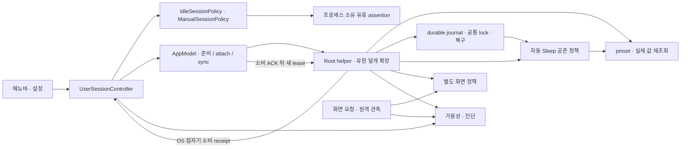
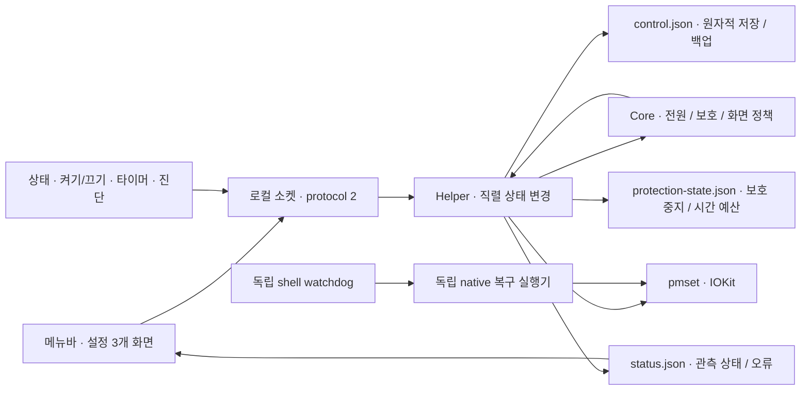

# Tether 아키텍처

2026-10-06: **다음 개발은 [새 기능 정의](PRODUCT-SPEC.ko.md)와 [실행 설계 v3](ARCHITECTURE-REDESIGN.ko.md)를 따른다. 이 파일은 현재/이전 구현 기록이며 v3 구현 완료의 증거가 아니다. 기존 중복 정책·240분·재시도 설계는 새 계약으로 자동 채택하지 않는다.**

2026-10-06 · 현재 작업 트리 기준. 제품 요구와 한도는 [기능 정의](PRODUCT-SPEC.ko.md), 수정한 결함·남은 출하 조건은 [설계 재검토](ARCHITECTURE-REVIEW.ko.md)를 따른다. [경쟁 앱 심층 조사](COMPETITOR-DEEP-RESEARCH.ko.md)의 새 트리거·UX는 추가 제안이다. 아래 현재 구조와 이후의 과거 빌드 기록을 구별한다.

## 현재 책임 경계

일반 작업 유지는 사용자 프로세스의 UserSessionController가 전원 트리거와 선택한 수동 요청을 합쳐 결정하고 IdleAssertionDriver가 자체 native 요청을 관리한다. AppModel은 덮개 확장이 필요할 때 준비 receipt·최신 설정·GUI 권한을 확인하고 유한 lease를 root helper에 전달한다. helper는 덮개 전역 변경과 독립 보호·복구를 담당한다. 화면과 원격 관측은 별도 경계다.

| 계층 | 현재 책임 | 제약 |
|---|---|---|
| 사용자 세션 정책 | 시작 사유·명시적 종료·수동 타이머·배터리 예산·사용자 소유권 | OS suspend는 현재 요청·임시 시간을 끝내고 사용자 종료·끄기·보호 의도는 보존. full wake에서 유효 전원 조건만 재평가 |
| native 실행기 | 자체 assertion 생성·갱신·관측·해제와 OS 유한 만료 | 확인 불가 중 갱신 금지. 변경 없는 기존 lease는 새 IPC 없이 마지막 확인된 유한 마감 안에서만 보존 |
| AppModel의 덮개 연계 | 준비·최신 receipt·epoch/revision·GUI 권한 검증 뒤 attach/sync, 늦은 응답 검사 | OS 잠자기로 lease가 소비되면 앱 연결이 남아 있어도 유한 재준비. 일반 유지와 관리자 덮개 기능의 가용성 구별 |
| root helper | 최신 자체 lease에 한정한 덮개 제어, 독립 보호, 실제 값 확인 | OS 잠자기는 저장·캐시된 grant도 소비. 같은 부트 소비 receipt를 앱이 확인한 결정만 재수락. 전역 bool의 배타적 커널 소유권을 주장하지 않음 |
| 화면·원격 관측 | 위험한 전체 화면 명령 보류, 제한·오류·실측 증거 표시 | 원격 연결·조회 실패로 작업을 시작/종료하지 않음. 무잠금 경로는 미확정 |
| 공통 시스템 설정 관측 | 화면 꺼짐 후 암호 요구와 로그인 자동 실행 등록·launchd 차단을 읽어 UI 갱신 | OS 정책 쓰기 없음. 잠금 상태·BTM/MDM 승인·실제 무잠금의 증거로 확대하지 않음 |
| watchdog·RecoveryCLI | 공통 lock과 작성자 journal로 자체 변경 복구. 정상 helper와 같은 자동 Sleep 정책 | 현재 GUI 확인 뒤 최종 native 경계에서 조건·작업 요청 재조회. unknown·AC·열림·DarkWake·유효 작업 요청은 자동 Sleep 보류. 실제 원복 전 clean 판정 금지 |
| 업데이트·이관 | 앱과 관리자 도우미의 별도 교체·호환 확인, 설정·끄기·보호 보존 | 소스 시험과 실제 구버전 교체의 합격을 구별 |

수동 옵션은 AC에서 무제한/시간 제한, 배터리에서는 최대 2시간이다. 기본 전원 트리거와 기존 자동 배터리 한도는 별도다. macOS 26 이상·Apple Silicon Mac 전체가 대상이며, 데스크톱 일반 유지에 배터리·덮개 기능을 강제하지 않는다. 신규 MacBook의 관리자 없는 일반 유지 경로와 기존 root 제어의 안전한 이관 경로를 구별한다.

AC에서 시작한 수동 옵션은 전원 분리 시 기본 종료하며, 명시적으로 선택한 시간에만 배터리로 이어간다. 선택만 저장하고 활성 세션·마감은 저장하지 않는다. 도우미가 먼저 분리를 관측한 마감은 앱에 전달해 같은 시간을 다시 지급하지 않는다. 자동 배터리 조건과 직접 예약은 이 선택에 종속되지 않는다.

ClosedLidSleepTracker는 실행 중 실제 자체 덮개 유지 이력이 있는 세션의 종료 책임을 원복 뒤에도 최대 90초 보존한다. 검증된 native handoff는 이 이력을 지우지 않으며 처음부터 macOS 기본 클램쉘만 사용한 경우에는 새 책임을 만들지 않는다. 외부 system assertion·조회 실패는 유한 보류, 화면/네트워크 요청만 있는 경우는 잠자기 거부 사유가 아니다. 덮개 열림·전원 변경·OS 잠자기·GUI 불확실·타 작성자 전역 override·기한 만료는 요청 직전에도 확인해 옛 재시도를 취소한다. 화면 명령은 기존 별도 공존 정책을 따른다.

현재 화면 실패가 작업 유지 종료로 번지는 결합은 해소되어 있다. Sleep 재평가·관측 불가 lease도 소스 수정·회귀 검증했다. 실제 화면 절전/무잠금·OS 호환·실기기 전원 전환·실제 업데이트의 합격은 설계 재검토에 별도로 기록한다.

SystemSettingsMonitor는 기존 앱 갱신 주기에서 최대 15초마다 조회하며 시스템 설정에서 돌아온 직후와 Wake에는 재조회한다. 암호 정책 근거는 45초 뒤 만료되고 실패·잠자기·사용자 세션 변경에는 확인 불가로 돌아간다. 앱의 로그인 등록 변경보다 먼저 시작한 읽기 결과는 폐기한다. 등록과 launchd 차단은 구별하며 외부 차단을 자동 해제하지 않는다. 읽기 완료가 유지 요청·배터리 예산·전원 트리거를 수정하지 않는다. [구현·검증·미완성 경계](ARCHITECTURE-REVIEW.ko.md#r32-공통-시스템-설정-연동과-잠금-계약-정정).

퇴역한 온도·발열 추천 엔진과 사용하지 않는 앱 상태·통계 getter·중복 절전 요청 조회를 제거했다. `SettingsMigration`에는 구버전 측정 기반 배터리 시간 한도를 한 번 고정하는 계산만 남긴다. CLI와 진단은 명시적으로 저장한 한도를 직접 읽는다. 앱 설정의 설치·서비스·전원 진단은 진단 항목을 열거나 다시 점검할 때 한 번 실행하고 점검 시각을 표시하며, 15초 반복 조회는 하지 않는다. 실시간 전원 상태, 충돌 안내, 보호·watchdog, 원본 백업·이관·복구 경로는 유지한다.

이번 정식 앱 대조에서는 생산 호출이 없는 ScreenPolicy와 비활성 sleep-drain 알림을 제거하고, watchdog의 중복 shell 잠자기 조건을 Core 정책으로 합쳤다. 화면은 Helper+Display·DisplaySleepGate 한 실행 경로로 검증하며 화면 실패를 작업 종료 사유로 사용하지 않는다. 구버전 원복 어댑터·유한 lease·소유권·보호 예산·서명·이관 백업은 필요한 경계이므로 유지한다. PreferenceMigration은 완성·동기화한 임시 백업만 독점 원자 게시하며 기존 원본을 덮어쓰지 않는다. 종료 시각 입력은 선택한 절대 날짜를 표시·확인에 공유한다.

쓰기 구성의 호환 요구는 coordinator 6, recovery executor v2, writer gate v3다. coordinator 5 이하가 새 수동 배터리 선택 검증을 제공한다고 오인하지 않으며 같은 표시 버전·빌드라도 계약이 다르면 새 덮개 권한을 주지 않는다. lease·journal 기존 디코딩 schema는 유지하고 선택 필드로 과거 상태를 읽는다. 보호·off·시간 예산을 확인할 수 없는 구형 도우미 이관을 무조건적인 fallback으로 우회하지 않는다. 검증한 빌드 49의 protocol2만 열린 덮개·현재 OS 관측·same epoch/자체 PID의 detach를 확인하고 일반 native 제어로 이관한다. 공개되지 않은 예산은 부트 시작부터 소비한 것으로 처리하고 임시 요청은 재생하지 않는다. 다른 버전/프로세스·관측 실패는 새 덮개 요청을 만들지 않는다.

helper 재시작 이후 Sleep은 실행 중 lease, 새 준비, 저장된 옛 lease 순으로 신원을 확인한다. GUI의 새 Workspace Sleep 경계는 중복된 옛 소비 receipt로 사라지지 않으며 원래 capture 시각 이전의 임시 요청을 소비한다. 확인된 자체 detach 또는 정상 제거만 root receipt 의존을 끝낼 수 있고 단순 조회 실패는 그 근거가 아니다. 제거 시 malformed/unreadable 복구 기록은 삭제하지 않고 보존한다.

IOKit 잠자기·깨움 observer가 등록되지 않으면 새 덮개 권한과 최종 전역 override 획득을 거부한다. 빈 준비·요청과 자체 해제·복구는 계속 가능하다. 최신 준비 뒤 자체 detach·마지막 보호/예산을 확인한 GUI는 root receipt 의존을 끝내고 일반 native 유지만 제공한다. installer readiness는 명시적인 등록 실패를 정상 덮개 준비로 표시하지 않는다.

사용자 명령 socket과 coordinator lock은 `~/Library/Application Support/io.github.jukqaz.tether`의 같은 개인 디렉터리에 둔다. 디렉터리 0700과 endpoint 0600을 검사한다. URLSession이 사용하는 0755 네트워크 캐시 디렉터리와 섞지 않으며 기존 캐시의 권한을 바꾸지 않는다. 최초 `prepareWorkSession`도 attach와 같은 현재 console·커널 GUI login/PID·승인 UID·생존 소유자 검사를 통과할 수 있다. 유효한 빈 lease·epoch/revision을 확인한 뒤에만 소유자를 등록하므로 아직 소유자가 없는 첫 연결이 스스로 막히지 않는다.

도우미 설치는 고정 `/usr/bin/osascript`의 정상 macOS 관리자 인증을 비동기로 기다린다. 설치 중에도 UI·IPC·heartbeat가 진행되며 중복 설치와 제거는 거부한다. stderr는 계속 배출하되 16KiB까지만 보존하고 프로세스 종료와 EOF를 모두 확인한다. 자동 설치 직전에 최신 helper를 다시 조회하고 설치 뒤 공유 readiness 계약을 통과한 경우에만 완료로 표시한다. 프로토콜 메타데이터는 보호 안내의 표시 상태와 분리해 정상 helper를 구버전으로 오인하지 않는다. 인증 취소·실패는 설정과 미완료 업데이트를 보존한다.

앞선 정리의 검증은 Swift 712개 중 705개 통과·실제 전원 요청 opt-in 7개 미실행, 격리 helper/installer 시나리오 63개 통과였다. 이번 추가 결함 수정의 검증은 [설계 재검토](ARCHITECTURE-REVIEW.ko.md)에 따로 기록한다. 소스·모의·IPC 결과이며 설치본 교체·실기기 화면/잠금 동작의 완료를 뜻하지 않는다.

## 빌드 49와 이전 구조 기록

이하 본문은 재설계 전 구조와 이전 빌드의 변경 이력이다. 특히 관리자 중심 일반 유지, 모든 배터리 요청 최대 4시간, 화면 실패 시 작업 중지라는 서술은 현재 세션 구조의 설명으로 사용하지 않는다. 현재 계약은 위 책임 표와 기능 정의가 우선한다.

2026-09-30 재설계 기준: 다음 개발은 [기능 정의](PRODUCT-SPEC.ko.md)와 [재설계 아키텍처](ARCHITECTURE-REDESIGN.ko.md)를 따른다. 최소 OS는 macOS 26 이상이다. 아래는 재설계 전 빌드 49 이후 소스의 구조 기록이며, 원격 무잠금·전 Apple Silicon 대응의 목표 구조가 이미 구현됐다는 뜻은 아니다.

Tether는 선택한 전원 조건에서 클램쉘을 유지하고, 시간·배터리·발열 한계에 도달하면 종료하는 작은 앱이다. 앱·CLI는 의도를 전달하고, 일반 전원 변경은 관리자 도우미가 처리한다. watchdog·설치·제거의 복구는 같은 lock과 작성자 journal을 사용하는 고정 복구 실행기로 직렬화한다.

### 경계와 책임

| 계층 | 책임 | 하지 않는 일 |
|---|---|---|
| `TetherCore/Policy` | 순수 전원 정책, 배터리 제한, 공개 OS 발열 판단, 보호 중지, 자동 타이머 진입 판단, 화면 절전 조건 | 파일 쓰기, 프로세스 실행, 권한 요청 |
| `TetherCore/IPC` | 버전 검사, Unix 소켓, peer UID 및 커널 제공 PID 검증, 읽기·설정 계약, 원자적 저장 | 임의 명령 실행, 작업 세션, 플러그인 호출 |
| `TetherHelper` | 센서 읽기 → 보호 판단 → 상태 저장 → OS 적용 → 결과 보고. 모든 변경은 main queue에서 직렬화 | 범용 앱 관리, 범용 규칙 엔진, Agent/MCP |
| `Tether` | 클램쉘 / 배터리·과열 보호 / 시스템·진단 화면, 알림, 명확한 오류 표시 | 직접 전원 변경, 화면 잠금 해제, 유휴 타이머 대체 |
| `TetherCLI` | 동일 서비스로 상태·켜기/끄기·배터리 타이머·진단 | `run`, 세션, 규칙, 프로필, MCP |
| watchdog | 도우미가 90초 이상 보고하지 않으면 같은 부팅의 Tether 변경 기록을 확인해 해당 절전 방지만 해제하고, 배터리·닫힌 덮개·full wake를 재확인해 절전 요청 | 강제 깨우기, Dark Wake 유지 |
| `TetherRecoveryCLI` | 공통 flock과 작성자 수명 확인, 고정 복구 명령의 journal·종료 관측 | IPC·서비스 시작, 절전 방지 획득, 임의 명령 |

복구 실행기와 도우미 대체 경로가 모두 사용 불가하면 기록 없는 전원 쓰기로 우회하지 않는다. 새 root 작성자는 PID·시작 신원을 내구성 있게 저장한 뒤 전용 파이프로 허용하며 같은 PID로 고정 명령을 exec한다. 허용 전 부모 사망은 명령을 실행하지 않고 취소한다. 포장·설치·원복과 실행 순서 검증, 남은 한계는 [독립 실행기 단계](RECOVERY-EXECUTOR-20260930.ko.md)와 [작성자 대기 경로](WRITER-GATE-20261001.ko.md)에 구분한다.

### 전원 조건

`enabled`는 사용자의 영구적인 켜기/끄기이고 `powerCondition`은 `ac`(기본), `battery`, `any` 중 하나다. 수동 끄기는 케이블 재연결이나 재시작으로 취소되지 않는다.

| 조건 | 전원 연결 중 | 배터리 사용 중 |
|---|---|---|
| `ac` | 클램쉘 허용 | 해제. 사용자가 직접 시작한 배터리 타이머만 예외 |
| `battery` | 해제 | 전환 시 제한 시간 타이머 시작 |
| `any` | 클램쉘 허용 | 전환 시 제한 시간 타이머 시작 |

덮개 열림/닫힘과 무관하게 같은 조건을 적용한다. 허용되지 않는 상태에서 이미 덮개가 닫혀 있으면 절전 방지 플래그 해제만으로 끝내지 않고 필요할 때 시스템 절전을 요청한다. AC와 외장 모니터가 연결되면 추가 잠자기 금지를 해제하고 macOS에 맡긴다. 이때 일반 끄기·타이머 취소는 잠자기를 요청하지 않는다. 이미 잠든 Mac을 전원 연결만으로 강제 깨우지 않는다.

`AutomaticHoldGate`는 조건에 진입했을 때 한 번만 자동 타이머를 시작한다. 취소한 타이머는 같은 조건에서 다시 생기지 않는다. Dark Wake 진입·종료는 새로운 전원 전환으로 취급하지 않는다. Dark Wake 중 전원 전환은 새 타이머를 만들거나 나중에 예약 실행하지 않는다. 도우미 재시작 시 현재 배터리 조건을 이미 진입한 상태로 초기화해 기존 타이머를 갱신하지 않는다. 명시적인 다시 켜기 또는 새로운 전원 조건 진입이 필요하다.

### 보호 불변조건

- 배터리 유지는 자동·수동 모두 기본 잔량 20%, 최대 4시간. 사용자 설정은 더 엄격하게만 적용한다.
- macOS serious/critical을 관측하면 자체 유지를 중단한다. AC + 물리 외장 화면은 기본 관리 경로이므로 보호 잠자기를 강제하지 않는다. 가상 화면만 있을 때는 Tether가 유지를 제공하므로 같은 보호를 적용한다.
- 필수 배터리 잔량·공개 발열 상태가 없으면 자체 유지를 허용하지 않는다. 선택적 섭씨 센서는 진단용이다.
- 약한 충전기로 배터리가 하한까지 감소하는 경우에도 기존 보호 판단을 유지한다.
- 보호 중지는 `ProtectionState.blockReason`으로 남고 자동 해제되지 않는다. 직접 재개할 때 OS 발열·잔량·전원과 복구 상태를 확인한다.
- `mach_continuous_time`은 시스템 절전 시간을 포함하고 시계 변경에 영향받지 않는다. 개별 타이머의 단조 시간 마감과 공통 배터리 시간 예산을 모두 적용한다.
- 취소·연장·도우미 재시작은 공통 배터리 시간 예산을 갱신하지 않는다. 30초 이상 연속 AC 관측이 새 예산을 허용한다. 최대 시간 중지는 배터리에서 직접 재개할 수 없다.
- 보호 상태를 저장하지 못하면 유지를 차단한다. 보호 상태 파일이 손상되어도 기본 허용 상태로 되돌리지 않는다.
- 새 세션은 전원 모드를 변경하지 않는다. 과거 모드 복원 전용 경로는 기록을 보존하며 사용자 중간 변경을 우선한다.

### 디스플레이

밝기·감마·화면 유지 assertion은 사용하지 않는다. 닫힘 + 자체 유지 + 외장 없음 + full wake에서 화면 절전을 관측하고, 사건당 3회/최소 10초 간격으로 복구한다. 60초 연속 절전 관측(표본 간격 최대 10초) 뒤에만 예산을 갱신한다. 지속 미확인·재점등·명령 실패는 중지한다. 상세 상태는 `DisplayRecoveryStatus`를 통해 앱·CLI·보고서에 공유한다.

이 명령은 전체 디스플레이를 대상으로 하므로 외장 모니터가 있을 때는 호출하지 않고 macOS의 기본 내장 패널 절전 동작을 따른다. 실제 온라인 디스플레이 목록을 CoreGraphics로 읽는다. `AppleClamshellCausesSleep`은 Tether의 절전 방지에 의해서도 변하므로 외장 화면 판별에 사용하지 않는다. 목록 조회 실패는 unknown으로 남겨 추가 유지를 보류한다. 외부 화면이 관측되어도 물리·가상 유형은 공개 관측만으로 확정하지 않는다.

`CGDisplayIsAsleep`의 관측 결과를 `displaySleeping`으로 보고하며 확인할 수 없으면 nil이다. 명령 성공과 관측은 분리한다. 절전 상태가 실제 패널 전원 차단을 얼마나 반영하는지, 덮개를 열 때 정상 복귀하는지는 대상 Mac에서 물리 검증한다. 화면 잠금은 macOS 설정을 유지한다.

기존 버전이 저장한 밝기·키보드 조명 값은 화면이 다시 보일 때 한 번 복원한다. 새 버전은 이 값을 낮추거나 저장하지 않는다.

### 저장과 이관

- `control.json`: root 소유, 0644. 변경 전 마지막 정상 상태를 0600 백업에 저장하고 새 파일을 fsync 후 원자적으로 교체한다. epoch/revision CAS로 동시에 바꾼 설정 유실을 방지한다.
- `protection-state.json`: root 전용 0600. 보호 중지 이유와 같은 부팅의 배터리 시간 예산을 보관한다. 구버전 온도 지속시간은 복원하지 않는다.
- `power-ownership.json`: root 전용 0600. 현재 부팅 식별자, Tether 변경 여부·시각. 전역 값의 배타 소유권을 보장하지 않는 복구 기록.
- `helper-state.json`: 인증된 앱 PID·시작 시각·UID, 사용한 타이머 식별자와 원래 저전력 설정. 도우미 재시작 시 기존 타이머를 소비 처리한다.
- `status.json`: 읽기 전용 관측 결과. 정책 의도와 센서·디스플레이 관측, 적용 오류를 구분한다.
- `usage.json`과 회전 로그: 기존 데이터 형식을 유지해 최근 절전·온도 진단에 사용한다. 상세 통계 화면과 측정 기반 자동 한도 조정은 제거했다.

Control schema 0/1/2를 원본 백업 후 schema 3으로 이관한다. 에너지 모드와 섭씨 제한은 제거하며 기존 잔량·시간·전원 조건을 유지한다. 직접 온도 제한을 쓰던 세션은 한 번 중지한다. 퇴역한 옵션은 GUI뿐 아니라 도우미 configure에서도 거절한다. 과거 비활성 프로필·수동 중지·보호 기록은 보존한다.

### 검증

1. 순수 정책 테스트: 전원×덮개, 수동 중지, Dark Wake, 배터리 하한·열·시간, OS 발열 상태, 이관.
2. 실제 helper/CLI + 임시 JSON 센서 + `--dry-run`: 동시 설정, 소켓 계약, 타이머 취소/만료, 재시작, 손상 파일, 기본·역방향·양쪽 전원 조건, 화면 절전 요청/외장 화면 제외.
3. 독립 watchdog은 shell 함수로 실제 전원 명령을 대체해 AC·배터리·실패·재확인 시나리오를 검증한다.
4. `Tether Preview.app`은 임시 폴더의 비관리자 dry-run 도우미만 사용한다. 로그인 항목·화면·실제 전원 설정을 변경하지 않는다.
5. 실기기 완료 조건: 두 가지 케이블/덮개 순서, 디스플레이 절전과 다시 열기, 외장 모니터 유지, 원격 연결 상태를 고정한 시스템 절전 로그. dry-run, 플래그 해제, 명령 성공은 물리 절전의 증거가 아니다.

### 업데이트 경계

앱 번들 교체는 Sparkle 2.10.0이 서명된 피드·압축 파일을 검증한 뒤 담당한다. 도우미는 별도 관리자 단계에서 버전·빌드·프로토콜을 확인하며 갱신한다. 설치기는 기존 파일을 백업하고 실제 소켓 준비 확인에 실패하면 복구한다. `SettingsMigration`은 원본 바이트 백업 이후 schema를 변환하고, `PreferenceMigration`은 기존 사용자 선택과 원본 도메인을 보존한다. [업데이트·이관 계약과 검사](UPDATES-AND-MIGRATION.ko.md)를 따른다.

### 빌드 27 보완

서비스 상태 조회는 읽기 전용이며 `ServiceConnection` actor가 UI 외부에서 통신한다. 충전 중 수동 유지는 `pendingHoldMinutes`로 예약하고 분리 시 시작한다. 일반 타이머 만료와 공통 배터리 시간 소진(`budget`)을 구분한다. 최신 동작·최적화·기본 클램쉘 공존 경계는 [신뢰성 개선](RELIABILITY.ko.md)을 따른다.

### 빌드 28: 근거와 UX

공개 Foundation 발열 알림은 초기 thermalState 읽기 후 등록한다. serious/critical을 OS 유지 명령보다 먼저 처리한다. 전원 모드 복원 전용 코드, 과거 기준 해석 `LegacySafetyPolicy`, 현재 `SafetyPolicy`를 구분한다. [보호 기준](PROTECTION-EVIDENCE.ko.md)과 [최종 기능](FINAL-SCOPE.ko.md)을 따른다.

### 빌드 29: 연결 수명과 관측·적용 분리

`PowerOwnership`, `DisplaySleepGate`, `StablePowerGate`는 순수 상태 판단을 담당한다. `Helper+Ownership`은 변경 전 기록 저장, OS 적용 후 재조회, 앱 프로세스 수명을 관리한다. production은 인증된 앱 연결이 있을 때만 추가 유지를 허용한다. 앱 종료 시 설정 의도를 보존하고 임시 유지·예약을 소비한다. 실제 프로세스 종료 이벤트와 시작 시각 재확인이 보완 관계라 정상 잠자기를 heartbeat 누락으로 오인하지 않는다.

CPU·다른 앱 조사는 GUI의 `PowerActivityInspector`에서 비관리자로 실행한다. `ProcessCPUProbe`는 libproc의 PID·시작 시각·이름·누적 CPU 시간만 읽는다. 읽기 불가·일부 관측·PID 재사용을 구분하고, 2초 표본 후 UI가 표시한다. 상시 프로세스 감시나 관리자 앱 종료 API를 추가하지 않는다. 자세한 상태 계약은 [빌드 29 문서](COORDINATION.ko.md)를 따른다.

### 빌드 30: 화면 연결 원인 판정

`DisplayProbe.observations()`는 CoreGraphics의 현재 화면 ID·내장 여부·제조사/제품·크기·활성/절전 상태를 읽는다. 정책 루프는 이 경량 API만 사용한다. `inspect()`는 사용자가 점검할 때만 4초·512KiB 제한의 system_profiler를 실행하고, 다시 읽은 CoreGraphics 관측과 화면·제조사·제품 ID가 모두 같은 단일 항목을 대조한다. 이름만으로 가상 화면을 판정하지 않으며 직렬번호·EDID·UUID는 결과 모델에 보관하지 않는다.

현재 Mac에서 교차 확인한 Splashtop 식별 패턴은 가상 화면으로 구분한다. 일반 HDMI/DisplayPort, USB, AirPlay/Sidecar는 시스템이 제공하는 연결 토큰에 따라 설명한다. DisplayLink/USB를 일괄 가상 화면으로 분류하지 않는다. 상세 연결 토큰이 없으면 확인한 이름·크기를 먼저 표시하고, 정보가 없는 구체적인 이유는 판정 근거에 둔다.

`virtualOnly`는 `usesNativeClamshell`로 표시하거나 시스템 유지 해제 사유로 사용하지 않는다. 전원 조건에 맞으면 자체 유지·열/잔량 보호를 계속하되, 전체 화면 끄기는 생략한다. `mayHaveExternal`은 가상 화면을 포함한 화면 절전 범위이며 `mayHavePhysicalExternal`은 기본 클램쉘에 맡길 수 있는 구성을 구별한다. 미확인 화면을 물리 화면 없음으로 간주하지 않는다. 원격 화면 감지는 실제 원격 접속 성공·잠금 해제의 증거가 아니다. 공개 API 조회 오류·빈 로그인 세션·전환 중 목록 변경·system_profiler 지연/형식 변경은 각각의 원인으로 설명한다.

### 진단 경로 (빌드 37)

GUI/CLI → 인증된 로컬 서비스의 `configure`·`markDiagnostic` → helper의 관측/명령/판단 로그. `debugLogUntil`은 기존 schema 2의 선택 필드이며 기존 무기한 명시 설정은 보존한다. 상세 기록과 전원 활성화는 별개다. 로그는 열린 inode를 유지하며 복사 후 비우고 최근 3개를 보관한다. 보고서는 읽기 전용으로 보관 로그와 현재 상태를 수집하고 자유 입력인 assertion payload를 제외한다. dry-run 보고서는 임시 경로로 격리한다. [상세 설명](DIAGNOSTICS.ko.md).
