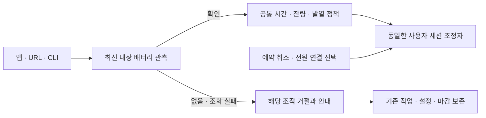

# 기기에 맞는 배터리 조작과 공통 작업 유지

2026-10-01 · 빌드 50의 미배포 소스. [모든 Mac·원격 협력 계약](MAC-REMOTE-COOPERATION.ko.md)과 [실행 중 기기 조회 처리](CAPABILITY-REFRESH-20261001.ko.md)의 후속 보완이다. 설치본은 빌드 49다.

## 수정한 문제

데스크톱에서 일반 세션을 제공하면서도 앱·URL·CLI가 노트북의 배터리 예약과 배터리 전용/전원·배터리 조건을 받아들였다. 설정 화면도 세 가지 조건과 배터리 자동 시간을 노출했다. 기존 CLI 시험은 데스크톱 fixture에 배터리 명령의 성공을 기대해 이 문제를 놓쳤다.

현재는 명령 직전에 내장 배터리 특성을 다시 읽어 같은 판정으로 집행한다. 화면이나 원격 출력이 있다는 사실은 배터리 기능의 근거가 아니다. UPS를 내장 배터리로 계산하지 않는 기존 기기 조회 규칙을 그대로 사용한다.

| 내장 배터리 관측 | 새 예약·연장·배터리 조건·자동 시간 변경 | 기존 설정·작업 | 제공하는 조작 |
|---|---|---|---|
| 확인됨 | 기존 전원·시간·잔량·발열·GUI 정책으로 판단 | 기존 한도 유지 | 전원/배터리 조건과 배터리 시간 |
| 없음 | `notApplicable` | 저장된 조건·꺼짐을 보존. 일반 수동·AC 자동 유지 지속 | 전원 연결 조건, 일반 세션, 기존 예약 취소 |
| 조회 실패 | `batteryCapabilityUnavailable` | 관측 실패만으로 세션·원래 마감·예약을 지우지 않음 | 일반 세션, 전원 연결 조건, 기존 예약 취소 |

일반 전원·잔량·발열 입력 자체가 유효하지 않으면 기존 보호 정책을 계속 적용한다. 위 표는 기기 특성 조회 하나만 실패한 경우의 분리이며 보호 우회가 아니다. 덮개 확인이 없어도 내장 배터리가 확인되면 배터리 기능을 제공한다.

## 공통 집행과 표시

`AppModel.validateBatteryAction()`을 앱·URL·CLI의 신규 배터리 조작이 함께 사용한다. 기기 조회 회복 시 이 기능이 만든 오래된 안내만 갱신/해제한다. 다른 오류는 지우지 않는다. 일반 세션 조정자를 교체하거나 별도 전원 작성자를 만들지 않는다.

데스크톱/미확인 기기의 조건 선택은 전원 연결만 보여 준다. 가져온 배터리 조건은 보존 사실과 사용자가 바꿀 수 있는 선택을 설명하며 자동으로 AC 조건으로 덮지 않는다. 새 배터리 시간 선택은 숨기되 기존 예약/카운트다운의 취소는 남긴다. CLI 상태의 `canStartBatteryHold`도 기능 가용성과 일치한다. 거절 명령은 기존 CLI 계약대로 종료 코드 1과 stderr 안내를 반환하며, 이후 `status --json`으로 실제 상태를 다시 확인한다.

## 확인 범위와 남은 검증

- 수정 전 회귀 3개에서 26개 실패를 재현했다. 같은 기기 조회 회복 시험에 오래된 UI 안내의 실패도 추가로 재현해 수정했다.
- 최종 Swift 547개(Core 467 + 앱·업데이트 80), 실패·건너뜀 0. 추가 회귀 4개와 기존 비관리자 native assertion 6개가 이 전체 실행에 포함된다.
- 포장 CLI에서 같은 실제 프로세스·소켓 3개를 재확인했다. arm64·최소 OS 15 메타데이터·deep/strict ad-hoc 서명·리소스 일치·격리 helper/CLI dry-run도 통과했다. 이 검사는 설치·최소 OS 런타임·서명된 배포 아카이브/feed 검증이 아니다.
- 데스크톱/노트북 구분은 주입한 특성이다. 실제 CLI 프로세스와 private 앱 명령 소켓은 사용하지만 신규 정책 시험의 assertion backend는 fixture다. 실물 데스크톱·UPS·센서 장애·원격 접속 완료로 확대하지 않는다.
- 렌더링용 데스크톱/미확인 특성은 private 환경설정과 OS 요청을 만들 수 없는 backend를 쓴다. 화면 배치 확인은 실제 앱 UI 승인이나 macOS 15 실행의 증거가 아니다.

설치본 정보의 SHA-256과 `pmset -g custom`은 검사 전후 동일했다. 공통 Core 변경을 포함한 재빌드에서 후보의 도우미와 복구 바이너리도 이전 후보와 바이트가 달라졌으나 이 단계에서 root 실행기 소스·설치 리소스는 수정하지 않았다. 현재 후보 전체를 다시 포장·검사했고 설치본은 교체하지 않았다.

기기별 실행, 실제 root 해제 효과와 Sleep/Wake, 원격 화면·입력·잠금, 최소 OS, 이전 버전 전체 업데이트의 완료 조건은 남아 있다. 잠금 설정·원격 앱 설정·전원 설정 변경을 이 보완에 포함하지 않는다.

근거는 작업 폴더 `work/tether-battery-capability-20261001`의 원본 백업, 실패/최종 로그, 포장 검사, source 단계 diff와 시각별 manifest에 남긴다. CLI JSON 반환과 연장 문법을 잘못 가정한 시험 오류, preview backend의 첫 컴파일 오류는 제품 동작 실패로 계산하지 않는다.
