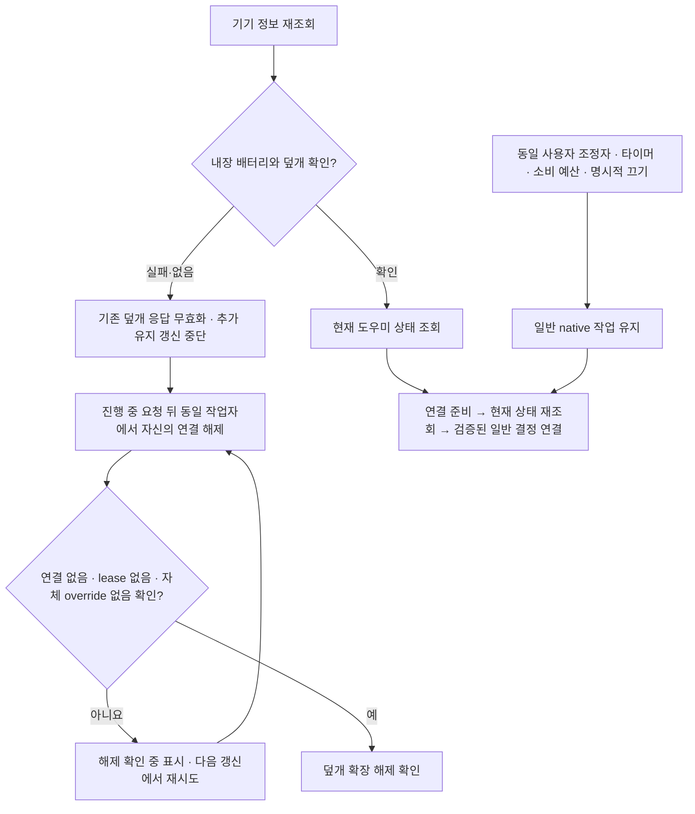

# 실행 중 기기 조회 실패·회복 처리

빌드 50 미배포 후보에서 기기 지원 여부를 시작 시점 값에 고정하던 문제를 수정했다. 기존 일반 작업 조정자는 유지하고, 내장 배터리·덮개 지원을 다시 확인할 때 덮개 연결만 해제·재준비한다. 설치본은 빌드 49이며 이번 후보를 설치하거나 배포하지 않았다.

## 처리 구조

`AppModel.refresh()`가 공개 전원 정보·IORegistry 읽기로 `MacCapabilities`를 갱신한다. 기존 15초 갱신 및 기존 경로에 등록된 사건 알림을 사용하며, 신규 고빈도 폴링이나 별도 정책 작성자를 만들지 않는다. UI와 CLI는 같은 최신 판정을 사용한다. 실제 센서 장애의 최악 감지 지연을 측정한 것은 아니다.

| 전환 | 일반 작업 | 덮개 확장 |
|---|---|---|
| 초기 조회 누락 → 확인된 MacBook | 같은 조정자·원래 마감 유지 | 기존 호환 도우미의 새 준비 증거로 연결 |
| 확인된 MacBook → 조회 누락·기능 없음 | 기존 타이머·소비 예산·중지 유지 | 추가 grant 중단, 자신의 연결 해제 |
| 준비/연결 ACK 전에 누락 → 즉시 회복 | 원래 세션 유지 | 세대 번호로 오래된 응답 거절, 해제 후 새 준비 |
| 해제 요청 실패 또는 성공 ACK에 해제 관측 없음 | 건강한 일반 작업 유지 | `pending` 표시, 해제 확인 전 유지 갱신·재연결 금지 |
| 이미 해제된 연결에 `notOwner` | 그대로 유지 | 새 조회에서 실제 해제 상태를 확인해야 완료 |
| 기기 판정이 그대로 | 재생성 없음 | 반복 detach/prepare 없음 |

지원 플랫폼은 기존 macOS 15+ arm64다. UPS는 내장 배터리로 취급하지 않는다. 기기 유형·배터리 관측 누락만으로 일반 native 절전 방지까지 중단하지 않는다. 발열·잔량·GUI 권한 등의 독립적인 보호 판단은 그대로 적용한다. 화면 절전·잠금·원격 앱 권한을 변경하지 않는다.

## 연결 순서와 실패 경계

- 덮개 지원 여부가 바뀌면 상태 조회와 작업 연결의 세대 번호를 바꾼다. 모든 비동기 준비 ACK·현재 상태 조회·attach/sync ACK·실패 후 조회 뒤에 현재 세대를 다시 검사한다.
- 오래된 요청이 이미 root에서 수락됐을 수 있으므로 취소했다고 가정하지 않는다. 동일한 직렬 작업자가 그 요청 뒤에 `detachApp`을 보낸다. 커널에서 확인한 자신의 호출 신원으로 해제한다.
- ACK 성공만으로 해제를 완료하지 않는다. 응답의 `appConnected=false`, `workSession=nil`, `ownsOverride=false`가 모두 필요하다. `notOwner`는 같은 기준을 만족하는 새 snapshot이 있어야 인정한다.
- 해제에 실패하면 매번 갱신 시 한 번 재시도하고 오류를 표시한다. 그동안 새 유지 grant를 보내지 않는다. 기존 공통 root lease에는 최대 90초 마감이 있지만, 이 수치는 실제 root 복구 지연·Sleep/Wake 상한의 실측 증거가 아니다. 구버전 자율 실행기는 공통 유한 lease와 같다고 가정하지 않는다.
- 회복 후에도 해제 미확인 상태가 먼저 해결돼야 재준비한다. 같은 `UserSessionController` 객체·UUID를 유지하고 새 타이머를 시작하지 않는다. 기존 [설정 v4 이관·준비 후 재조회](SESSION-HANDOFF-20261001.ko.md)를 그대로 적용한다.
- CLI는 해제 미확인 상태를 `lidSupport=pending`으로 표시한다. 일반 유지 성공과 덮개 유지 성공을 합치지 않는다. 조회가 같은데 추가 설정 이관·연결 준비를 반복하지 않는다.
- 종료와 진행 중 해제가 겹치면 이미 해제됐음을 새 상태로 확인할 수 있다. 앱 전체 작성자 잠금은 실제 프로세스 종료까지 유지한다.

## 확인 결과

| 검사 | 결과와 범위 |
|---|---|
| 수정 전 논리 재현 | 새 회귀 7개에서 39 assertion 실패. 테스트용 기기 조회·전송 주입과 fixture만 먼저 추가한 상태 |
| 최종 전체 Swift | 543 통과(Core 467 + 앱·업데이트 76), 실패·건너뜀 0 |
| 추가 회귀 | 초기 회복, 누락/기능 없음, 준비·attach 지연, 즉시 회복, 해제 실패·거짓 성공 ACK·기존 해제, 배터리 예산·명시적 off 보존 등 9개. 전체 수에 포함 |
| native | 기존 비관리자 유한 IOKit 검사 6개가 전체에 포함. 기기 관측 전환 자체는 fixture |
| 도우미 IPC | 새 AC·배터리 2개를 debug와 포장 실행 파일에서 각각 통과. 실제 격리 소켓·커널 peer, OS 쓰기는 모두 dry-run |
| 포장 CLI | 전체 중 같은 실제 CLI 회귀 2개를 포장 실행 파일로 재실행해 통과 |
| 후보 포장 | arm64·최소 OS 15·deep/strict ad-hoc 서명·리소스 일치·fixture 제외·읽기 전용 설치 판정·격리 소켓/CLI 확인 |

도우미 시험은 자신의 detach, 오래된 sync/attach 거절, 같은 UUID로 재준비, 원래 수동 마감과 배터리 소비 시작 보존, 갱신 없는 유한 lease 만료를 확인한다. 앱 센서 장애나 실제 닫힌 덮개의 OS 반응을 재현했다고 표현하지 않는다.

첫 Swift 시도에서 잘못된 테스트 필드 이름으로 난 컴파일 실패, Python fixture의 잘못된 조건 raw 값·UUID 대소문자·금지된 자율 configure 호출도 별도 보존했다. 이들은 제품 결함 재현 수에 포함하지 않는다. 초기 기본 전체 실행은 opt-in native 6개를 건너뛰었고, 최종 `TETHER_RUN_LIVE_ASSERTION_TESTS=1` 실행에서 모두 포함했다. 최종 근거는 `swift-all-final.log`다.

증거·변경 전 원본·포장 manifest는 작업 공간의 `work/tether-capability-refresh-20261001/`에 보존한다. 기존 root·Core·설치 코드의 검사 기록은 이전 단계에 보존하며 이번 통과 수에 합산하지 않는다.

## 남은 검증

실제 센서 실패·회복, 데스크톱/UPS·독·외장 화면·원격 앱, 관리자 root 실행 효과·해제 지연, macOS 15 런타임, GUI hang/사용자 전환, 덮개/Sleep/Wake, Sparkle 전체 업데이트와 기존 설치본 인계는 남아 있다. 이 단계는 모든 Apple Silicon 모델의 실측 지원이나 모든 상황의 무중단 전환을 보증하지 않는다. 커밋·푸시·원격 CI·설치·릴리스도 이번 단계에서 하지 않았다.
