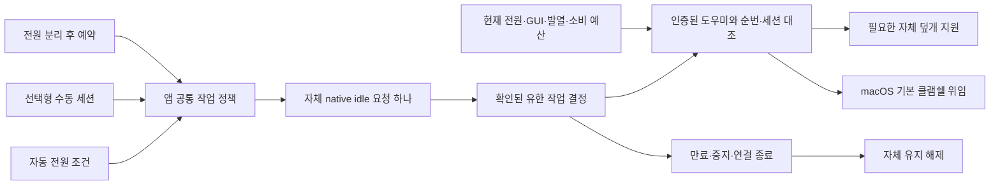

# MacBook 공통 작업 세션과 유한 덮개 지원

2026-10-01 미배포 빌드 50 후보의 구현·검증 기록이다. 현재 설치된 빌드 49는 교체하지 않았다. 일반 작업 유지와 MacBook 덮개 지원이 같은 작업 결정을 사용하도록 연결했으며, 실제 Sleep/Wake·원격·전체 업데이트 검증은 별도로 남아 있다.

## 동작 계약

| 조작·상황 | 현재 구현 |
|---|---|
| 자동 전원 조건 | AC·배터리·항상 중 선택한 조건을 평가한다. 일반 작업과 덮개 지원이 같은 결정을 사용한다. |
| 수동 AC 세션 | 자동 조건과 독립적으로 무제한 또는 최대 24시간의 시간 지정 세션을 선택한다. 무제한 선택에도 실행기의 건강 확인 마감은 유한하다. |
| 수동 배터리 세션 | 최대 2시간이며 기존의 더 엄격한 제한·소비 예산을 적용한다. 종료나 앱 재시작으로 소비 시간을 초기화하지 않는다. |
| 전원 분리 후 예약 | 명시적으로 예약한 시간은 배터리 전환 시 시작한다. 시간 선택만으로 수동 세션을 시작하지 않는다. |
| 자동 배터리 유지 | 별도 최대 4시간 예산과 더 엄격한 사용자 제한을 적용한다. 수동 2시간 예산과 혼동하지 않는다. |
| 자동 또는 수동 한 가지 종료 | 남은 유효한 이유가 있으면 일반 작업과 자체 덮개 지원을 유지한다. |
| 전체 끄기·앱 종료 | 자체 요청과 자체 덮개 지원을 해제한다. 앱 종료는 도우미의 해제 응답까지 확인한다. |
| 발열·잔량·관측 실패·시간 보호 | 해당 작업을 중지한다. 도우미가 확인한 발열·배터리·센서·시간·예산 차단도 앱 정책에 전달한다. |
| 덮개·화면 지원 오류 | 유효한 일반 작업 요청을 취소하지 않는다. 별도 경고와 명시적 다시 확인 동작을 제공한다. |
| macOS 기본 클램쉘 | 물리 외장 화면의 기본 경로를 위임한다. 원격 화면 연결은 작업 유지의 필수 조건으로 삼지 않는다. |

화면 절전과 화면 잠금은 서로 다른 상태다. 이 변경은 시스템 잠금 설정을 바꾸거나 잠금을 해제하지 않으며, 화면 꺼짐 관측을 패널 전력 0의 증거로 표현하지 않는다.

## 앱과 도우미의 역할

앱은 `UserSessionController`의 공통 정책에서 자동·수동 이유를 합치고, 실제 확보한 idle 요청을 확인한 뒤 도우미에 전달한다. 도우미는 인증된 연결, 현재 전원, 세션 UUID, 증가하는 순번, 최대 90초 건강 확인 마감을 대조한다. 이전 순번·다른 세션·무제한 IPC 마감·잘못된 배터리 수동 기한은 거절한다.

전원 명령의 실행 직전에도 보호된 세션 기록, GUI 신원, 제어 앱의 수명, 현재 전원·발열·잔량을 재확인한다. 이미 시작한 명령의 종료·복구는 별도 writer 거래가 담당한다. 저장 실패는 새 유지를 거절하고 자체 상태를 해제하는 평가 경로로 연결한다.

보호된 도우미 기록은 실행 경계의 근거와 소비 예산을 보존한다. 임시 활성 작업을 재시작 뒤 복원하는 허가로 사용하지 않는다. 도우미를 다시 시작하면 새 핸드셰이크가 필요하며, 공통 모드에서 구형 활성화 명령으로 자동 돌아가지 않는다. CLI의 공통 세션 시작 경로는 아직 구현·검증이 남아 있다.

외부 중지 뒤에는 앱의 비활성·빈 세션 응답을 확인하기 전까지 지연된 갱신을 거절한다. 자동·수동 중 하나를 종료하면 나머지는 유지한다. 덮개 지원 실패는 별도 상태로 표시하며, 명시적 다시 확인으로 덮개 차단을 재평가한다. 일반 요청과 도우미의 보호 중 발열·잔량·시간 보호만 공통 작업 종료에 반영한다.

90초 마감은 앱의 native idle 요청과 도우미 갱신 계약에 적용된다. `SleepDisabled`가 커널에서 90초 뒤 자동 해제된다는 뜻은 아니다. root 경로 전체의 실제 해제 상한은 도우미·watchdog·writer 복구를 포함해 별도로 측정해야 한다.

## 이전 설정 이관

사용자 세션 환경설정 v1/v2를 v3으로 이관하고 실제 원본 버전에 맞는 `.migration.v1.backup` 또는 `.migration.v2.backup`을 남긴다. 꺼짐 선택, 자동 조건, 선택한 시간, 더 엄격한 잔량·시간 제한, 부팅 내 소비 예산을 보존한다. 손상되었거나 미래 형식인 원본은 덮어쓰지 않는다.

선택 시간과 현재 허용 시간을 구별한다. 예를 들어 자동 시간을 180분으로 저장했더라도 보존된 더 엄격한 120분 제한이 있으면 실행 허용은 120분이다. 수동 타이머·예약·활성 세션은 앱 재시작 뒤 되살리지 않는다. 같은 부팅에서 앱·도우미의 소비 시작을 병합할 때 더 이른 시간을 보존한다.

소비 예산은 짧은 AC 연결·중지·재시작으로 새로 지급하지 않는다. 안정된 AC 연결 30초 후 초기화는 현재의 공학적 동작 기준이며 하드웨어 내구성의 객관적 보장 수치로 표현하지 않는다.

## 확인한 범위

| 검사 | 결과와 범위 |
|---|---|
| 전체 Swift | Core 450개 + 앱·업데이트 42개 = 492개 통과, 실패·건너뜀 0. 실제 native 요청 검사 6개가 이 수에 포함된다. |
| 앱 공통 연결 | 42개 중 5개. 초기 협상, 자동·수동 독립, 자동 배터리 표시·연장, 덮개 거절 시 일반 유지, 보호 재개, 종료 해제 응답을 모의 서비스와 직렬화된 응답으로 확인했다. |
| 실제 도우미 IPC | debug·포장 실행 파일에서 동일한 10개 시나리오가 각각 통과했다. 실제 격리 Unix 소켓·프로세스 신원을 사용하고 OS 쓰기는 dry-run했다. 서로 다른 20개 시험으로 합산하지 않는다. |
| 기존 기능 교차 | 도우미 dry-run 14개 통과. 화면 충돌·시간 제한·최신 잠자기 의도의 상호작용을 확인했다. |
| 설치·원복 | 포장 실행 파일에서 모의 OS 34개 통과. 실제 `/Library` 설치나 관리자 실행·전체 Sparkle 업데이트의 증거는 아니다. |
| 후보 포장 | 빌드 50의 arm64·최소 OS 15·서명·리소스 일치·소켓·CLI 조회·복구 기능을 확인한다. 설치·배포와 구별한다. |

실제 도우미 시나리오는 닫힌 AC의 공통 인계, 잘못된 갱신 거절, 임대 만료, 외부 override 소유권 보존, 발열 차단과 명시적 재개, 일부 이유 종료, 별도 배터리 예산, 외부 중지 응답, 재시작의 새 협상을 포함한다. 관리자 GUI 권한은 격리 fixture를 사용했으므로 실제 관리자 집행 통과로 확대하지 않는다.

처음 발견한 IPC 상태 필드 누락은 명시적 JSON 키·디코딩과 왕복 회귀로 수정했다. 최초 협상 누락과 상태 응답의 불필요한 재갱신도 실제 앱 연결 회귀로 확인했다. 자동 배터리 표시·연장은 수동 예산을 사용하던 경로를 분리했다. 실패한 초기 로그와 수정 후 로그를 모두 로컬에 보존한다.

## 남은 완료 조건

- 실제 Sleep 상태에서 닫힌 채 AC 연결 → 실제 Wake → 조건 적용의 인과 순서.
- 화면 꺼짐·잠금·계산 지속·원격 화면과 입력을 각각 확인하는 시험.
- macOS 15 실기기, 모든 Apple Silicon 모델, 데스크톱·UPS·독, 빠른 사용자 전환과 root 전체 해제 상한.
- 실행기 가용성 변경·복구·기존 root 기록 인계와 CLI 공통 세션 경로.
- 설치된 이전 버전부터 서명된 다운로드·설정 이관·도우미 교체·실패 원복까지 전체 Sparkle 업데이트.

[설계의 남은 구멍](DESIGN-GAPS.ko.md)과 [GitHub 진행 관리](GITHUB-WORKFLOW.ko.md)에서 완료 기준을 유지한다. 원본 로그·인증 정보·개인 경로는 공개 이슈에 올리지 않는다.
