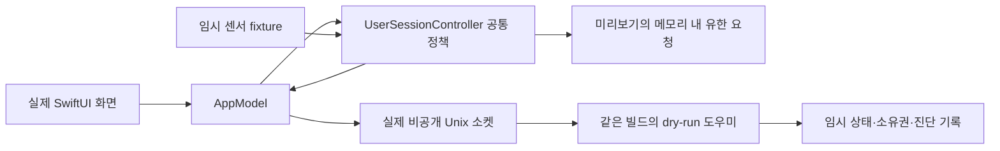

# 공통 세션의 실제 UI 검증

빌드 50 미배포 후보의 `Tether Preview.app`을 실제 앱의 공통 세션 정책과 도우미 IPC에 연결했다. 이전 미리보기의 독립적인 레거시 정책으로 새 설계의 동작을 검증하던 공백을 해소한다. 센서와 일반 절전 요청 실행기는 모의값이며 설치 앱·관리자 도우미·전역 전원·잠금 설정은 변경하지 않는다.

## 구조와 격리

미리보기마다 별도 환경설정과 실행 잠금을 사용한다. 종료 시 해당 환경설정과 임시 폴더를 제거한다. 센서 파일 읽기에 실패하면 실제 Mac의 값으로 대체하지 않는다. 도우미 변경 전에 최신 snapshot의 같은 빌드·dry-run 상태를 다시 확인한다. 일반 작업 정책·유한 덮개 요청·설정 인계는 배포 앱과 같은 코드를 사용하며 미리보기의 일반 요청만 OS 대신 메모리에 할당한다.

## 수정한 실제 시작 오류

도우미가 소켓을 먼저 열고 첫 상태 평가는 약 0.1초 뒤 수행한다. 최초 성공한 소켓 응답만으로 준비 완료를 판단하면 상태가 없는 응답을 빌드 불일치로 오인했다. 포장 도우미의 별도 3회 시작에서 각 3개, 총 9개의 성공한 빈 상태 응답과 이후 빌드 50 상태를 직접 관측했다. 미리보기는 제한 시간 안에 첫 상태를 기다린 뒤 버전·공통 조정자·인계 정보를 검증한다.

AppKit 시작 전에 오류 대화상자를 열어 안내를 읽지 못하던 경로도 보완했다. 실패 이유를 임시 통신 경로, dry-run 여부, 빌드, 조정자, 인계 정보로 구분한다. 실제 UI 재실행에서 정상 창이 열리고 공통 연결이 수립됐다.

## 확인한 범위

### 전원 전환·명시적 잠자기·공통 기록 후속 보완

GUI·URL·CLI의 새 작업과 대기 중 잠자기가 경쟁하면 이전 잠자기 의도를 폐기한다. 실제 실행기 호출과 actor의 RPC 전송 직전에 동일 의도·유효기한·현재 GUI·작성 권한을 재검사한다. 새 작업이 거절되거나 일반 전원 관측만 바뀌면 사용자의 요청을 임의 취소하지 않는다. 이미 OS에 전달한 요청을 되돌리거나 다른 앱과의 전역 원자성을 보장한다고 표현하지 않는다. 수정 전 2 tests/12 assertion failures와 queue 1 test/8 assertion failures를 fake 실행기·개인 소켓에서 재현했다.

앱의 IOPS 알림과 3초 fallback을 함께 사용한다. 도우미가 전원을 먼저 읽으면 반대 전원의 미리 승인된 판단으로 기존 소유 요청만 유한 lease 안에서 보존한다. 현재 GUI·잔량·발열·덮개·Full Wake·OS 상태를 다시 검사하며 새 override를 얻거나 원래 마감을 늘리지 않는다. 첫 전환 receipt는 같은 세션·token과 원래 예산에 묶는다. 앱이 짧은 배터리 전환을 놓치고 AC 복귀만 읽어도 원래 예약을 소비한다. TTL 뒤의 receipt는 과거 소비 사실만 반영하며 현재 유지 권한을 부여하지 않는다. stop/off·취소·사용자 변경 뒤 과거 기록은 작업을 부활시키지 않는다. AC 수동 마감을 연장하는 JSON을 거절하되 배터리 cap에서 AC 무제한으로 돌아가는 정상 선택은 구분한다. 신규 계약은 coordinator 3이며 이전 2를 연결한 채 필드를 무시하는 fallback은 허용하지 않는다. 알림 객체 소멸 때 weak context·CF source·타이머·workspace 관찰자를 정리한다.

공통 작업 기록은 덮개 도우미 없이 사용한다. 기본 판단 변화는 macOS Unified Log, 최근 128개는 현재 앱 메모리, 화면은 최신 20개다. 상세 기록은 연속 시간으로 끝나며 종료 실패 뒤에도 사용자가 중단할 수 있다. 카운트다운·잔량 변화만으로 기본 로그를 반복하지 않고 자유 형식 오류·계정·주소·인수를 기록하지 않는다. 복사/저장을 선택하지 않으면 별도 보고서·공통 로그 파일을 생성하지 않는다. [기록의 보관·관측 범위](DIAGNOSTICS.ko.md).

최종 전체 Swift는 **695개(Core 546 + 앱·업데이트 149), 실패·건너뜀 0**이다. 이번 회귀 35개와 기존 실제 IOKit 7개가 포함되며, 추가 알림 수명 시험은 전원 조작 없이 실제 source 등록·해제를 확인한다. 포장 후보의 IPC 9개·실제 CLI 3개, 작업 24개·이관 8개·기기 전환 2개·수동 27개·조정 14개·native 위임 12개·전원 관측 17개·원격 정책 27개·화면 관측 17개도 통과했다. helper OS 효과·센서는 격리 dry-run이다. 처음 focused의 만료 시점·wall-clock 비교 실패는 합성 시각의 fixture 기대를 정정했으며 실제 제품 수정과 구분한다.

한국어 실제 Preview에서 기록 시작·시점 표시·중단·최근 동작 순서와 행 정렬·사이드바를 확인했다. 센서·OS 실행은 모의다. 창 닫기 뒤 Preview·전용 도우미·임시 폴더는 0개이고 별도 screenshot 파일은 만들지 않았다. 앞선 이미지·설치 41개·660개 결과는 당시 근거로 보존한다. 후보 앱·Preview의 ad-hoc 서명은 통과했다. 설치본 49·전원/잠금 설정·Git index는 유지한다. 실제 덮개/분리/Sleep·장시간·잠금/원격 프레임과 입력·관리자 효과·macOS 15·전체 Sparkle·원격 CI·새 배포는 남는다.

GitHub는 기존 gh 권한으로 [#2 명령 경계](https://github.com/jukqaz/tether/issues/2#issuecomment-5930709509)·[#6 전원 전환과 기록](https://github.com/jukqaz/tether/issues/6#issuecomment-5930709751)을 게시하고 API로 본문·작성자·Open·In Progress를 재확인했다. 추가 토큰·권한이나 커밋·푸시·릴리스를 만들지 않았다.

### 화면 관측·업데이트 취소·배포 경계 후속 보완

화면 목록을 마지막으로 읽었을 때 구성 변경을 발견해도 이전 화면 보고서는 남아 새 점검 시각과 함께 표시되던 문제를 수정했다. 화면 보고서와 원격 context를 동일한 최신 목록에서만 게시한다. refresh·취소·GUI 세대 변경 때도 두 결과를 함께 폐기하고 전원 요청·CPU 결과의 기존 근거는 보존한다. 수정 전 새 회귀 2개가 실패했고 수정 후 Inspector 9개가 통과했다.

업데이트 종료를 보류한 뒤에는 현재 GUI 소유권·정책·관측이 유효할 때만 같은 일반 세션으로 덮개 연결을 다시 준비한다. 기존 수동 마감과 소비 예산을 새로 만들지 않는다. 이미 분리된 legacy 응답 뒤에도 업데이트 안전성을 다시 확인한다. [종료 취소 복구와 검증 범위](UPDATE-TERMINATION-20261001.ko.md).

CI에 공통 세션 이관·기기 capability 전환·수동 유지·기능 간 조정 스크립트를 연결하고 앱 포장 뒤 실제 helper·CLI 경로 검사도 추가했다. 로컬 포장 helper에서 각각 8·2·27·14개가 통과했으며 OS 쓰기는 dry-run이다. 서명 배포 준비는 git 상태 조회 실패 또는 staged·수정·untracked 소스를 개인키 확인 전에 거부한다. 격리 preflight 5개와 YAML·쉘 문법 검사도 통과했다. workflow 변경은 원격 CI 실행 성공의 증거가 아니다. [현재 후보와 릴리스 절차](RELEASING.ko.md).

해당 단계의 전체 Swift는 **660개(Core 532 + 앱·업데이트 128), 실패·건너뜀 0**다. 새 포장 후보의 helper IPC 9개·실제 CLI 3개도 통과했고 앱·Preview 포장과 ad-hoc 서명을 확인했다. 신규 회귀 6개(Inspector 2·종료 취소 4)와 기존 native 7개가 포함된다. 아래 654개·636개와 이전 UI 관측은 당시 근거이며 이번 실행에 합산하지 않는다. 설치 41개·실제 Preview UI는 이번 수정 뒤 재실행한 결과로 표시하지 않는다.

### 원격 관측·화면 재연결 후속 보완

가상 화면이나 물리·가상 혼합 화면이 연결됐다 해제되면 이미 소진한 화면 회복 횟수를 초기화하던 결함을 수정했다. 수정 전 포장 helper의 공통/이전 경로 × 가상/혼합 구성 4건에서 모두 `stopped/3 → inactive/0 → recovering/1`, 화면 끄기 요청 총 4회를 재현했다. 추가 화면·조회 불명은 명령만 보류하고 소진·부분 예산과 원래 재시도 간격을 보존한다. 실제 덮개 열림 또는 자체 유지 종료만 회복 상태를 초기화한다. 요청 직전 재조회에도 같은 구분을 적용했다. 기존 작업 lease·수동 마감·배터리 소비 예산은 화면 재연결로 바꾸지 않는다.

작업 유지 화면의 ‘화면·원격 사용 확인…’은 충돌 안내가 없어도 열 수 있다. Splashtop·RustDesk·Apple 화면 공유의 제품·host/viewer·설치 버전을 공개 번들 정보로 확인하며 실행·가상 화면·절전 요청은 힌트로만 표시한다. 접속·프레임·입력·인증은 별도 관측이며 현재 공급자 경로가 없는 값은 미관측으로 둔다. 설치·실행·CPU 활동·오래된 시험을 현재 원격 성공으로 바꾸지 않는다. 공식 설정 안내도 실제 현재 값을 읽은 결과와 구별한다. 원격 관측은 새 전원 작성자나 작업 유지 사유를 만들지 않는다.

공통 앱 경로에도 화면 변경 관측을 연결하고 GUI 세션·깨움·화면 revision이 바뀌면 오래된 원격 context를 폐기한다. 비동기 읽기 뒤 실제 화면 ID·해상도·구성을 다시 대조하며 화면 없음과 조회 실패를 구분한다. 이전 refresh가 최신 busy 상태를 바꾸지 않게 했고 observer는 앱 해제 때 제거한다. 진단 보고서에는 각 원격 metric의 관측 시각·출처·가용성만 추가하고 접속 주소·계정·입력 내용·sessionKey를 담지 않는다.

이번 전체 Swift는 Core 532 + 앱·업데이트 122 = **654개**, 실패·건너뜀 0이다. 새 회귀 18개(회복 4·원격 계약 7·Inspector 7)와 비관리자 native 7개가 포함된다. 최종 포장 후보로 private helper IPC 9개·실제 포장 CLI 경로 3개, 공통 작업 10개·원격/가상 정책 27개·화면 관측 17개를 확인했다. 동일 검사의 debug·포장 결과나 이전 636개를 합산하지 않는다. 설치 41개는 앞선 포장 단계의 결과이며 이번 변경 뒤 새 설치 실행으로 표현하지 않는다.

이번 한국어 실제 Preview에서 원격 카드·공식 안내·글자와 정렬·스크롤을 확인했다. 자동 유지가 꺼지고 수동 세션만 남았을 때 ‘Tether 중지’가 활성화되고 클릭 뒤 해당 작업과 전체 사용을 종료했다. 원격 정보와 전원 센서는 순수 모의값이며 실제 접속·패널 전력·Sleep/Wake의 증거가 아니다. 창 닫기 뒤 Preview·개인 도우미·임시 폴더가 정리됐다. 앱·Preview 포장과 ad-hoc 서명 검사를 통과했다. 설치본 49·관리자 helper·전원 설정·git index는 보존한다. 기존 14개 검증 기록을 사용하며 새 보고서나 바탕화면 파일은 만들지 않는다.

실제 공급자 adapter, 잠금/해제·원격 화면/입력, 장시간·물리 덮개, 관리자 OS 효과, macOS 15 실행과 전체 Sparkle 업데이트는 남는다. [원격 계약과 구현 범위](MAC-REMOTE-COOPERATION.ko.md). 아래 636개 단계와 앞선 UI 기록은 당시 근거로 보존한다.

### 공통 상태·예약·진단 후속 보완

자동 유지 설정을 바꾸면 직접 예약한 배터리 시간을 지우거나 자동 시간으로 늘리던 결함을 수정했다. 자동 타이머와 직접 예약의 출처를 구분하며 대기 중 예약·진행 중 마감을 보존한다. 명시적 취소·전체 끄기·보호 중지·만료·종료는 계속 해당 요청을 해제한다. 배터리 소비 예산은 유지한다. 수정 전 정책 회귀 6개 중 4개에서 20개 assertion이 실패했고, 수정 뒤 통과했다.

보호 중 사용 토글이 꺼짐처럼 보이던 연결은 저장된 사용 선택에 맞췄다. 보호 재개 실패를 GUI와 CLI에 알리며 실패한 명령을 성공으로 응답하지 않는다. 수정 전 CLI 회귀 1개에서 8개 assertion이 실패했다. 보호 중 명시적 끄기는 식은 뒤에도 보존한다. 자동 조건이 현재 전원과 맞지 않아 대기하는 정상 상태는 재개 오류와 구분한다. 자동 유지가 꺼져 있어도 직접 배터리 유지가 남으면 그 예약 유지로 설명한다.

문제 해결 점검·보고서·CLI 진단은 현재 공통 조정자를 읽는다. 레거시 helper의 설정으로 공통 사용 상태를 대신 판단하지 않는다. 데스크톱에는 불필요한 덮개 도우미 설치 오류를 표시하지 않는다. 요청이 있는데 자체 절전 방지가 확인되지 않으면 경고하며 정상 대기·꺼짐·보호 중지를 구분한다. OS·helper의 optional 관측 누락과 값 차이는 규칙 판정을 보류하되 상세 기록·온도 진단을 숨기지 않는다. 응답 없음을 기본 한도 적용으로 바꾸지 않으며 화면 목록 조회 성공 후 빈 결과도 조회 실패와 구별한다. 온라인 화면 없음은 원격 준비나 물리 패널 꺼짐의 증거가 아니다.

앞선 공통 상태·예약·진단 단계의 전체 Swift는 Core 521 + 앱·업데이트 115 = **636개**, 실패·건너뜀 0이다. 기존 611개와 합산하지 않는다. 추가 회귀 25개와 기존 비관리자 native 7개가 전체 실행에 포함된다. 최종 포장 후보로 임시 도우미 IPC 9개와 실제 CLI 경로 3개, 작업 유지 10개·원격/가상 화면 정책 25개·화면 관측 5개·설치 41개를 다시 확인했다. 설치 41개 중 7개는 실제 이전 빌드 49 helper를 개인 경로에서 실행하며 서비스·전원 효과는 모의값이다. 수동 유지 27개와 한국어·영어 실제 GUI는 앞선 단계의 근거로 보존하며 이번 포장의 새 실행으로 표현하지 않는다.

앱·Preview 포장과 ad-hoc 서명을 확인했다. 설치본 정보·관리자 helper 49·전원 설정·이번 단계 git index는 그대로이며 임시 시험 파일과 프로세스는 정리했다. 기존 검증 폴더의 14개 기록을 갱신하고 별도 보고서나 바탕화면 파일을 추가하지 않았다. 실제 관리자·물리 Sleep/Wake·원격 화면/입력·최소 OS·전체 Sparkle UI 검증과 배포는 계속 남는다.

### 세션 화면 개선

현재 상태 → 수동 유지 → 자동 유지 → 전원 분리 후 배터리 유지 순서로 정리했다. 수동 시간은 기본 메뉴와 시작 버튼으로 선택하고, 자동 조건은 기본 분할 컨트롤로 표시한다. 수동 종료는 자동 유지를 끄지 않는다. AC 무제한을 선택한 뒤 시작 전에 배터리로 바뀌면 최대 2시간으로 전환하고 실제 명령에서도 전원 상태를 다시 확인한다.

화면 끄기 보류·조회 실패·재시도 중단은 작업 상태와 분리해서 안내한다. 해당 안내가 나타나도 자동·수동 유지와 원래 종료 시각이 보존된다. 덮개 열림·데스크톱·연결 끊김에는 오래된 화면 안내를 숨긴다. 화면 연결 조회가 일시적으로 불명확해질 때 소진된 재시도 횟수가 초기화되어 네 번째 화면 끄기 명령을 만들던 오류를 재현·수정했다.

기본 다크 화면의 카드·여백과 영어 사이드바 줄바꿈을 정리하고 언어를 바꾸면 미리보기 경고도 즉시 갱신한다. 데스크톱에는 배터리 제한·덮개 열기 설명을 숨기며, 이전의 배터리 조건은 버튼으로 AC 조건으로 바꿀 수 있다. 정상 설정을 임의로 바꾸지 않는다.

검증 자료는 프로젝트 작업 폴더에 필요한 기록만 보관한다. 미리보기 임시 폴더는 종료 시 제거하고 데스크톱에는 저장하지 않는다. 진단 내보내기는 사용자가 저장이나 복사를 선택하는 경로를 유지한다.

### 타이머·초기화 보완

전원 분리 후 시작한 배터리 유지가 잠깐 AC로 돌아오면 즉시 지워지던 결함을 재현·수정했다. 원래 마감은 AC에서도 소비하며 만료 뒤 AC 자동 이유만 유지한다. 관측 공백이나 AC 복귀가 이미 만료된 수동 배터리 세션을 되살리지 않게 했다. 무제한 요청도 배터리 기한이 지난 뒤에는 새 시작을 요구한다.

AC 연결을 30초 확인한 뒤 남아 있는 배터리 타이머로 재분리하는 경계도 확인했다. 타이머를 보존하는 수정만으로는 소비 예산 시작값과 재시작 방지 기록이 누락되어 AC-only/배터리-only/양쪽 조건의 1개 회귀에서 19개 assertion이 실패했다. 재분리 때 배터리 소비 기록을 시작하고 원래 마감·공유 상한·재시작 방지를 함께 유지하도록 보완했다. 추가한 정책 회귀는 시간을 주입한 시뮬레이션이며 실제 2시간·4시간 지속 시험은 아니다.

환경설정 백업 실패 후에도 설정 변경·세션 시작이 가능하던 초기화 경로는 조정자 결합 전에 중단한다. 로그인 항목 갱신은 공통/기존 시작 경로에 함께 적용하되 기존 꺼짐을 보존한다. [이관 실패 재현과 확인 범위](UPDATES-AND-MIGRATION.ko.md). 동일한 7개 추가 회귀를 포함한 전체 실행과 기존 공통 IPC의 전원 재연결 검사를 완료했다. 날짜별 새 보고서나 임시 원본 사본을 추가하지 않고 이 문서와 기존 검증 기록에 합쳤다.

| 검사 | 근거와 결과 |
|---|---|
| 전체 Swift 회귀 | 타이머·초기화 보완 후 Core 495 + 앱·업데이트 100 = 595개, 실패·건너뜀 0. 실제 비관리자 native 7개 포함. 화면 수정 단계의 588개와 중복 합산하지 않음 |
| 미리보기 회귀 | 실제 임시 도우미 프로세스·Unix IPC의 8개. 전원 재연결 후 같은 세션·원래 배터리 마감·수동 이유를 보존하고 예약만 취소하는 검사를 보강. 전체 Swift에 포함하며 최종 포장 도우미로 같은 8개도 통과 |
| 포장 도우미의 유지 회귀 | 공통 작업 유지 10개·기존 수동 유지 27개. 유한 마감·독립 예산·취소·재시작·타 앱 소유권 보존을 확인. 센서와 OS 효과는 dry-run |
| 화면 관측 회귀 | 최종 포장 도우미 5개. 소진·부분 재시도 예산 보존, 열린 덮개의 새 사건, 초기 조회 실패 복구. 기존 원격 화면 25개와 작업 세션 10개도 통과. OS 명령은 dry-run |
| 준비 전 상태·호환성 | 빈 상태, live 응답, 다른 빌드·조정자에서 연결과 추가 작업 생성 거절 |
| 자동·수동 독립 | AC 자동 유지에 30분 수동 추가, 수동 종료 뒤 자동 이유 보존. 메모리 실행기의 단일 할당을 회귀로 확인 |
| AC 무제한·배터리 한도 | 실제 UI에서 무제한 시작 후 모의 배터리 전환 시 약 2시간 마감. 배터리 180분 직접 입력은 시작 불가, 30분은 시작 |
| 예약·기기 조회 | AC 예약의 분리 시 시작·AC 재연결/재분리 시 원래 기한 유지·취소, 데스크톱/조회 불가 전환 시 같은 일반 세션·기한 보존과 덮개 지원만 해제 |
| 덮개 조회 공백 | 덮개·SleepDisabled 조회 불가에도 일반 수동 작업과 원래 기한 보존, 조회 복구 뒤 추가 일반 할당 없음 |
| 종료 | 정상 창 닫기로 미리보기·자식 도우미 종료와 해당 임시 폴더 제거. 회귀에서 도우미 해제 응답 이후 일반 요청·환경설정 해제 확인 |
| UI 설명 | 맥 공통 메뉴를 `작업 유지`로 정리. 정상 대기를 도우미 오류처럼 표현하지 않음 |
| 실제 GUI | 한국어·영어, 직접 입력 취소, 시작 전 AC→배터리, 자동·수동 동시 유지, 화면 보류·중단, 데스크톱 조건 복구, 기본·간단 메뉴바 보기 확인. 센서·OS 효과는 모의값 |
| 포장 | macOS 15 arm64 메타데이터·실행 파일, 후보·미리보기의 ad-hoc 서명 검사. 실행 호스트는 macOS 27.0 arm64 |

기존 전원 관측 단계의 64개 포장 도우미 검사는 [별도 기록](POWER-OBSERVATION-20261001.ko.md)이며 이번 8개와 전체 Swift 수에 다시 합산하지 않는다. 설치본 빌드 49는 유지한다. 소스는 커밋·푸시·원격 CI·배포 전이다.

## 남은 실제 확인

모의 전원·덮개·기기 전환과 메모리 요청은 물리 덮개, 실제 Sleep 뒤 닫힌 AC Wake, 관리자 도우미의 OS 효과나 원격 화면·입력의 증거가 아니다. macOS 15의 실제 실행, 장시간 보호·해제 지연, 전체 Sparkle 업데이트도 남는다. 2시간 마감 관측은 실제 2시간 지속 시험이 아니다. 프로젝트 #6은 이러한 완료 조건이 남아 `Open`·`In Progress`로 유지한다.
