# Tether 디자인 리뷰

## 현재 후보 · 2026-11-11 메뉴·설정 재구성 · 설치 미실시

메뉴는 상태·더보기 헤더 하나와 가까운 수동 조작으로, 설정은 관련 옵션 묶음과 짧은 행으로 재배치했다. 별도 브랜드 제목·반복 섹션 제목·중첩 구분선·변경 없는 큰 비활성 적용 버튼을 제거했다. 본문14pt·보조12pt, 승인 옵션과 전원 규칙은 유지한다. 수동 전원·시간 한도는 기본으로 보여주고, 시작 안내는 선택 아래 결과를 배치한다.

[새 화면·전후·검증 기록](../.build/verification/classic-ui-redesign-20261111/index.html). Computer Use로 한글·영어, 밝음·어두움, 상태·초안·펼침·하단을 확인했다. source 전체/후속 검사를 고유 ID로 합친1,510개 중1,501통과·실제 전원9생략·실패0이다. 최초 fixture 경로 실패와 보완 과정은 결과에 남겼다. XCTest 화면 제어 suite와 설치·물리·배포는 미실시다. 스크린샷·검사 결과는 사용자 미감 수락을 대신하지 않는다.

## 이전 후보 · 2026-11-11 native 유틸리티 정돈 · 설치 미실시

메뉴는 현재 작업·새 수동 시작·허용 옵션·하단 조작의 순서를 유지하고 중복 아이콘·구분선 여백을 줄였다. 설정 4개 페이지는 같은 제목·값 열과 native checkbox를 사용하며 저장 시점은 그룹에 한 번 표시한다. AppKit 선택 상자·버튼의 고유 크기와 텍스트 기준선을 SwiftUI 행에 전달한다. 380pt 메뉴, 본문 14pt·보조 12pt, 불투명 시스템 표면과 Liquid Glass 제외 결정을 유지했다.

긴 영어 설정에서 620pt viewport 안의 native split view가 740pt로 커져 제목과 sidebar가 잘리는 결함을 재현했다. detail viewport에서 고정 제목과 스크롤 본문을 분리해 해결하고 한글·영어, 기본·최소 창의 페이지 전환 회귀 검사로 남겼다. 모의 센서의 실제 SwiftUI 창을 Computer Use로 조작해 메뉴·설정 4개 페이지·펼침·스크롤 끝, 수동 시작·종료·전체 중지·중지 해제를 확인했다. [화면과 검증 자료](../.build/verification/native-ui-polish-20261111/index.html).

소스 검사 1,510개 중 1,498개 통과·12개 생략·실패 0. 경로 미지정으로 생략된 CLI 3개는 별도 private stub 검사에서 모두 통과했다. 두 실행을 합친 고유 검사 1,510개 중 1,501개 통과·9개 생략·실패 0이다. 나머지 9개는 opt-in 실제 전원 assertion 검사이며 이번 디자인 검증에서 실행하지 않는다. 디자인 검사기 32개와 UI runner 자체 검사 23개도 통과했다. XCTest 화면 제어 검사는 이번 실행에서 수행하지 않았으며 Computer Use 관측과 구분한다. 설치본·도우미·물리 덮개/Sleep·시스템 잠금 설정은 변경하지 않았다. 수치 검사는 미감의 자동 합격 점수가 아니다.

## 이전 후보 · 2026-10-08 필수 기능·중복 UI 정리 · 설치 미실시

사용자가 승인한 수동 시간 선택의 메뉴바 통합, 종료 예고·시간 만료 알림 제거, 별도 사용법 창 제거를 적용했다. 첫 준비·보호 알림·전원 분리 후 수동 배터리 예외는 유지하고 Desktop의 빈 섹션도 제거했다. 관련 소스138개와 같은 native 실행3/3이 통과했다. skip·expected failure·런타임 경고0, 새 캡처4개 시각 확인, 검사 프로세스 잔여0이다. 새 정량 점수는 산출하지 않았다. [새 화면·검증 결과](../.build/verification/essential-cleanup-20261008/RESULT.ko.md).

후보 GUI `83b76b68…`, 설치 GUI `2d7da124…`를 확인했다. 설치본은 교체하지 않았다. private UI 센서·절전은 모의이며 물리·production 인수와 구별한다.

## 이전 후보 · 2026-10-08 시간 옵션 정리 · 설치 미실시

메뉴와 설정의 직접 입력창·sheet·popover를 제거했다. 기본 선택은15분·30분·1시간·2시간이며 수동 무제한은 전원 연결 중에만 표시한다. 자동 배터리 유지와 전원 분리 후 계속 유지도 같은 네 가지 옵션을 사용한다. 유효한 이전 임의 시간은 `기존 설정`으로 보존하고 새 옵션을 선택하면 목록에서 없어진다. 공통 시간 선택 코드를 사용하며 기존 색상 역할·native 컴포넌트·아이콘을 유지한다.

소스 회귀88개가 통과했다. 배터리 메뉴·한국어 전체 화면·시간 설정의native3개 경로는 각각 후속 실행에서 통과했고, 최초·후속 실패도 보존했다. 단일3/3 실행으로 표시하지 않는다. 실제 캡처4개에서 시간 선택·정렬을 시각 확인했으며 이번 범위의 정량 디자인 점수는 새로 산출하지 않았다. 검사 프로세스 잔여0이다. [옵션·새 화면·검증 결과](../.build/verification/preset-simplification-20261008T071529Z/RESULT.ko.md).

새 후보 GUI SHA는 `9e6fbcea…`, 현재 설치본은 `2d7da124…`다. 후보를 설치하지 않았으며 private 검증 화면을 설치·물리 덮개·Sleep 증거로 표시하지 않는다.

## 이전 후보 · 2026-10-08 색상 역할 정리 · 설치 미실시

활동·선택은 파랑, 공통 보조 버튼은 시스템 회색, 정상 확인은 초록으로 통일했다. 전원 조건 대기·macOS 자체 관리는 중립색이며 보호·주의는 같은 주황을 사용한다. 흰 글자용 주요 버튼의 진한 파랑과 native 포커스는 유지한다. 전원 동작·배치·아이콘 형태를 바꾸지 않았다.

새 후보에서 화면 렌더링·메뉴바 테스트20개와 native 한국어 전체 화면·보조 흐름1개가 통과했다. native skip·expected failure·런타임 경고0, 캡처11개에서 배치 기준의 중대 결함0이다. 확인 점수50.45/100·측정 범위50.45%이며 Glass 대비·전체 미적 평가는 미측정이다. 검증용 프로세스 잔여0을 확인했다.

[새 색상 화면·검증 결과](../.build/verification/palette-20261008T065856Z/RESULT.ko.md) · [근거 요약](../.build/verification/palette-20261008T065856Z/verification-summary.json)

GUI 후보 SHA `e8e302e901a5cec8df2f5ee562131386ab64e1e40f932199e88c0b2381c0f3cc`, 설치 SHA `2d7da1247d5ffad9ae6ebc9f7467db617a8cd020e6921c2ca781c39850e6921d`를 대조했으며 설치본은 교체하지 않았다. ‘미리보기’는 예시 센서·요청으로 실행하는 검증 화면 표시이고 일반 실행에서는 보이지 않는다. 도우미 미설치·Amphetamine 등 예시 내용을 현재 기기의 관측으로 해석하지 않는다.

## 이전 후보 · 2026-10-08 정보 구조·디자인 리뷰 · 설치 미실시

[전체 화면25장](../.build/verification/ui-review-20261008T054559Z/SCREENS.ko.md) · [디자인·기능 결과](../.build/verification/ui-review-20261008T054559Z/RESULT.ko.md) · [검증 요약](../.build/verification/ui-review-20261008T054559Z/verification-summary.json)

메뉴는 현재 상태 → 자동·덮개·분리 결과 → 수동 유지 순서로 정리했다. `자동 조건 사용`, `수동 유지 종료`, `모두 일시 중지`의 범위를 구분하고 중복 설정 진입·경고·설명을 줄였다. 필요한 도우미 복구를 업데이트보다 먼저 표시한다. 전원 분리 문구에는 유효한 배터리 유지 예외를 포함하며 정책은 그대로다. graphite+blue·native Form/Picker·Liquid Glass 기준은 [DESIGN.md](../DESIGN.md)를 따른다.

관련 소스292개·격리 helper dry-run70그룹·실제 유한 IOKit/IOPS3개·평가기28개가 통과했다. 최종 callback/UI88개는292와 겹치는 후속 검증이다. native-reviewed 전체12개는11통과·메뉴 닫힘1실패였고, 준비 조작을 바로잡은 acceptance2개와 sheet2개·viewport1개가 후속 통과했다. 12개 경로에 성공 근거가 있으나 단일 전체12/12 실행으로 표현하지 않는다. 최신 후속은 skip·expected failure·런타임 경고0이며 실패 원본을 보존한다.

최종11개 native 캡처의 중대 결함 검출0, 측정 항목 통과율100%, 확인 점수·측정 범위50.45/100·50.45%다. 나머지49.55%는 미측정이다. 보조 창은 실제 sheet 경계로 촬영하고, ScrollView의 실제 descendant 소속을 읽어 숨은 버튼의 오검출을 구분했다. 잘림 기준을 완화하거나 미측정을 통과로 바꾸지 않았다. 별도 시각 리뷰에서도 명백한 글자·조작 겹침은 발견하지 못했다. 전체 미적·대비 인증은 아니다.

후보 GUI SHA `d3397671ba4293db4bcd318e78bd3d9c0f5411cf8e1cfaed45f958bb7c0e9d6c`, 현재 설치 파일 SHA `2d7da1247d5ffad9ae6ebc9f7467db617a8cd020e6921c2ca781c39850e6921d`를 읽어 구별했다. 같은 build53이지만 **교체하지 않았다**. 캡처는 모의 센서의 실제 native Scene이고 production 프로세스·물리 덮개/Sleep·원격·macOS26 실물은 이번 인수 근거가 아니다. 아래 설치·점수는 각 당시 기록이다.

## 이전 단계 · 2026-10-08 객관적 UI 평가·잘림 개선

[UI 품질 측정](DESIGN-QUALITY.ko.md)에 배치40·조작20·읽기20·입력20의 제품 기준을 정의했다. 실제 PNG·AX 프레임·OCR·같은 GUI 후보의 native 실행 결과를 연결하고, 미측정은 통과 점수를 받지 않는다. Apple/WCAG 인증이나 전체 미적 점수로 표현하지 않는다.

동일한29개 화면의 공통 측정 항목 통과율은 **92.42% → 100%**, 확인된 중대 잘림은 **1 → 0**이다. 메뉴 경고의 3줄 제한이 숨기던 복구 순서를 끝까지 표시하고, 시작·일시 중지 버튼의 실제 높이를 모두24pt로 맞췄다. 설정의 native 탭·Form·정렬 구조는 유지했다.

전체 확인 점수는 이전76.38/100(측정 범위80.86%), 이후59.48/100(59.48%)이다. 강화한 AX 수집기가 설정 화면의 익명·빈 프레임 등을 partial로 남겨 해당 배치 배점을 보류했기 때문이다. 같은 공통 범위59.14%에서 비교한 확인 점수는54.66 → 59.14이며, 점수 감소를 UI 악화로 해석하지 않는다. Glass 대비·전체 글자 잘림·미적 취향은 여전히 미측정이다.

새 native UI **11/11 통과**, 실패·skip·expected failure·런타임 경고0. 평가기26·자료 준비16·실행기13의55개 회귀 항목도 통과했다. 앞선 AX Identity Binding 수집 실패를 보존하고 타입별 query/index로 수정한 뒤 다시 실행했다. 기능 검증 기준을 낮추지 않았다.

검증한 GUI SHA-256 `2d7da1247d5ffad9ae6ebc9f7467db617a8cd020e6921c2ca781c39850e6921d`를 설치했고 새 PID86387·도우미 연결·기존 AC 자동 유지 복원을 확인했다. 도우미·CLI·복구·ICNS는 동일하다. 새 설치본의 production 픽셀·물리 덮개·실제 Sleep·원격 앱·최소 지원 OS는 이번 단위의 인수 범위가 아니다.

[전후 화면·점수·검증 결과](../.build/verification/design-quality-20261008T132310/RESULT.ko.md), [전체 근거](../.build/verification/design-quality-20261008T132310/verification-summary.json).

## 이전 단계 · 2026-10-08 실제 Settings·메뉴 재정리

현재 구현 기준은 [DESIGN.md](../DESIGN.md)다. 아래의 과거 치수·독립 시안·설치 결과는 당시 기록으로 보존하며, 이번 후보의 합격 근거와 구분한다. 최신 자동 검사·native UI 조작·설치 확인 상태는 [이번 검증 결과](../.build/verification/design-repair-20261008T111403/RESULT.ko.md)를 따른다. 최종 소스989개와 공유 native Scene UI9개가 실패·skip0으로 통과했고 새 GUI를 설치했다. 설치본의 실제 픽셀 검사는 Computer Use 시간 초과로 미확인이다.

| 영역 | 현재 변경과 목적 |
|---|---|
| 설정 탐색 | 실제 `Settings` Scene 툴바의 segmented `Picker`로 세 페이지의 제목·선택 상태를 표시한다. 본문은 grouped `Form`·`Section`으로 구성하고 중복 소개·카드·테두리를 줄인다. |
| 메뉴 구조 | 현재 상태와 경고 → 자동·덮개 상태 → 수동 시간·시작·종료 순서로 평평하게 배치한다. 설정·전체 중지 조작을 명확히 구분하고 긴 본문은 스크롤로 읽는다. |
| 크기·정렬 | 메뉴 폭360pt·좌우 inset16pt·본문 그룹 간격12pt를 사용한다. 설정 기본800×660pt·최소760×600pt·읽기 열 최대700pt를 기준으로 글자와 컨트롤의 정렬을 맞춘다. 이 수치는 Tether의 제품 선택이다. |
| 색·재질 | 다크 graphite와 공통 파란 강조색을 사용한다. 선택·주요 조작·경고·성공 토큰을 구분하며, native 탐색·버튼과 공통 `actionButton`에 Liquid Glass를 적용한다. 긴 설명은 안정적인 Form·Material 표면에서 읽는다. |
| 직접 입력 | 설정은 하나의 안정된 sheet, 메뉴는 popover가 입력을 소유한다. 중복 행 레이아웃 안에 입력창을 만들지 않으며 Return 확인·Escape 취소와 저장값 표시를 함께 검증한다. |
| 저장값 반영 | 수동 사용 시간을 저장해도 Picker가 이전 값을 표시하던 변경 통지 누락을 수정했다. 작업 상태가 같아도 저장된 설정이 달라지면 화면을 갱신하고, 동일값·거부된 값은 불필요한 갱신을 만들지 않는다. 덮개·전원 분리 설정도 같은 경로를 사용한다. |
| 경고 해결 동선 | 도우미·덮개 준비 경고의 해결 버튼은 도우미 옵션이 있는 앱 설정 페이지로 연결한다. 일반 설정 재열기와 원인별 해결 링크의 목적을 구분한다. |

최종 공유 Scene UI9개는 한국어 실제760pt 크기 조절, 한국어·영어3탭과 재열기, 메뉴 시작·종료·전체 중지, 직접 입력의 Return·Escape, 설정 sheet, 보호 차단·데스크톱·긴 오류를 확인했다. 런타임 경고·expected failure도0이다. native Settings host가 `.resizable=false`인 것을 자체 창 읽기 관측으로 확인하고 기존 bridge에서 크기 조절 기능만 보완했다. 임의 창 프레임을 지정해 검사를 통과시키지 않았다.

공유 Scene의 XCUITest는 실제 탭·메뉴·AX·키보드 입력과 화면 반영을 확인한다. offscreen PNG는 정적 배치 참고이며 native Glass·설치 상태·물리 덮개/Sleep·원격 입력의 증거를 대신하지 않는다. 기존에 승인한 앱 아이콘6·메뉴바 아이콘1과 상태별 고정 크기 원칙은 현재 기준에서 유지한다.

## 이전 단계 · 2026-10-08 실제 Settings 툴바 겹침 수정·설치

사용자가 실제 설정 창을 열자 **production Settings scene에서 탭의 제목과 아이콘이 겹치는 결함**을 확인했다. 같은 view의 Workbench 창만으로 native Settings 툴바까지 통과시킬 수 없었다. 탭은 SwiftUI `Text(page.title)`로 바꿔 글자 중심으로 정리했다. 새 GUI SHA-256은 `2e6852bdb9c3d086ddc499400226de8946d3a3143f5410c678191b610d65943d`이며 `/Applications/Tether.app`에 적용했다. 별도 탐색 구조나 전원 로직은 추가하지 않았다.

[실제 화면 수정 전](../.build/verification/installed-ui-qa-20261008T105132/screenshots/settings-before-toolbar-fix.png), [변경·검증 결과](../.build/verification/installed-ui-qa-20261008T105132/RESULT.ko.md). UI22개·release 빌드·strict 서명과 교체 뒤 실제 앱/도우미 연결은 통과했다. 실제 ON/OFF·독립 수동1분·만료61.031초 뒤 해제의7개 검사와 타사 요청 보존2개는 탭 수정 전 GUI에서 확인했고 전원 로직·도우미는 동일하다.

**수정 후 native 시각 검사는 대기**다. 교체로 일반 창이 닫히면 Computer Use의 정확한 app 경로 조회가 -10005로 실패한다. 동일 bundle ID의 여러 백업 때문에 ID 조회도 모호하다. 설정 창을 열었을 때 접근은 정상이며 원래 시작 job·OS 보안 설정·다른 백업은 보존했다. 이 도구 제약을 앱 전원 기능의 실패로 표시하지 않고, 수정 후 실제 탭/메뉴 조작·macOS26·물리 덮개/Sleep/원격 입력은 미확인으로 남긴다.

## 이전 UI 단계 · 2026-10-08 설치본53의 설정·메뉴 배치 정리

독립적인 `DesignPreview` 시안과 설치 앱의 `SettingsView`·`TetherPanel`은 구조가 달랐다. 이번에는 설치 앱과 같은 화면을 사용하는 native Workbench에서 최소 창과 메뉴를 확인하고 배치를 수정했다. **2026.10.1 Beta 1 · 빌드53에 실제 적용했다.** 독립 시안의 사이드바나 예시 이미지로 설치 화면을 검증하지 않는다.

[Apple Typography](https://developer.apple.com/design/human-interface-guidelines/typography)의 macOS 기본 본문13pt와 semantic text style, [Layout](https://developer.apple.com/design/human-interface-guidelines/layout)의 정렬·그룹 구분, [Settings](https://developer.apple.com/design/human-interface-guidelines/settings)의 native 탐색·설정 컴포넌트를 기준으로 삼았다. Liquid Glass는 탐색과 조작에 사용하고 긴 설명은 안정적인 Form 표면에 둔다. 760pt·22pt·12pt 등의 치수는 이번 제품의 배치 선택이며 Apple이 정한 의무 규격은 아니다.

| 영역 | 수정한 내용 | 확인 |
|---|---|---|
| 설정 상단 | 탭 아래 반복 소개·구분선을 제거. 미리보기 표시는 개발 창의 native 툴바로 이동 | 최소760×600pt에서 작업 유지의 주요 옵션과 마지막 설명이 함께 보임 |
| 정렬·공간 | 읽기 열 최대700→760pt. 행의 최소 높이28→22pt로 줄이고 실제 여백은 native Form에 맡김 | 항목명·값·switch의 기준선과 좌우 공간을 정리 |
| 제목·글자 | 섹션은 `.headline`, 본문·설명은 시스템 text style. 강제 자간 없음 | 글자 축소로 공간을 확보하지 않고 반복 행을 줄임 |
| 보호 화면 | 열 상태와 배터리를 나란히 배치. 배터리 시간 안내는 그룹 아래 footer로 이동 | 마지막 변경의 한국어·영어 최소 창 정적 렌더에서 정렬·줄바꿈 확인 |
| 메뉴 | 시간 선택기·시작 버튼을 regular 크기로 통일하고 첫 기준선 정렬. 그룹 간격14→12pt | native 메뉴에서 선택·시작·하단 조작 배치 확인 |
| 경고 | Form 안의 중복 카드/여백 제거. 경고와 설정 진입을 가까이 묶음 | 긴 오류·보호 안내의 기존 회귀 검사 포함 |

[설정 수정 전](../.build/verification/ui-layout-20261008T095542/before/general-native.png) → [수정 후](../.build/verification/ui-layout-20261008T095542/after/general-native.png), [메뉴 수정 전](../.build/verification/ui-layout-20261008T095542/before/panel-native.png) → [수정 후](../.build/verification/ui-layout-20261008T095542/after/panel-native.png). 이 캡처는 설치 앱과 같은 view를 사용하는 **native Preview의 모의 상태**다. 실제 전원 동작의 결과가 아니다. 보호 최종 렌더는 [한국어](../.build/verification/ui-layout-20261008T095542/after/safety-final-static-ko.png)·[영어](../.build/verification/ui-layout-20261008T095542/after/safety-final-static-en.png)이며 Liquid Glass를 끈 정적 배치 증거다. 상단 offscreen 탭 artifact는 native UI의 파손으로 판정하지 않는다.

- UI binding·접근성 기본 속성·메뉴 아이콘 **22개 통과**, 실패·skip0. 한국어/영어·휴대형/데스크톱·최소 창·좁은 메뉴·긴 오류·보호 상태를 포함한다. [최종 로그](../.build/verification/ui-layout-20261008T095542/ui-tests-final.log).
- release 빌드·서명 통과. 설치된 GUI SHA-256은 `6a918431cd1d38977fb911a28018c18c022cd7d39a35e9e3fa85949235240267`이며 새 프로세스·도우미53 응답·AC 자동 유지와 감시 장치를 확인했다. 도우미·CLI·복구·승인된 아이콘의 바이너리는 동일하다. 재컴파일 때 바뀐 asset catalog 메타데이터는 승인된 설치본 카탈로그를 보존한 뒤 다시 서명했다.
- 기존 기능 선택은 보존했다. 안전한 교체를 위한 명시적 OFF→ON으로 자동 활성화 식별자와 설정 backup은 정상 갱신됐으므로 설정 파일 자체가 byte-identical이라고 표현하지 않는다. [설치·결과](../.build/verification/ui-layout-20261008T095542/RESULT.ko.md).
- **남은 시각 확인:** production 앱의 Computer Use 조회는 시간 초과였다. native Preview의 General·System 탭 탐색/스크롤 초기화와 메뉴 배치는 관측했지만 마지막 보호 화면의 native 재확인·영어 전체 native 동선·Space 시작/종료 활성화·production MenuBarExtra 호스트는 미확인이다. 마지막 native 접근 때 Mac 잠금이 확인되어 조작을 중단했다. 정적 렌더나 Tab 포커스만으로 버튼 활성화를 통과시키지 않는다. 물리 덮개·실제 Sleep·원격 입력도 별도다.

## 이전 단계 · 2026-10-08 Apple 컴포넌트와 가독성 보완 · 후보53

현재 소스는 다크 기본, native 탭·그룹형 Form·전원 조건 segmented picker·표준 switch/menu, 동작부의 Liquid Glass를 사용한다. [macOS Liquid Glass](https://developer.apple.com/design/human-interface-guidelines/materials), [설정](https://developer.apple.com/design/human-interface-guidelines/settings), [메뉴](https://developer.apple.com/design/human-interface-guidelines/menus)를 기준으로 조작과 읽기 영역의 역할을 구분했다. 참조 스킬은 macOS `liquid-glass`, `swiftui-patterns`다. 비교 앱의 자체 요청/상태 아이콘 원칙은 [기능 효용 평가](FEATURE-UTILITY-REVIEW.ko.md#2026-10-08--코드와-디자인에서-채택한-원칙)에 연결한다.

| 항목 | 변경과 의도 | 검증 경계 |
|---|---|---|
| 설정 정보 위계 | 중요한 규칙을 native Section footer로 이동. 반복 안내 행을 줄이고 고급 덮개/시간/진단은 접힘 유지 | 각 조작 바로 아래 규칙을 읽도록 함. 자동 OFF가 수동 종료를 뜻하지 않음 |
| 조건 표현 | “항상”→“둘 다” | 무기한 유지와 혼동하지 않으며 AC/배터리 조건 자체는 동일 |
| 메뉴 조작 | 더 보기의 중복 chevron 제거, 수동 끝내기를 native 작은 버튼으로 정리 | 기존 수동 종료/모두 일시 중지의 범위와 실시간 상태를 유지 |
| 크기·문자 | 설정 최소760×600pt·읽기 열 최대700pt·메뉴360pt·icon18×20pt, 시스템 본문/설명 크기·줄바꿈 | 한국어/영어·긴 문장·본문 스크롤·고대비/투명도 감소 회귀 |
| 시각 자원 | 사용자가 승인한 접힌 면 앱 아이콘6·메뉴바1 유지, 상태별 모양 구분 | 원격 배지·폭 변경 없음. 메뉴바 전체 공간 부족은 bitmap 검사만으로 확인되지 않음 |

실제 모델·Workbench·메뉴 bitmap·접근성 관련 focused36개가 통과했다. 이 횟수는 최종 전체 검사와 겹친다. [정적 배치 파일](../.build/verification/goal-completion-20261008/design/general-760.png), [보호 페이지](../.build/verification/goal-completion-20261008/design/safety-760.png), [메뉴 패널](../.build/verification/goal-completion-20261008/design/panel.png)은 현재 shipping view를 private render bundle에서 그린 모의 데이터다. renderer의 narrow 크기도 실제 최소760×600으로 맞췄다.

**시각 인수 미완료:** 현재 Mac이 잠겨 Computer Use가 native Preview의 접근을 거부했다. 보안 설정 변경이나 자동 잠금 해제를 실행하지 않았다. offscreen export는 Liquid Glass를 끈 재질 fallback이며 탭 탐색부에 offscreen 그리기 artifact가 있다. 이를 실제 앱 UI 파손·native Glass 합격으로 판단하지 않는다. 새 후보53의 실제 탭·버튼·스크롤·production MenuBarExtra와 키보드/마우스는 잠금 해제 후 확인한다. 기존52 native 결과는 새53의 실물 증거가 아니다.

아래 날짜/버전의 화면은 변경 전후 역사 기록이다. 현재 기본 화면의 사이드바·T형 아이콘·실행 중인 옛 helper 경고와 혼동하지 않는다.

2026-10-06 · 로컬 `Tether Design.app`의 네이티브 창과 메모리 내 예시 조작을 검토한다. 전원·덮개·열 상태·남은 시간은 예시이며 실사용 앱이나 macOS 효과의 판정이 아니다.

기본 탐색 구조는 유지할 만하다. 관측한 정렬·잘림·스크롤 결함과 잘못 읽힐 수 있는 유지/잠금 설명을 수정했으며, **아래 조작 범위에서 수정 후 양호**로 판정한다. 출시 UI·실제 동작·전체 접근성의 완료 판정은 아니다.

| 단계 | 검토한 화면과 조작 | 수정 후 상태 |
|---|---|---|
| 1 | 메뉴 패널의 수동 시작·종료와 자동 OFF, 한국어·영어 | 양호: 정렬·종료 범위·줄바꿈 확인 |
| 2 | 작업 유지 설정과 최소 창 | 양호: 제목·예시 메뉴·하단 접근 확인 |
| 3 | 도우미 필요 상태의 잠금 ON | 양호: 준비 전 유지 가능성을 단정하지 않음 |
| 4 | 하단 스크롤 후 기기 보호로 전환 | 양호: 첫 보호 안내부터 표시 |
| 5 | 앱 설정의 기본 접힘·Tab·Space 펼침 | 양호: 정보 밀도·설명 정렬·부분 키보드 동선 확인 |

우선 수정한 항목은 자동 OFF에서 자동 유지를 약속하던 영어 설명, 도우미 미준비 상태의 잠금 설명, 페이지 전환 후 첫 안내를 가리던 스크롤이다. 패널·진단 정렬, 창 제목 잘림, 개별 PNG의 예시 표기도 정리했다.

## 1. 메뉴 패널과 수동·자동 조작

수정 전 화면을 이번 실행에서 캡처하고 저장된 PNG를 열어 확인했다. 시간 선택기가 수동 유지 제목의 왼쪽 정렬과 어긋나며 자동 스위치도 오른쪽 끝에 정렬되지 않는다. 시작 버튼은 AX에서 활성이고 클릭 후 수동 유지가 표시됐다. 비활성 창에서 회색으로 보이는 재질만으로 버튼이 사용 불가능하다고 판정하지 않는다.

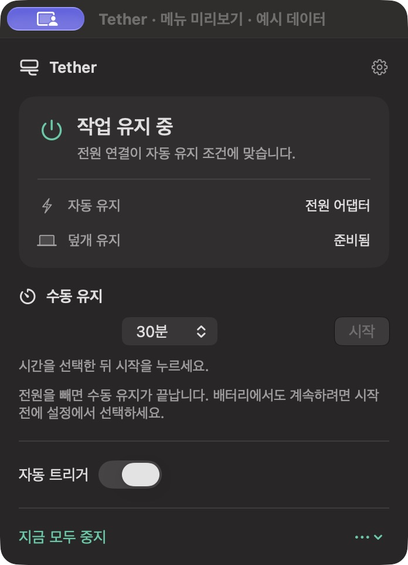

## 2. 작업 유지 설정

수동 시작 후 자동 트리거를 끄고 설정을 열었다. 수동 유지가 남고 자동 조건만 비활성화됐다. 긴 미리보기 창 제목이 툴바 옆에서 잘린다. 제목 위 약 40pt의 공간은 처음에는 불필요한 여백처럼 보였으나 제거한 최소 창에서 페이지 제목이 툴바 뒤로 가려졌다. 네이티브 미리보기의 툴바 예약 영역으로 유지하고 창 제목·메뉴를 줄인다. 수동 종료 후 자동 유지에 관한 영어 문구는 자동 OFF 상태를 구별하지 않는다.

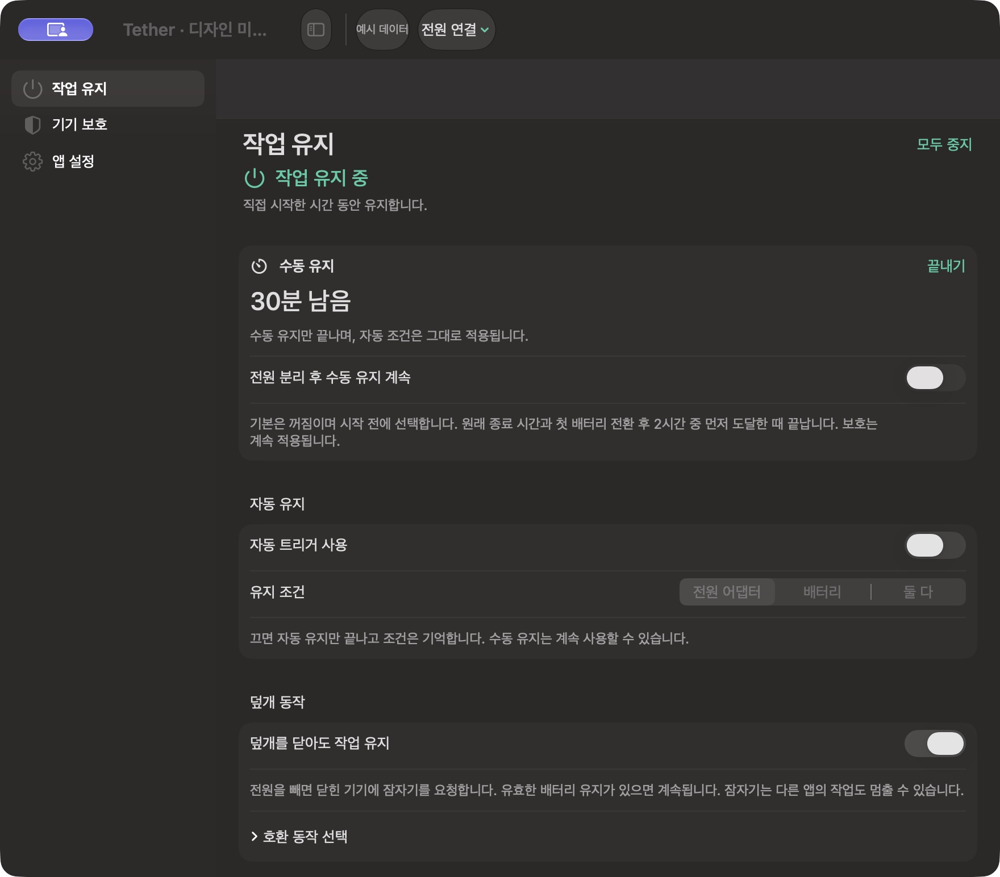

## 3. 도우미 준비와 잠금

도우미 필요 예시에서 아래로 스크롤하고 잠금을 켰다. 같은 화면에 `덮개 유지 도우미 필요`와 `잠긴 채 작업을 계속합니다`가 함께 표시돼, 옵션 선택을 실행 가능한 상태처럼 설명하는 결함을 재현했다. 잠금과 작업 유지의 범위 및 준비 조건을 분리해야 한다.

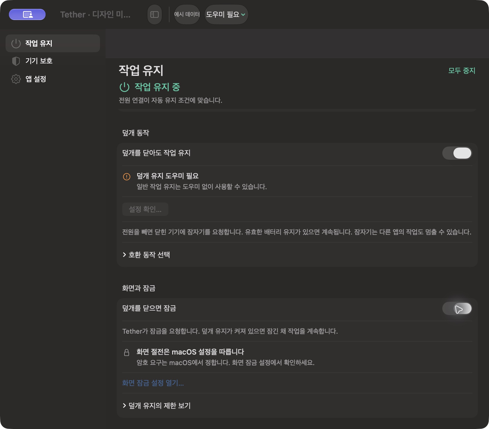

## 수정 후 · 메뉴 패널

348pt 패널의 시간 선택기는 왼쪽, 시작 버튼과 자동 스위치는 오른쪽 끝에 정렬됐다. `예시 데이터`가 패널 내용에도 표시된다. 활성 창에서는 시작 버튼과 ON 스위치의 native 강조 색이 관측됐고 글자·조작의 잘림은 보이지 않았다.

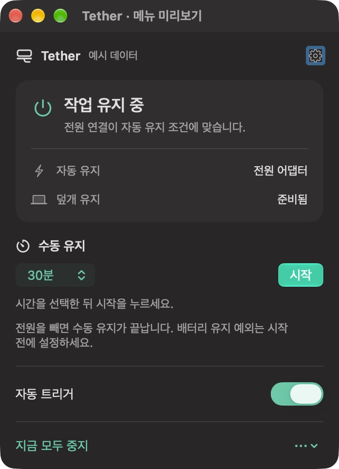

## 수정 후 · 최소 창과 잠금 설명

760×600pt 내용 크기와 190pt 사이드바에서 페이지 제목·모두 중지·예시 메뉴가 잘리지 않는다. 스크롤로 하단의 화면/잠금 옵션에 접근했다. 도우미 필요 예시의 잠금 ON 설명은 `도우미 준비·복구 전에는 덮개 유지를 제공할 수 없습니다`로 바뀌어 유지 가능 상태를 단정하지 않는다.

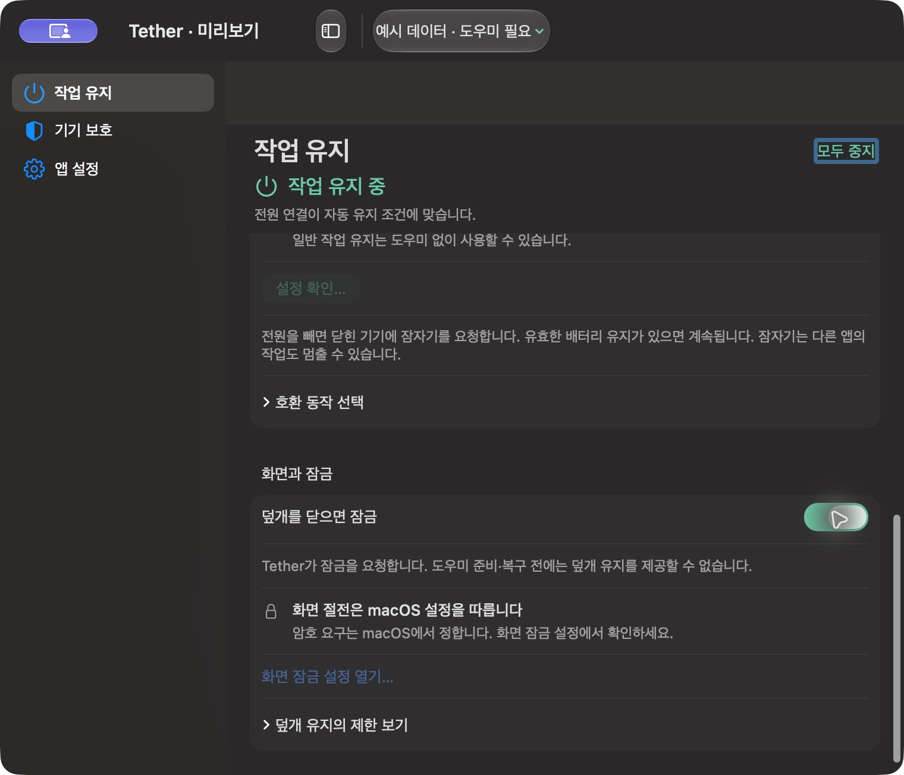

## 4. 기기 보호와 페이지 전환

작업 유지 페이지의 하단을 보고 기기 보호로 이동하자 이전 스크롤 위치가 이어져 새 페이지의 첫 보호 안내가 잘렸다. 열 상태·배터리 하한·고정된 마감 안내는 읽히지만 가장 중요한 현재 상태가 처음부터 보이지 않는 탐색 결함이다. 페이지를 바꾸면 본문이 위에서 시작하도록 수정한다.

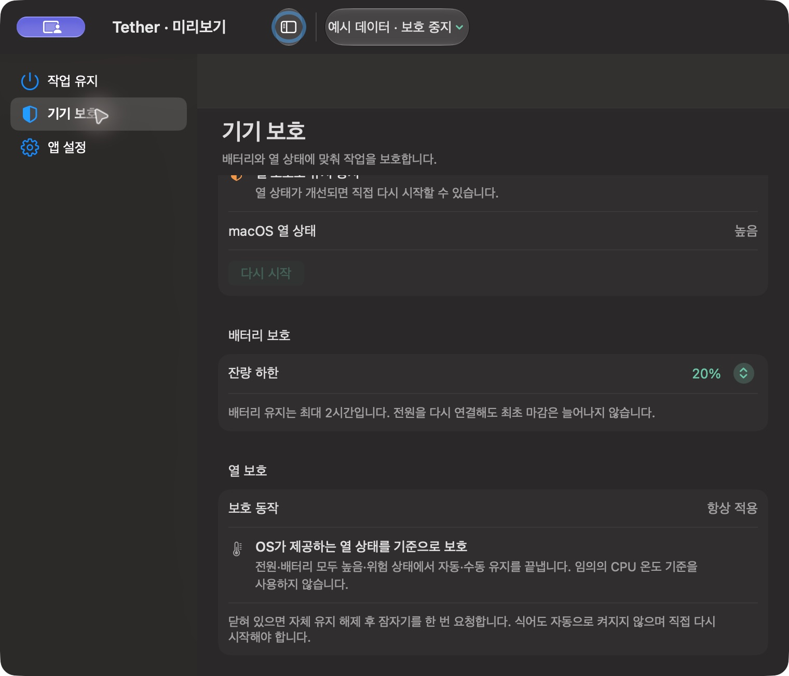

## 수정 후 · 영어 메뉴 패널

영어 표시에서 자동 트리거를 OFF로 한 뒤 수동 시작을 눌렀다. 종료 설명은 `Ending this session turns keep-awake off.`로 표시돼 실제 예시 상태와 일치한다. 348pt 패널에 상태·큰 숫자·배터리 예외 설명·하단 조작이 모두 보이고 영어 문장은 줄바꿈된다. 끝내기를 누르면 `Keep-awake is off`가 되어 설명과 일치했다.

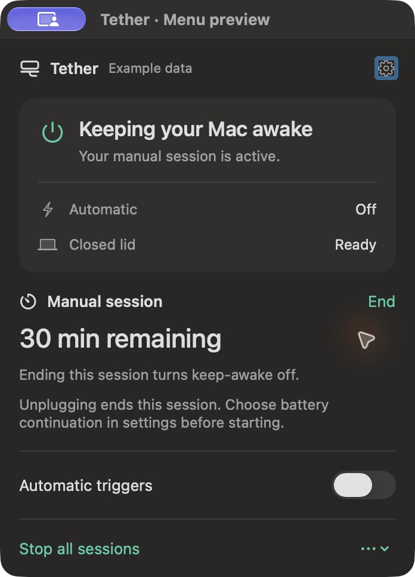

## 수정 후 · 페이지 전환

같은 최소 창의 영어 작업 유지 페이지를 끝까지 스크롤한 뒤 기기 보호를 열었다. 새 본문 스크롤 값은 0이고 `Current state`와 첫 안내가 온전히 표시된다. 사이드바 세 항목과 긴 영어 배터리 안내도 잘리지 않는다. 아래 내용은 스크롤로 읽는 구조다.

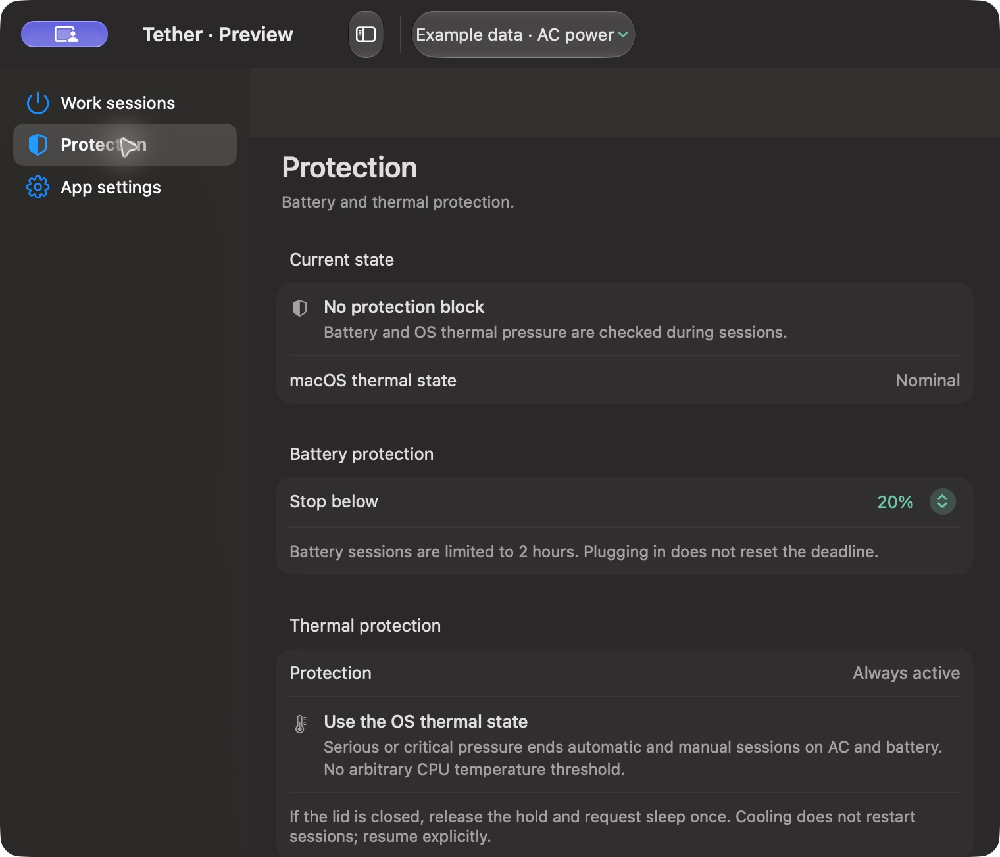

## 5. 앱 설정과 보조 옵션

760×600pt 영어 창에서 로그인 시 시작·업데이트·진단이 세 구역으로 구별된다. 업데이트 채널·로그는 기본 접힘이고 필수 작업 유지 설정을 밀어내지 않는다. 업데이트 확인은 미리보기에서 비활성화돼 실제 업데이트와 혼동하지 않는다. 글자와 사이드바·행의 겹침은 보이지 않았다.

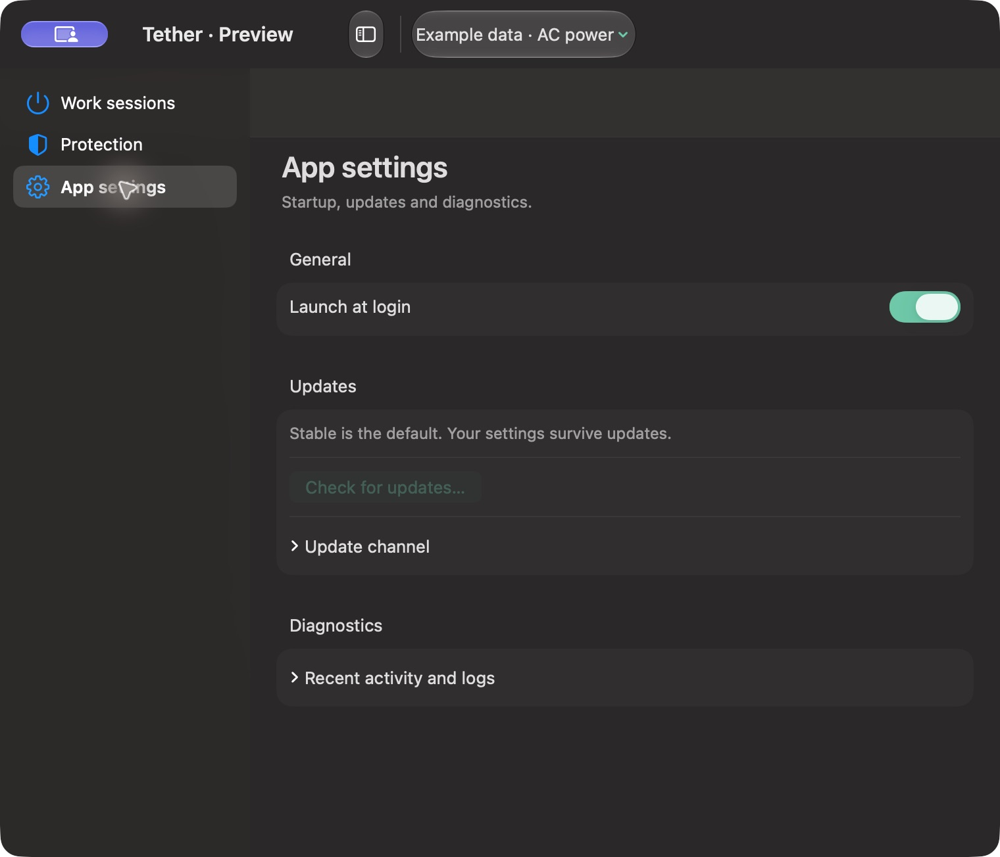

앱 설정의 Tab 이동은 로그인 시 시작 → 업데이트 채널 → 베타 선택 → 진단 순서로 관측했다. Space로 두 접기 행을 펼칠 수 있다. 펼친 로그 설명과 내보내기는 가운데 정렬돼 다른 행의 왼쪽 기준선과 어긋나므로 왼쪽으로 맞춘다. 클릭 자동화가 펼침 삼각형을 바꾸지 않았지만 키보드 조작으로 실제 펼침을 확인했으며, 마우스 입력 고장을 단정하지 않는다.

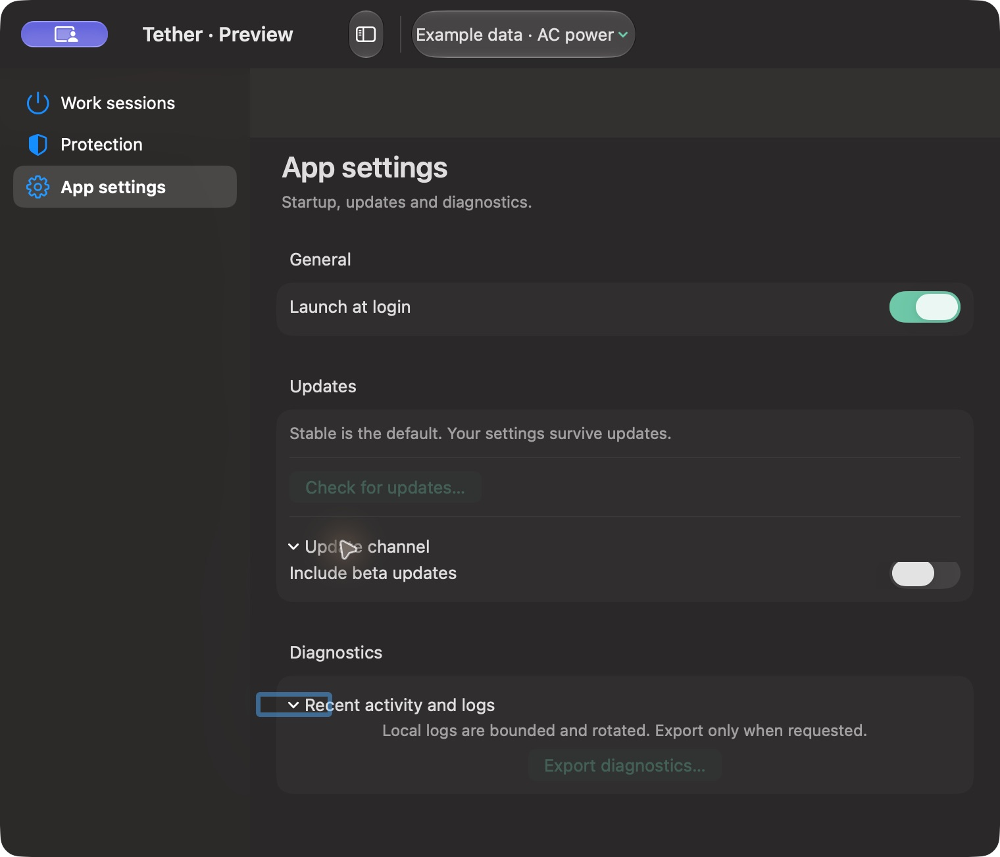

수정 후 진단 설명과 내보내기는 다른 설정 내용과 같은 왼쪽 기준선에 놓였다. 접기·펼치기와 영어 문장 읽기에 필요한 폭은 그대로 유지한다.

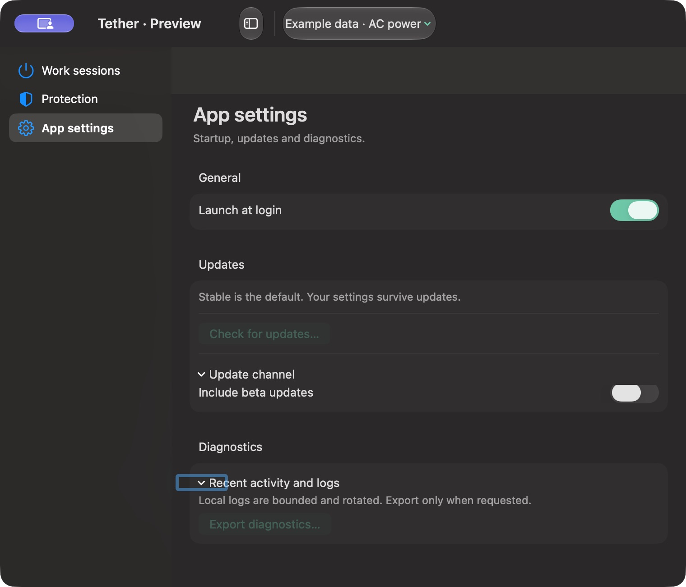

## 검증 범위와 남은 항목

- 개별 패널/설정 PNG에도 `예시 데이터`가 포함되는지 보호 예시로 생성·열기 확인했다. 설정 단독 렌더의 사이드바 글자가 어둡게 나오는 bitmap 문제는 저장 렌더 전용 색으로 보정했다. 실창의 native 사이드바는 유지한다. 확인용 임시 PNG는 정리하고 기존 [비교 이미지](images/redesign-v3.png)를 현재 소스로 갱신했다. 저장 재질은 Liquid Glass 검증용이 아니다.
- 이번 실행의 macOS는 `27.0.1 (26A434)`다. 독립적인 디자인 번들의 기본 880×720pt와 최소 760×600pt 설정, 348pt 메뉴 패널을 Computer Use로 관측했다.
- `swift test --filter DesignPreviewStateTests`: 7개 통과. 자동 OFF/수동 유지, 전체 중지, 배터리 2시간 한도, 보호 차단의 **메모리 표시 상태** 회귀다. 최종 디자인 번들 빌드도 통과했다.
- 실제 카운트다운, 종료 시각, 모든 예외 문구·배터리·데스크톱 조합, 실제 메뉴바 status item, 업데이트·설정 이관, macOS 26의 재질은 이번 검토의 확인 대상에서 제외돼 미확인이다.
- 현재 native 조작의 Tab·Space 일부, AX 이름·값·비활성 상태는 관측했다. 전체 키보드 동선, VoiceOver, 명암 대비 측정, 고대비·투명도 감소·다른 배경에서의 Liquid Glass는 미확인이다. WCAG 또는 접근성 완전 합격으로 표시하지 않는다.
- 출시 UI의 실제 모델 연결과 덮개·잠자기·잠금·원격 앱 동작은 별도 게이트다. 디자인 미리보기의 표시 결과로 실사용 동작을 보증하지 않는다.

## 실제 UI 연결 뒤의 추가 확인

위 표는 먼저 수행한 예시 디자인 검토다. 이후 후보 51의 실제 `TetherPanel`·`SettingsView`와 `AppModel/UserSessionController`를 연결하고 전체 소스 검사 919개를 통과했다. 실제 UI 17개·표시 6개·한국어/영어 최종 렌더 2개의 표적 검사도 통과했다. 이 수는 일부 전체 검사에 포함된다.

같은 Mac의 별도 preview 50 native에서 시간 선택과 시작, 3:00→2:55, 자동 OFF와 수동 독립, 모두 중지→명시적 재개, 배터리 상한, Desktop 옵션 숨김, 열 보호, 접힌 겹침·앱별 상세를 확인했다. 760pt 창의 preview 툴바 가림은 여백 수정 후 다시 확인했다. 실제 출시 화면의 자동 시간 연장·종료 시각 편집·미지원 잠금 토글은 제공하지 않는다.

최신 preview 51의 요청 종류 줄·preview 전용 2초 재조회·마지막 잠금 토글 숨김·새 Cmd-Q 정상 종료는 Mac 잠금 때문에 **native 미확인**이다. 임시 preview/helper 프로세스와 private preferences는 정리했으며 설치본 50은 보존했다. 원격 프레임·입력·실제 화면 절전·실제 Sleep은 이 UI 검토로 확인되지 않는다. [상세 근거와 이미지](../.build/verification/v3-20261006T102138Z/live-ui-qa.ko.md), [기능 효용](FEATURE-UTILITY-REVIEW.ko.md), [남은 조작](VALIDATION-CHECKLIST.ko.md).

## 기능 효용에 따른 간소화

2026-10-07 후보52 후속 정리: CPU 분석과 전역 단축키를 제거하고, 작업 유지 화면의 중복 암호 안내를 진단으로 모았다. 아래51 이미지·검사는 당시의 기록이며 현재 범위의 구현·설치 근거를 대신하지 않는다.

정상 설정의 메뉴 미리보기를 제거하고 진단 진입점을 하나로 합쳤다. 진단 창은 현재 상태·실제 전원 요청·설치 앱을 먼저 보여주며 화면·원격 관측, CPU 정보는 기본 접힘이다. CPU는 펼칠 때만 별도 측정하며 접기/창 닫기 뒤 늦은 결과는 버리고 전원 조회 시각을 갱신하지 않는다. 쓰이지 않는 연장·종료 예약 화면도 삭제했다.

간소화 뒤 86개 표적 회귀와 후보 51 재빌드를 확인했다. 새 패키지의 [한국어 진단 bitmap](../.build/verification/v3-20261006T102138Z/scope-cleanup/activity.png), [영어 앱 설정 bitmap](../.build/verification/v3-20261006T102138Z/scope-cleanup/system.png)을 열어 접힘·행 정렬·줄바꿈을 관측했다. bitmap의 미리보기 버튼은 private preview에만 해당한다. Liquid Glass 배경을 재현하지 못하는 offscreen ‘다시 점검’ 버튼의 대비와 실제 접기/펼치기 조작은 native에서 추가 확인해야 한다. 현재 Mac UI 접근을 다시 조회했으나 잠금으로 막혔다. [현재 검증 범위](../.build/verification/v3-20261006T102138Z/scope-cleanup/verification-summary.json).

## 2026-10-07 · 메뉴 패널과 설정 배치 수정

후보 51의 실제 `TetherPanel`과 설정 화면을 정리했다. 메뉴 폭은 348pt로 고정하고 자신의 화면 작업 영역에서 최대 560pt까지만 사용한다. 짧은 내용은 필요한 높이만 쓰며, 긴 상태·오류·보호 안내는 본문에서 스크롤된다. 설정 버튼과 모두 중지/다시 시작·다른 동작은 본문 밖에 고정한다. 오류 요약은 세 줄과 설정 진입점으로 제공하고, 실행 중 전원 분리 설명은 해당 세션이 시작할 때 확정한 선택을 한 행으로 표시한다.

설정 제목과 카드의 왼쪽 기준선을 20pt로 맞췄다. 사이드바는 164–220pt 범위·기본 180pt를 사용하고 글자색·한 줄 표기를 정리했다. 자동 조건은 좁은 세그먼트 대신 메뉴 선택을 사용한다. 네이티브 미리보기의 툴바 예약 공간 40pt를 제거하면 제목이 가려지는 현상을 다시 확인해 유지했다. 이 예약은 별도 미리보기 호스트에만 적용된다. 전체 중지 뒤의 수동 시작 설명도 로그인 확인 대신 명시적 다시 시작을 안내한다.

| 확인 | 결과와 제한 |
|---|---|
| 최종 UI 회귀 | `LiveUIBindingTests`와 `MenuBarIconTests` **13개, 실패·skip 0**. [로그](../.build/verification/menu-layout-20261007/ui-regression.log). 한국어/영어 × MacBook/데스크톱 × 정상·긴 오류·수동·열 보호·전원 미확인 × 360/560pt의 **40개 패널 조합**에서 폭·높이와 bitmap 생성 확인 |
| 전체 소스 검사 | 이번 배치 중 실행한 969개 중 **962개 통과, 7개 opt-in native 검사는 건너뜀, 실패 0**. [로그](../.build/verification/menu-layout-20261007/swift-test.log). 마지막 안내 문구·미리보기 종료 보완 뒤에는 위 13개를 다시 실행했으며, 이전 42단계 통합 검사를 새 실행으로 표시하지 않음 |
| 네이티브 설정 | macOS 27.0.1의 최소 폭 760pt에서 작업 유지·기기 보호·앱 설정 제목, 카드, 스크롤, 조건 메뉴를 관측. 사이드바는 실제 표시된 180pt만 확인 |
| 네이티브 메뉴 패널 | 실제 status item에 연결한 별도 `NSPopover`에서 자동·수동 시작/종료·보호 안내·설정 진입 확인. 360pt 패널의 본문 스크롤 끝에서도 설정·중지 버튼이 유지됨. **production `MenuBarExtra`의 창 호스트 자체는 이 미리보기와 다름** |
| 네이티브 진단 | 기본 접힘, 앱별 긴 설명 펼침, 스크롤과 고정 닫기·하단 버튼을 관측. 전원 요청·센서는 명시된 모의값이며 실제 충돌 판정 아님 |
| 아이콘 | 기존 18×20pt template 아이콘의 1×/2× 크기·투명 가장자리와 상태 변화 시 고정 크기를 회귀 확인. 원격 연결 배지나 긴 텍스트를 새로 추가하지 않음 |
| 정리·패키지 | 수정본 release·preview 재빌드. 미리보기 종료 때 hosting controller 참조를 해제해 순환 소유를 끊음. private helper·임시 폴더 정상 정리 및 설치본 50 보존 확인. [최종 기록](../.build/verification/menu-layout-20261007/summary.json) |

이 검토는 UI 표시와 조작에 대한 근거다. 설치본은 교체하지 않았고, 실제 덮개·화면 절전·Sleep·원격 클라이언트·관리자 설치를 새로 검증하지 않았다. macOS 26의 재질, production 메뉴바 배치, VoiceOver 전체 동선·명암 대비 측정·여러 모니터 이동은 별도 인수 항목으로 남긴다. 시험 자료는 저장소 `.build`에만 저장한다.

## 2026-10-07 · 메뉴와 설정 시각 재구성

큰 회색 그룹과 반복된 상태 설명을 줄이고, 메뉴의 실행 동작과 설정의 기본값을 구별했다. 기본 다크 모드에서 콘텐츠는 안정적인 어두운 표면을 사용하며, 탭·선택·시작 버튼은 네이티브 컨트롤과 Liquid Glass를 사용한다. 시각적 개선을 기능 우위나 실물 클램쉘 합격으로 표시하지 않는다.

| 화면 | 구현한 변화 | 최종 네이티브 화면 |
|---|---|---|
| 메뉴 | 상태와 이유 → 자동 조건·덮개 상태 → 수동 시간·시작. 활성 타이머는 큰 숫자로 표시하고 `끝내기`와 `모두 일시 중지`의 범위를 구별. 설정·추가 메뉴는 상단, 중지·전원 상태는 하단에 고정 | [메뉴](../.build/verification/design-improvement-20261007/01-menu-panel.jpg) |
| 작업 유지 | 사이드바 대신 세 탭. 조건은 `전원 / 배터리 / 항상` 선택으로 비교하고, 분리 후 배터리 예외는 수동 기본값에 통합. 긴 설명은 기본 접힘 | [설정](../.build/verification/design-improvement-20261007/02-work-sessions.jpg) |
| 기기 보호 | 열 상태와 배터리 잔량을 나란히 표시. 과열 시 종료와 냉각 뒤 직접 재개를 짧게 강조. 자세한 보호 기준과 알림 설명은 펼침 | [보호](../.build/verification/design-improvement-20261007/03-protection.jpg) |
| 앱 설정 | 기본 설정·업데이트·필수 도우미·진단의 순서. 업데이트 채널은 반복된 카드 없이 표시하며 설치 대기·계속 동작은 기본 노출 | [앱 설정](../.build/verification/design-improvement-20261007/04-app-settings.jpg) |
| 앱·화면 점검 | 현재 Mac의 요약을 줄여 앱 이름·영향·조정 방법·앱 열기/Finder 버튼을 먼저 표시. PID·긴 요청 이름·기술 설명은 상세에서만 표시 | [기본](../.build/verification/design-improvement-20261007/05-app-diagnostics.jpg), [상세](../.build/verification/design-improvement-20261007/06-diagnostic-details.jpg) |
| 사용법 | 제목과 완료 버튼을 고정하고 안내 본문만 스크롤. 메뉴에서 실행하는 방법과 자동/수동/전체 중지의 범위를 명시 | [사용법](../.build/verification/design-improvement-20261007/07-guide.jpg) |

설정 제목은 19pt, 메뉴 상태는 17pt, 옵션은 13pt, 보조 설명은 12pt로 맞췄다. 옵션 행은 좌측 이름·우측 컨트롤로 정렬하고, 공간이 부족하면 세로 배치한다. 카드 내부 14pt·그룹 간 20pt를 공유하며 긴 문장은 줄바꿈한다. 메뉴바 아이콘은 익숙한 SF Symbols 전원 기호를 **18×20pt template**에 담는다. 원격 상태·타이머·배지 때문에 폭이 바뀌지 않는다.

검증 환경은 Apple Silicon·macOS 27.0.1·Swift 6.4다. 화면은 production View/AppModel/controller에 연결된 private 미리보기에서 직접 관측했으며 JPEG와 전체 접근성 트리를 저장했다. 전원·배터리·열·타사 요청은 모의값이다. 캡처의 `덮개 유지 꺼짐` 상태는 일반 작업 유지 예시이며 실물 클램쉘을 증명하지 않는다. 미리보기의 OS 설정·설치·타사 앱 열기 버튼이 비활성인 것은 의도한 격리다.

| 검사 | 결과와 범위 |
|---|---|
| 전체 소스 | 969개 중 **962개 통과·7개 opt-in native skip·실패 0**. [로그](../.build/verification/design-improvement-20261007/swift-test-final.log). 마지막 메뉴 viewport 여백과 캡처 호스트 보완 전 실행이며 이후 변경은 아래 최종 회귀로 확인 |
| 최종 UI·충돌 표시 | **16개 통과·skip 0·실패 0**. [로그](../.build/verification/design-improvement-20261007/ui-regression-final.log). KR/EN·MacBook/데스크톱·오류/보호·360/560pt 패널 조합, 760×600pt 설정, 진단, 아이콘 1×/2× 가장자리와 고정 크기 포함 |
| 캡처 호스트 | native 탭의 툴바 수명을 위해 실제 미리보기와 같은 `NSHostingController`를 사용하고 창을 명시적으로 닫는다. 간헐적 `Invalid view geometry` 경고를 재현해 보완했으며 최종 회귀 로그에서는 0건 |
| 네이티브 조작 | 세 탭, 전원/배터리/항상 선택과 배터리 시간 행, 수동 시작/끝내기, 모두 중지/재개, 보호·업데이트·앱 기술 정보 펼침, 사용법 끝까지 스크롤 확인. 수동 종료 뒤 자동 유지가 남고 재개 뒤 옛 타이머는 부활하지 않음 |
| 작은 메뉴 | 최종 360pt viewport에서 대기 조작은 본문 스크롤 없이 표시됨. 활성 타이머의 긴 내용은 본문만 스크롤하고 상단 설정·하단 중지는 유지 |
| 빌드와 보존 | release/preview 재빌드, strict 서명 검사 통과. 후보는 **51**, 설치본 **50**과 control bytes·pmset custom은 보존. helper hash 동일, 임시 앱·도우미·폴더 정상 종료. [최종 기록](../.build/verification/design-improvement-20261007/summary.json) |

macOS 26의 실제 재질·production `MenuBarExtra` 호스트와 다른 메뉴바 아이콘 사이의 배치·VoiceOver 전체 동선·정량 명암 대비는 남아 있다. 이번에 실제 덮개·Sleep/Wake·원격 클라이언트·관리자 설치를 다시 시험하거나 설치본을 교체·배포하지 않았다. 이전 42단계 통합 검사도 새 실행으로 합산하지 않는다.

## 2026-10-07 · 시각 디자인·사용성 재평가

판정: **현재 UI는 시각 디자인과 사용성에서 재정리가 필요하다.** 직전의 회귀 통과는 잘림·폭·스크롤·조작 연결 검사였다. 이를 디자인 완성도가 좋다는 근거로 쓰지 않는다. 큰 회색 카드와 설명이 화면의 인상을 지배하고, 사용자가 원하는 자동·덮개 동작보다 부가 정보가 먼저 보인다.

이번 감사에서는 후보 51의 실제 화면을 새로 열어 Computer Use로 관측·캡처했다. 저장한 원본 JPEG를 다시 열어 같은 화면인지 확인했다. 오래된 이미지나 메모리를 디자인 증거로 사용하지 않았다. 설정은 760pt 폭, 메뉴 내용은 348pt 폭이다. 메뉴는 별도 status item/NSPopover의 실제 `TetherPanel`이며, 전원·센서·충돌 앱은 명시된 모의값이다. 설치본 50의 화면 또는 production MenuBarExtra 호스트로 표시하지 않는다.

### 1. 메뉴 패널 · 재설계 우선

자동 유지가 켜진 화면에서 현재 상태 제목·전원 조건 행·자동 트리거 토글로 같은 의미가 반복된다. 수동 시간 선택·시작 버튼 뒤에도 안내와 분리 동작이 이어져 간단한 메뉴가 길어진다. 미리보기 안내를 제외해도 이 중복은 남는다. ‘지금 모두 중지’의 이후 자동 동작까지 멈추는 범위도 한눈에 읽기 어렵다.

좋은 기반은 설정·중지 버튼의 고정 위치와 실제 상태/원인의 구분이다. 정상 화면은 상태 한 줄과 이유, 빠른 수동 시작, 자동 유지 토글, 설정으로 압축하고 긴 정책 설명은 설정/도움말로 옮긴다. 수동·자동 종료 범위는 해당 버튼 가까이에서 짧게 설명한다. 좁은 패널의 회색 재질 위 보조 글자·민트 링크는 대비 위험이 보여 별도 측정이 필요하다.

### 2. 작업 유지 설정 · 정보 순서 수정 우선

첫 화면이 제목·현재 상태·수동 유지·자동 유지로 채워져 핵심인 덮개 동작은 스크롤 뒤에 있다. 기본 설명이 조작보다 많은 세로 공간을 쓰고, ‘작업 유지’, ‘수동 유지’, ‘자동 트리거’의 관계를 문장으로 이해해야 한다. 세 항목을 위한 180pt 사이드바도 작은 설정 창에서 비중이 크다.

자동 조건 → 덮개 동작 → 배터리 예외를 첫 화면의 주 내용으로 배치한다. 실행용 타이머는 메뉴 패널에 집중시키고 설정에서는 기본값과 예외를 다룬다. 사이드바는 현재 세 분류에 맞춰 폭을 줄이거나 간결한 설정 탭으로 검토한다. 기능을 제거하거나 기존 OFF 선택을 바꾸는 권고가 아니다.

### 3. 기기 보호 · 설명과 조작의 비중 조정 필요

아래 캡처는 열 보호·알림까지 스크롤한 상태다. 항상 적용되는 열 보호가 여러 긴 문장과 구분선으로 크게 표현되고, 알림 항목에도 ‘관측 확인’ 같은 내부 용어가 들어간다. 재개가 수동이라는 중요한 정보가 배경 설명 속에 섞인다.

‘과열 시 중지 · 식은 뒤 직접 재개’를 먼저 짧게 제시하고 센서·보장 범위는 상세 설명으로 접는다. 알림은 ‘종료 전/시간 만료’, ‘과열 또는 상태 확인 실패’, ‘배터리 부족’처럼 원인별로 읽기 쉬운 이름을 사용한다. 모의 환경의 비활성 알림 권한 버튼은 실제 앱의 실패로 판정하지 않는다.

### 4. 앱 설정 · 분류와 밀도 보완 필요

‘시작 동작’ 아래에 언어·단축키·사용법이 섞인다. 카드와 섹션 사이 공간이 넓어 도우미·진단에 도달하려면 다시 스크롤해야 한다. 네이티브 컨트롤과 상세 접힘은 유지할 수 있지만, 현재 분류와 배치는 사용자가 찾는 기준과 맞지 않는다.

기본 설정·업데이트·도우미·진단으로 정리하고 사용법은 도움말 진입점으로 둔다. 단순한 한두 행을 위해 큰 카드를 만들지 않는다. ‘메뉴 패널 보기’와 비활성 로그인/업데이트는 미리보기 전용이므로 출시 화면의 결함에 포함하지 않는다.

### 5. 앱 상태 진단 · 해결 안내를 먼저 배치

기본 상세 접힘과 관측 시각 표시는 유용하다. 그러나 앱별 상세를 펼치면 겹치는 기능·제약·예외·요청 명칭이 한꺼번에 이어져 해당 앱에서 어떤 옵션을 끄면 되는지 찾기 어렵다. 기본 행의 PID도 대부분 사용자의 다음 조작에 도움을 주지 않는다.

앱 이름 → 현재 영향 → 확인할 옵션 → 앱 열기/위치 보기 순으로 안내한다. 정확한 설정 이름을 모르는 경우에는 요청 종류에서 추정한 안내임을 유지하며 특정 메뉴 경로를 지어내지 않는다. PID·원시 요청·긴 공존 설명은 기술 정보로 접는다. 예시 Amphetamine/LLM 목록은 실제 설치나 현재 충돌의 증거가 아니다.

### 수정 순서와 확인 기준

1. 메뉴의 중복 상태·상시 설명을 줄이고 주 조작을 한눈에 보이게 한다. 정상 상태에서 짧은 한 화면으로 조작 가능한지 native로 비교한다.
2. 설정 첫 화면에서 자동·덮개·전원 분리 동작이 보이도록 순서를 바꾸고 타이머 실행의 중복 진입점을 정리한다.
3. 보호·진단은 요약 → 조정 방법 → 기술 상세 순으로 바꾼다. 필수 제한과 종료 범위는 숨기지 않는다.
4. 그 구조 위에서 글자 대비·버튼 강조·카드 수·간격을 맞춘다. Liquid Glass는 메뉴/도구 영역에 필요한 만큼 사용하고 본문 읽기 영역의 대비를 확보한다.

이는 캡처와 사용자 목표에 근거한 디자인 판단이며, 사용자 조사 결과나 수치 점수가 아니다. 스크린샷만으로 전체 접근성 합격을 주장하지 않는다. VoiceOver·키보드 전체 동선·실제 명암 대비·여러 배경/화면·macOS 26·실제 메뉴바 아이콘 픽셀은 이번 범위에서 미확인이다. 이번 턴은 리뷰이며 앱 코드는 변경하지 않았다. 미리보기/helper/임시 폴더를 정상 종료·정리했고 설치본·전원 설정은 보존했다.

설정 아이콘 후속 보완: 메뉴를 열면 첫 버튼에 자동으로 붙던 파란 사각형은 macOS 키보드 포커스 표시였다. 설정 버튼에만 `focusEffectDisabled()`와 `FocusState`에 따른 아이콘 밝기를 적용했다. native private 미리보기에서 AX 포커스가 유지된 채 사각형이 사라지는 것, Tab 이동·Shift-Tab/Space 실행·마우스 클릭으로 설정 창이 열리는 것을 확인했다. 영문·국문 메뉴/설정 크기 렌더 검사 1개와 release/preview 빌드·strict 서명 확인이 통과했다. 다른 컨트롤의 네이티브 포커스 표시는 유지한다. 앞선 이미지 `01-menu-panel.jpg`는 수정 전 포커스 사각형을 담은 기록이며, 수정 후 시각 확인은 이번 Computer Use 관측이다. 설치본·실제 전원 설정은 그대로이며 production MenuBarExtra 호스트는 미확인이다.

## 2026-10-07 · 빌드52 필수 화면과 연결 고리 아이콘

실물 플러그 컨셉을 두 개의 연결 고리로 교체했다. 흰색과 파란색의 굵은 고리는 연결 유지와 앱 이름 Tether를 표현하며, 상태·원격 연결을 나타내는 배지를 추가하지 않는다. 내장 `image_gen.imagegen`으로 투명 전경을 생성해 connection.png에 원본 그대로 복사했다. 이후 T 컨셉으로 교체했으며 [당시 리소스](../.build/verification/tether-identity-20261007T084355Z/before/Resources/AppIcon.icon/Assets/connection.png)는 검증 백업에 보존했다. graphite/navy 바탕과 macOS 아이콘 표현은 Apple Icon Composer가 제공한다. 사용하지 않는 플러그 SVG 세 개는 제거했다. 당시 메뉴바는 같은 두 고리 형태의 native `link` template을 비율 유지해 18×20pt에 담았다.

| 확인 | 결과와 근거 |
|---|---|
| 생성 리소스 | RGBA 1254×1254, alpha 0~1. 복사한 파일과 생성 원본 SHA 동일. [최종 프롬프트·생성 방식](../.build/verification/minimal-scope-20261007T064444Z/design/image-generation.json) |
| 앱 아이콘 | actool 컴파일 통과. 컴파일된 ICNS의 16/32/64/128/256px를 확인. [256px](../.build/verification/minimal-scope-20261007T064444Z/design/ai-app-icon-256.png) |
| 메뉴바 | 1×/2×, 밝고 어두운 배경, 모든 기존 상태 payload에서 크기·그림 고정 및 가장자리 alpha 0. [1×](../.build/verification/minimal-scope-20261007T064444Z/design/ai-menubar-1x.png), [2×](../.build/verification/minimal-scope-20261007T064444Z/design/ai-menubar-2x.png) |
| 화면 회귀 | MenuBarIcon·Accessibility·LiveUIBinding 합계16개 통과, 실패0. [로그](../.build/verification/minimal-scope-20261007T064444Z/design/ai-icon-ui-tests.log). 전원 실행 전체 시험 수에 추가 합산하지 않음 |
| native 시각 검토 | 한국어 최소 설정 창과 실제 NSPopover 안의 출시 view를 관측. 헤더 아이콘 교체·비율·정렬 확인. [메뉴](../.build/verification/minimal-scope-20261007T064444Z/design/28-ai-korean-menu.jpeg), [설정](../.build/verification/minimal-scope-20261007T064444Z/design/27-ai-korean-settings.jpeg). 센서는 private 모의값 |
| 최종 설치 | `/Applications/Tether.app` 앱·도우미52. 정상 Quit 후 GUI 교체, 네 바이너리와 아이콘·카탈로그·Info.plist 일치. 이번 그래픽 교체에서 설정 선호 차이 없음. 도우미/CLI/복구 바이너리 변경 없음. [근거](../.build/verification/minimal-scope-20261007T064444Z/design/ai-installation.json) |

레이아웃 검토는 이번 단위의 한·영 최소 창, 설정3탭, 접힌/펼친 설명, 보호 상태와 메뉴를 대상으로 했다. 같은 정보의 설명을 반복하던 문구는 짧게 정리했다. 비활성 창의 회색 OS 컨트롤, 키보드 포커스 강조, 스크롤 끝의 다음 행 일부 노출을 실제 잘림 결함으로 오인하지 않는다. 상시 기술 정보는 접힌 진단에 유지한다. 비교 앱의 공식 [KeepingYouAwake](https://keepingyouawake.app/)·[Keepresso](https://keepresso.com/) 기능 설명은 간결한 진입점과 상세 분리의 참고 자료이며, 이번에 해당 앱 픽셀을 직접 비교한 근거는 아니다.

실제 검사 호스트는 macOS27.0.1이다. 최소26의 재질·production MenuBarExtra 호스트 전체 캡처·정량 명암 대비·닫힌 덮개의 Sleep/잠금/원격 입력은 별도 근거가 필요하다. 이번 이미지는 실물 전원 시험의 증거가 아니다. VoiceOver는 사용자 요청에 따라 범위에서 제외한다. private Preview는 정상 Quit했고 임시 도우미와 폴더를 정리했다.

### 후속 · 상태마다 구분되는 메뉴바 아이콘

위 연결 고리 교체 단계에서는 모든 상태의 그림을 고정했다. 이번 후속에서는 기존 앱의 관측된 유지 상태를 메뉴바에 연결한다. 자동 유지 설정이 ON이어도 조건 대기·일시 중지·미확인 상태를 유지 성공으로 표시하지 않는다. 원격 접속 여부는 별도 배지나 폭 변경의 이유로 사용하지 않는다.

| 상태 | 메뉴바 모양 |
|---|---|
| 확인된 자동 작업 유지 | 연결 고리 |
| 유지 꺼짐·조건 대기·일시 중지 | 사선이 있는 연결 고리 |
| 확인된 수동 유지 | 타이머 |
| 보호 중지 | 방패 |
| 실행 실패·유지 미확인 | 경고 삼각형 |
| 상태 적용·확인 중 | 모래시계 |
| 기존 macOS 기본 클램쉘 관리 표시 | 디스플레이 |

모든 상태는 **18×20pt** template 이미지다. 고리는 기존 패딩 그리드에, native SF Symbol은 **14.5×14.5pt** 영역에 비율을 유지해 가운데 배치한다. label도 같은 크기로 고정한다. 긴 텍스트·원형 진행률·남은 시간은 메뉴바 이미지와 폭에 영향을 주지 않는다. 수동 유지가 남아 있으면 자동 유지 OFF 뒤에도 타이머를 표시한다. 지원하지 않는 아이콘 이름은 같은 크기의 경고 모양으로 대체한다.

검증은 UI binding·접근성·bitmap **21개**와 기존 세션·절전 표시 회귀 **20개**가 통과했다. 1×/2×의 투명 가장자리, 주요 일곱 상태의 서로 다른 실루엣, 긴 기존 payload의 무영향, 미확인→확인·전원 분리·보호 전이를 포함한다. 기존 전체 검사 수에 합산하지 않는다. [1× 렌더](../.build/verification/menu-state-20261007T081350Z/menubar-1x.png)와 [2× 렌더](../.build/verification/menu-state-20261007T081350Z/menubar-2x.png)의 순서는 자동→꺼짐→수동→보호→오류→확인 중→macOS 관리이며, 위·아래 행은 밝고 어두운 배경이다.

native private 프리뷰의 실제 NSPopover에서 자동→수동→자동 OFF/수동 지속→수동 종료를 조작하고, 표시와 내용의 잘림이 없는 것을 확인했다. [자동](../.build/verification/menu-state-20261007T081350Z/preview-menu-automatic.jpeg), [수동](../.build/verification/menu-state-20261007T081350Z/preview-menu-manual.jpeg), [자동 OFF/수동 유지](../.build/verification/menu-state-20261007T081350Z/preview-auto-off-manual-on.jpeg), [꺼짐](../.build/verification/menu-state-20261007T081350Z/preview-menu-off.jpeg). Preview의 임시 status item도 모델 변경을 받아 이미지를 갱신하도록 연결하고 종료 때 구독을 해제한다.

설치된 GUI52를 정상 Quit 뒤 이번 패키지로 교체했다. 파일 일곱 개 SHA·strict 서명·새 PID55863·도우미 연결·자체 소유권·AC/열린 덮개를 확인했으며, 저장된 선호 변경은 없다. 도우미·CLI·복구 바이너리는 바꾸지 않았다. [설치 근거](../.build/verification/menu-state-20261007T081350Z/installation.json), [결과와 로그](../.build/verification/menu-state-20261007T081350Z/RESULT.ko.md). 프리뷰 도우미와 임시 폴더, Applications 교체 임시 번들은 정리했고 `.build`의 원본 설치 백업은 보존했다.

상태별 픽셀 검사는 앱의 동일한 렌더 경로이며, production MenuBarExtra를 포함한 전체 macOS 메뉴바 캡처는 이번 근거에 포함하지 않는다. 실제 호스트는 macOS27.0.1이고 macOS26·물리 클램쉘·잠금·장시간 내구성은 이 아이콘 검사의 범위가 아니다. macOS가 공간 부족으로 status item 전체를 숨기는 동작과 앱 이미지의 가장자리 잘림은 구별한다.

### 최종 후속 · Tether 전용 T와 케이블 끝

연결 고리가 다른 앱과 비슷해 보인다는 사용자 피드백에 따라 새로운 전경을 내장 `image_gen.imagegen`으로 생성했다. 흰색 가로 막대와 파란색 세로 케이블, 오른쪽으로 휘어진 짧은 끝이 하나의 T를 이룬다. 선택한 graphite/blue 색상을 유지한다. 일반 글꼴 T나 SF Symbol을 앱 아이콘으로 쓰지 않는다. [최종 생성 프롬프트·도구·원본 경로](../.build/verification/tether-identity-20261007T084355Z/image-generation.json), 당시 리소스 `Resources/AppIcon.icon/Assets/tether-hook.png`(현재 소스에서는 사용하지 않음).

RGBA **1312×1199**, alpha **0~255**의 투명 PNG를 변형 없이 복사했다. 생성 원본과 프로젝트 파일의 SHA가 동일하다. Icon Composer가 바탕·macOS 재질·정사각형 마스크를 처리한다. 기존 connection.png는 리소스에서 제거하고 검증 백업으로만 보존했다. [컴파일된 256px](../.build/verification/tether-identity-20261007T084355Z/AppIcon.iconset/icon_128x128@2x.png), [32px](../.build/verification/tether-identity-20261007T084355Z/AppIcon.iconset/icon_16x16@2x.png), [16px](../.build/verification/tether-identity-20261007T084355Z/AppIcon.iconset/icon_16x16.png)를 직접 확인했다.

메뉴바의 기본 모양도 같은 T와 케이블 끝을 직접 그린 벡터로 교체했다. 꺼짐은 빈 가로 막대와 끊어진 줄기다. 수동·보호·오류·확인 중·macOS 관리에서는 기본 T를 유지한 채 우측 아래에 시계·방패·삼각형·세 점·화면 표시를 붙인다. 기존 상태 판단과 18×20pt 고정 크기는 유지한다. [1×](../.build/verification/tether-identity-20261007T084355Z/menubar-1x.png), [2×](../.build/verification/tether-identity-20261007T084355Z/menubar-2x.png)의 순서는 자동·꺼짐·수동·보호·오류·확인 중·macOS 관리다. 위와 아래는 밝고 어두운 배경이다.

| 확인 | 근거 |
|---|---|
| UI·상태·크기·bitmap 회귀 | **22개 통과**, 실패·skip 0. 기존 상태 전이, 1×/2× 투명 가장자리, 상태별 실루엣 차이, 모든 활성 상태의 T 유지, 긴 기존 payload 무영향. [로그](../.build/verification/tether-identity-20261007T084355Z/ui-tests.log) |
| 시각 보완 | 최초 검사에서 작은 시계와 원형 경고의 차이가 부족했다. 경고를 삼각형으로 바꾼 뒤 같은 기준을 통과했다. 기준을 낮추지 않았다 |
| 패키지 | release/preview 성공, arm64·최소26·deep strict 서명. [빌드](../.build/verification/tether-identity-20261007T084355Z/package-build.log) |
| native private 프리뷰 | 새 헤더 아이콘·자동 T 표시·수동 전환·잘림 없는 팝오버 확인. 센서는 모의. [자동 메뉴](../.build/verification/tether-identity-20261007T084355Z/preview-menu-automatic.jpeg), [기록](../.build/verification/tether-identity-20261007T084355Z/native-preview.json) |
| 실제 설치 | GUI52 정상 종료·교체·새 PID65433, 파일7개 SHA 일치·서명·도우미52 연결·자체 유지 확인. 저장 선호 변경 없음, helper/CLI/복구 동일. [설치](../.build/verification/tether-identity-20261007T084355Z/installation.json) |

프리뷰·자식 도우미·해당 임시 폴더와 Applications 교체 임시 번들은 정리했다. 이전 설치본은 `.build/verification/tether-identity-20261007T084355Z/installed-before/Tether.app`에 보존한다. 이번 디자인은 사용자 목표와 작은 크기 검토에 따른 선택이다. 모든 앱·상표와의 독점성을 조사한 결과로 제시하지 않는다. 실제 production 메뉴바 전체 캡처·macOS26 실물·닫힌 덮개 동작은 위와 같이 별도 근거가 필요하다.
