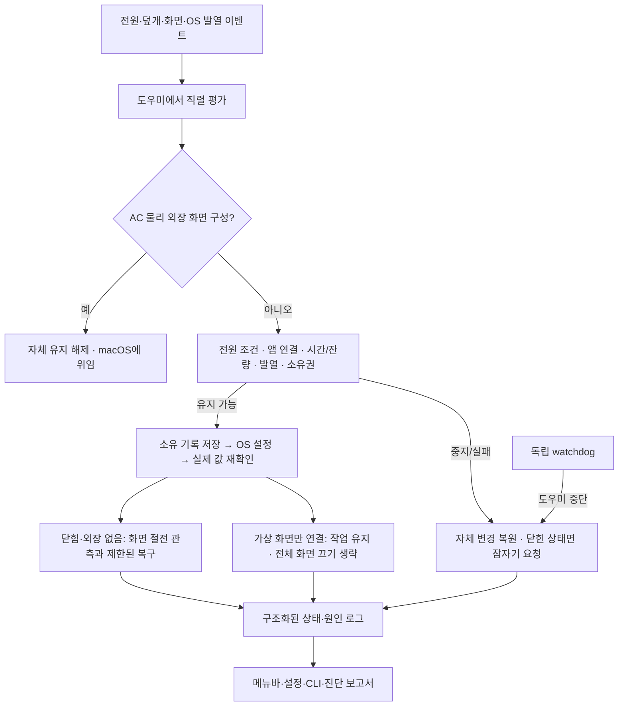

# Tether 빌드 49 구현 범위 기록

> **문서 분류 · 2026-10-21: 역사 자료 — 빌드49 구현 범위 기록.** 본문은 당시의 선택·근거로 보존한다. 현재 범위·기본값은 [기능명세서](PRODUCT-SPEC.ko.md), 새 수락 조건은 [현행 검증표](V5-VALIDATION-CHECKLIST.ko.md)를 따른다. 아래의 ‘현재·최신·최종’과 합격 수는 당시 대상에 한정하며 현재 전체 기능의 완료를 뜻하지 않는다.

2026-09-30 · 2026.9.1 Beta 7 · 빌드 49 이후 소스의 구현 기록. **다음 개발의 우선 기준은 [새 기능 정의](archive/2026-10-21-spec-cleanup/PRODUCT-SPEC-V4.ko.md)와 [재설계 아키텍처](ARCHITECTURE-REDESIGN.ko.md)**다. 아래 동작·시험 결과는 기존 구현의 증거이며 새 설계의 완료 증거로 전용하지 않는다. 사설 배포용 후보로, 공개 GitHub 배포는 별도 절차다.

**빌드 49 이후 소스 수정:** 가상 화면을 기본 클램쉘로 위임하던 회귀를 수정했다. 설치된 빌드 49에는 아직 적용되지 않았다. 새 단위 회귀 8개는 통과했으며 도우미 통합·실기기 재검증은 아래 제한을 따른다.

**2026-09-30 후속 설계 요구:** 다음 수정은 [모든 Apple Silicon Mac 지원 설계](APPLE-SILICON-SUPPORT.ko.md)를 따른다. 개발 소스의 최소 OS는 macOS 15로 정하고 26 이상에서만 Liquid Glass를 사용한다. [OS 분기·사용량 조사·남은 검증](MACOS-COMPATIBILITY.ko.md)을 기준으로 하며 노트북·데스크톱의 기능별 지원은 별도 구현 과제다. 아래 표는 현재 구현을 설명하며, 전 기종 대응과 원격 무잠금 요구의 재설계가 완료됐다는 뜻은 아니다.

## 남기는 여섯 기능

| 기능 | 실제 동작과 제공 옵션 | 책임 경계 |
|---|---|---|
| 전원 조건별 클램쉘 | 전원 연결 중만 / 배터리만 / 둘 다. 열린 덮개에서도 조건에 맞춰 닫힘에 대비한다. 끄기는 다시 직접 켤 때까지 유지한다. 가상 화면만 연결돼도 같은 조건을 적용한다 | 잠든 Mac을 케이블 연결만으로 깨우지 않는다. AC + 물리 외장 화면은 macOS에 맡긴다. 가상 화면에는 전체 화면 끄기를 요청하지 않는다 |
| 배터리 사용 예산 | 시작·전원 분리 시 시작 예약·직접 입력·연장·취소. 잔량 하한과 공유 시간 한도. 취소/재시작/짧은 전원 흔들림으로 예산이 초기화되지 않는다 | 잔량·시간은 사용자 사용 예산이며 제조사 손상 기준이 아니다. 충전 상한·방전 제어는 하지 않는다 |
| 내장 화면 절전 | 밝기를 바꾸지 않고 OS 화면 절전을 요청하고 관측한다. 화면이 잠깐 깨어나면 10초 이상 간격, 사건당 최대 3회 복구한다 | 화면 꺼짐·잠금·시스템 잠자기를 구분한다. 패널 전력 0은 측정하지 않는다. 단순 요청 성공을 화면 절전 성공으로 보지 않는다 |
| 발열·잔량 보호 | macOS 공개 thermalState가 심각/위험이면 다음 관측에서 자체 유지를 중단한다. 필수 잔량·발열 상태 누락도 중단한다. 정상/주의 및 잔량 여유를 확인한 뒤 직접 재개한다 | 팬·저전력·고성능 모드와 기본 외장 화면 발열 관리는 macOS에 맡긴다. 배터리 섭씨값은 선택적 진단 정보다 |
| 공존·장애 복구 | 다른 앱의 작업 유지와 화면 유지 요청을 구별한다. Tether의 현재 부팅 소유 기록·설정값을 대조해 복구하고 독립 watchdog을 유지한다 | 타 앱 요청 해제·강제 종료·잠금 방지·가짜 사용자 입력을 하지 않는다. 전역 설정이어서 모든 타 앱 변경을 완벽히 귀속할 수는 없다 |
| 업데이트·진단 | 정식/베타 채널, 서명된 업데이트, 원본 설정 백업·이관·롤백. 현재 상태/원인, 제한 시간 상세 기록, 최근 활동과 진단 보고서 | 기록은 로컬에 보관한다. 공개 피드 배포와 회사 Mac 설치·물리 시험은 자동 단위 시험과 별도다 |

## 이번에 보완한 것

- **장시간 화면 복구:** 덮개를 닫은 시간 전체에 3회 제한을 누적하던 구조를 수정했다. 60초 동안 화면 절전을 연속 관측하고 표본 간격이 10초 이내일 때만 해당 사건을 끝내고 예산을 갱신한다. 단일 성공 표본·관측 공백·미확인 값은 갱신 근거가 아니다. 지속 재점등과 10초 이상 연속 관측 실패는 중단한다.
- **기본 기능 중복 제거:** 새 세션은 macOS 에너지 모드를 쓰지 않는다. 옛 배터리/AC 모드 기록은 복원 전용 경로와 watchdog/제거기에 남긴다. 원복 실패 시 기록을 지우지 않고, 사용자가 중간에 바꾼 모드는 보존한다.
- **보호 기준 정리:** 40/43/45°C 같은 제품 온도 제한을 활성 정책에서 제거했다. 현재 `SafetyPolicy`는 OS 발열 상태만 사용하며, 2026-10-02 정리에서 퇴역한 온도 추천·제한 엔진을 제거했다. 구버전 배터리 한도 이관과 전원 모드 복구는 유지한다. 센서 미지원만으로 모든 클램쉘을 막지 않으며, 비정상 숫자는 진단 JSON 저장을 깨뜨리지 않게 처리한다.
- **기본 클램쉘 위임:** 외장 화면이 있을 때의 과열 잠자기와 저전력 자동 변경도 제거했다. 자체 유지를 제공하지 않는 상태에서는 OS의 작업을 대신 중단하지 않는다.
- **진단·UI:** 복구 중/화면 꺼짐 관측/조회 지연/중단을 구조화해 앱·CLI·보고서가 같은 값을 사용한다. 보호 화면에는 시스템 발열과 잔량·시간 예산을 앞에 두고 중복 옵션을 제거했다.
- **설정 형식 3:** 전원 조건, 잔량, 시간, 언어·알림 등 기존 선택을 보존한다. 원본 바이트는 별도 백업한다. 직접 온도 제한이나 자동 온도 기준을 쓰던 세션은 한 번 중지하고 새 기준을 확인한 뒤 재개하도록 알린다. 퇴역한 옵션은 도우미 API에서도 거절한다.

## 구조

`TetherCore`는 순수 정책·설정 이관·공유 상태, `TetherHelper`는 인증된 요청과 OS 작업, GUI/CLI는 조작과 설명을 맡는다. 복구 코드는 기능 제거 시 함께 지우지 않는다.

## 검증과 남은 확인

빌드 49의 단위 검사 301개(실제 IOKit 요청 4개 포함), 새 최종 범위 18개, 도우미 서비스 70개, 충돌 55개(600회 상태 전환과 32개 동시 요청 포함), 화면/로그 14개, 수명·복구 11개, 설치·롤백 7개, 제거 7개, 업데이트 피드 7개, 실제 Sparkle 합성 업데이트 10개를 모두 통과했다. 서명된 최종 앱 번들의 도우미로도 최종 범위 18개를 재확인했다. 자동 시나리오는 실제 도우미/소켓을 사용하되 전원 쓰기와 센서 입력은 모의값이다. 테스트 개수는 중복 없는 품질 점수가 아니다.

실제 IOKit 검사는 테스트 소유 요청 생성·해제와 다른 프로세스 요청 보존만 확인한다. 전원 설정·화면 끄기·시스템 잠자기는 유발하지 않는다. 비활성화 직후 조회 실패 1건이 있었고 원인은 확정하지 못했다. 유효한 관측을 최대 2초 기다리도록 시험을 보완했으며 미확인 응답만으로 통과시키지 않는다.

2026-09-30 이 Mac에 빌드 49 앱·도우미를 설치했다. 열린 덮개 AC에서 실제 커널 유지 해제·복원, 설정 형식 3 이관, 기존 선택과 전원 환경설정 보존, 30초 연속 상태, watchdog 등 16개 실행 확인을 통과했다. 좁은 보호 화면의 정렬·줄바꿈도 오프스크린 렌더링으로 확인했으나 실제 Liquid Glass 화면 승인을 대신하지 않는다.

2026-09-30 08:24–08:45 재시험에서 외장 화면 없는 AC 닫힘을 424개 연속 표본, 21분 13초 동안 관측했고 해당 구간 OS Sleep이 없었다. 이후 08:47:59 가상 화면 연결로 유지가 해제되고 08:48:25 실제 Clamshell Sleep이 발생했다. 이 실패가 이번 소스 수정의 근거다. 두 가지 전원 연결 순서, 회사 독/모니터, 원격 무잠금·LLM 실작업 조합과 장시간 내구성은 여전히 미확인이다.

이번 수정 후 관련 Swift 검사 93개 중 91개가 통과했다. 나머지 2개는 실행 환경의 `kern.bootsessionuuid` 접근 차단으로 소유권·재시작 시간 예산 전제가 충족되지 않아 실패했다. 새 원격 회귀 8개는 모두 통과했다. `scripts/test-remote-display.py`의 실제 도우미 dry-run 통합 시나리오는 같은 부팅 ID 제한으로 실행 전 차단됐다. 보호 가드를 우회하지 않았으며 앱 설치·물리 재검증·원격 잠금 해제를 완료했다고 하지 않는다.

차용 근거: [오픈소스 대조](OPEN-SOURCE-REVIEW.ko.md), [기본 기능·지원 범위 조사](SUPPORT-SCOPE.ko.md). 외부 앱 코드를 복사하거나 새 의존성을 추가하지 않았다. [보호 기준](PROTECTION-EVIDENCE.ko.md)과 [아키텍처](ARCHITECTURE.md)를 함께 본다.
