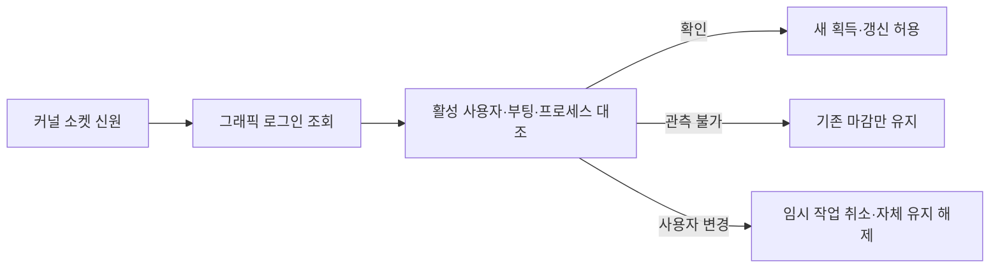

# GUI 로그인 세션 권한 보완

2026-10-01 · 빌드 **50**의 미배포 후보. 설치본 **49**와 실제 전원·잠금 설정은 변경하지 않았다. [D-06 이슈](https://github.com/jukqaz/tether/issues/7)는 구현·검증 진행 중이며 완료하지 않았다.

같은 사용자의 화면 잠금과 다른 사용자로의 전환을 분리했다. 같은 GUI 로그인을 유지하는 동안 화면 잠금·원격 연결 여부를 사용자 전환의 근거로 사용하지 않는다. 다른 사용자가 활성화되면 이전 Tether의 새 유지·갱신을 거절하고 자체 유지와 임시 작업을 종료한다. 사용자 전환을 이유로 전체 Mac에 잠자기 명령을 보내거나 새 사용자에게 권한을 자동으로 넘기지 않는다.

이 변경은 **잠금 해제나 무잠금 기능을 구현한 것이 아니다.** 실제 잠금 화면·원격 화면 수신·입력 전달은 D-02에서 별도로 검증한다.

이 문서는 앞선 GUI 권한 단계의 기록이다. 이후 [native 작성자 실행 직전 검증](GUI-WRITER-GATE-20261001.ko.md)을 추가했으며 최신 후보의 결과는 그 단계에서 구분한다.

## 신원과 집행

`LocalService`는 연결된 Unix 소켓의 `LOCAL_PEERPID`, `getpeereid`, `LOCAL_PEERTOKEN`에서 PID·UID·로그인 세션을 읽는다. JSON에 같은 이름의 필드를 넣어도 인증 메타데이터로 해석하지 않는다. `SessionGetInfo`로 그래픽 로그인 여부를 조회하고, `SCDynamicStoreCopyConsoleUser`가 제공한 활성 사용자 UID와 대조한다. 조회 API는 읽기 전용이다.

앱 연결에는 부팅 ID, PID·UID·프로세스 시작 시각·실행 파일 신원, OS 로그인 세션 ID를 함께 저장한다. UID는 계정이며 로그인 세션 ID는 해당 로그인의 신원이다. 원격 GUI에 그래픽 접근 권한이 있으면 원격이라는 이유로 거절하지 않는다. 그래픽 로그인이 없는 시스템/SSH 세션을 제어 GUI로 인정하지 않는다.

서비스는 캐시된 성공 응답을 반환하기 **전에** 권한을 다시 검사한다. 새 획득·시스템 잠자기·화면 절전 명령은 조정자에서 직전 권한을 조회한다. 사용자 전환 감지 시 잠자기 재시도와 화면 복구 예약도 취소한다. 전역 `SleepDisabled`가 다른 앱의 값이면 해제하지 않는다. OS 보안 세션 ID는 상태 응답·사용자 로그에 출력하지 않고 `confirmed/unavailable/revoked`만 제공한다.

일반 Mac용 사용자 assertion도 같은 권한 정책을 사용한다. 사용자 전환으로 수동 세션을 종료하고 자동 세션을 억제하며, 예전 수동 타이머를 복원하지 않는다. 명시적인 시작·자동 기능 재개 때 현재 GUI 신원을 다시 읽는다.

## 관측 공백과 이전 설정

- 정상 조회 후 관측이 불가하면 기존 자체 요청만 마지막 확인에서 **30초**까지 보존한다. 새 획득·기한 연장은 거절한다. 사용자 assertion에는 그 마감을 OS timeout으로 전달하며 관측 공백에서 갱신하지 않는다.
- 다른 로그인/활성 사용자 확인 시에는 즉시 권한을 철회한다. 원래 사용자가 돌아와도 철회된 lease는 저절로 부활하지 않는다. 새 연결 또는 명시적 현재 세션 확인이 필요하다.
- 시계가 역행하거나 유효하지 않으면 새 권한을 부여하지 않는다. 잘못된 시각 조회가 철회 상태를 복구하지 않는다.
- `HelperState`의 GUI 소유자와 승인 UID는 선택 필드로 추가했다. 설정 schema 3·IPC protocol 2는 유지한다. 이전 PID/UID/start 기록으로 로그인 세션을 추정하지 않고 새 커널 핸드셰이크를 요구한다.
- 명시적 끄기와 사용자의 기존 설정을 유지한다. 재연결로 임시 타이머·AC에서 대기 중이던 배터리 예약을 되살리지 않는다. 승인 UID는 연결 종료 후에도 남기며 다른 UID로 자동 이전하지 않는다.

30초와 3초 점검은 공학적 초기값이다. 전체 보호 해제 지연이나 제조사 내구성 보증값이 아니다. 기존 전역 lease·watchdog 복구 계약은 별도로 유지한다.

## 검증 범위

로컬 Swift 검사와 격리된 비관리자 도우미 시험을 수행했다. 실제 소켓·커널 토큰·Security 조회를 사용하되 사용자 전환과 센서·전원 명령은 fixture로 주입한다. GUI 로그인이 없는 CI 환경은 native GUI 시험을 `SKIP`으로 표시하며 통과로 계산하지 않는다. 같은 로그인의 잠금/원격 라벨 시험은 실제 화면 잠금이나 원격 입력의 증거가 아니다.

| 검사 | 결과 | 증거 범위 |
|---|---|---|
| Swift 단위·어댑터 | **424 통과 · 5 건너뜀 · 0 실패** | Core 401 통과/5 건너뜀, 사용자 앱 23 통과. 새 GUI 관련 검사 18개 포함 |
| 포장 도우미 GUI IPC | **11 통과** | 실제 커널 로그인 토큰 + 모의 활성 사용자/전원. 이전 상태 이관 포함 |
| 포장 도우미 기능 범위 | **19 통과** | 실제 IPC + 모의 전원/센서. 확인된 네이티브 위임과 미확인 외장 구성의 자체 보호 구분 |
| 이번 단계의 기존 회귀 | 서비스 **70**, 수명 **11**, 충돌 **49** 통과 | GUI clock 방어 추가 전 단계의 debug 도우미. 해당 fixture의 GUI 권한 강제 검사는 꺼져 있어 native GUI 성공으로 세지 않음 |
| 로컬 패키지 | 통과 | arm64/macOS 15 배포 대상, 4개 실행 역할 서명·기능, 실제 포장 도우미 소켓·CLI 상태 및 격리된 재개/중지 |

실행 결과와 파일 해시는 이 단계의 별도 검증 기록에 보존한다. 두 이전 외장 화면 fixture는 화면 존재만으로 네이티브 위임을 기대했다. 변경 전 포장 도우미로 같은 결과를 재현한 뒤 `nativeDisplayVerified` 증거를 추가했고, 미확인 외장 화면에서는 자체 보호를 적용하는 반대 조건도 추가했다. 초기 실패 기록은 삭제하지 않는다. 새 반대 조건은 외장 화면이 있을 때 전체 Mac에 AC 보호 잠자기를 요청하지 않는 기존 정책도 검사한다.

이전 상태 이관 시험은 바뀌지 않은 파일을 불필요하게 다시 쓰지 않는 계약을 반영했다. `controllerUID`의 선택 필드가 아직 파일에 없으면 저장된 `appUID`를 승인 소유자 fallback으로 사용하고, 성공한 새 핸드셰이크 저장 때 GUI 소유자와 승인 UID를 함께 기록한다.

## 남은 완료 조건

1. 관리자 도우미가 실행되는 실제 빠른 사용자 전환, 로그인/로그아웃, 같은 사용자 잠금, 원격 GUI와의 공존 시험.
2. 전원 작성자 journal과 일회성 실행 게이트에서 GUI 소유자/현재 권한을 재검증하는 실행 단계 연결. 현재 조정자 직전 검사는 지연된 작성자의 전환 경합까지 증명하지 않는다.
3. 현재 활성 GUI 로그인 세션 ID와 저장된 소유자 SID를 직접 대조하는 범위 검증. 현재 root 경로는 저장된 SID의 그래픽 유효성·프로세스 수명·활성 UID를 확인하며, 동일 UID의 여러 GUI 로그인이나 살아 있는 프로세스의 세션 변경까지 입증하지 않았다.
4. 다른 사용자에게 제어권을 넘기는 명시적 관리자 재승인 경로. 현재 승인 UID를 임의 교체하지 않지만 재승인 UI/설치 경로는 아직 없다.
5. macOS 15 실기기·여러 Apple Silicon 모델, 실제 Sleep/닫힌 전원 연결, 업데이트·롤백과 사용자 전환의 교차 시험.

패키지 빌드·임시 소켓/CLI 실행과 실제 설치·업데이트·배포를 구분한다. 이번 후보를 설치하거나 GitHub에 푸시·배포하지 않았다. [남은 설계 조건](DESIGN-GAPS.ko.md), [업데이트 계약](UPDATES-AND-MIGRATION.ko.md), [작성자 게이트](WRITER-GATE-20261001.ko.md)를 함께 적용한다.

## 근거

Apple의 [빠른 사용자 전환과 로그인 세션 구분](https://developer.apple.com/library/archive/documentation/MacOSX/Conceptual/BPMultipleUsers/Concepts/FastUserSwitching.html), [SessionGetInfo](https://developer.apple.com/documentation/security/sessiongetinfo(_:_:_:)), [그래픽 접근 속성](https://developer.apple.com/documentation/security/sessionattributebits/sessionhasgraphicaccess)과 현재 SDK 헤더를 대조했다. 소켓 audit token 및 프로세스 신원 검사는 현재 Mac의 실행 결과로 별도 검증했다. 타 앱 코드를 복사하거나 외부 의존성을 추가하지 않았으며 Security.framework와 시스템 libbsm을 연결했다.
