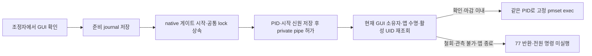

# GUI 권한을 전원 명령 실행 직전에 확인

2026-10-01 · **빌드 50 미배포 후보**. 설치본 49와 시스템 전원·화면 잠금 설정은 변경하지 않았다. [전원 거래 #2](https://github.com/jukqaz/tether/issues/2), [GUI 권한 #7](https://github.com/jukqaz/tether/issues/7)은 진행 중이다.

이미 승인된 전원 명령도 실제 실행을 기다리는 동안 제어 앱이 종료되거나 GUI 권한이 철회될 수 있다. 조정자가 처음 명령을 승인한 사실만으로 실행하지 않고, 일회성 native 게이트가 `execv` 바로 전에 다시 확인한다. 새 절전 방지, 화면 절전, 시스템 잠자기가 대상이다. 자체 절전 방지 해제와 이전 에너지 설정 원복은 GUI 제어권 상실 후에도 가능하다.

## 순서와 신원

journal의 GUI 소유자는 부팅 ID, 앱 PID·UID·시작 시각·실행 파일, GUI 로그인 ID로 구성한다. 게이트는 준비/실행 journal의 신원·의도·마감이 같음을 확인하고, 현재 `helper-state.json`의 승인 사용자와 앱 신원이 일치하는지 다시 읽는다. 공개 Security API의 그래픽 로그인 조회와 활성 콘솔 사용자 UID, native 프로세스 조회를 대조한다. 명령 인자나 환경 변수로 root의 GUI 확인을 생략하거나 실행 대상을 바꿀 수 없다.

상태 파일은 `O_NOFOLLOW`로 연 하나의 FD에서 소유자·0600 모드·단일 link를 검사해 읽는다. 지원 폴더도 실행기의 소유이며 group/other 쓰기가 금지되어야 한다. 읽기 lock 대기는 기존 250 ms 상한을 사용한다. GUI 확인 뒤에도 마감을 다시 확인하므로 조회 대기가 지난 마감의 실행 허가로 바뀌지 않는다.

조정자에서 GUI가 거절되면 작성자는 시작하지 않는다. 이 경우 `terminationConfirmed=true`, PID 없음, 상태 77을 반환해 작성자 수명 미확인과 구분한다. 부모 사망·등록 누락·timeout의 기존 lock/journal 계약은 유지한다. 종료 확인만으로 OS 효과가 취소되었다고 판단하지 않는다.

## 업데이트 호환성

`power-writer-gate-v2`로 실행 계약을 구분한다. helper와 독립 복구 실행기를 모두 검사하며 v1 실행기를 새 계약으로 인정하지 않는다. v1 실행기와 v2 helper가 섞이면 검증된 v2 helper로 고정 복구 명령을 보낸다. 둘 다 v1이면 새 라이브러리는 전원 쓰기를 거절한다. 설치기는 새 묶음의 독립 복구 실행기를 먼저 검사해 이전 서비스 복구에 사용한다.

journal schema 1에 선택적 `guiOwner`를 추가했다. 기존 기록은 읽을 수 있지만 root의 새 유지·화면/시스템 잠자기에 GUI 권한을 만들어 주지 않는다. 원복·해제는 계속 가능하다. 설정 schema 3과 IPC protocol 2를 유지하며 저장된 끄기와 전원 조건을 보존한다. 기존 임시 세션은 재생하지 않는다.

## 로컬 검증

| 검사 | 결과 | 범위 |
|---|---|---|
| Swift 전체 | 436 통과, 5 건너뜀, 실패 0 | Core 418 실행 중 5 건너뜀 + 앱/업데이트 23 통과. 새 GUI 작성자 회귀 12개 포함 |
| native GUI 작성자 | 16 통과 | 실제 프로세스·Security GUI 조회·pipe·exec, 비관리자 임시 Mach-O 대상 |
| 작성자 게이트 | 6 통과 | 등록 전/후 부모 사망, 마감, 잘못된 진입 |
| 독립 복구 실행기 | 10 통과 | 기존 8개 + v1/v2 혼합 2개 |
| 복구 lock / helper 작성자 guard | 각각 6 통과 | 모의 전원 효과와 자체 작성자 복구 |
| 설치·원복 / 제거 | 22 / 10 통과 | 비관리자 임시 파일과 모의 OS 명령 |
| 포장 helper GUI 서비스 / 기능 범위 | 11 / 19 통과 | release helper의 실제 소켓·신원 조회와 모의 센서/전원 효과 |
| 로컬 앱 묶음 | 통과 | arm64·macOS 15 배포 대상, 4개 실행 역할의 strict 서명·v2 식별, 소켓/CLI 준비 경로 |

GUI 작성자 시험은 세 명령의 정상 실행과 대기 중 GUI 승인 제거를 확인한다. 승인 UID·앱 PID·시작 시각·로그인·부팅 불일치, 오래된 상태, 파일 누락/불안전 모드, 실제 fixture 제어 프로세스 종료에서 대상 미실행과 77을 확인했다. 승인 철회 뒤 유지 해제는 실행된다. 모든 대상 효과는 전용 임시 파일이며 실제 pmset을 호출하지 않는다. GUI 로그인이 없는 CI는 이 native 시험을 `SKIP`으로 표시한다.

5개 Swift 건너뜀은 opt-in 실제 IOKit assertion 시험이다. 통과 수에 포함하지 않는다. 새 root 정책은 순수 회귀에서 검사했으며 실제 관리자 실행·사용자 전환 성공으로 표현하지 않는다. 포장의 최소 OS 값은 macOS 15 실제 실행의 증거가 아니다. private/ad-hoc 후보이며 배포용 서명 archive·feed와 전체 관리자 업데이트 경로는 미검증이다.

## 남은 한계

- 활성 콘솔 API는 UID를 제공한다. 저장된 로그인 ID의 그래픽 접근·현재 앱 수명을 확인해도 **같은 UID의 다른 GUI 로그인**이나 앱의 audit 세션 변경을 완전히 식별했다는 증거는 아니다.
- 마지막 조회와 OS 명령 실행을 묶는 원자적 API는 구현하지 않았다. 실제 사용자 전환 및 root 실행에서 남은 경쟁 구간을 검증해야 한다.
- `IOPMSleepSystem` 직접 호출 경로에는 조정자의 GUI 직전 검사가 적용된다. 이 native pmset 게이트가 그 호출을 대체한 것은 아니다.
- 정책 마감·소유권·최신 전원 의도·OS 실제 효과와 전체 보호 지연의 완료 조건은 별개다. 실제 닫힌 전원 연결, 잠금/원격 입력, macOS 15 실행, 여러 Apple Silicon 기기의 확인은 남아 있다.

[전체 남은 조건](DESIGN-GAPS.ko.md)과 [앞선 GUI 권한 단계](GUI-AUTHORITY-20261001.ko.md)를 함께 적용한다. 이번 단계로 D-06이나 배포 완료를 선언하지 않는다.
