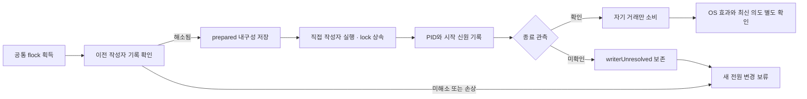

# 전원 작성자 복구와 업데이트 원복 검증

2026-09-30 · 소스 후보 `2026.9.1 Beta 8`, 빌드 **50**, 최소 macOS **15**. 설치된 앱은 빌드 **49**이며 이번 변경은 설치·게시하지 않았다.

helper가 전원 명령 실행 도중 종료돼도 옛 작성자와 새 도우미·watchdog·설치기가 동시에 전원 값을 바꾸지 않도록 보완했다. 도우미 교체 실패 시 이미 해제한 소유권을 복구 설정으로 되살리던 오류도 수정했다. 모든 OS·기기·원격 환경의 동작이 검증됐다는 뜻은 아니다.

이 문서는 작성자 journal을 추가한 첫 단계의 실행 결과다. 이후 shell 복구 명령에도 독립 실행기를 연결한 변경과 최신 검증은 [복구 실행기 단계](RECOVERY-EXECUTOR-20260930.ko.md)에 기록한다. 아래 검사 수는 해당 이전 단계의 수치로 보존한다.

## 작성자의 수명과 거래

`PowerWriterJournal`은 고정된 직접 실행 명령에 대해 다음 순서로 동작한다. 운영 helper의 실행 파일은 `/usr/bin/pmset`이며 사용자 IPC가 임의 명령을 제공하지 않는다.

1. 보호된 공통 recovery flock 안에서 앞선 기록을 검사한다. 기록이 손상됐거나 종료가 미확인이면 후속 쓰기를 막는다.
2. 거래 UUID, 부팅 신원, 부모 신원, 마감, 현재 의도 세대가 담긴 `prepared` 기록을 0600으로 쓴다. 파일과 부모 디렉터리를 동기화한 뒤 실행한다.
3. 직접 작성자에게 flock이 연결된 stdin을 상속하고 실행 후 PID·UID·시작 신원을 기록한다. 부모가 죽어도 작성자가 살아 있는 동안 같은 lock을 사용할 수 없다.
4. timeout에서는 SIGTERM/SIGKILL 발송과 실제 종료 관측을 구분한다. 종료 확인 뒤 자기 거래만 소비하며 옛 완료가 새 거래를 지우지 못하게 한다.
5. 종료 미확인이면 `writerUnresolved`를 유지한다. 복구는 만료한 직접 작성자의 세대·프로세스 수명·실행 파일을 재검사한 뒤 제한된 종료를 시도한다. PID가 재사용됐으면 새 프로세스를 종료하지 않는다.

공통 lock 파일은 Tether 지원 폴더 밖에 두며 journal의 atomic rename이나 제거 작업으로 교체하지 않는다. 소유권 lease와 작성자 수명 기록은 서로 다른 자료다. 작성자 종료만으로 OS 적용 성공·취소를 선언하지 않는다.

## 이전 버전에서의 교체

알 수 없는 인자를 무시하고 서비스를 시작하는 옛 helper가 있을 수 있으므로 새 복구 모드를 곧바로 실행하지 않는다. 먼저 기존 설정 검증 기능의 존재를 확인하고 그 모드에서 `power-writer-recovery-v1` 응답을 받아야 새 복구 인자를 전달한다. 검증 기능도 없는 helper는 probe 실행을 생략한다.

설치기는 사용자 설정·이전 바이너리·plist의 원복과 실행 중 lease를 분리한다. 이미 OS 해제를 확인하고 소비한 `power-ownership.json`을 원복으로 재생하지 않는다. `power-writer.json`도 옛 설정 백업으로 덮지 않는다. schema 1/2/3 이관에서 켜기/끄기, 전원 조건, 시간·잔량 한도와 로그 선택을 보존한다. 손상·미래 schema는 기본값으로 덮지 않고 중단한다.

## 이번 실행 결과

| 검증 | 결과 | 실제 실행 범위 |
|---|---:|---|
| 전체 Swift 단위 검사 | 403 통과 · 5 건너뜀 · 0 실패 | Core 388건 중 5개 실 OS 검사 건너뜀, 앱 업데이트 20건 통과 |
| helper 통합 | 213 통과 | 실제 helper/IPC와 합성 센서·전원 명령. 서비스 70, 수동 세션 27, 전원 보완 16, 조정 14, 충돌 49, 원격 화면 정책 25, recovery lock 6, 작성자 guard 6 |
| 설치·이관·실패 원복 | 20 통과 | 실제 설치 스크립트·dry-run helper, 임시 파일·모의 OS/launchd |
| 제거 | 10 통과 | 실제 제거 스크립트, 임시 파일·모의 OS/launchd |
| 부모 SIGKILL·구버전 probe | 5 통과 | 실제 격리 프로세스와 flock, 임시 늦은 파일 쓰기 확인 |
| 같은 표시 버전의 Sparkle 업데이트 | 3 통과 | 실제 엔진·서명 피드·전체 합성 앱 교체. 49→50 교체, 51→50과 50→50 제외 |
| 피드 정책 | 9 통과 | 정식/베타·빌드·최소 OS·서명 URL 회귀 |
| 앱 포장 | 통과 | macOS 15 arm64 메타데이터, ad-hoc 서명, 스크립트 원본 일치·복구 기능 probe, 시험 fixture 미포함 |

전체 Swift 검사 후 변경한 빌드 식별과 사용자 오류 문구는 helper·앱 재빌드로 확인했다. 이전 실패 로그도 보존한다. 초반 SIGKILL 통합 시험 2건은 시험 fixture가 macOS의 `/tmp` 경로 정규화를 잘못 거부해 실패했으며, fixture 수정 후 최종 5건을 다시 통과했다. 최종 결과로 이전 실패를 삭제하거나 숨기지 않는다.

## 남은 제한

- PID 등록 전 부모가 죽은 창에서는 상속 flock으로 경쟁은 막지만, 신원 없는 작성자를 추정해 종료하지 않는다. 정해진 시간 안에 자동 복구된다는 보장은 아직 없다. 시험에서 해당 상황의 차단과 기록 보존을 확인했고 정리는 격리 시험 프로세스에만 수행했다.
- 이 단계에서는 watchdog·설치·제거의 새 pmset 명령에 PID·마감 journal이 없었다. 이후 [독립 실행기 단계](RECOVERY-EXECUTOR-20260930.ko.md)에서 연결했지만 PID 등록 전 복구 등 D-04의 남은 조건은 유지한다.
- shell fallback은 동일 flock 획득과 제한된 기록 검증을 사용하며 native 프로세스 신원 검증과 같은 수준의 증거가 아니다. 직접 명령의 FD 수명 가정과 OS 접수 후 효과 확인은 별도다.
- 실제 Tether Sparkle 화면→앱 재시작→관리자 도우미 교체, 물리 Sleep·닫힌 AC 연결·잠금/원격 입력, 빠른 사용자 전환, macOS 15 실행 및 여러 Apple Silicon 모델은 이번 시험에 포함하지 않았다.
- 새 코드·문서·CI 정의는 로컬 변경이며 GitHub Actions 실행·소스 푸시·배포는 아직 하지 않았다.

남은 과제는 [통합 이슈 #10](https://github.com/jukqaz/tether/issues/10), [업데이트 #1](https://github.com/jukqaz/tether/issues/1), [작성자 복구 #2](https://github.com/jukqaz/tether/issues/2), [설계의 제한](DESIGN-GAPS.ko.md)에서 관리한다.
