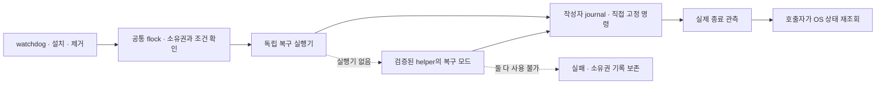

# 독립 전원 복구 실행기 검증

2026-09-30 · `2026.9.1 Beta 8`, 빌드 **50**, macOS **15 이상**의 로컬 후보다. 설치본은 **49**이며 새 후보를 설치하거나 게시하지 않았다.

watchdog·설치·제거에서 시작하는 전원 복구 명령도 작성자 수명 기록을 사용하도록 바꿨다. 기존 helper가 실행되지 않는 경우를 위해 별도 `TetherRecoveryCLI`를 포장한다. 서비스나 IPC를 시작하지 않고, 현재 부팅의 작성자 확인과 고정 복구 명령만 수행한다.

이 문서는 독립 실행기 연결 단계의 기록이다. 이후 새 작성자의 PID 기록 전 실행을 차단한 변경과 최신 실행 결과는 [2026-10-01 대기 경로 검증](WRITER-GATE-20261001.ko.md)에 구분한다. 아래 수치는 해당 이전 단계의 수치로 보존한다.

## 실행 경계

운영 파일은 `/Library/PrivilegedHelperTools/local.tether.power-recovery`이며 앱에는 `Contents/Resources/tether-power-recovery`로 포함한다. root 실행은 테스트 환경변수를 무시하고 `/usr/bin/pmset`만 사용한다. 테스트 대체 명령은 비관리자 실행과 소유자 전용 임시 폴더를 모두 만족할 때만 허용된다.

`--write`는 호출자가 stdin으로 전달한 **같은 recovery flock**을 확인한다. 허용한 작업은 `disablesleep 0`과 `sleepnow`뿐이며 새로운 절전 방지 획득이나 임의 명령을 받지 않는다. 실행 전 `prepared` 기록, 실행 후 PID·UID·시작 신원, 마감과 실제 종료 결과는 기존 `PowerWriterJournal`로 관리한다. 복구 실행기에는 2초 명령 제한과 별도의 종료 관측이 있다. 실행기 자체의 시작부터 전체 OS 효과까지 2초 안에 완료된다는 보장은 아니다.

`--resolve`는 만료한 작성자의 거래·프로세스 수명·실행 파일을 재확인한다. `--clear`는 공통 flock을 보유하고 해소된 거래만 소비한다. 소유권 확인, 전원·덮개 조건 판단, OS 효과 재조회는 호출자의 책임으로 유지한다. 명령 성공만으로 실제 잠자기나 화면 전력 0을 선언하지 않는다.

독립 실행기가 없으면 기능 응답을 확인한 helper 복구 모드만 사용한다. 두 경로가 모두 없으면 bare `pmset`으로 우회하지 않고 실패를 기록하며 소유권 자료를 보존한다. 알 수 없는 새 인자를 무시하는 구버전 helper에는 기존 `--validate-settings` 검증 경로에서 먼저 기능을 확인한다.

## 설치·원복·제거

설치기는 새 실행기의 안전한 파일 속성과 기능 응답을 **기존 서비스 종료 전에** 확인한다. 누락·쓰기 가능한 위험한 바이너리는 기존 파일을 교체하지 않고 거부한다. 도우미·watchdog·복구 라이브러리와 함께 복구 실행기도 백업·설치·원복하며, 설치된 복구 도구는 root 소유로 둔다.

이미 OS 해제를 확인하고 소비한 전원 소유권은 실패 원복에서 되살리지 않는다. 작성자 journal도 설정 백업으로 덮지 않는다. 제거는 복구 확인 뒤 실행기를 지우고, 지원 폴더 밖의 공통 lock inode는 유지한다.

## 검증 결과

| 검사 | 결과 | 실제 범위 |
|---|---:|---|
| 전체 Swift 검사 | 404 통과 · 5 건너뜀 · 0 실패 | Core 389건 중 5개 실 OS 검사 제외, 앱 업데이트 20건 통과 |
| 독립 복구 실행기 | 8 통과 | 실제 native 프로세스·flock, 모의 고정 전원 명령. 성공·실패·TERM 무시·부모 SIGKILL·대체 경로 검증 |
| 부모 종료·구버전 기능 확인 | 5 통과 | PID 등록 전/후 강제 종료와 미확인 작성자 차단. 시험 정리도 native 시작 신원을 확인 |
| 공통 lock·작성자 guard | 12 통과 | 실제 helper/IPC, dry-run OS 쓰기. 손상·미래 기록·경쟁·소유권 보존 |
| 설치·이관·실패 원복 | 22 통과 | 임시 폴더·모의 OS/launchd·실제 dry-run helper. 새 실행기 누락·위험한 권한 거부 포함 |
| 제거 | 10 통과 | 임시 폴더의 실제 제거 스크립트·모의 OS |
| 플랫폼 포장 회귀 | 7 통과 | 실제 Mach-O의 arm64·최소 OS·아이콘·복구 바이너리 누락 검사 |
| 후보 앱 포장과 실행 경로 | 통과 | 앱·helper·복구 실행기·CLI 서명, 원본 리소스 일치, fixture 미포함, 포장된 helper 소켓·CLI·기능 응답 |

새 복구 바이너리를 검사 목록에 넣으면서 숫자 인덱스로 일반 CLI를 고르던 포장 검사 오류도 수정했다. 현재 검사는 실행 파일을 이름으로 고르고, 실제 포장된 CLI에 `status`를 보내며 helper의 준비·resume/stop 경로를 확인한다.

전체 Swift 검사는 복구 실행기 변경 뒤 실행한 결과다. 이후 변경한 것은 시험 fixture 정리와 포장 검사이며, 관련 부모 종료·실행기 시험과 실제 포장 경로를 다시 확인했다. 더 이전 helper 213건·Sparkle 3건 등은 [이전 단계 기록](POWER-WRITER-RECOVERY-20260930.ko.md)으로 보존하며 이번 재실행 횟수에 더하지 않는다.

## 완료하지 않은 조건

- **D-04는 진행 중이다.** PID 등록 전 부모가 죽으면 상속 lock은 경쟁을 막지만 신원 없는 작성자를 추정해 종료하지 않는다. 정해진 시간 안의 자동 복구는 아직 보장하지 않는다.
- 실행기 시작 자체가 OS 로더 등에서 지연되는 경우의 상한은 검증하지 않았다. 작성자 종료가 이미 OS에 접수된 효과의 취소를 증명하지 않는다.
- 실제 관리자 설치·Tether 전체 Sparkle 업데이트·물리 Sleep/Wake·잠금·원격 입력·빠른 사용자 전환·macOS 15 실행·여러 모델은 이번 검증에 포함하지 않았다.
- 이번 후보는 미커밋 소스의 로컬 포장이다. 새 ZIP/서명 피드 검증, GitHub Actions 실행, 푸시·배포는 완료하지 않았다. 현재 컴퓨터의 전원·잠금 설정은 변경하지 않았다.

남은 조건은 [업데이트 #1](https://github.com/jukqaz/tether/issues/1), [작성자 복구 #2](https://github.com/jukqaz/tether/issues/2), [통합 #10](https://github.com/jukqaz/tether/issues/10), [설계의 제한](DESIGN-GAPS.ko.md)에서 추적한다.
