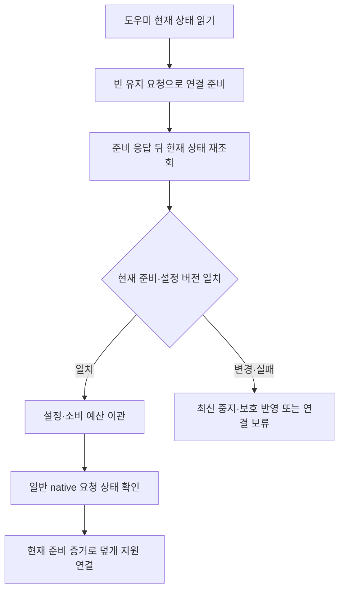

# 기존 도우미에서 공통 세션으로 이관

빌드 50 후보에서 설정 이관이 꺼짐 선택을 해제하거나 임시 타이머를 새로 시작하는 경로를 수정했다. 기존 공통 설정의 자동 조건도 보존한다. 도우미의 연결 준비를 확인하고 현재 상태를 다시 읽은 뒤 일반 작업을 시작하며, 오래된 연결 요청으로 더 최근의 중지를 되돌릴 수 없게 했다. 전체 업데이트·실기기 완료를 의미하지 않는다.

## 재현한 문제

- 기존 설정을 사용자 조작용 함수로 적용하면서 `automaticSuppressed`가 풀려 새 일반 유지 요청이 생겼다.
- 이미 이관한 공통 설정의 자동 끄기·전원 조건·배터리 시간이 아직 이관하지 않은 root 설정으로 덮어써졌다.
- 기존 임시 배터리 타이머와 소비 예산을 읽고 새 3시간 유지로 다시 시작했다.
- 실제 격리 도우미 소켓에서 revision 1을 읽은 뒤 중지로 revision 2가 됐는데, revision 1의 연결 요청이 성공하고 다시 켜졌다. 당시 OS 쓰기는 dry-run이었다.

앞의 세 Swift 회귀는 수정 전 11개 assertion에서 실패했다. 마지막 IPC 재현도 실패로 기록한 뒤 새 연결 계약으로 막았다. 단순 코드 추정과 실제 시스템 효과를 구별한다.

## 설정의 기준

공통 사용자 설정은 v4다. v1/v2의 원본을 보존하고 `legacyRootConfigurationPending`으로 기존 도우미 설정을 기다린다. v3는 이미 공통 정책의 선택이므로 자동 조건과 시간을 다시 가져오지 않는다. 미지원 미래 설정은 추측해서 변환하지 않는다.

도우미의 기존 꺼짐은 명시적으로 새로 활성화하지 않은 공통 설정에도 적용한다. 준비 중 사용자가 끄면 꺼짐이 유지된다. 사용자가 새 수동 세션을 시작했다면 그 의도는 별도로 유지하며 자동 조건을 임의 변경하지 않는다. 배터리 잔량 하한은 높은 값, 시간 상한은 짧은 값을 보존한다.

이관은 일반 조작 함수와 분리했다. 중지·소비 예산을 지우지 않으며 같은 부팅의 더 이른 시작을 보존한다. 과거 임시 유지·예약은 새 활성 타이머로 복원하지 않는다. 실제 현재 세션의 마감은 보존한다. 준비 후 실패·재시작에 대비해 root의 공통 모드 확인 또는 새 명시적 사용자 조작 전에는 이관 대기 정보를 완료로 처리하지 않는다.

## 연결 순서

외부 IPC 형식은 v2, 작업 lease와 읽기 전용 bridge는 v1을 유지한다. 공통 조정자 기능은 v2로 올려 준비 기능이 없는 v1·알 수 없는 미래 기능을 구분한다. 알려진 미지원 공통 조정자를 기존 `attachApp` 경로로 우회하지 않는다. 사용자 일반 유지와 덮개 확장의 오류는 분리한다.

`prepareWorkSession`은 활성 grant가 아니다. root가 가진 현재 epoch·설정 revision·공통 session UUID·90초 이내 마감을 갖고, 커널에서 확인한 호출 UID/PID/프로세스 시작 신원에 묶인다. 기존에 소유한 닫힌 AC 유지는 준비 때문에 해제하지 않는다. 기존 유지가 없으면 준비만으로 새 전역 유지를 획득하지 않는다.

클라이언트는 준비 성공 응답만 믿지 않고 snapshot을 다시 읽어 같은 증거인지 확인한다. 뒤늦은 ACK, 중지, 재시작·교체는 새 native 획득 전에 구별한다. 실제 attach에서 도우미가 epoch/revision·준비 마감·호출 신원을 다시 확인한다. 준비 정보는 프로세스 메모리에만 두며 재시작·연결 종료 뒤 복원하지 않는다. revision 충돌 재시도는 8회로 제한한다. 독립적인 전원 작성자 journal과 이 준비 증거를 혼동하지 않는다.

최종 상태를 다시 읽은 **이후** 발생하는 모든 외부 변경과 OS 효과를 단일 원자적 거래로 보장한다는 뜻은 아니다. 기존 유한 lease·외부 중지 확인·보호 집행과 이후 관측이 계속 필요하다. 화면·잠금·원격 서비스 설정은 변경하지 않는다.

## 확인 범위

| 검사 | 확인 결과와 범위 |
|---|---|
| 전체 Swift | 534 통과: Core 467 + 앱·업데이트 67, 실패·건너뜀 0. 이번 회귀 11개와 native 6개는 전체에 포함 |
| 새 연결 IPC | 실제 격리 도우미·커널 peer의 8개. 전원 쓰기는 dry-run |
| 기존 공통 세션 IPC | 실제 격리 도우미의 10개. lease 순서·만료·소유권·보호·재시작 확인, 전원 쓰기는 dry-run |
| 교차 회귀 | 기존 14개, 격리·dry-run 범위 |
| 설치·원복 | 모의 OS 34개, 실제 업데이트 완료 증거 아님 |
| 포장한 빌드 50 | arm64·최소 macOS 15·deep/strict 서명·리소스 일치·시험 fixture 제외·읽기 전용 설치 판정·도우미 소켓/CLI 확인. 같은 도우미 IPC 8+10개와 같은 CLI 회귀 2개 통과 |

서명은 사설 사용 후보의 ad-hoc 서명이며 공증이나 업데이트 feed 서명 완료를 뜻하지 않는다. 현재 설치본은 빌드 49다. debug와 포장 실행 파일에서 같은 시나리오를 반복해도 서로 다른 기능의 개수로 합산하지 않는다. Swift native 시험은 비관리자 idle/display 요청과 공존·만료의 근거이며 root 덮개 전원 효과의 근거로 확대하지 않는다.

## 남은 조건

- 실행 중 기기 기능 관측이 회복될 때 같은 공통 controller·소비 예산을 보존하며 실행 경로를 갱신하는 작업이 남는다. 현재 시작 시의 기능 판정만으로 모든 복구 전환을 완료했다고 하지 않는다.
- 실제 관리자 도우미에서 구버전 유지→새 native 일반 유지→덮개 확장의 전환, 실제 앱 hang·종료·사용자 전환과 보호 해제 지연을 측정해야 한다.
- 실제 Sleep 뒤 닫힌 AC 연결의 Wake 가용성, 화면 절전과 잠금 정책, 원격 화면·입력, 기본 클램쉘·외부 요청의 공존은 별도 실측이다.
- macOS 15 및 Apple Silicon MacBook·데스크톱의 지원 행렬, 실제 Sparkle 전체 업데이트·설정 이관·실패 원복을 확인해야 한다.

[#1](https://github.com/jukqaz/tether/issues/1)과 관련 D-01~07은 남은 완료 조건 때문에 열린 상태다. 로컬 수정과 포장은 커밋·푸시·원격 CI·설치·공개 배포와 구분한다.
