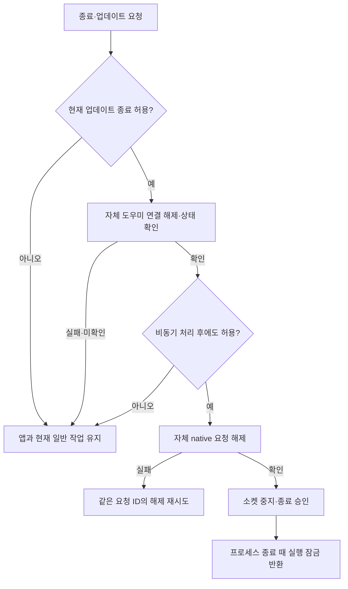

# 종료 실패와 업데이트 재실행 경계

2026-10-01 · 미배포 빌드 50 후보. **도우미 연결 해제 실패로 앱 종료가 취소되면, 정상적인 일반 작업 세션을 같은 조정자·원래 마감으로 유지한다.** 업데이트 종료 중 덮개가 닫히거나 조회되지 않으면 종료 승인을 보류한다. 설치본 빌드 49에는 이번 수정이 적용되지 않았다.

## 후속 보완: 해제 완료 뒤 업데이트 취소

이전 555개 단계는 일반 작업 보존을 확인했지만, 도우미 해제 후 업데이트가 보류되면 덮개 lease가 비어 있는 상태를 그대로 두었다. legacy 경로는 `appConnected=false`·`ownsOverride=false` 응답에서 최신 업데이트 gate를 확인하기 전에 종료를 승인했다. 수정 전 집중 회귀 4개에서 19 assertion failures로 두 경로를 재현했다.

현재는 자체 해제를 새 snapshot으로 확인하고 현재 GUI 소유권·보호·기기 관측·full wake·기존 일반 작업이 유효할 때만 같은 세션의 finite 준비→재조회→부착을 재사용한다. 원래 session ID·수동 마감·설정·소비한 배터리 예산은 보존한다. 준비 IPC 뒤에도 사용자·만료·보호 상태를 재확인한다. 권한이나 관측이 없어 재획득하지 못하면 안내를 남기며, 남은 빈 preparation의 해제는 계속 허용한다. legacy의 이미 분리된 응답도 종료 성공 반환 전에 최신 gate를 확인한다.

신규 회귀 4개와 기존 비동기 경계 1개를 확장했다. 배터리 소비 검사는 실제 단조 시각의 짧은 경과를 사용해 유효 lease 시간을 넘기는 합성 시각 오류와 제품 결함을 구분한다. 최종 전체 Swift **660개(Core 532 + 앱·업데이트 128), 실패 0·건너뜀 0**가 통과했다. 비관리자 native 7개는 전체에 포함되며 별도 품질 점수로 더하지 않는다. 집중 CommonSessionRoutingTests는 opt-in 없이 43 통과·native 1 건너뜀이었고, 이후 전체 실행에서는 opt-in을 켜 44개 모두 통과했다.

이번 기록은 기존 `work/tether-session-design-20261001`에 합쳤다. 아래 555개와 별도 검증 폴더는 이전 단계의 근거이며 최신 실행과 합산하지 않는다. 실제 관리자·물리 덮개·전체 Sparkle UI·최소 OS와 새 배포는 여전히 남는다.

## 문제와 수정

수정 전 `AppModel.prepareToQuit()`은 일반 `UserSessionController.end()`를 먼저 호출했다. 이후 도우미의 해제 오류나 효과 없는 성공 응답을 받으면 앱은 계속 실행되지만 일반 작업과 수동 마감은 이미 끝났고, 조정자가 종료되어 재시작도 할 수 없었다. 별도 격리 회귀 3개에서 22개 검증 실패로 재현했다. 이 중 마감 소실을 검사하는 2개 unwrap 실패가 포함된다.

또한 Sparkle 설치 요청 상태를 종료 시작 때만 확인했다. 도우미 IPC를 기다리는 동안 덮개가 닫힘/미확인으로 바뀌어도 종료 승인이 진행됐다. 실제 `AppUpdater`·Sparkle delegate와 덮개 관측 fixture로 검사 2개를 실행했으며, 비동기 경계 검사 1개가 14개 검증 실패로 재현됐다. 처음부터 안전하지 않은 상태를 거절하는 기존 경로는 통과했다.

새 종료 순서는 다음과 같다.

1. 업데이트 설치 요청이 있다면 현재 덮개 관측으로 종료 허용 여부를 확인한다.
2. 종료 처리 중 명령을 잠시 보류하고, 이전 도우미 준비·갱신 응답 세대를 무효화한다. 일반 작업과 타이머의 정책 평가는 계속한다.
3. 자체 도우미 연결 해제를 요청하고 `appConnected=false`, `workSession=nil`, `ownsOverride=false`를 확인한다. 성공 명령만으로 해제를 확정하지 않는다.
4. 실패하면 앱 종료를 취소한다. 일반 조정자·설정·원래 마감·소비 예산을 새로 만들거나 되돌리지 않는다. 해제가 확인될 때까지 새 덮개 갱신을 보류한다.
5. 해제 뒤 업데이트 안전성을 다시 읽는다. 안전하지 않으면 일반 세션을 종료하지 않고 대기한다. 안전하다면 자체 native 요청을 해제하고 명령 소켓을 중지한 뒤 종료를 승인한다.
6. native 요청 해제가 실패하면 같은 ID로 해제를 재시도한다. 종료 요청을 받은 조정자는 새 도우미 lease를 발행하지 않는다.

보존은 종료 전 상태의 무조건 복원이 아니다. IPC 대기 중 타이머가 만료되거나 보호 조건이 바뀌면 정상 정책이 적용된다. 이미 만료된 임시 세션을 종료 취소로 되살리지 않는다. 명령 소켓과 앱의 실행 잠금도 서로 다르며, 성공한 종료 승인 이후에도 실행 잠금은 실제 프로세스가 끝날 때까지 유지한다.

[Sparkle delegate 계약](https://sparkle-project.org/documentation/api-reference/Protocols/SPUUpdaterDelegate.html)에 따르면 설치 재개 방식에 따라 지연 callback만으로 모든 종료를 막을 수는 없다. 따라서 종료 경계에서도 설치 요청 상태를 검사한다. 이번 시험은 실제 Sparkle delegate를 사용하지만 설치·재실행 전체 경로를 실행한 것은 아니다.

## 이번에 추가한 회귀

| 검사 | 확인한 경계 |
|---|---|
| 도우미 거절/효과 없는 ACK | 종료 취소 뒤 같은 UUID·수동 마감·설정 바이트와 조작 가능 상태 보존, 이후 종료 재시도 |
| 해제 순서 | 도우미 해제 효과가 확인되는 동안 일반 작업이 살아 있음 |
| native 해제 실패 주입 | 도우미 해제 뒤 같은 요청 ID의 해제 재시도, 중복 요청 없음 |
| 비동기 업데이트 경계 | 열린 덮개에서 해제 대기 중 닫힘/미확인으로 바뀌면 일반 세션 종료 보류 |
| 처음부터 안전하지 않은 업데이트 | 설정·도우미·native 요청 변경 없이 종료 거절 |
| 대기 중 타이머 만료 | 종료 취소 뒤 임시 세션·원래 타이머 부활 없음 |
| 실제 비관리자 IOKit 요청 | 종료 실패 뒤 같은 native ID의 활성 관측, 해제 재시도 뒤 OS 활성 목록에서 제거 확인 |
| 실제 사용자 소켓·flock | 종료 실패 뒤 status 응답과 독점 실행 잠금 유지, 성공 뒤 소켓 중지와 프로세스 수명 잠금 유지 |

새 회귀는 8개이며 전체에 포함된다. 도우미는 wire 직렬화와 유한 lease gate를 사용하는 fixture다. 실제 IOKit 요청 검사도 관리자 도우미·전역 전원 변경을 실행하지 않는다. 소켓 검사는 별도 스레드의 실제 연결과 커널 peer 확인을 거치지만 제품 CLI subprocess 시험과는 별도다. 제품 CLI의 같은 3개 회귀는 포장 실행 파일로 재확인했다.

| 검증 | 결과와 범위 |
|---|---|
| 전체 Swift | **555개(Core 467 + 앱·업데이트 88), 실패 0·건너뜀 0** |
| 비관리자 native | 7개, 전체 Swift에 포함. 새 종료 회귀 1개 포함 |
| 종료·공통 경로 선별 검사 | 29개 통과, 전체와 중복 합산하지 않음 |
| 포장 CLI | 기존 같은 3개 회귀 통과. 전체 검사 수에 더하지 않음 |
| 후보 포장 | arm64·최소 macOS 15 메타데이터·ad-hoc 서명·리소스·격리 도우미 소켓·CLI 확인 |
| 현재 설치본·전원 설정 | 빌드 49와 `pmset -g custom` 검사 전후 동일 |

로그·수정 전 사본·이 단계의 차이·포장 manifest는 저장소 바깥 `work/tether-update-quit-20261001`에 보존한다. 첫 native/소켓 묶음의 실패 1개는 중지한 서버 객체가 nil이 된다는 잘못된 테스트 가정이었다. 실제 소켓은 이미 제거됐으며, 검사 대상을 종료 후 명령 수락 금지·소켓 제거·잠금 유지로 수정한 뒤 통과했다. 이 실패를 제품 결함 재현으로 집계하지 않는다.

## 아직 확인하지 않은 것

실제 관리자 도우미의 해제·전역 OS 효과, 물리 덮개 변경과 종료의 경쟁, 장시간·Sleep/Wake·원격 앱·macOS 15 실행, 실행 중인 Tether의 Sparkle UI → 재시작 → 도우미 교체는 남아 있다. 덮개 재확인은 OS 물리 사건과 원자적인 보장이 아니다. 다른 앱의 전역 값 쓰기까지 안전하게 독점한다고 주장하지 않는다.

일반 설정 v4와 root schema 3·IPC protocol 2는 이번에 변경하지 않았다. 커밋·푸시·원격 CI·새 ZIP/피드·설치·배포는 진행하지 않았다. [전체 이관 계약](UPDATES-AND-MIGRATION.ko.md), [설정 v4 인계](SESSION-HANDOFF-20261001.ko.md), [남은 한계](DESIGN-GAPS.ko.md)를 함께 확인한다.
