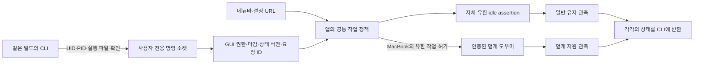

# 앱과 CLI의 공통 명령 경로

2026-10-01 미배포 빌드 50 후보의 기록이다. 설치본 빌드 49는 교체하지 않았다. CLI의 시작·연장·종료·자동 조건 변경이 실행 중인 앱의 `UserSessionController`를 사용하도록 연결했다. 관리자 도우미나 설정 파일을 통해 별도의 작업 정책을 만들지 않는다.

## 구조와 동작

앱은 `~/Library/Caches/io.github.jukqaz.tether/commands.sock`을 사용한다. 폴더는 해당 사용자 소유 0700, 소켓과 `commands.lock`은 0600이다. lock 수명은 명령 서버의 수명과 같고 두 번째 서버가 기존 소켓을 삭제하지 못한다. 예상하지 못한 파일·링크·권한은 거절한다. 이 소켓 lock을 전역 전원 값의 소유권 증거로 사용하지 않는다.

양쪽은 커널의 UID/PID와 실행 파일을 대조한다. 앱은 번들에 함께 있는 CLI만 받으며 CLI도 자기 번들의 실행 중인 앱을 확인한다. 프로토콜과 컴파일된 빌드 번호를 추가로 대조해 번들 교체 뒤 이전 빌드의 프로세스가 계속 실행 중인 경우를 거절한다. 같은 계정의 비 GUI CLI는 현재 GUI 앱에 명령을 위임할 수 있지만 관리자 덮개 허가의 소유자가 되지는 않는다. 다른 GUI 로그인, 다른 UID, PID 재사용과 실행 파일 불일치는 변경을 거절한다.

CLI는 먼저 상태를 읽고 앱의 실행 epoch·revision과 요청 UUID를 붙인다. GUI가 그사이 상태를 바꾸면 실행 전에 거절하며 현재 상태를 다시 읽는다. 실행한 요청의 응답을 15초 요청 마감까지 보존해 응답 유실 뒤 동일 프레임 재전송이 타이머 연장이나 토글을 두 번 실행하지 않게 한다. 유효한 응답 64개가 찼으면 새 변경을 보류하고 살아 있는 기록을 밀어내지 않는다. 실행 후 실패한 부분이 있어도 같은 요청을 새 변경으로 재실행하지 않는다.

보호 재개를 기다리다가 뒤에 GUI에서 끄면 최근 끄기를 유지한다. 원래 요청 마감이 지난 뒤 응답이 와도 새 일반 유지 요청을 획득하지 않는다. 취소·마감 오류를 상태 버전 충돌로 취급해 자동 재시도하지 않는다. 앱을 다시 시작하면 epoch와 응답 기록을 새로 만들며 임시 세션은 재생하지 않는다.

앱이 없으면 변경 명령은 앱을 열도록 안내하고 끝난다. CLI가 앱이나 장기 서비스를 몰래 실행하지 않는다. `status`는 공통 연결이 없을 때 기존 도우미의 읽기 전용 진단으로 원인을 보여 줄 수 있으며 JSON의 `commonSessionAvailable=false`로 구분한다. 명시적인 격리 도우미 시험 소켓에서는 기존 CLI fixture 경로를 유지한다.

## 조작 예시

앱을 실행한 뒤 번들의 `Contents/Helpers/tether`를 사용한다. 아래 명령은 미배포 후보용이며 설치본 빌드 49의 새 기능을 뜻하지 않는다.

| 명령 | 결과 |
|---|---|
| `tether status --json` | 일반 작업·자동·수동·예약과 덮개 지원을 각각 조회 |
| `tether on` / `off` / `toggle` | 전체 켜기·보호 재개 / 자체 작업 전체 중지 / 전환 |
| `tether auto on` / `off` | 자동 전원 트리거만 변경. 유효한 수동 작업은 유지 |
| `tether condition ac` / `battery` / `any` | 자동 트리거의 전원 조건 선택 |
| `tether manual unlimited` | AC에서 수동 무제한 선택. 배터리에서는 거절 |
| `tether manual 1h` / `+30m` / `off` | 수동 시작·연장·종료. 배터리는 최대 2시간 및 더 엄격한 기존 한도 |
| `tether hold 30m` / `+15m` / `off` | AC에서 분리 후 예약 또는 배터리 유지·연장·취소. 시작부터 최대 4시간과 소비 예산 적용 |
| `tether sleep` | 현재 자체 작업 중지 후 명시적 잠자기 요청. 실제 Sleep 완료는 OS 로그로 별도 확인 |

AC의 유한 수동 입력은 최대 24시간이다. 배터리에서 더 긴 입력을 하더라도 실제 작업 마감은 2시간과 더 엄격한 보호 한도로 줄인다. 자동·수동·예약은 하나의 native 요청을 공유하며 한 이유만 끝나면 다른 유효한 이유는 남는다. 전체 끄기, 발열·잔량·센서·예산 보호는 공통 작업에 적용한다.

JSON schema 2의 `receipt.status`는 일반 유지 상태다. `receipt.lidSupport`는 `notRequired`, `inactive`, `active`, `pending`, `unavailable`, `error`를 구별한다. 데스크톱에는 덮개·도우미가 필요 없으며, 덮개 오류가 있어도 정상 일반 유지 상태를 실패로 바꾸지 않는다. native 요청을 확인하지 못하면 변경 성공을 반환하지 않는다. 지난 native 마감을 새 점검 전에도 유지 중으로 표시하지 않는다.

## 확인 범위와 남은 조건

전체 Swift **515개, 실패·건너뜀 0**: Core 461 + 앱·업데이트 54. 새 프로토콜 11개·앱 명령 12개와 실제 native 요청 6개는 이 전체 수에 포함한다. 가상 GUI·전원·발열 입력과 실제 커널 소켓 신원, 실제 CLI subprocess를 함께 사용했다. 실제 CLI 시험의 로그인 ID가 가상 fixture와 달라 처음 변경 명령이 거절되었으며, fixture를 관측한 로그인 ID에 맞춘 뒤 통과했다. 제품 인증 검사를 완화하지 않았다.

지연 재개 시험은 뒤의 끄기와 요청 만료를 각각 주입했다. 요청 중복, 소비 예산·자동/수동 분리, 잔량·발열 보호, native 해제 실패, 앱 부재·잘못된 옵션·빌드 불일치, 비 GUI 위임과 다른 GUI 거절을 확인한다. 포장된 실제 CLI도 동일 격리 앱 정책에 연결해 확인하며 설치·원복은 모의 OS에서 검사한다. 상세 로그와 최종 바이너리 해시는 작업 산출물에 남긴다.

실제 GUI 앱→관리자 도우미 전체 경로, 빠른 사용자 전환·동일 UID의 별도 GUI 로그인, 실행기 가용성 변경과 기존 root 기록 인계, 실제 보호·watchdog 해제의 전체 상한, Sleep/Wake·화면·원격 입력·macOS 15 실행 및 전체 Sparkle 업데이트는 남는다. 소켓/단위 시험을 물리 Sleep나 장시간 내구성의 증거로 확대하지 않는다. 90초 앱 건강 마감은 전역 `SleepDisabled`의 커널 자동 해제 보장이 아니다. 시스템 잠금·팬·충전 정책은 변경하지 않았다.

이 CLI 구현 단계의 명령 서버 lock은 같은 사용자 소켓의 두 번째 서버가 첫 번째 서버를 대체하지 못하게 했다. 당시에는 다른 앱 복사본·GUI 인스턴스와 명령 서버 시작 실패 뒤의 앱 전체 변경 차단이 남아 있었다. 이후 별도 앱 수명 잠금과 초기화 전 서버 예약을 추가해 Swift 523개 및 격리된 모델·실제 프로세스 잠금을 확인했다. [앱 수명 보완과 검증 한계](APP-COORDINATOR-LIFETIME-20261001.ko.md). 실제 GUI·root 기록 인계·실행기 전환은 여전히 남아 있다.

코드·문서와 후보 포장은 아직 커밋·푸시·원격 CI·배포 전이다. 이 단계로 #6·#8 또는 P0를 완료 처리하지 않는다.
