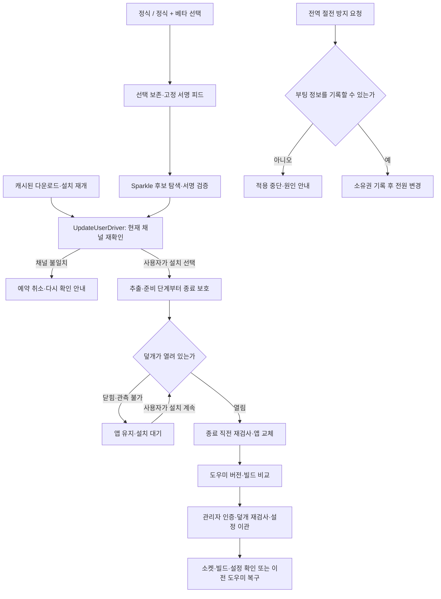

# Tether 버전·업데이트 개선 결과

2026-09-29 · `2026.9.1 Beta 2` · 내부 빌드 `43` · **로컬 후보, 미게시**

업데이트 재개 경계와 전원 변경의 예외 처리를 보완하고 설치 ZIP을 만들었다. 전체 검증 완료나 GitHub 배포 완료 상태는 아니다. 이전 빌드 42의 파일은 별도로 보존했다.

## 버전 결정

`연도.월.배포순번`을 유지한다. `2026.9.1`은 9월 첫 배포를 뜻하며 마지막 숫자는 일이 아니다. 베타 순번은 별도이고 내부 빌드는 모든 채널에서 증가한다. 다음 후보 또는 정식 승격은 빌드 44 이상을 사용한다. 앱 식별자, 설정 schema 2, helper protocol 2, 업데이트 서명키는 유지한다.

## 이번에 수정한 것

- **재개된 베타의 채널 확인:** Sparkle는 캐시된 업데이트를 이어받을 때 일반 후보 검사 delegate를 생략한다. 표준 UI를 유지하는 `UpdateUserDriver`에서 현재 채널과 다시 비교하고 맞지 않는 후보는 다운로드/대기 설치까지 취소한다.
- **종료와 설치 시점 보호:** 추출 시작 및 준비된 설치 재개부터 종료 직전의 덮개 검사가 적용된다. 재개된 설치에서 나중에를 선택하면 종료 후 설치 예약도 취소한다. 덮개를 열기만 해서는 보류된 설치가 자동 재개되지 않는다.
- **검사 오판 방지:** 이전 낮은 빌드 검사 fixture는 실제로 동일 빌드를 비교했다. 설치 3 → 후보 2 검사와 설치 2 → 후보 2 검사를 분리했다. SDK의 후보 없음 종료 코드 4 및 서명 오류 종류도 확인해 캐시/네트워크 오류를 검증 성공으로 세지 않는다.
- **부팅 정보 접근 실패:** 복구 소유권을 식별할 수 없으면 전역 절전 방지를 새로 적용하지 않는다. 기존 복구 기록을 덮지 않고 구체적 원인을 표시한다. 적용 실패를 켜짐/꺼짐 성공 이력으로 기록하지 않는다.
- **설치 문서:** 새 베타마다 수동 교체해야 한다는 오래된 설명을 삭제했다. 공개 2.0.x에서 새 업데이터로 넘어가는 첫 설치는 수동이며, 이후 고정 피드와 선택한 채널을 사용한다. 미게시 링크를 이미 받을 수 있는 것처럼 안내하지 않는다.

SDK 근거: [캐시 재개 경로](https://github.com/sparkle-project/Sparkle/blob/2.10.0/Sparkle/SPUBasicUpdateDriver.m), [설치 취소·보류 계약](https://github.com/sparkle-project/Sparkle/blob/2.10.0/Sparkle/SPUUserDriver.h), [CLI 종료 코드](https://github.com/sparkle-project/Sparkle/blob/2.10.0/sparkle-cli/SPUCommandLineDriver.m). 다른 앱에서 참고한 선택 보존·조용한 알림 정책은 [조사 문서](UPDATE-REFERENCES.ko.md)에 있다.

## 동작 구조

## 빌드 43 검증 결과

| 범위 | 이번 결과 |
|---|---|
| 전체 Swift 검사 | 298개: **278 통과, 16 실패, 4 live IOKit 생략**. 실패를 통과로 처리하지 않음 |
| 이번 변경 관련 검사 | 위 검사 중 업데이트 delegate/드라이버 10개, 업데이트 정책 6개, 부팅 정보 실패 소유권 1개 통과 |
| 부팅 정보 접근 불가 도우미 | 실제 dry-run 도우미 2개 통과: 전원 변경·허위 성공 없음, 재시도도 차단 |
| Sparkle 네이티브 엔진 | 낮은 빌드 제외, 동일 빌드 제외, 정식의 베타 제외, 변조 피드 거부 **4개 통과** |
| Sparkle 전체 교체 재시험 | 첫 정상 다운로드 후 사용자 캐시 쓰기 제한으로 중단. 최신 빌드에서 전체 교체 성공으로 주장하지 않음 |
| 피드 생성 | 7개 통과: 채널 유지, 링크 일치, 버전·빌드·순번 재사용/역행 거부 |
| 도우미 설치·복구 스크립트 | 7개 통과: 성공, watchdog/이관 실패 복구, 미래 schema, 닫힘·관측 불가·검사 도중 닫힘 |
| 서비스·충돌 통합 전체 | 부팅 세션 접근 제한으로 실패/중단. 각각 70개/55개를 이번 빌드의 통과 수로 제시하지 않음 |
| 릴리스 실행 파일 | 앱·helper·CLI의 arm64 릴리스 컴파일, 버전·빌드 일치 및 중첩 코드 서명 확인 |
| 포장된 파일 | ZIP SHA256, ZIP·피드 Ed25519 서명, 새 임시 폴더에 푼 helper 소켓·CLI·resume/stop 응답 확인 |
| 게시 거부 검사 | 미커밋 소스, ZIP 손상, 피드 서명 손상 3개 거부 확인 |

전체 검사의 16개 실패는 부팅 세션 접근을 전제로 한 소유권·보호 상태 지속·watchdog fixture에서 발생했다. `/usr/sbin/sysctl kern.bootsessionuuid`가 `Operation not permitted`를 반환했고, 도우미 snapshot도 유효한 소유권을 확인하지 못했다. 이를 계기로 전원 변경 전 차단을 추가했다. 일반 실행 환경에서 전체 회귀 검사를 다시 통과해야 게시 판단을 할 수 있다. 삭제·건너뛰기로 검사 수를 맞추지 않았다.

포장 검사의 resume/stop은 전원·외장 화면 연결을 가정해 macOS 기본 관리에 맡기는 경로다. 이 검사는 IPC와 설치 파일의 실행을 검증하며 실제 전역 전원 변경 검사를 대신하지 않는다.

## 이번 로컬 패키징의 조건

SwiftPM의 중첩 샌드박스 실행이 거부되어 SwiftPM 자체의 추가 샌드박스만 끄고 작업 폴더 안의 캐시를 사용했다. Codex의 파일 접근 제한은 유지했다. `actool`은 macOS 서비스 접근 오류로 아이콘을 재컴파일하지 못했다. 빌드 42 설치 ZIP의 체크섬과 현재/과거 아이콘 소스 4개 파일의 바이트 일치를 확인한 뒤 기존 `Assets.car`·`AppIcon.icns`를 재사용했다. 관련 해시는 `icon-cache-evidence.json`에 기록한다.

이번 로컬 피드는 Sparkle RSS의 필수 메타데이터를 직접 구성한 뒤 기존 `update-feed.py`와 공식 `sign_update`로 생성·검증했다. `generate_appcast` 기반의 통상 게시 파이프라인 전체가 이번 환경에서 성공했다는 뜻은 아니다. 이 패키지는 `source_dirty: true`인 로컬 시험 후보다.

## 남은 단계

1. 부팅 세션·사용자 캐시·아이콘 컴파일 서비스에 접근할 수 있는 일반 개발 환경에서 전체 Swift, 서비스, 충돌, 제거, 네이티브 Sparkle 교체 검사를 다시 수행한다.
2. 검토한 소스 커밋과 원격 CI 결과를 확보한다. 현재 실행 환경은 `.git` 쓰기가 제한되고 승인 요청도 할 수 없다. 앞선 `git add`·커밋은 자동 승인 검토에서 `approval required by policy, but AskForApproval is set to Never`로 거부되었으며 우회하지 않았다.
3. 깨끗한 같은 커밋에서 표준 `release.sh`로 재패키징하고 `verify-release.py --require-clean`을 통과시킨다.
4. GitHub Prerelease에 ZIP·체크섬·appcast·manifest를 올린 뒤 공개 다운로드를 다시 확인한다. **고정 피드와 채널 다운로드 목록은 자산 검증 후 마지막에 게시**한다.
5. 회사 Mac에서 관리자 설치, 기존 설정 보존, 물리 덮개·전원·외장 화면 전환, 업데이트 UI부터 재실행까지의 경로를 시험한다.

이번에 확인한 공개 릴리스는 `v2.0.1`, `v2.0.0`이다. 새 ZIP과 고정 피드는 아직 게시되지 않았다. 현재 앱은 ad-hoc 서명이고 Developer ID/Apple 공증이 없으며 Gatekeeper 검사는 `internal error in Code Signing subsystem`으로 끝나 허용 여부를 확인하지 못했다. 시뮬레이션·Preview·소켓 응답을 실제 잠자기·화면 꺼짐·과열 보호의 실기기 증거로 대체하지 않는다.

[설치·실기기 시험](INSTALL-AND-TEST.ko.md) · [게시 절차](RELEASING.ko.md) · [설정 이관](UPDATES-AND-MIGRATION.ko.md)
