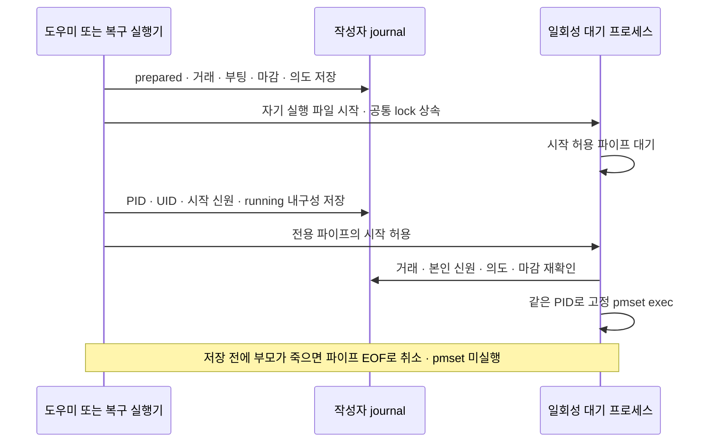

# PID 기록 전 전원 명령 실행 차단

2026-10-01 · 빌드 **50**의 미배포 소스 후보. 설치본은 **49**이며 전원·잠금 설정과 설치본은 변경하지 않았다.

새 전원 작성자가 PID 기록 전에 OS 명령을 시작하던 순서를 바꿨다. 먼저 같은 실행 파일의 일회성 대기 프로세스를 띄우고, PID·UID·시작 신원을 내구성 있게 저장한 뒤 전용 파이프로 시작을 허용한다. 대기 프로세스는 새 자식을 만들지 않고 `execv`로 고정 전원 명령으로 바뀌며 PID·시작 신원과 공통 lock을 유지한다.

## 순서와 신원

대기 프로세스는 보호된 journal의 현재 부팅·거래 UUID·마감, 본인의 native 프로세스 신원, 호출자의 같은 flock과 시작 허용을 확인한다. 기록의 소유자·명령·의도 세대가 달라지거나 마감이 지나면 실행하지 않는다. target은 root에서 `/usr/bin/pmset`으로 고정한다. 인자는 절전 방지 0/1, 화면/시스템 절전과 기존 전원 모드 원복에 필요한 한정된 값만 받는다. 서비스 IPC에 새 명령이나 임의 실행 파일 선택은 추가하지 않았다.

시작 허용 파이프의 쓰기 끝은 부모만 보유한다. 자식에게는 `CLOEXEC`으로 상속하지 않는다. 부모가 PID 저장 전 또는 저장 후 허용 전에 죽으면 EOF로 취소하며, 허용이 없어도 기존 거래 마감 뒤에는 취소한다. 자식이 먼저 종료했을 때 허용 쓰기의 `EPIPE`가 부모를 `SIGPIPE`로 종료시키지 않도록 해당 FD를 설정했다. 일반 `Shell.run`에는 이 경로를 사용하지 않는다.

운영 root 전원 작성자는 이 대기 경로 없이 실행할 수 없도록 했다. 대기 실행 파일은 이미 실행 중인 작성자 프로그램 자신으로 제한한다. 관리자 승인으로 실행 중인 앱 번들의 도구는 사용자 소유일 수 있으므로 자기 실행 파일의 안전한 속성과 native 신원을 확인하며, 실제 target의 소유자 검사와 고정 경로는 유지한다.

## 복구·이전 기록·설치

작성자 journal은 schema 1의 선택 필드 `gateExecutable`을 추가한다. 기존 기록은 그대로 읽으며, 대기 실행 파일이 기록된 부모와 다르면 손상 기록으로 보존한다. 복구는 저장된 PID·시작 신원을 확인하고 아직 대기 중인 실행 파일 또는 고정 target만 검사한다. `exec` 뒤 시작 신원이 유지되는 경로도 실제 종료·timeout 시험으로 확인했다.

복구 쓰기는 `power-writer-gate-v1` 기능 응답까지 확인한 독립 실행기나 helper만 사용한다. 미지원 실행기에 기록 없는 쓰기로 돌아가지 않는다. root의 독립 실행기 검사에서는 기능 인자를 실행하기 전에 ad-hoc 코드 서명과 `local.tether.power-recovery` 식별자를 확인해, 다른 component가 잘못 들어가 구버전 helper의 서비스를 시작하는 경로를 피한다. Developer ID·Apple 공증을 추가했다는 뜻은 아니다.

설치·원복·제거는 [독립 복구 실행기 단계](RECOVERY-EXECUTOR-20260930.ko.md)의 공통 lock·소유권 소비·백업 규칙을 유지한다. 구버전의 이미 만들어진 미확인 작성자 기록은 이 변경으로 새 신원을 얻지 못한다. 기존 기록은 계속 보존하고 안전하게 확인할 때까지 후속 변경을 보류한다.

## 이번 실행 결과

| 검사 | 결과 | 범위 |
|---|---:|---|
| 전체 Swift | 406 통과 · 5 건너뜀 · 0 실패 | Core 391건 중 5개 실 OS 검사 제외, 앱 업데이트 20건 통과 |
| 새 대기 경로 | 6 통과 | 실제 native 실행과 flock. 정상 획득, 금지 인자, PID 저장 전/후 부모 SIGKILL, 허용 없는 마감, 무권한 진입 거부 |
| 독립 복구 실행기 | 8 통과 | 성공·실패·TERM 무시·부모 사망 뒤 만료 작성자 종료·대체 경로·미지원 거부 |
| 기존 작성자·구버전 호환 | 5 통과 | 이전 방식의 PID 등록 전/후 차단, 신원 확인 후 시험 정리, 구버전 안전 probe |
| 공통 lock·writer guard | 12 통과 | 실제 helper/IPC와 dry-run 쓰기, 경쟁·손상·미래 schema·lease 보존 |
| 설치·이관·원복 | 22 통과 | 실제 스크립트·dry-run helper·임시 폴더·모의 OS/launchd |
| 제거 | 10 통과 | 실제 스크립트·모의 OS, 복구 실패와 자료 보존 |
| 새 후보 앱 포장·실행 | 통과 | macOS 15 arm64, 4개 component 서명·식별자·기능 응답·리소스 일치·helper 소켓·CLI·resume/stop |

두 부모 강제 종료 시나리오에서는 허용 전 취소 뒤 target의 PID 파일·효과 파일이 생성되지 않았고, lock이 풀린 뒤 현재 실행기가 journal을 해소·소비했다. 단순히 `prepared`가 없어졌다는 것으로 통과시키지 않았다. 이전 단계의 기록과 첫 대기 경로 시험 로그는 보존한다. CI 정의에 새 검사를 넣었지만 원격 GitHub Actions는 실행하지 않았다.

## 남은 조건

**D-04의 새 작성자 실행 순서는 보완했지만 전체 이슈는 진행 중이다.** OS 로더·프로세스 생성 자체가 멈춰 대기 코드에도 도달하지 못하는 경우의 복구 상한, 구버전의 신원 없는 미확인 작성자, OS가 이미 접수한 작업의 실제 효과와 최신 의도, 실제 관리자 교체 경계는 별도로 남는다. `exec`나 프로세스 종료가 이미 접수된 OS 작업의 취소를 증명하지 않는다.

대기·exec와 모의 target의 FD 수명은 시험했지만 운영 `pmset`의 FD 수명과 실제 OS 효과는 이번 격리 시험의 증거에 포함하지 않는다.

실제 Sleep/Wake·닫힌 AC 연결·화면/잠금·원격·빠른 사용자 전환·macOS 15 실행·여러 Apple Silicon 모델은 이번 시험에 포함하지 않았다. 새 ZIP/서명 피드, Tether 전체 Sparkle 업데이트와 관리자 설치, 소스 푸시·배포도 완료하지 않았다. 검증 대상은 미커밋 소스의 로컬 후보이며 기존 사용 환경은 유지했다.

시작 허용 FD 구성은 [Apple `Process.standardError` 문서](https://developer.apple.com/documentation/foundation/process/standarderror)의 FileHandle 지정 경로를 사용하며, EOF·FD 수명은 위 실제 프로세스 시험으로 확인했다. SIGPIPE 억제 FD 옵션은 현재 SDK와 [Apple Darwin 헤더](https://github.com/apple/darwin-xnu/blob/main/bsd/sys/fcntl.h)를 대조했다. 다른 앱 코드를 복사하거나 새 외부 의존성을 추가하지 않았다.

진행 상태는 [작성자 복구 #2](https://github.com/jukqaz/tether/issues/2), [업데이트 #1](https://github.com/jukqaz/tether/issues/1), [프로젝트](https://github.com/users/jukqaz/projects/8), [남은 설계 조건](DESIGN-GAPS.ko.md)에서 관리한다.
